# Gallery

The main picture of each design in the [catalog](README.md). Click a picture or a name to open the toolchanger page with all its pictures. Legacy designs and concepts are in [OTHER.md](OTHER.md).

## Tool changers

<table>
<tr><td align="center" valign="bottom" width="25%"><a href="toolchangers/stealthchanger/README.md">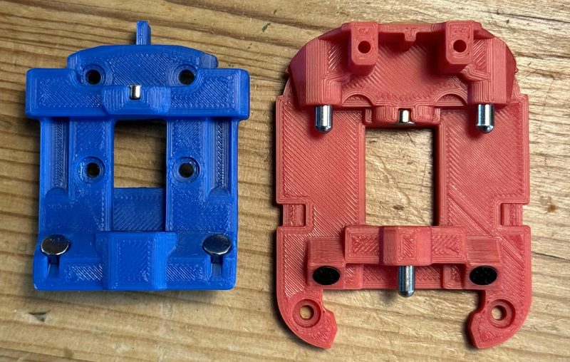</a> <a href="toolchangers/stealthchanger/README.md">StealthChanger</a></td><td align="center" valign="bottom" width="25%"><a href="toolchangers/tapchanger/README.md">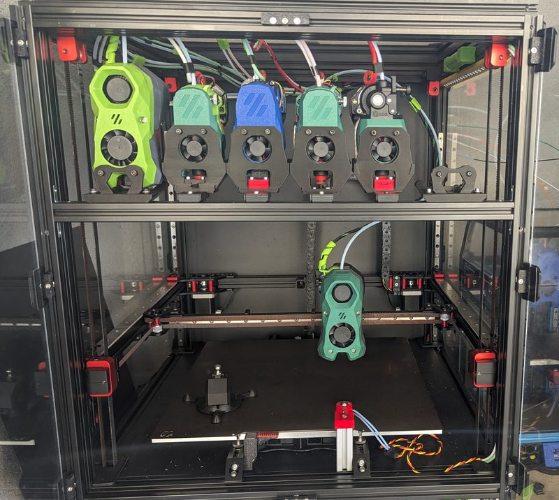</a> <a href="toolchangers/tapchanger/README.md">TapChanger</a></td><td align="center" valign="bottom" width="25%"><a href="toolchangers/jubilee/README.md">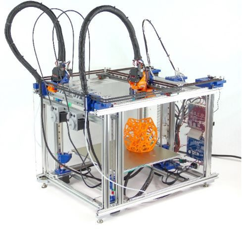</a> <a href="toolchangers/jubilee/README.md">Jubilee</a></td><td align="center" valign="bottom" width="25%"><a href="toolchangers/madmax/README.md">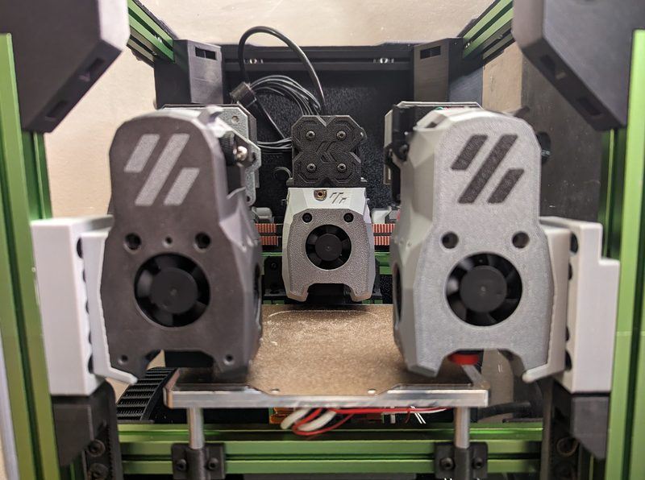</a> <a href="toolchangers/madmax/README.md">MadMax</a></td></tr>
<tr><td align="center" valign="bottom" width="25%"><a href="toolchangers/daksh-v2/README.md">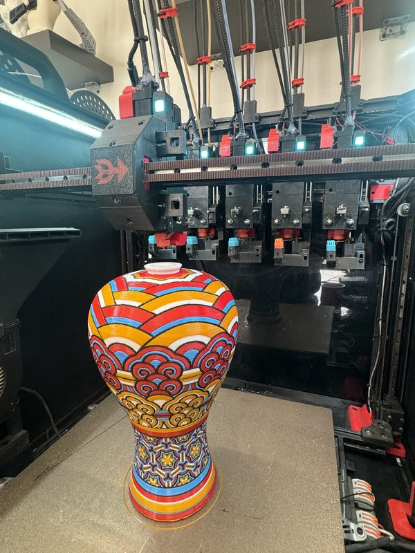</a> <a href="toolchangers/daksh-v2/README.md">DAKSH V2</a></td><td align="center" valign="bottom" width="25%"><a href="toolchangers/lineux-toolchanger/README.md">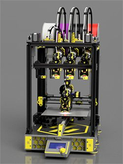</a> <a href="toolchangers/lineux-toolchanger/README.md">Lineux Toolchanger</a></td><td align="center" valign="bottom" width="25%"><a href="toolchangers/misschanger/README.md">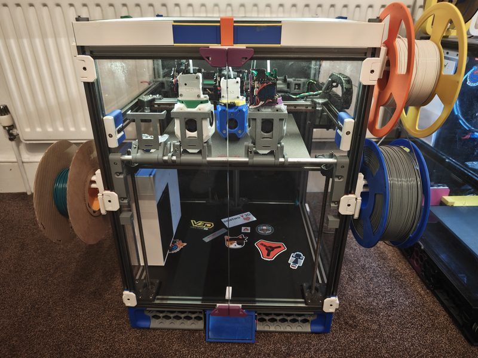</a> <a href="toolchangers/misschanger/README.md">MissChanger</a></td><td align="center" valign="bottom" width="25%"><a href="toolchangers/clickchanger/README.md">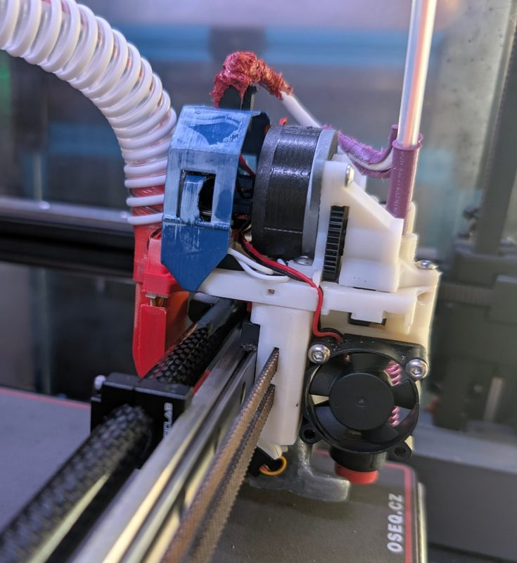</a> <a href="toolchangers/clickchanger/README.md">ClickChanger</a></td></tr>
<tr><td align="center" valign="bottom" width="25%"><a href="toolchangers/blackbox/README.md">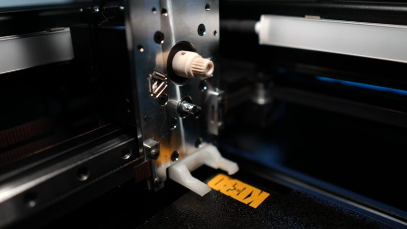</a> <a href="toolchangers/blackbox/README.md">Blackbox CE</a></td><td align="center" valign="bottom" width="25%"><a href="toolchangers/proforge/README.md">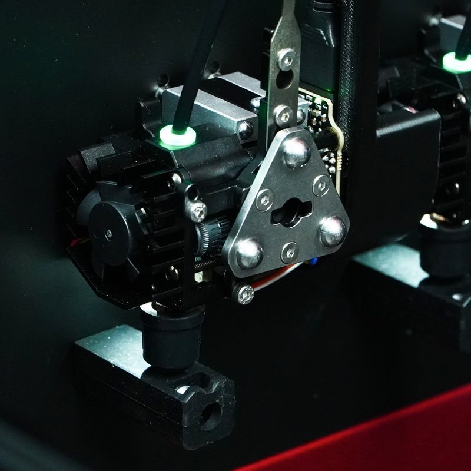</a> <a href="toolchangers/proforge/README.md">ProForge</a></td><td align="center" valign="bottom" width="25%"><a href="toolchangers/hydra/README.md">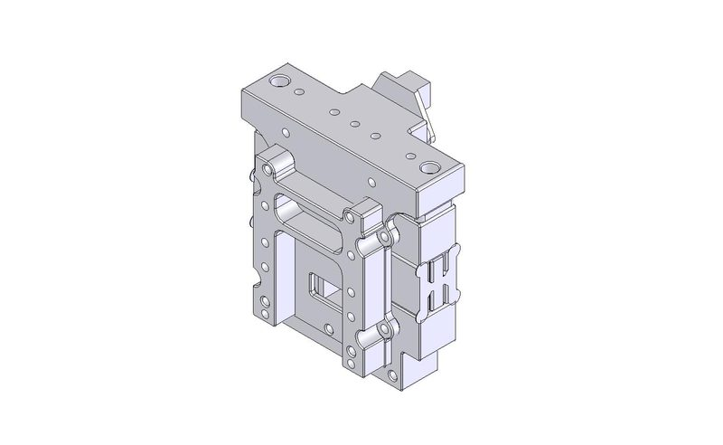</a> <a href="toolchangers/hydra/README.md">Hydra</a></td><td align="center" valign="bottom" width="25%"><a href="toolchangers/maxwells-razor/README.md">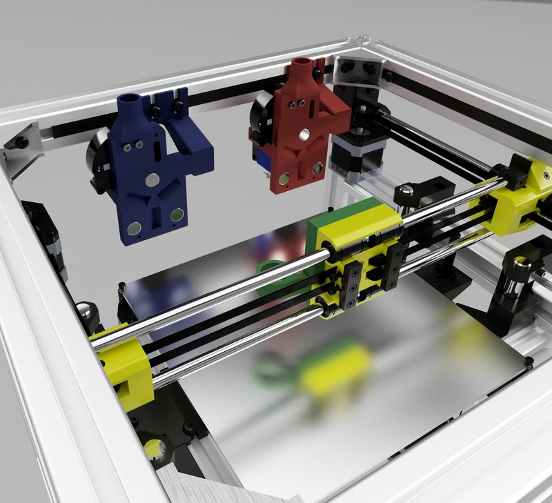</a> <a href="toolchangers/maxwells-razor/README.md">Maxwell&#x27;s Razor</a></td></tr>
<tr><td align="center" valign="bottom" width="25%"><a href="toolchangers/sid-ender-3-toolchanger/README.md">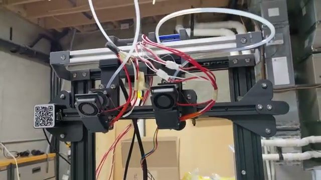</a> <a href="toolchangers/sid-ender-3-toolchanger/README.md">Ender 3 Toolchanger</a></td></tr>
</table>

## Hotend changers

<table>
<tr><td align="center" valign="bottom" width="25%"><a href="toolchangers/cxchanger/README.md">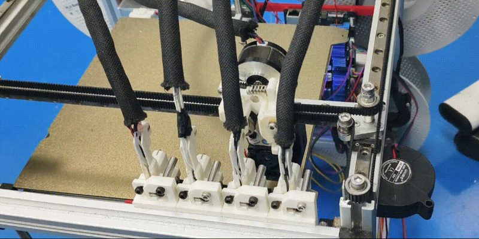</a> <a href="toolchangers/cxchanger/README.md">CxChanger</a></td><td align="center" valign="bottom" width="25%"><a href="toolchangers/yudx/README.md">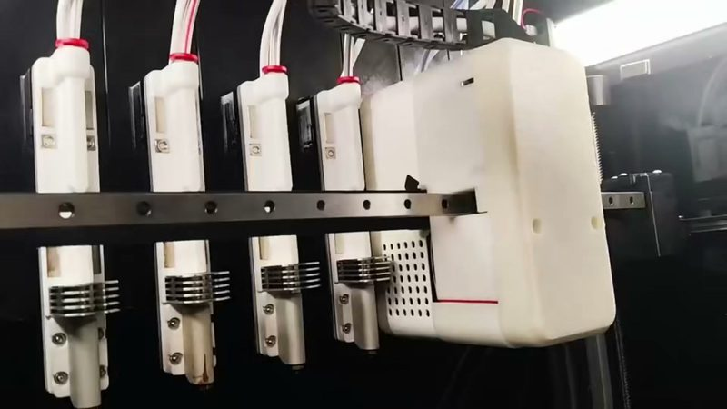</a> <a href="toolchangers/yudx/README.md">YUDX</a></td><td align="center" valign="bottom" width="25%"><a href="toolchangers/medusahc/README.md">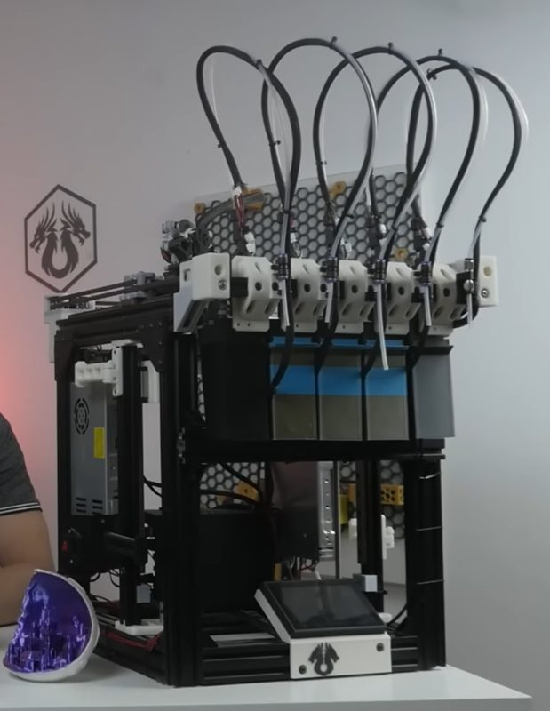</a> <a href="toolchangers/medusahc/README.md">MedusaHC</a></td><td align="center" valign="bottom" width="25%"><a href="toolchangers/e3ng-toolchanger/README.md">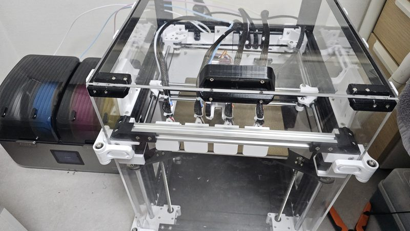</a> <a href="toolchangers/e3ng-toolchanger/README.md">E3NG Toolchanger</a></td></tr>
<tr><td align="center" valign="bottom" width="25%"><a href="toolchangers/lineux-hotswap/README.md">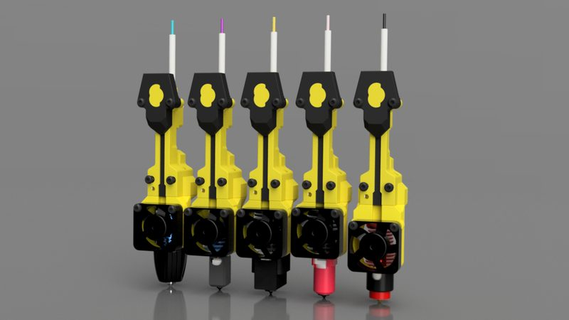</a> <a href="toolchangers/lineux-hotswap/README.md">Lineux Hotswap</a></td><td align="center" valign="bottom" width="25%"><a href="toolchangers/spark/README.md">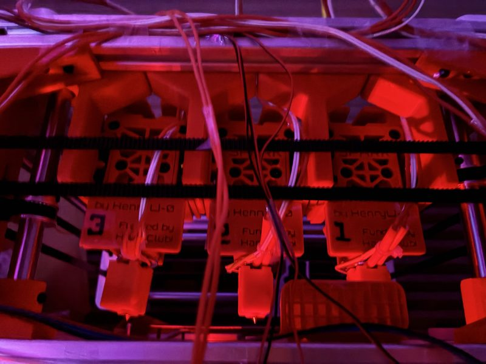</a> <a href="toolchangers/spark/README.md">Spark</a></td></tr>
</table>

## Concepts and prototypes

<table>
<tr><td align="center" valign="bottom" width="25%"><a href="toolchangers/quindec/README.md">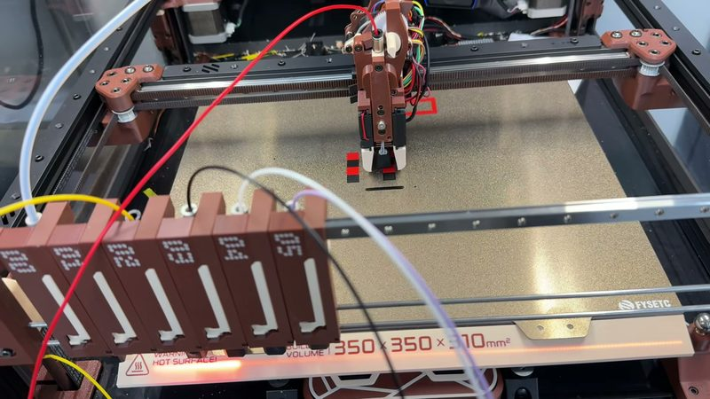</a> <a href="toolchangers/quindec/README.md">Quindec</a></td></tr>
</table>

## Legacy designs

<table>
<tr><td align="center" valign="bottom" width="25%"><a href="toolchangers/e3d-toolchanger/README.md">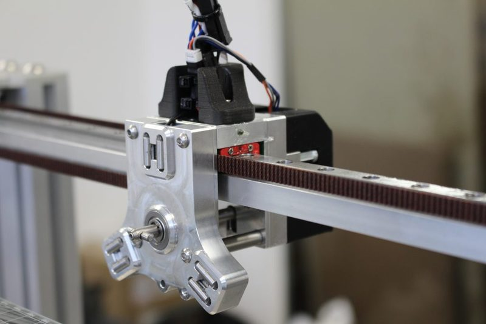</a> <a href="toolchangers/e3d-toolchanger/README.md">E3D ToolChanger</a></td><td align="center" valign="bottom" width="25%"><a href="toolchangers/wp-daksh/README.md">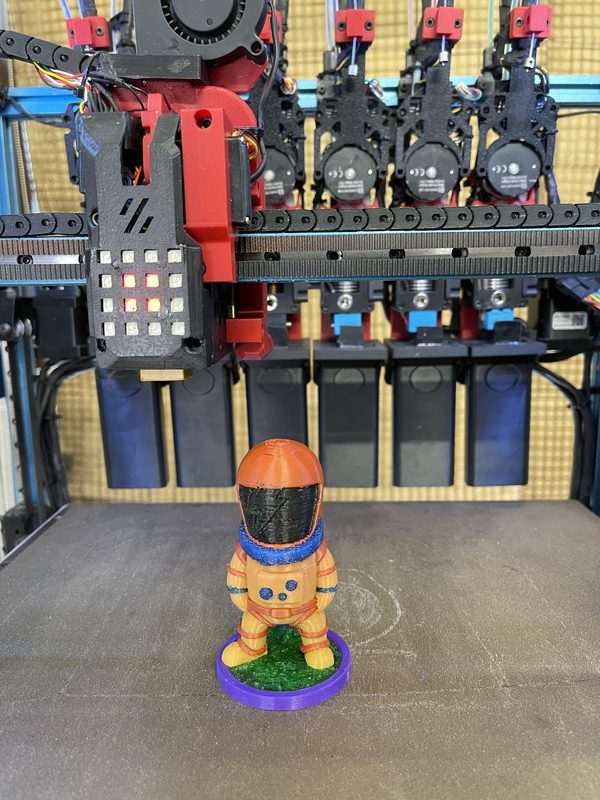</a> <a href="toolchangers/wp-daksh/README.md">WP-DAKSH</a></td><td align="center" valign="bottom" width="25%"><a href="toolchangers/magswitch-toolchanger/README.md">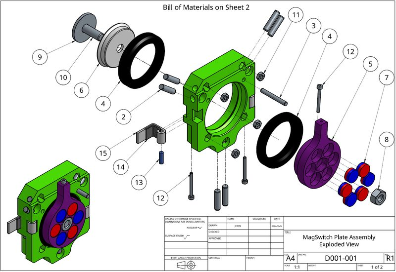</a> <a href="toolchangers/magswitch-toolchanger/README.md">MagSwitch Toolchanger</a></td></tr>
</table>

## Picture credits

We credit each picture to its author on the toolchanger page. We found the authors as well as we could, and some credits can be wrong or missing. If a picture is yours and the credit is wrong, or you want the picture removed, [open an issue](https://github.com/vvchik/awesome-toolchangers/issues). We will fix or remove it.
