# Other toolchangers

Designs that are not in the [catalog](README.md), kept for history. The [Column notes](README.md#column-notes) explain the columns. `Type` names the catalog table that fits the design.

## Contents

- [Concepts and prototypes](#concepts-and-prototypes)
- [Legacy designs](#legacy-designs)
- [Not in the catalog](#not-in-the-catalog)

## Concepts and prototypes

Ideas with a public record, such as a video, renders, or part of the files. Most have no complete build package or no build by other people. Use them to study an idea, not as a build plan.

| Photo | Toolchanger and why it’s interesting | Type | Status | Coupling | Lock | Latest version | Stars Likes Views | Links |
| --- | --- | --- | --- | --- | --- | --- | --- | --- |
| <a href="toolchangers/delta-toolchanger/README.md">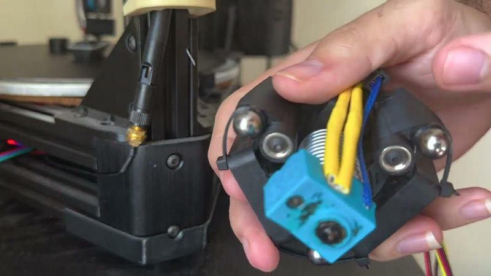</a> | [**DeltaToolChanger**](https://github.com/BenWolpert/DeltaToolChanger) *Ben Wolpert (bdw53 on YouTube)* Tool changer for an existing delta printer: three magnet pairs hold the tool, and a frame-mounted U-axis motor turns a ring in the effector through a cable to separate the magnets for release. Docks are parking posts on the frame braces. | Tool changer | Files and a working build | steel balls on pins (3-point) + magnets | magnets, a motor turns a ring to release | CAD [2022-08](https://github.com/BenWolpert/DeltaToolChanger/commit/d8cef45a1f28e2d65847c3c3a0b14099aaa8e45f) |  [⏯️⁠28.2K](https://www.youtube.com/watch?v=AtBPeQnealA) | [STEP](https://github.com/BenWolpert/DeltaToolChanger/tree/master/step_files) [STL](https://github.com/BenWolpert/DeltaToolChanger/tree/master/stl_files) [Config](https://github.com/BenWolpert/DeltaToolChanger/tree/master/software/duet2/RepRapFirmware3/sys) [Video](https://www.youtube.com/watch?v=GrMim3Twws8) |
| <a href="toolchangers/sparkshift/README.md">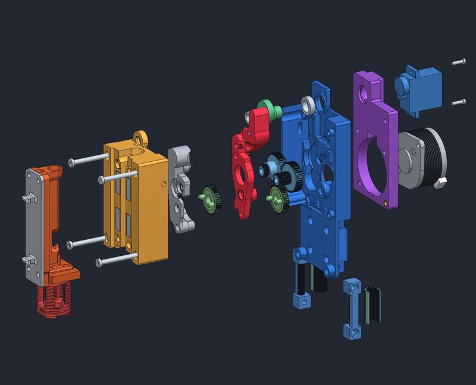</a> | [**SparkShift**](https://github.com/nisparks/SparkShift) *Nicholas Sparks (nisparks)* Hotend changer for the Voron 2.4 350, derived from YUDX and CxChanger. A separate servo cam opens the extruder, so normal extrusion cannot release it. CAD only: the author has not built it yet. | Hotend changer | CAD only, not built yet | Maxwell | magnets | v26j [2026-10](https://github.com/nisparks/SparkShift/commit/38aa617) |  | [CAD](https://github.com/nisparks/SparkShift/tree/main/cad) [STL](https://github.com/nisparks/SparkShift/tree/main/stl_v26) [BOM](https://github.com/nisparks/SparkShift/blob/main/BOM.md) |
| <a href="toolchangers/constellation/README.md">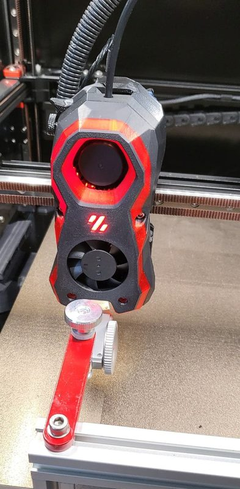</a> | [**Constellation**](https://github.com/ben5459/Constellation) *ben5459 (Ben Nickolay)* Carriage-side changer with no wires to the X carriage: tools are docked at the front and get power and signals through pogo pins on the tool. A toggle lock with no servo or stepper reports lock and tool state through slider switches. Each tool is a full Stealthburner with its own Clockwork 2. | Tool changer | Working build, no files | Maxwell | toggle latch with magnets | Last seen [2022-11](https://github.com/ben5459/Constellation) |  | [Wiki](https://github.com/ben5459/Constellation/wiki) [BOM](https://github.com/ben5459/Constellation/wiki/BOM) [Config](https://github.com/ben5459/Klipper_ToolChanger) [Specs](https://github.com/ben5459/Constellation/wiki/Current-Specifications) [Testing](https://github.com/ben5459/HybridManufacturingPlatform/tree/main/Automatic%20Tool%20Changer/Testing/Repeatability) |
| <a href="toolchangers/voron-magchange/README.md">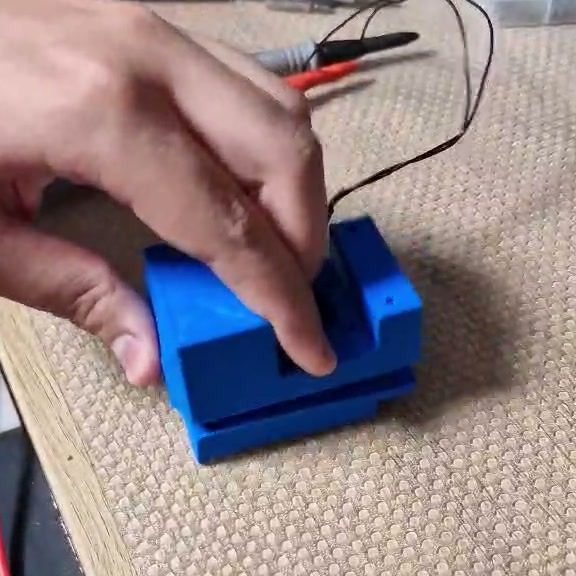</a> | [**Voron MagChange**](https://github.com/BlackShadeOSS/Voron-MagChange) *BlackShadeOSS (BlackShade)* Coupling plate for Voron. A 24 V electromagnet (25x11 mm) on the carriage holds the tool plate, which sits on a Kelvin coupling of cup-head nuts. A microswitch detects a mounted tool. | Tool changer | Coupling plate only | Kelvin (M3 cup-head nuts DIN1587) | electromagnet | STEP [2023-09](https://github.com/BlackShadeOSS/Voron-MagChange/commit/d48678e3b1879300fc345d5f3a4bb8634bb73401) |  | [STEP](https://github.com/BlackShadeOSS/Voron-MagChange/tree/main/STEP) [STL](https://github.com/BlackShadeOSS/Voron-MagChange/tree/main/STL) [BOM](https://github.com/BlackShadeOSS/Voron-MagChange#bom) |
| 📷 | [**DAKSH Bolt**](https://github.com/ankurv2k6/daksh-bolt-toolchanger) *Ankur Verma* Unreleased DAKSH variant for the Voron 2.4. STEP files for the latch, slider and frame only. | Tool changer | STEP files only | — | latch | STEP [2024-06](https://github.com/ankurv2k6/daksh-bolt-toolchanger/commit/aab6f7b) |  | [STEP](https://github.com/ankurv2k6/daksh-bolt-toolchanger/tree/main/STEP) |
| <a href="toolchangers/iitc/README.md">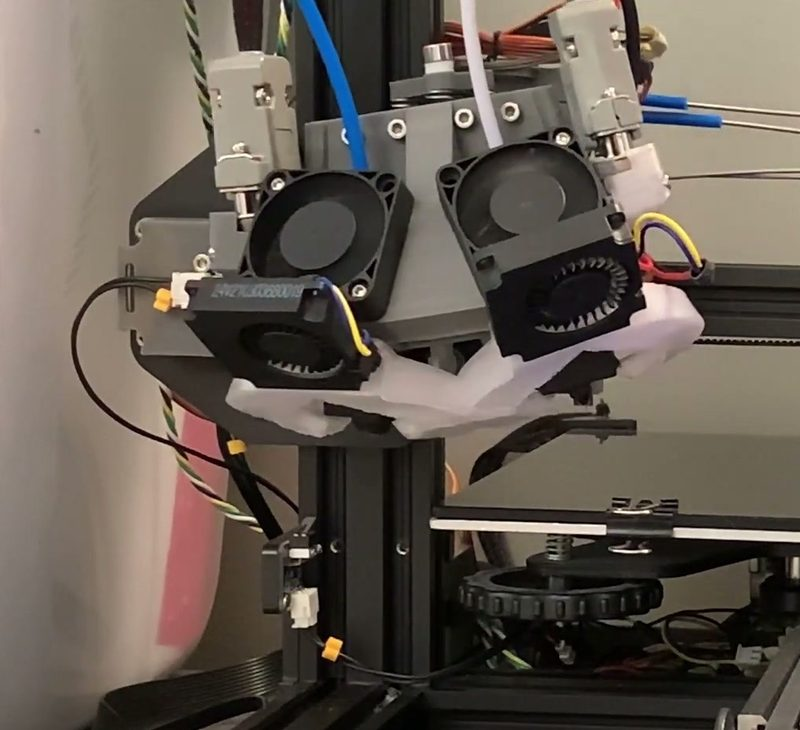</a> | [**IITC**](https://github.com/dotdash32/IITC) *dotdash32 (Josh DeWitt)* Mostly printed add-on for Ender 3 and other V-slot printers. A Bowden-cable servo tilts a dual head between two nozzles (intra). Tool groups on a screw-head kinematic mount are swapped by hand (inter). The spring-loaded mount also works as a nozzle probe. | Tool changer, Bowden | Files; changes between tool groups are manual | Kelvin (socket head cap screws, kinematic mount) | manual | v0.1.1 [2021-07](https://github.com/dotdash32/IITC/releases/tag/v0.1.1) |  [⏯️⁠1K](https://www.youtube.com/watch?v=5y99OYjvCSE) | [CAD](https://github.com/dotdash32/IITC/tree/main/CAD) [FW](https://github.com/dotdash32/IITC/tree/main/Firmware) [Video](https://www.youtube.com/watch?v=5y99OYjvCSE) |
| <a href="toolchangers/kinematic-magnetic-parking-extruder/README.md">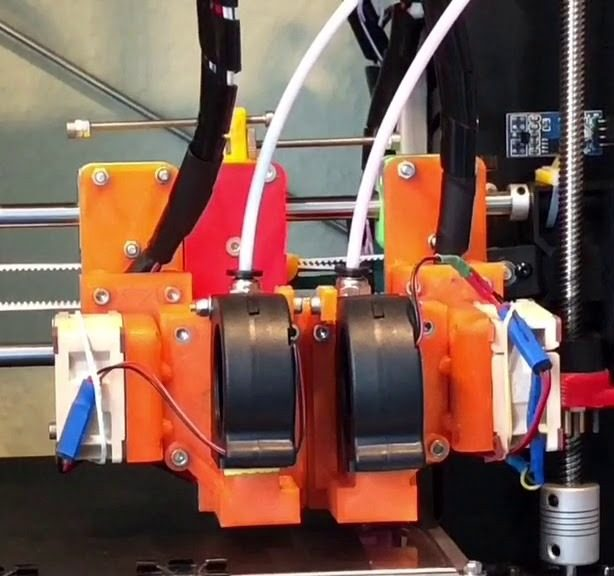</a> | [**Magnetic Parking Extruder**](https://www.thingiverse.com/thing:3080893) *Rolf Werum (Weruminger)* A dual-tool parking changer for i3 Mendel. One transport slider on the X rail grabs either of two hotend sliders parked at the X ends, using side magnets and moves only (no solenoid or servo). It is supported in mainline Marlin as MAGNETIC_PARKING_EXTRUDER. | Tool changer, Bowden | Files, Marlin feature | magnets (transport slider to tool slider, on a shared X rail) | magnets | CAD [2019-11](https://github.com/Weruminger/Magnetic_Parking_Extruder/commit/b160ca9) |  [⏯️⁠2.6K](https://www.youtube.com/watch?v=smjgnP-W-VE) | [Files](https://www.thingiverse.com/thing:3080893/files) [STL](https://github.com/Weruminger/Magnetic_Parking_Extruder/tree/master/stl) [STEP](https://github.com/Weruminger/Magnetic_Parking_Extruder/tree/master/STEP) [CAD](https://github.com/Weruminger/Magnetic_Parking_Extruder/tree/master/model) [FW](https://github.com/MarlinFirmware/Marlin/pull/12351) [Video](https://www.youtube.com/watch?v=smjgnP-W-VE) [Video](https://www.youtube.com/watch?v=Bqbcs0CU2FE) |
| <a href="toolchangers/euryale-toolchanger/README.md">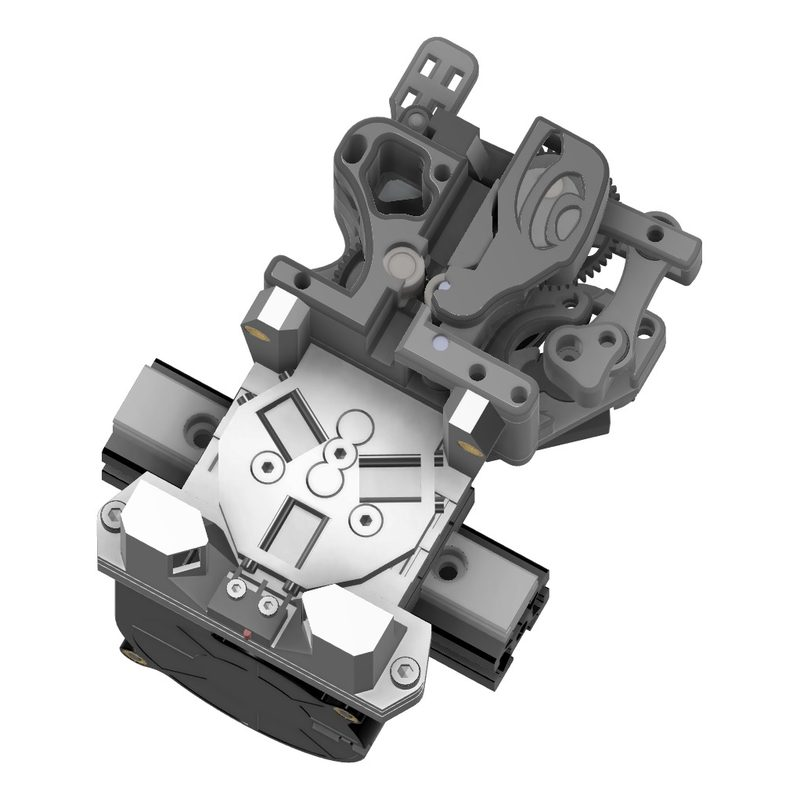</a> | [**Euryale**](https://github.com/Blackrosedyin/Euryale-ToolChanger) *blackrosedying (GitHub: Blackrosedyin)* Fork of MedusaHC with a quasi-kinematic line-contact coupling: floating 6 mm dowel barrel bolts sit on parallel 3 mm dowel pins at 35 degrees in a modified Maxwell layout. Tools take power over USB-A/USB-C cables, and direct wiring is also planned. README credits minor inspiration from CxChanger. | Hotend changer | Renders only | Maxwell (line contact: floating 6 mm dowel barrels on 3 mm dowel pins) | — | Last seen [2026-09](https://github.com/Blackrosedyin/Euryale-ToolChanger) |  [⏯️⁠92](https://youtu.be/iKWvAJGqXgY) | [CAD (Fusion, view only)](https://a360.co/46orMO9) [Video](https://youtu.be/iKWvAJGqXgY) |
| <a href="toolchangers/toolchanger-development-foctow/README.md">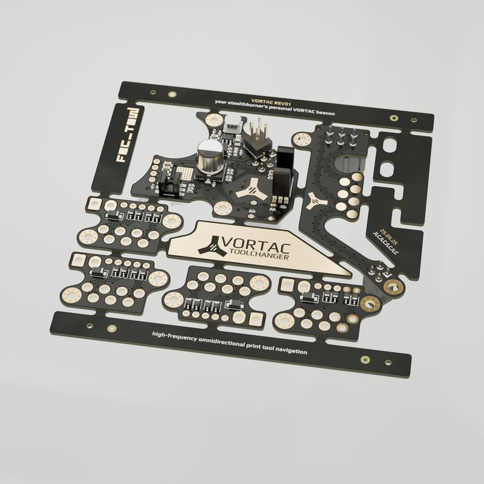</a> | [**VORTAC Toolchanger**](https://github.com/VortacDesign/VortacToolchanger) *VortacDesign (FoCTow, HenrikH96)* Stealthburner-based toolchanger with a carriage PCB and per-tool plate PCBs that connect through Mill-Max spring pogo contacts. A hook turned by a stepper locks the tool, and opto sensors on the carriage board read the tool and lock state. | Tool changer | PCB, STL and firmware, no CAD of the mechanics | — | hook, stepper | Files [2026-04](https://github.com/VortacDesign/VortacToolchanger/commit/f813cc8) |  | [PCB](https://github.com/VortacDesign/VortacToolchanger/tree/main/pcb) [STL](https://github.com/VortacDesign/VortacToolchanger/tree/main/stl) [FW](https://github.com/VortacDesign/VortacFirmware) |
| <a href="toolchangers/bbox-toolchanger/README.md">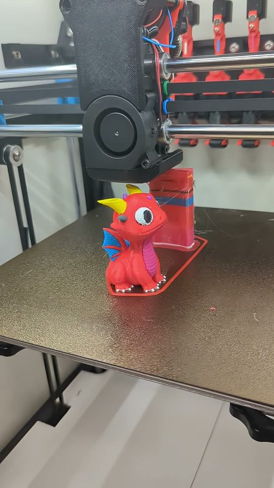</a> | [**BBox Toolchanger**](https://github.com/sakitume/BBox-KTC/tree/454210ad923966efdba06891e0414830af77da98) *sakitume (Sakitume Makes)* Hotend changer on the author's BBox CoreXY with up to 8 hotends in 3-bay dock triplets on a rear 2020 extrusion. A lateral move in the dock opens the extruder swing arm against a support rod, and screws on the back of the hotend attach magnetically to the dock. The author's own Klipper extension adds a web UI for dock and nozzle-probe calibration. | Hotend changer | Working build, no files | — | extruder arm clamp, the dock opens it | Last seen [2026-09](https://www.youtube.com/watch?v=QqzJJWBxuFM) |  [⏯️⁠13.4K](https://youtube.com/shorts/VmdlazyVDtU) | [FW](https://github.com/sakitume/BBox-KTC/tree/454210ad923966efdba06891e0414830af77da98) [Video (8 tools)](https://youtube.com/shorts/hkDlSAuNtN8) [Video (in action)](https://www.youtube.com/watch?v=QqzJJWBxuFM) |
| 📷 | [**AHS-A1**](https://github.com/PrototypeMaker/AHS) *PrototypeMaker* Planned add-on for the Bambu Lab A1: a separate robotic arm, not mounted on the printer, swaps the A1's quick-swap hotends from a dock, and a BMCU coordinates the swap with the printer. The A1's own extruder stays on the carriage. | Hotend changer | Idea | — | — | Last seen [2026-07](https://github.com/PrototypeMaker/AHS) |  | [Hardware](https://github.com/PrototypeMaker/AHS/blob/main/Hardware/Hardware.md) [FAQ](https://github.com/PrototypeMaker/AHS/blob/main/Documentation/FAQ.md) |
| 📷 | [**CoreXY Tool Changer Motion System**](https://www.thingiverse.com/thing:2946805) *smoki3* Kinematic coupling with a T-bar lock turned by a geared hobby servo on a 12 mm linear rail. Tools are Bowden E3D v6 heads with a magnetic print-head holder and a BLTouch. | Tool changer, Bowden | Files | kinematic coupling (DIY, details not stated) | T-bar, servo | STEP [2019-01](https://www.thingiverse.com/thing:2946805/files) |  | [Files](https://www.thingiverse.com/thing:2946805/files) [FW](https://github.com/smoki3/Marlin/tree/bugfix-2.0.x-toolchanger) [Printer frame](https://www.thingiverse.com/thing:3078056) [Marlin](https://github.com/MarlinFirmware/Marlin/pull/11623) |
| <a href="toolchangers/cheapest-toolchanger/README.md">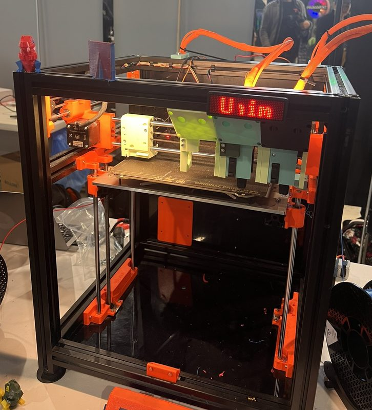</a> | [**The Cheapest ToolChanger**](https://www.printables.com/model/1294704-the-cheapest-toolchanger) *iZboxo* Two M3 screw heads on each tool slide into 5.6 mm holes in the carriage; a sideways move wedges them under plastic, and a magnet holds the tool. The author presents it as an idea, not a kit. | Tool changer | Working build, head STEP only | screws in holes | friction wedge and magnet | Files [2025-05](https://www.printables.com/model/1294704-the-cheapest-toolchanger/files) | [🧡⁠7](https://www.printables.com/model/1294704-the-cheapest-toolchanger/files) [⏯️⁠1.1K](https://www.youtube.com/watch?v=I-BHHJCY7Gk) | [STEP](https://www.printables.com/model/1294704-the-cheapest-toolchanger/files) [Video](https://www.youtube.com/watch?v=I-BHHJCY7Gk) [Video 2](https://www.youtube.com/watch?v=M6zyjaL1JsE) |
| <a href="toolchangers/tiamat/README.md">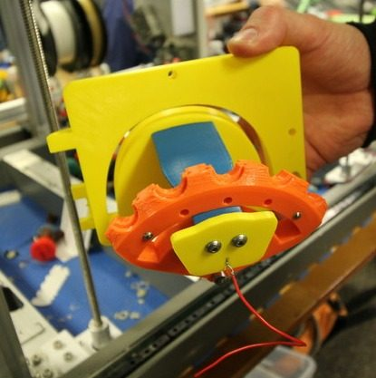</a> | [**Tiamat Tool Changer**](https://www.printables.com/model/1808-tiamat-tool-changer) *Paul Paukstelis* Five-head rotating carousel for E3D V6 hotends, shown at MRRF 2019. A servo turns the carousel on an 8 mm rod, and spring-backed 5 mm balls lock each position. | Tool changer | Files; turret without a dock | ball detents in the sled | turret with ball detents | Files [2019-04](https://www.printables.com/model/1808-tiamat-tool-changer/files) | [🧡⁠5](https://www.printables.com/model/1808-tiamat-tool-changer/files) [⏯️⁠6.7K](https://www.youtube.com/watch?v=-qzkJFe4Lkg) | [STL](https://www.printables.com/model/1808-tiamat-tool-changer/files) [Video](https://www.youtube.com/watch?v=-qzkJFe4Lkg) |
| <a href="toolchangers/mihaidesigns-10-hotend/README.md">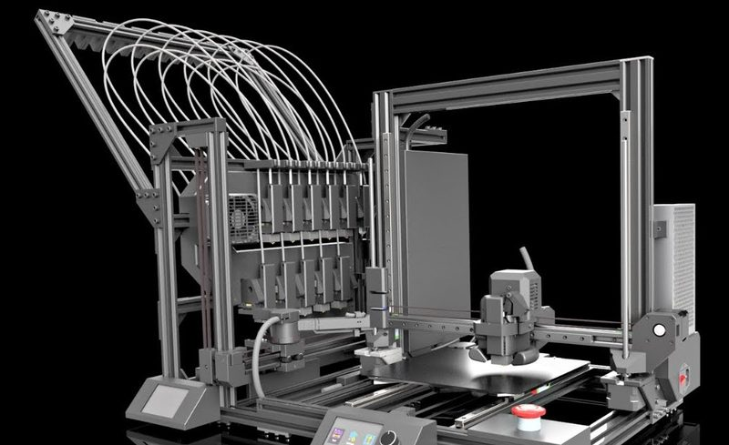</a> | [**PitStop 3**](https://mihaidesigns.com/pitstop3) *MihaiDesigns* Printer with a revolving arm that moves 10+ hotends (plus a probe as a tool) between parking slots and a few heated pre-heat slots; the next hotend is preheated while the current one prints. | Hotend changer | Prototype, no files, paused since 2025 | kinematic mount | latch with magnets | Last seen [2023-11](https://www.youtube.com/watch?v=KofWZylVYjw) | [⏯️⁠73.9K](https://www.youtube.com/watch?v=wzug_HmM-FQ) | [Video (design)](https://www.youtube.com/watch?v=wzug_HmM-FQ) [Video (Formnext firmware)](https://www.youtube.com/watch?v=DZfEvyKoTOw) |
| <a href="toolchangers/tool-changing-delta/README.md">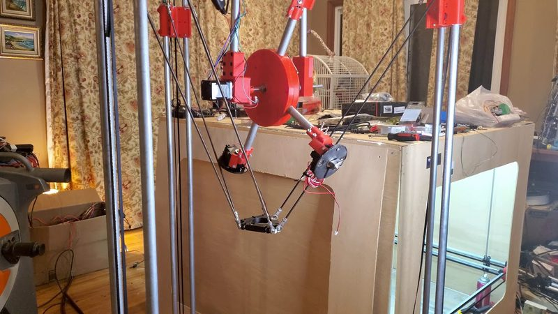</a> | [**Tool Changing Delta**](https://www.youtube.com/watch?v=-LXkxiC_5YA) *Rob Mink (Printcepts)* Tool changer on an EMT Goliath delta. A wheel above the print area carries the tools on arms and swings one down to the effector. Klipper on two RAMPS 1.4 boards. | Not sorted | Working build, no files | — | — | Last seen [2020-09](https://www.youtube.com/watch?v=-LXkxiC_5YA) | [⏯️⁠12K](https://www.youtube.com/watch?v=UJbb69vk-8g) | [Video (Mk1)](https://www.youtube.com/watch?v=UJbb69vk-8g) [Video (Mk2)](https://www.youtube.com/watch?v=-LXkxiC_5YA) |
| <a href="toolchangers/amx-hotend-changer/README.md">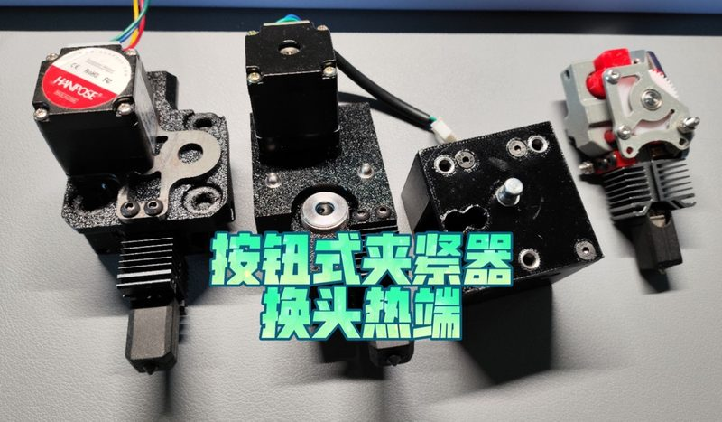</a> | [**AMX hotend changer**](https://www.bilibili.com/video/BV1cQYReYEu3/) *飞翔的AMX* DIY hotend-changing printer. It started in 2023 as a magnetic shared-extruder hotend changer and moved in 2024 to a push-button clamp. The machine frame and motion run, but no tool change has been shown. | Tool changer | Prototype, stopped, no files | locating pins (0604, per the author's comment) | push-button clamp | Last seen [2024-08](https://www.bilibili.com/video/BV141ecefE18/) | [⏯️⁠8.5K](https://www.bilibili.com/video/BV1cQYReYEu3/) | [Video (concept, 2023)](https://www.bilibili.com/video/BV1os4y1A71V/) [Video (button clamp)](https://www.bilibili.com/video/BV1ZAicejEcR/) [Video (machine moving)](https://www.bilibili.com/video/BV1cQYReYEu3/) |
| <a href="toolchangers/vijaya-toolchanger/README.md">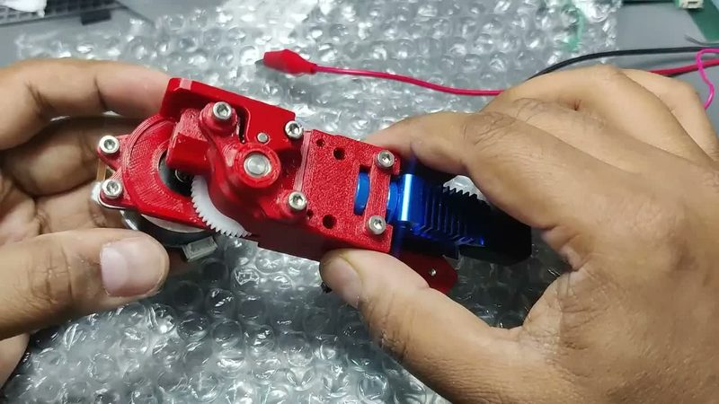</a> | [**Vijaya toolchanger**](https://www.youtube.com/watch?v=8qZWVmBb7m0) *DoTheDIY (GitHub apoorv1in)* A small toolchanger where a permanent electromagnet holds the tool. Power is needed only to release it, so a power cut does not drop the tool and the magnet does not heat. It includes a piezo Z-probe. | Tool changer | Bench tests, no files | — | permanent electromagnet | Last seen [2024-06](https://www.youtube.com/watch?v=lcpa8969MFk) | [⏯️⁠8.5K](https://www.youtube.com/watch?v=8qZWVmBb7m0) | [Video](https://www.youtube.com/watch?v=8qZWVmBb7m0) [Video (piezo Z-probe)](https://www.youtube.com/watch?v=lcpa8969MFk) |
| <a href="toolchangers/indx-clone-tiantian/README.md">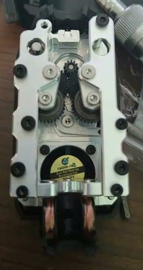</a> | [**INDX clone (好像是天天啊)**](https://www.bilibili.com/video/BV1nY3z6VEHZ/) *好像是天天啊* An INDX-style tool with an induction-heated hotend: a self-wound coil (0.1x200 Litz wire) driven by a ZVS circuit, Creality K1 extruder gears, an Ender-3 V3 Plus extruder motor, a trimmed V6 heatsink, an MK8 throat and a Volcano CHT hardened nozzle. | Hotend changer | Renders only | — | — | Last seen [2026-07](https://www.bilibili.com/video/BV1nY3z6VEHZ/) | [⏯️⁠3K](https://www.bilibili.com/video/BV1nY3z6VEHZ/) | [Video](https://www.bilibili.com/video/BV1nY3z6VEHZ/) |
| <a href="toolchangers/kukuad-hotend-changer/README.md">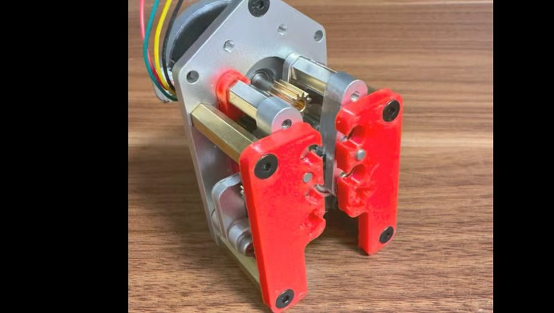</a> | [**酷酷ad hotend changer**](https://www.bilibili.com/video/BV1VSYC6eExu/) *酷酷ad* Shared-extruder hotend changer built from standard parts (K1 gear pack, rack-and-pinion arm spreader). It is front-mounted on a Bambu P1 frame running Klipper. The author chose front mounting because rear mounting loses about 20 mm of travel. | Hotend changer | Prototype in testing | — | — | Last seen [2026-09](https://www.bilibili.com/video/BV1VSYC6eExu/) | [⏯️⁠2.5K](https://www.bilibili.com/video/BV1VSYC6eExu/) | [Video (extruder test)](https://www.bilibili.com/video/BV1VSYC6eExu/) [Video (P1 hotend changer)](https://www.bilibili.com/video/BV1Miao6oEJF/) |
| <a href="toolchangers/delta-magnet-ring-prototype/README.md">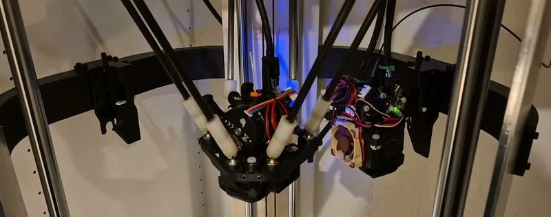</a> | [**Delta toolchanger with a magnet ring**](https://www.youtube.com/watch?v=KamrUvCROx8) *Jason Leppin* A toolchanger for a custom delta printer. A rotating magnet ring on the end effector locks each tool and shears the magnets to release it. Each dock has a spring-loaded catch and a centring spike. Since 2026 a servo-driven retracting lever handles ooze. | Tool changer | Working build, no files | kinematic mount: steel balls on rods | magnet ring, turned to release | Last seen [2026-09](https://www.youtube.com/watch?v=Ln2aJkhUCsk) | [⏯️⁠2.2K](https://www.youtube.com/watch?v=KamrUvCROx8) | [Video (prototyping)](https://www.youtube.com/watch?v=KamrUvCROx8) [Video (progress)](https://www.youtube.com/watch?v=Ln2aJkhUCsk) |
| <a href="toolchangers/idriss-razgani-hotend-changer/README.md">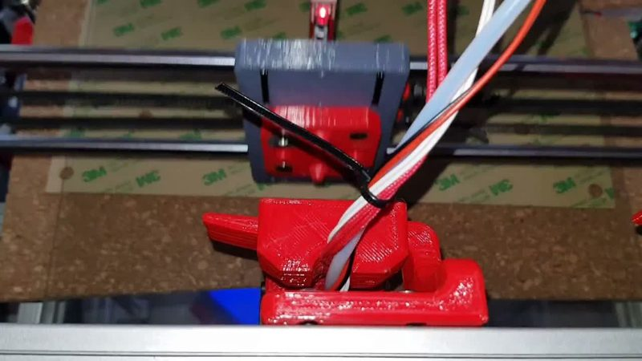</a> | [**Hotend changer (Idriss Razgani)**](https://www.youtube.com/watch?v=So9vmKJjUbg) *Idriss Razgani* Head for a Hypercube-style CoreXY that sits on four centering cones and is held by neodymium magnets; the holder profile snaps the parked head in place. | Hotend changer | One video, no files | 4 centering cones | magnets | Last seen [2018-10](https://www.youtube.com/watch?v=So9vmKJjUbg) | [⏯️⁠1.5K](https://www.youtube.com/watch?v=So9vmKJjUbg) | [Video](https://www.youtube.com/watch?v=So9vmKJjUbg) |
| <a href="toolchangers/terry-tao-toolchanger/README.md">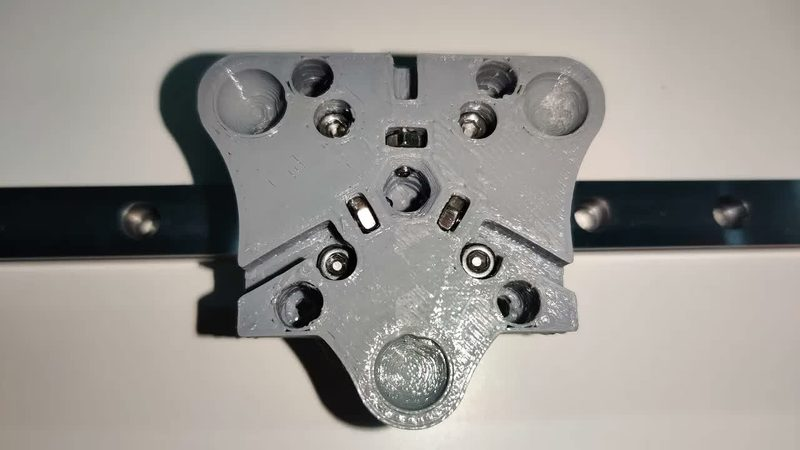</a> | [**Terry Tao toolchanger**](https://www.youtube.com/watch?v=HsSOVnam678) *Terry Tao* A 2020 toolchanger carriage with a detent and pin locking mechanism. The author abandoned it before finishing the printer. | Tool changer | Idea, abandoned | pins | detent | Last seen [2020-11](https://www.youtube.com/watch?v=HsSOVnam678) | [⏯️⁠478](https://www.youtube.com/watch?v=HsSOVnam678) | [Video](https://www.youtube.com/watch?v=HsSOVnam678) |
| <a href="toolchangers/mk8-hotend-changer/README.md">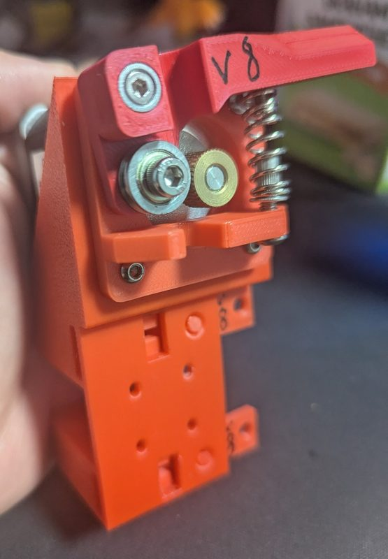</a> | [**Mk8 hotend changer**](https://www.printables.com/model/1784948-mk8-hotend-changer) *Dreadnought 3D* Early MK8 hotend swapper published as a single STEP at viewers' request; the author never tested it on a printer and has since moved to a different design. | Hotend changer | STEP file, never tested | — | — | First release [2026-07](https://www.printables.com/model/1784948-mk8-hotend-changer) | — | [STEP](https://www.printables.com/model/1784948-mk8-hotend-changer/files) |

## Legacy designs

The files still work, but the design is no longer developed. A design is legacy in three cases: it has no update in two years and no group with 100 or more members, its repository is archived, or a newer version replaced it.

| Photo | Toolchanger and why it’s interesting | Type | Coupling | Lock | Change time | Latest version | Stars Likes Views | Links | Groups |
| --- | --- | --- | --- | --- | --- | --- | --- | --- | --- |
| <a href="toolchangers/rotating-magnet-toolchanger/README.md">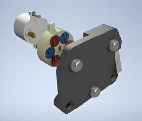</a> | [**Rotating Magnet Toolchanger**](https://github.com/totaldesaster/toolchanger) *totaldesaster (Remo)* A 28BYJ-48 geared stepper turns a ring of alternating-pole magnets on the head, so the head either pulls the tool on or pushes it off. It needs no servo, only a free stepper driver. Steel balls on the head and L profiles on the tool form a Maxwell coupling. The parts are almost all printed, and the design suits only light Bowden tools. No update since 2023-02. | Tool changer, Bowden | Maxwell | rotating magnet ring, motor | — | CAD [2023-02](https://github.com/totaldesaster/toolchanger/commit/6910d2d) |  | [CAD](https://github.com/totaldesaster/toolchanger/tree/main/Version%201/Inventor%20Files) [Manual](https://github.com/totaldesaster/toolchanger/tree/main/Version%201/Assembly%20Drawings) [Config](https://github.com/totaldesaster/toolchanger/blob/main/Version%201/Klipper%20Config.txt) | — |
| <a href="toolchangers/foxchanger/README.md">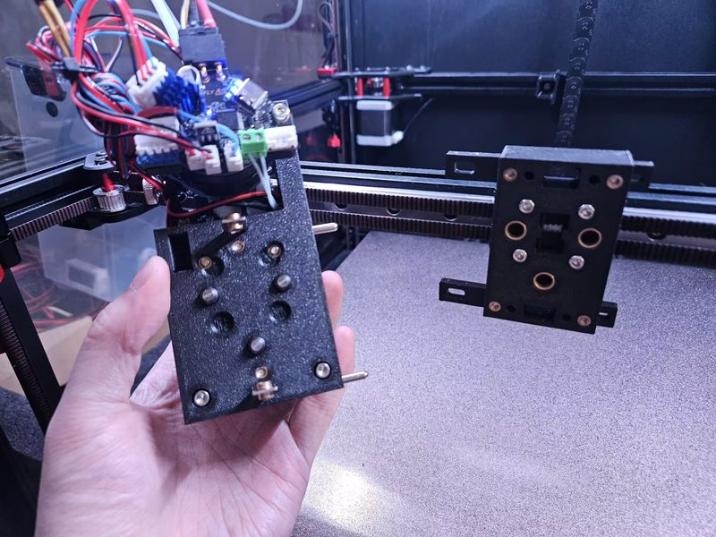</a> | [**FoxChanger**](https://github.com/Noisyfox/FoxChanger) *Noisyfox* Voron 2.4/Trident mod that uses a Prusa XL-style latch made only from off-the-shelf pins, magnets and steel angles, with no custom metal parts. The latch takes the toolhead's Z-probe space, so a piezo bed sensor does Z homing. The repo also has a micro-switch nozzle-align probe. No update since 2024-10. | Tool changer | cone pins in bushings | latch, the dock opens it | — | CAD [2024-10](https://github.com/Noisyfox/FoxChanger/commit/ed7ae1c) |  | [STEP](https://github.com/Noisyfox/FoxChanger/tree/main/Toolchanger/CAD) [STL](https://github.com/Noisyfox/FoxChanger/tree/main/Toolchanger/STLs) [Config](https://github.com/Noisyfox/FoxChanger/tree/main/Klipper/config) [Video](https://www.bilibili.com/video/BV1c142117zm) | — |
| <a href="toolchangers/toolchanger2/README.md">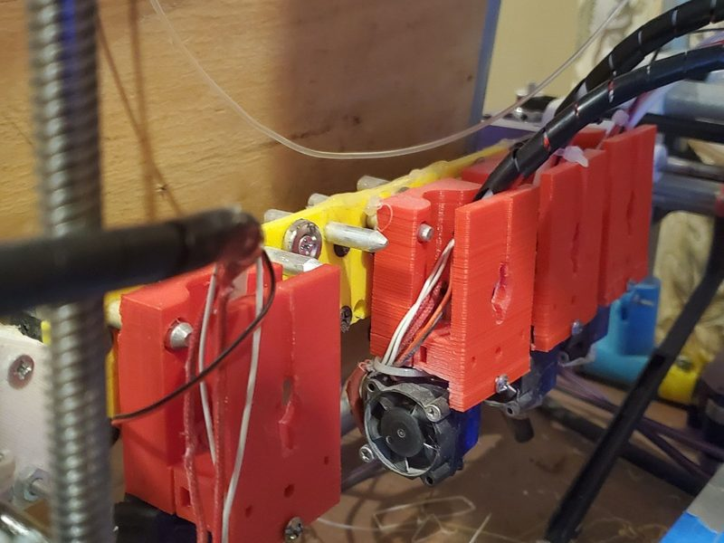</a> | [**toolchanger2**](https://github.com/RobMink/toolchanger2) *Rob Mink (Printcepts)* Large tool changer based on Alex's Piper 2. A servo on the carriage side locks the tool. Heads include J-head print tools, a laser and a CNC head, with per-tool Klipper activate/deactivate G-code. No update since 2021-11. | Tool changer, Bowden | — | servo lock | — | Update [2021-11](https://www.thingiverse.com/thing:5100796) |  [⏯️⁠4.1K](https://www.youtube.com/watch?v=2u0d4myZtUk) | [STL](https://github.com/RobMink/toolchanger2) [Config](https://github.com/RobMink/toolchanger2/blob/master/printer.cfg) [Video](https://www.youtube.com/watch?v=C4KVxfeMUEw) | [Discord](https://discord.gg/nVmeNJJSH2) EN 888 |
| <a href="toolchangers/xhtc/README.md">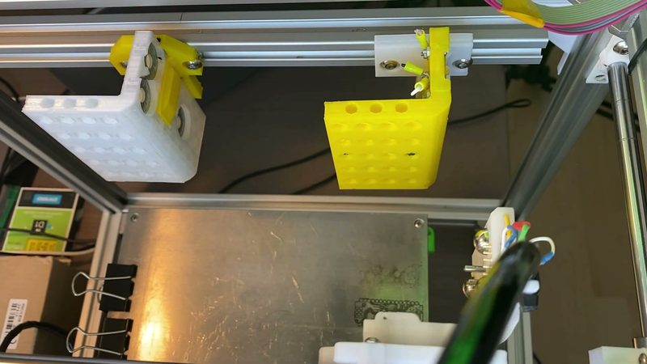</a> | [**XHTC**](https://github.com/xpix/XHTC) *Frank Herrmann (xpix)* Automatic tool changer for a Hypercube, based on René Jurack's design. Magnets hold the tool, and pogo pins make all tool connections in one move. OctoPrint before/after toolchange scripts drive the change. No update since 2019-08. | Tool changer | — | magnets | — | Update [2019-08](https://www.thingiverse.com/thing:3036622) |  [⏯️⁠4K](https://www.youtube.com/watch?v=xUQaVA273kA) | [CAD](https://a360.co/2DpOXs6) [CAD (extruder module)](https://a360.co/31B6Dh0) [CAD (magnet holder)](https://a360.co/2JZUHQm) [FW](https://github.com/xpix/Marlin) [Config](https://github.com/xpix/XHTC/blob/master/toolchange_before.tmpl) [PCB](https://oshpark.com/shared_projects/ypHD6yYr) [Video](https://www.youtube.com/watch?v=tmCkdqE2O68) | — |
| <a href="toolchangers/bitechanger/README.md">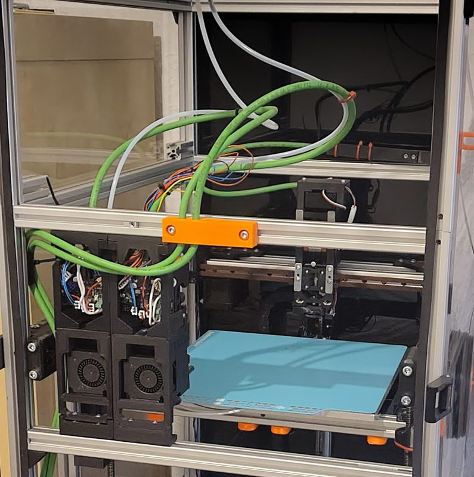</a> | [**BiteChanger**](https://github.com/gspck/bitechanger) *gspck* Servo-locked toolchanger for the Voron Trident. Each tool has its own Sherpa Mini extruder and EBB CAN board. Dock and pickup use custom Klipper macros. The author marks it pre-alpha. No update since 2025-10. | Tool changer | — | servo lock | — | prealpha.1 [2025-10](https://github.com/gspck/bitechanger/releases/tag/prealpha.1) |  | [STEP](https://github.com/gspck/bitechanger/blob/main/bitechanger.step) [Files](https://github.com/gspck/bitechanger/releases/tag/prealpha.1) [Config](https://github.com/gspck/bitechanger/tree/main/config) | [Discord](https://discord.gg/gnCjt6DTd2) EN 3 |
| <a href="toolchangers/mtc/README.md">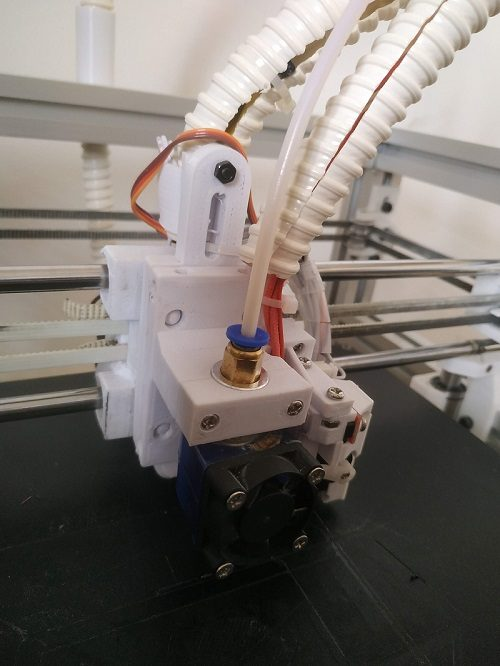</a> | [**Magnetic Tool Changing (MTC)**](https://github.com/doryosef/mtc) *dor yosef (doryosef)* OpenSCAD magnetic carriage adapter and tool catchers for the Hypercube Evolution. It holds a V6 hotend, a pen or a laser, with Duet tfree/tpost G-code. No update since 2020-04. | Tool changer, Bowden | — | magnets | — | First release [2020-04](https://github.com/doryosef/mtc/commit/c942a3ca2351fc18b56528e58f0129dbb641455b) |  | [CAD](https://github.com/doryosef/mtc) [Config](https://github.com/doryosef/mtc/blob/master/setTool.gcode) | — |
| <a href="toolchangers/hypercube-parking-extruders/README.md">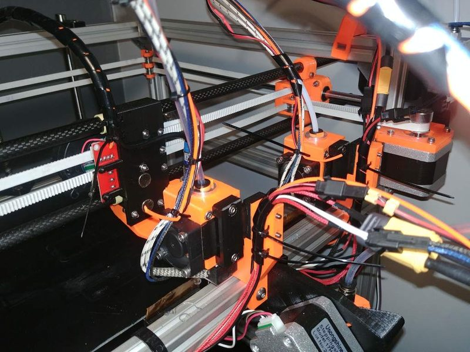</a> | [**Hypercube parking extruders**](https://www.printables.com/model/202063-hypercube-tool-changermulti-material-parking-extru) *McAbra (Paweł Kucmus, pkucmus / EVA-3D)* Parking-extruder heads for the HyperCube: the carriage picks a head off a hook in a fixed dock by moving in Y, and magnets with centering screws hold it. It was built mainly to switch between 0.4 and 0.6 mm nozzles. Tool changes are slicer G-code moves, not firmware. No update since 2018-11. | Tool changer, Bowden | magnets and centering screws | magnets | — | First release [2018-11](https://www.thingiverse.com/thing:3230818) | [🧡⁠11](https://www.printables.com/model/202063-hypercube-tool-changermulti-material-parking-extru/files) [⏯️⁠3K](https://www.youtube.com/watch?v=ODtzj8-Y1U0) | [STL](https://www.printables.com/model/202063-hypercube-tool-changermulti-material-parking-extru/files) [FW](https://github.com/pkucmus/Marlin/tree/hypercube-parking-1.1.9) [Video](https://www.youtube.com/watch?v=ODtzj8-Y1U0) [Video (print start)](https://www.youtube.com/watch?v=3nZpMxgXLOU) | — |
| <a href="toolchangers/rolmie-tool-changer/README.md">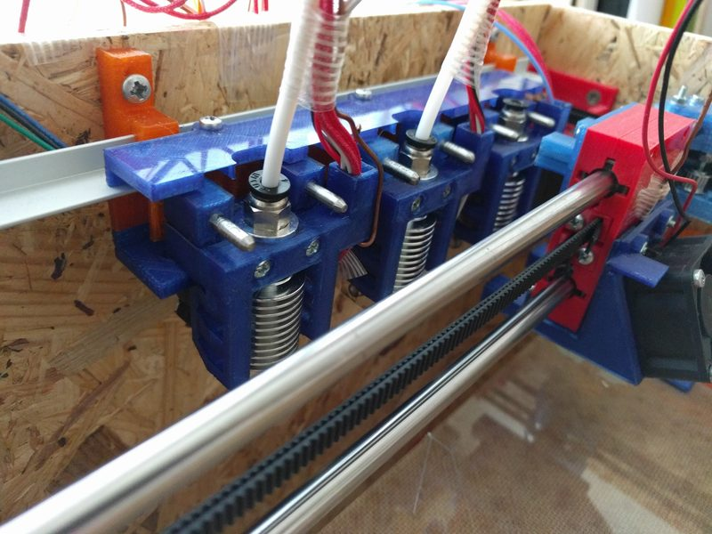</a> | [**Tool Switching**](https://hackaday.io/project/26053-tool-switching-multi-extrusion) *rolmie (GitHub: rmie)* Early magnetic tool switching on four 4 mm shafts, with OpenSCAD files on Hackaday.io. The logs show dual-colour prints and 200 load and unload cycles. No update since 2017-10. | Tool changer, Bowden | pins and bushings | magnets | — | Last seen [2017-10](https://hackaday.io/project/26053-tool-switching-multi-extrusion) | [⏯️⁠23.3K](https://www.youtube.com/watch?v=eOKCvtaMa08) | [Files](https://hackaday.io/project/26053/files) [Manual](https://hackaday.io/project/26053/instructions) [Video](https://www.youtube.com/watch?v=eOKCvtaMa08) [Video (redesign first print)](https://www.youtube.com/watch?v=NvcBKoBVFjo) [Config (offset calibration tool)](https://github.com/rmie/NozzleOffsetCalibrationTool) | — |
| <a href="toolchangers/dpr-magnetic-toolchanger/README.md">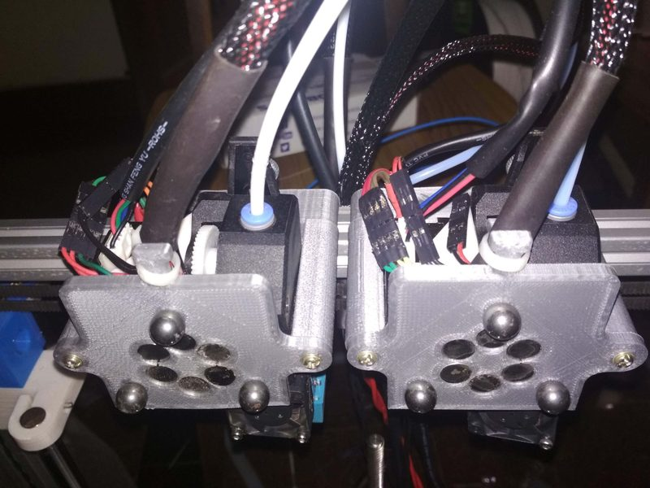</a> | [**3D Printed Magnetic Toolchanger**](https://www.instructables.com/Magnetic-3D-Printed-Toolchnager/) *D_P_R (devalopr)* A servo turns a ring of alternating-pole magnets on the carriage by 60 degrees, which switches the force between attract and repel. Kinematic coupling with 3 threaded steel balls per tool. Uses only off-the-shelf and printed parts, with no CNC. No update since 2020-02. | Tool changer | kinematic, 3 balls | rotating magnet ring, servo | [~5-6 s](https://www.youtube.com/watch?v=bWBItIszMek) | First release [2020-02](https://www.instructables.com/Magnetic-3D-Printed-Toolchnager/) | [⏯️⁠5.9K](https://www.youtube.com/watch?v=bWBItIszMek) | [Manual](https://www.instructables.com/Magnetic-3D-Printed-Toolchnager/) [Video](https://www.youtube.com/watch?v=bWBItIszMek) | — |

## Not in the catalog

Designs that we checked and did not add, with the reason.

| Photo | Toolchanger | Type | Reason | Coupling | Lock | Latest version | Links |
| --- | --- | --- | --- | --- | --- | --- | --- |
| 📷 | [**The Doot Changer**](https://github.com/AmyTheCute/The-Doot-Changer) *AmyTheCute (AmyTheBun)* | Tool changer, Bowden | The author abandoned the project, and it never had a large group, so it does not fit Legacy either. | dowel pins | magnets (Mag) wedge, motor (Twist) | CAD [2021-10](https://github.com/AmyTheCute/The-Doot-Changer/commit/5c5bedb) | [CAD](https://github.com/AmyTheCute/The-Doot-Changer/tree/master/Doot%20Changer%20Mag) [CAD Twist](https://github.com/AmyTheCute/The-Doot-Changer/tree/master/Doot%20Changer%20Twist) [Config](https://github.com/AmyTheCute/The-Doot-Changer/tree/master/Doot%20Changer%20Mag/Klipper%20Backups) [Files](https://www.thingiverse.com/thing:3914045) [Video](https://www.youtube.com/watch?v=qUyrYl33SpE) |
| <a href="toolchangers/snakeoil-changer/README.md">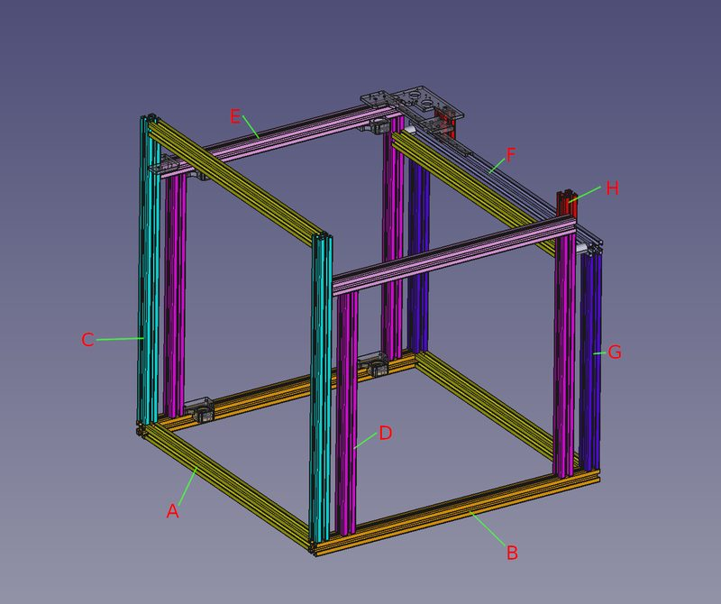</a> | [**SnakeOil-Changer**](https://github.com/ChipCE/SnakeOil-Changer) *ChipCE (Chip, snakeoildev.com)* | Not sorted | The files show only the base printer. No coupling, lock, dock, or tool change is documented. | — | — | CAD [2026-11](https://github.com/ChipCE/SnakeOil-Changer/commit/30a8722) | [Files](https://github.com/ChipCE/SnakeOil-Changer/tree/master/src) [STEP](https://github.com/ChipCE/SnakeOil-Changer/blob/master/doc/frame/frame_260111.step) [BOM](https://github.com/ChipCE/SnakeOil-Changer/blob/master/doc/frame/frame.md) |
| <a href="toolchangers/linker3d-toolchanger/README.md">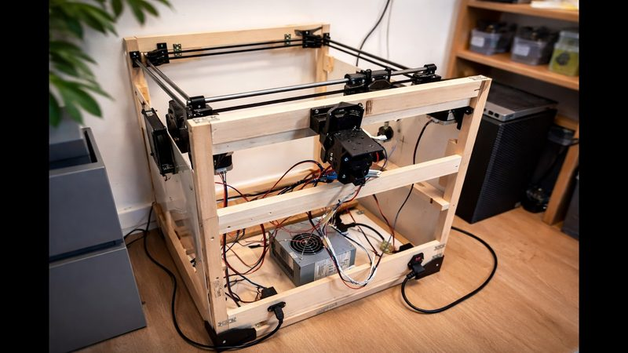</a> | [**Linker3D Toolchanger**](https://github.com/privt00/Linker3DToolchanger) *privt00 (Privt)* | Tool changer | Planned, but nothing of the toolchanger is published. The repository has only the base CoreXY frame and a board for four extruders. | — | — | Last seen [2026-04](https://github.com/privt00/Linker3DToolchanger) | [Video](https://www.youtube.com/watch?v=XlKTBpUcuso) [Video](https://www.youtube.com/watch?v=YI5guWG1CF4) [Video](https://www.youtube.com/watch?v=idBv9-dRqzA) [STL](https://github.com/privt00/Linker3DToolchanger/tree/main/Frame) [PCB](https://github.com/privt00/rp2040-extruder) |
| 📷 | [**Lycan Toolchanger**](https://www.thingiverse.com/thing:4705919) *EdwardMakesThings* | Not a changer | No toolchanger was designed. The printer runs one Hemera extruder. | — | — | Files [2025-12](https://github.com/edwardmakesthings/Lycan3DPrinter) | [Files](https://github.com/edwardmakesthings/Lycan3DPrinter) |
| 📷 | [**MRC**](https://github.com/mattiras/MRC) *mattiras* | Hotend changer | Only a Klipper config is public. No CAD and no pictures. | — | rotary lock, motor | Last seen [2025-05](https://github.com/mattiras/MRC) | [Config](https://github.com/mattiras/MRC/tree/main/Klipper) |
| <a href="toolchangers/index-oosaka/README.md">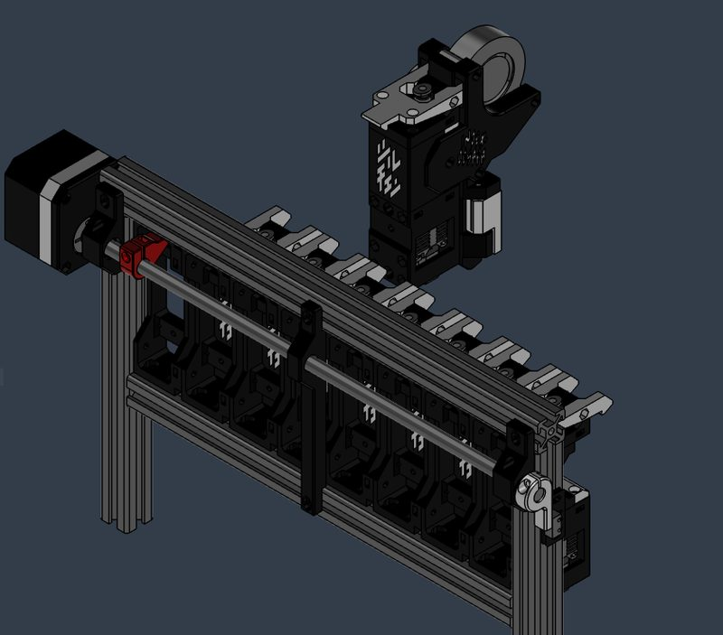</a> | [**INDEX-OOSAKA**](https://www.printables.com/model/1630327-index-oosaka-vb) *OOSAKA Lab* | Hotend changer | Paid model, and the terms do not allow sharing. | — | spring lock lever | Files [2026-10](https://www.printables.com/model/1630327-index-oosaka-vb/files) | [Files](https://www.printables.com/model/1630327-index-oosaka-vb/files) [Video](https://youtu.be/A1MYL63sIwo) |
| <a href="toolchangers/ultimate-tool-changer/README.md">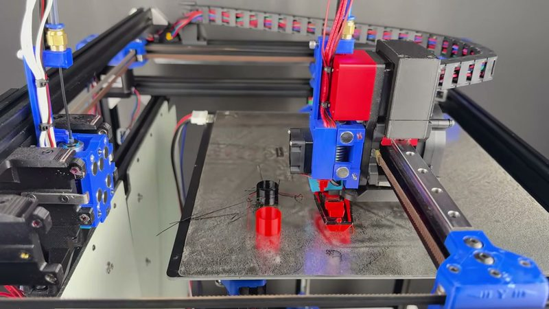</a> | [**Ultimate Tool Changer**](https://buymeacoffee.com/ultimatetoolchanger/e/552354) *Andrey, Ultimate Tool Changer (formerly Engineers Grow)* | Hotend changer | The STEP and Fusion files are paid. Only the STLs and the BOM are free. | kinematic plate (pins with cone-tip set screws) | magnets | 2.0 [2026-04](https://buymeacoffee.com/ultimatetoolchanger/e/552354) | [STL](https://buymeacoffee.com/ultimatetoolchanger/e/552354) [STEP](https://buymeacoffee.com/ultimatetoolchanger/extras) [BOM](https://www.youtube.com/watch?v=9c_qe6sydw0) [Video](https://www.youtube.com/watch?v=XMZGlL5eZCs) |
| <a href="toolchangers/kevin-mce-docking-hotends/README.md">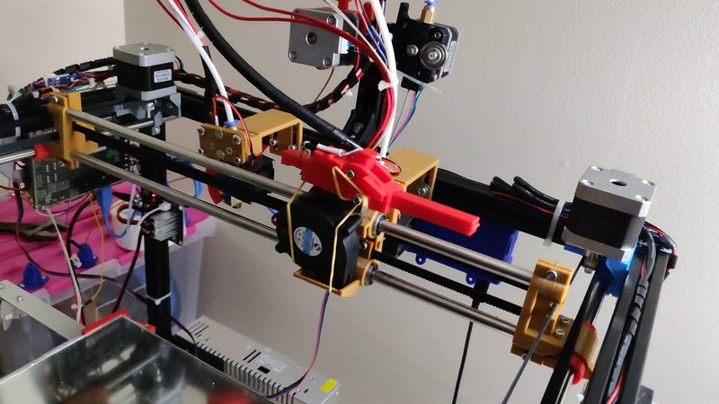</a> | [**FLSUN HyperCube docking hotends**](https://www.youtube.com/watch?v=EmZUaAau1Cc) *Kevin McE* | Tool changer, Bowden | Three videos from 2018 and no files. The author removed the changer after a few prints. | — | — | Last seen [2018-08](https://www.youtube.com/watch?v=EmZUaAau1Cc) | [Video](https://www.youtube.com/watch?v=EmZUaAau1Cc) [Video (docking tests)](https://www.youtube.com/watch?v=Nj3CPNZZzTs) [Video (dual hotend print)](https://www.youtube.com/watch?v=6nI-Aijzgdk) |
| <a href="toolchangers/magnetic-idex-push-push-latch/README.md">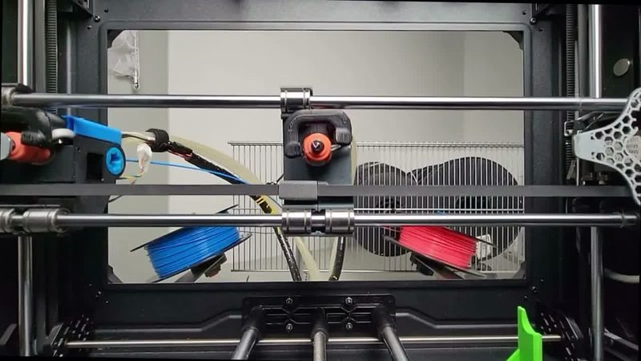</a> | [**Magnetic IDEX push-push latch**](https://www.youtube.com/watch?v=EZoxpfzPa4U) *Magnetic IDEX 3D Printer (m_IDEX, dmitryr / dromanovich)* | Tool changer | A latch that parks the heads of an IDEX printer. It is not a changer, although the latch files are public. | — | push-push latch | Files [2026-05](https://www.printables.com/model/567323-push-push-latch-actuator-aka-strike) | [Video](https://www.youtube.com/watch?v=EZoxpfzPa4U) [BOM](https://docs.google.com/spreadsheets/d/1fb1T2YSfM-OhzU3zWx77bUNyia4o-GPZsPlaNYT4-vA/edit?usp=sharing) [STEP](https://www.printables.com/model/567323-push-push-latch-actuator-aka-strike/files) |
| <a href="toolchangers/octohead/README.md">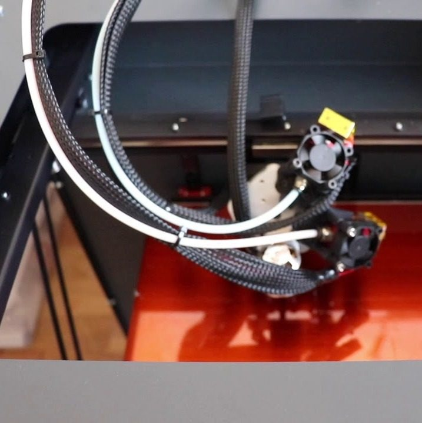</a> | [**OctoHead**](https://web.archive.org/web/20201130040459/https://raybot.fr/) *octohead project (Raybot, France)* | Tool changer | Rotary turret: three tools on a swivel head, with no dock and no lock. It was sold as a commercial product. | — | — | First video [2018-09](https://www.youtube.com/watch?v=d1BWFsc4pcQ) | [Video](https://www.youtube.com/watch?v=d1BWFsc4pcQ) [Video](https://www.youtube.com/watch?v=V4W0I0hq6hI) |
| <a href="toolchangers/micro-make-delta-changer/README.md">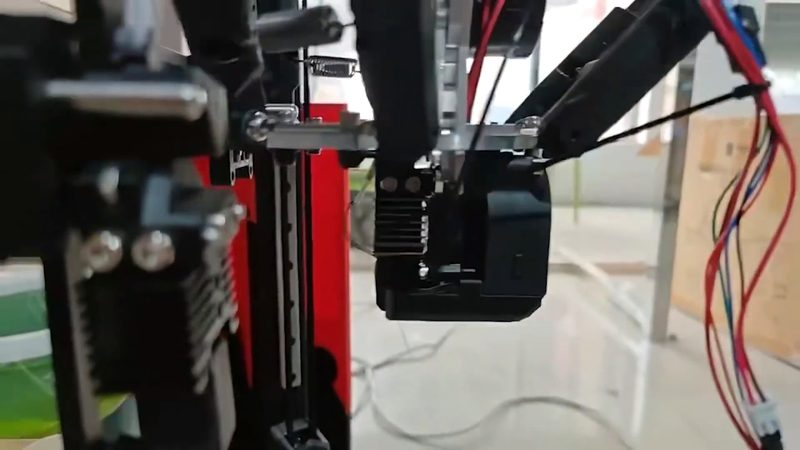</a> | [**INDX & KliTek magnetic tool changer for delta**](https://www.youtube.com/watch?v=SCrmRJolNY8) *MICRO MAKE* | Hotend changer | One prototype video and no changer files. The public Venture Delta files cover only the base printer. | — | — | Last seen [2026-07](https://www.youtube.com/watch?v=SCrmRJolNY8) | [Video](https://www.youtube.com/watch?v=SCrmRJolNY8) |
| 📷 | [**APIS CoreXY**](https://www.thingiverse.com/thing:3887104) *EdwardMakesThings* | Tool changer | A printer for E3D ToolChanger tools, not a new changer. It has no BOM or build guide, and nobody built it. The author put it on pause in 2021. | Maxwell | twist lock, motor | Files [2019-09](https://www.thingiverse.com/thing:3887104/files) | [STL](https://www.thingiverse.com/thing:3887104/files) |
| 📷 | [**FDM-toolchange-1.15**](https://drive.google.com/file/d/1ucA5McrE9urfsopDnSSWp1lm62WEDtce/view) *gurayushi* | Hotend changer | One STEP file with no description and no build. The download link is dead. | pins (2 locating pins, 定位销) | swing-lever latch | Last seen [2026-01](https://drive.google.com/file/d/1ucA5McrE9urfsopDnSSWp1lm62WEDtce/view) | [STEP](https://drive.google.com/file/d/1ucA5McrE9urfsopDnSSWp1lm62WEDtce/view) |
| <a href="toolchangers/misschanger-v2/README.md">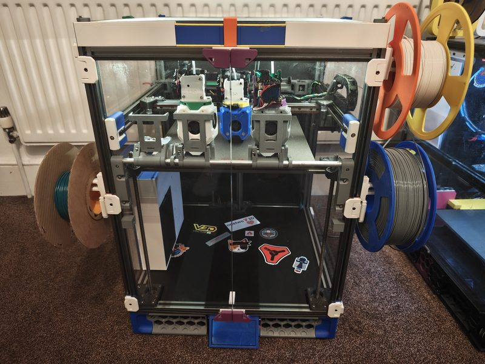</a> | [**MissChanger v2**](https://www.printables.com/model/1533585-misschanger-v2) *VIN-y* | Tool changer | The STEP and FreeCAD files are paid (USD 25, commercial license). The free page has only 3MF files. MissChanger v1 is in the catalog. | pins and bushings | magnets | MCv2 [2026-07](https://www.printables.com/model/1533585-misschanger-v2) | [Files](https://www.printables.com/model/1533585-misschanger-v2) [Wiki](https://gitlab.com/misschanger/misschanger-v2/-/wikis/home) |
| <a href="toolchangers/saddleback/README.md">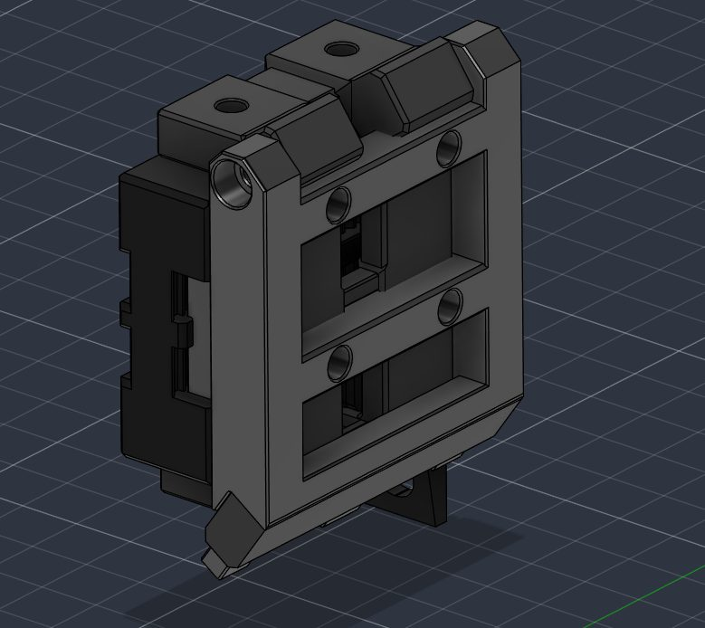</a> | [**Saddleback V1**](https://www.printables.com/model/1805729-saddleback-v1-tollhead-change-system-for-voron-24) *Palimino Productions* | Not a changer | The files show no dock, no lock, and no automatic change. | — | — | Last seen [2026-08](https://www.printables.com/model/1805729-saddleback-v1-tollhead-change-system-for-voron-24) | [STL](https://www.printables.com/model/1805729-saddleback-v1-tollhead-change-system-for-voron-24/files) |
| <a href="toolchangers/vzbot-basis-toolchanger/README.md">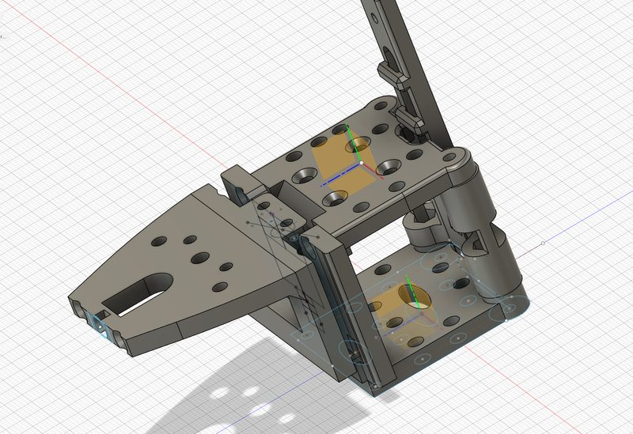</a> | [**ToolChanger VZbot.basis**](https://www.printables.com/model/1125546-toolchanger-vzbotbasis) *Michael-3d* | Not a changer | No dock. As published, it is a manual magnetic quick-swap plate. | dowel pins | magnets | Last seen [2024-12](https://www.printables.com/model/1125546-toolchanger-vzbotbasis) | [Files](https://www.printables.com/model/1125546-toolchanger-vzbotbasis/files) |
