# Awesome-Toolchangers

A curated catalog of open-source toolchangers and hotend changers for FDM 3D printers. Every design has one row with its coupling, lock, change time, latest revision, links, and builder groups. Designs of the same type sit side by side.

    

## Contents

- [Start here](#start-here)
- [Tool changers](#tool-changers)
- [Hotend changers](#hotend-changers)
- [Concepts and prototypes](#concepts-and-prototypes)
- [Legacy designs](#legacy-designs)
- [Other designs](#other-designs)
- [Column notes](#column-notes)
- [How to contribute](#how-to-contribute)
- [Similar projects](#similar-projects)
- [License](#license)

## Start here

Good designs to start with. Most people build one changer for their printer, so pick the one that fits your printer. Each has public CAD, build instructions, and Klipper configs. Most have an active builder group.

### Start with a tool changer

- **[StealthChanger](#stealthchanger): the most common choice for Voron-style printers**  
is very popular, and more people have built it than any other changer here. A shuttle with pins and bushings carries the toolhead. It works with many toolheads and has a full manual and wiki.
- **[TapChanger](#tapchanger): the design that StealthChanger grew from**  
has a kinematic shuttle with no servos and no wires: the tool rides on bearings and rods. A lift bar dock adds static-gantry printers such as the Voron Trident family. Its author also wrote klipper-toolchanger, the Klipper plugin that many of these designs use.
- **[MadMax](#madmax): simple tool changer conversion**  
is one of the first changers from the Voron community, and it is simple to build. The docks attach to the front corners of the gantry, at the idlers, not to a front beam. For this reason, it is common on the Voron 0 and other small printers that have no front beam at gantry level. It converts an existing CoreXY with a front MGN9 or MGN12 X rail.
- **[Lineux Toolchanger](#lineux-toolchanger): tool changer with a stowable dock**  
has a dock that slides away, so the stock build volume stays usable. Tool changes run on plain Klipper macros without a plugin. It fits VzBot and RatRig style carriages, Voron style carriages, and bed slingers such as the Enderwire.

### Start with a hotend changer

- **[CxChanger](#cxchanger): low-cost hotend changer with preheating docks**  
moves only in XY to release a hotend and to open the shared extruder. The docks preheat the next hotend, plug parked nozzles with silicone, and cool them with fans.
- **[MedusaHC](#medusahc): budget hotend changer**  
keeps one extruder on the head and swaps only the hotends. As a hotend leaves, a servo opens the extruder lever. It started as an add-on for the Duender CoreXY and has its own Klipper module.
- **[Lineux Hotswap](#lineux-hotswap): hotend changer without a servo**  
keeps the extruder, the part fan, and the toolboard on the carriage. A pin on the dock opens the extruder idler as the hotend leaves.

## Tool changers

Each tool has its own extruder, on the tool or on the frame with a Bowden tube. The whole tool leaves the carriage.

| Photo | Tool changer and why it’s interesting | Coupling | Lock | Extruder | Change time | Tools | Printer | Firmware | Latest version | Stars Likes Views | Links | Groups |
| --- | --- | --- | --- | --- | --- | --- | --- | --- | --- | --- | --- | --- |
| <a href="toolchangers/stealthchanger/README.md">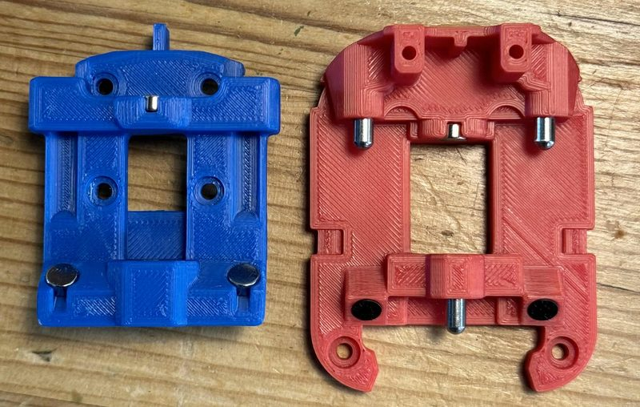</a> | [**StealthChanger**](https://github.com/DraftShift/StealthChanger) *DraftShift Design* Shuttle on the X carriage with pins and bushings. Fork of TapChanger with fewer parts. V1.1 parts do not fit V1.0. | pins and bushings | magnets | on the tool | [~5-12 s](https://github.com/Rich-Nelson/voron-stealthchanger-cmyk/tree/main/toolchange-tuning) | 6 | CoreXY, flying gantry, front MGN9 or MGN12 X rail | Klipper, klipper-toolchanger-easy | V1.1 [2024-06](https://github.com/DraftShift/StealthChanger/commit/785a7b19f94e84e928ec93a0ecc2198cabb71e5b) |  [🧡⁠223](https://www.printables.com/model/837771-stealthchanger-tool-changer) [⏯️⁠68.2K](https://www.youtube.com/shorts/ftX2LirTnoE) | [CAD](https://github.com/DraftShift/StealthChanger/tree/main/CAD) [STL](https://github.com/DraftShift/StealthChanger/tree/main/STLs) [BOM](https://github.com/DraftShift/StealthChanger/wiki/Bill-of-Materials) [Manual](https://github.com/DraftShift/StealthChanger/tree/main/Manual) [Wiki](https://github.com/DraftShift/StealthChanger/wiki) [Config](https://github.com/DraftShift/StealthChanger/tree/main/Klipper) [Files](https://www.printables.com/model/837771-stealthchanger-tool-changer) [Video](https://www.youtube.com/shorts/ftX2LirTnoE) | [Discord](https://discord.gg/draftshift) EN 4.4K [Facebook](https://www.facebook.com/groups/449879874593718/) EN |
| <a href="toolchangers/tapchanger/README.md">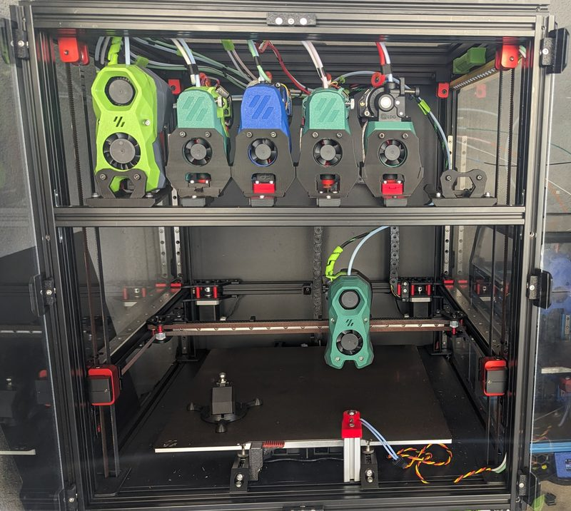</a> | [**TapChanger**](https://github.com/viesturz/tapchanger) *viesturz* Kinematic shuttle: the tool rides on bearings and rods. No servos and no wires on the shuttle. An optional lift bar dock adds static-gantry printers. | bearings on rods | magnets | on the tool | [~5-7 s](https://www.youtube.com/watch?v=IVhQJohzZ84) | 6 | CoreXY, any gantry | Klipper, klipper-toolchanger | V4.3 [2024-06](https://github.com/viesturz/tapchanger/commit/da002c4bdac88759e0f119470014cb8955da5879) |  [⏯️⁠54.8K](https://www.youtube.com/watch?v=EnS93NUZhsY) | [STL](https://github.com/viesturz/tapchanger/tree/main/Tapchanger/STL) [CAD](https://github.com/viesturz/tapchanger/tree/main/Tapchanger/CAD) [BOM](https://github.com/viesturz/tapchanger/blob/main/Tapchanger/BOM.md) [Manual](https://github.com/viesturz/tapchanger/blob/main/Tapchanger/Assembly.md) [Config](https://github.com/viesturz/tapchanger/tree/main/Klipper) [Video](https://www.youtube.com/playlist?list=PLqU7kX5nUJDRDw5z0NLwJ22OkV6fbjnSW) | [Discord](https://discord.gg/xmDWrYGwVJ) EN 2.2K |
| <a href="toolchangers/jubilee/README.md">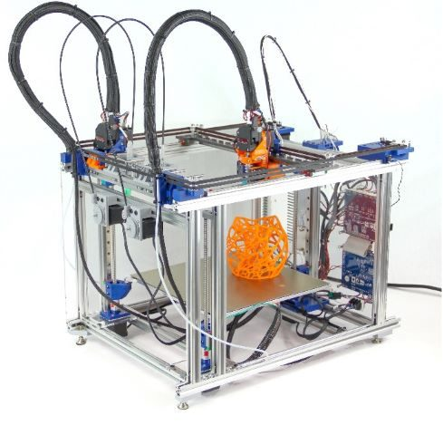</a> | [**Jubilee**](https://github.com/machineagency/jubilee) *Machine Agency (Joshua Vasquez)* Complete open multi-tool CoreXY platform (300×300×300 mm) for printing, plotting, and lab tools. A twist lock that senses torque pulls the tool plate onto a kinematic coupling. The tool plates fit E3D tools. | Maxwell and wedge plate | twist lock, motor | on the tool | — | 4 | own printer | RepRapFirmware | V2.2.2 [2021-10](https://github.com/machineagency/jubilee/releases/tag/v2.2.2) |  | [STEP](https://github.com/machineagency/jubilee/tree/main/frame) [Files](https://github.com/machineagency/jubilee/tree/main/tools) [BOM](https://docs.google.com/spreadsheets/d/1pRzBQxVzL9c4T9b1RrKvSjlSwJJhJ7NcbSV6iJUv0X0/edit#gid=0) [Manual](https://jubilee3d.com/index.php?title=Assembly_Instructions) [Wiki](https://jubilee3d.com/index.php?title=Main_Page) [Config](https://github.com/machineagency/jubilee/tree/main/software/duet_config_files) | [Discord](https://discord.gg/XkphRqb) EN 2K [Reddit](https://www.reddit.com/r/Jubilee3D/) EN |
| <a href="toolchangers/madmax/README.md">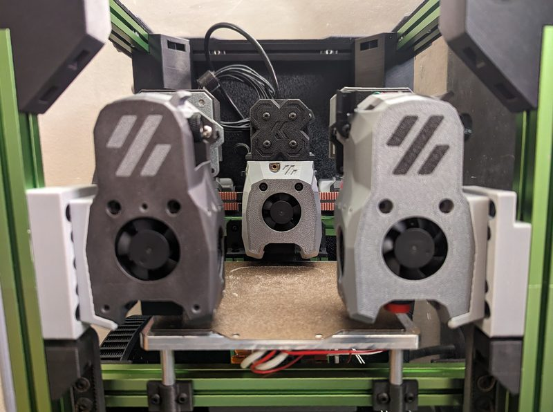</a> | [**MadMax**](https://github.com/zruncho3d/madmax) *Zruncho* Converts an existing CoreXY with a front MGN9 or MGN12 X rail, such as the Voron Trident and Voron 0 families. The docks attach to the front corners of the gantry, so the printer needs no front beam at gantry level. A magnetic Maxwell coupling of pins and screws holds the tool. | Maxwell | magnets | on the tool | [~4-5 s](https://github.com/zruncho3d/madmax/blob/main/DESIGN.md) | 2 | CoreXY, any gantry, front MGN9 or MGN12 X rail | Klipper, klipper-toolchanger | CAD [2025-03](https://github.com/zruncho3d/madmax/commit/b375a90) |  [⏯️⁠9.1K](https://www.youtube.com/watch?v=5X3DfevA83A) | [CAD](https://github.com/zruncho3d/madmax/tree/main/CAD) [STL](https://github.com/zruncho3d/madmax/tree/main/STL) [BOM](https://github.com/zruncho3d/madmax/blob/main/BOM.md) [Manual](https://github.com/zruncho3d/madmax/blob/main/INSTRUCTIONS.md) [Config](https://github.com/zruncho3d/madmax/blob/main/CONFIGURATION.md) [Video](https://www.youtube.com/watch?v=5X3DfevA83A) | [Discord](https://discord.gg/doomcube) EN 6.9K |
| <a href="toolchangers/daksh-v2/README.md">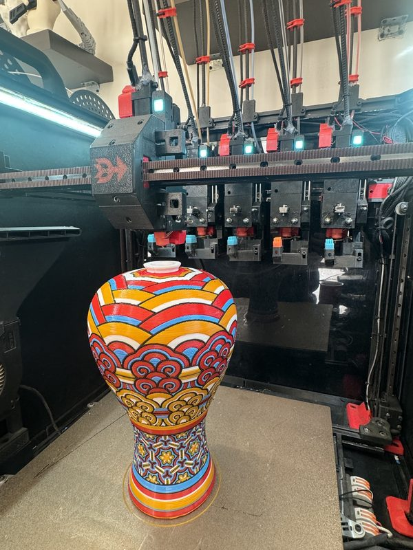</a> | [**DAKSH V2**](https://github.com/ankurv2k6/daksh-toolchanger-v2) *Ankur Verma (3D Unplugged)* Fully printed servo-less latch inspired by the Prusa XL. The carriage locks and unlocks a tool with an X move at the dock. Front-dock and rear-dock tool variants. | Maxwell | spring latch, the dock opens it | on the tool | [<2.5-4 s](https://github.com/ankurv2k6/daksh-toolchanger-v2) | 5 | CoreXY, any gantry | Klipper | CAD [2024-06](https://github.com/ankurv2k6/daksh-toolchanger-v2/commit/6f9bed3) |  [⏯️⁠13.2K](https://www.youtube.com/watch?v=v6QG2y4h36s) | [STL](https://github.com/ankurv2k6/daksh-toolchanger-v2/tree/main/STL) [CAD](https://github.com/ankurv2k6/daksh-toolchanger-v2/tree/main/CAD) [BOM](https://github.com/ankurv2k6/daksh-toolchanger-v2/tree/main/BOM) [Config](https://github.com/ankurv2k6/daksh-toolchanger-v2/tree/main/Klipper) [Video](https://www.youtube.com/watch?v=v6QG2y4h36s) | [Discord](https://discord.gg/wJqUzYxYXH) EN 927 |
| <a href="toolchangers/lineux-toolchanger/README.md">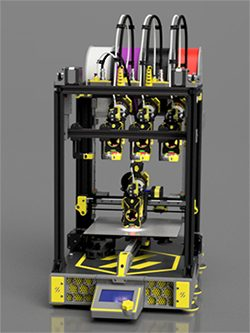</a> | [**Lineux Toolchanger**](https://github.com/3dfiyMyLife/Lineux-Toolchanger) *3dfiy My Life (formerly Bikin-Creative)* Front-mounted changer with Dockslide, a dock that slides away so the stock build volume stays usable. Tool changes run on plain Klipper macros (BTC) without a plugin. The Sling variant fits bed slingers, for example the Enderwire. | pins and bushings | magnets | on the tool | — | 5 | CoreXY, any gantry bed slinger | Klipper macros | CAD [2026-11](https://github.com/3dfiyMyLife/Lineux-Toolchanger/commit/1f25f49) |  [🧡⁠73](https://www.printables.com/model/1109204-lineux-tool-changer) [⏯️⁠48K](https://www.youtube.com/watch?v=LZql-NJ3cAA) | [CAD](https://github.com/3dfiyMyLife/Lineux-Toolchanger/tree/main/CAD) [STL](https://github.com/3dfiyMyLife/Lineux-Toolchanger/tree/main/STL) [BOM](https://github.com/3dfiyMyLife/Lineux-Toolchanger/tree/main/BOM) [Manual](https://github.com/3dfiyMyLife/Lineux-Toolchanger/tree/main/Manual) [Config](https://github.com/3dfiyMyLife/Lineux-Toolchanger/tree/main/Klipper) [Files](https://www.printables.com/model/1109204-lineux-tool-changer) [Video](https://www.youtube.com/watch?v=LZql-NJ3cAA) | [Discord](https://discord.gg/Xwqbjj4VjH) EN 1.1K |
| <a href="toolchangers/misschanger/README.md">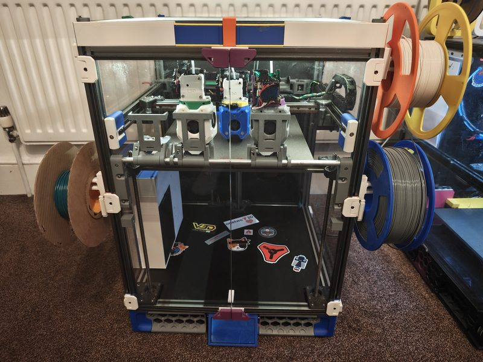</a> | [**MissChanger**](https://github.com/VIN-y/MissChanger) *VIN-y* Four corner pins with N52 magnets hold the tool, and a sliding ramp on the dock does the Z part of the docking move. You can convert back to a single Stealth Burner without tools. | pins and bushings | magnets | on the tool | — | 4 | CoreXY, flying gantry | Klipper, klipper-toolchanger fork | v1.2.2 [2025-07](https://github.com/VIN-y/MissChanger/releases/tag/release) |  | [CAD](https://github.com/VIN-y/MissChanger/tree/main/CADs) [STL](https://github.com/VIN-y/MissChanger/tree/main/STL_%26_Assembly) [Manual](https://github.com/VIN-y/MissChanger/blob/main/STL_%26_Assembly/MissChanger_Assembly_Manual.pdf) [BOM](https://github.com/VIN-y/MissChanger/blob/main/STL_%26_Assembly/BOM.pdf) [Config](https://github.com/VIN-y/MissChanger/tree/main/Klipper_Config) [FW](https://github.com/VIN-y/klipper-toolchanger) [Wiki](https://github.com/VIN-y/MissChanger/wiki) | [Discord](https://discord.gg/qrb6HXNYxs) EN 2.2K |
| <a href="toolchangers/clickchanger/README.md">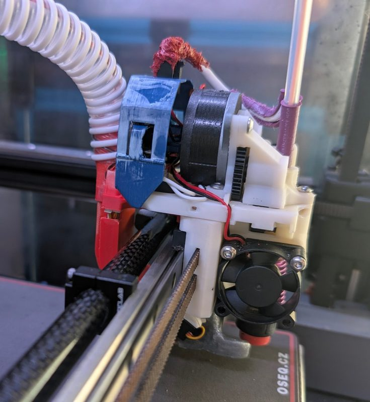</a> | [**ClickChanger**](https://github.com/viesturz/ClickChanger) *viesturz* Skeletal toolheads with one shared CPAP part-cooling fan in the shuttle, connected through a servo valve. Two variants: 4 mm pins with bushings, or bearings on square rods. | pins and bushings | magnets | on the tool | — | 6 | CoreXY, any gantry | Klipper, klipper-toolchanger | Bearings [2026-03](https://github.com/viesturz/ClickChanger/commit/06be510) |  [⏯️⁠21.9K](https://www.youtube.com/watch?v=bxkY-NfGOMM) | [CAD](https://github.com/viesturz/ClickChanger/tree/main/PinsVariant) [BOM](https://github.com/viesturz/ClickChanger/blob/main/README-pins.md#bom) [Manual](https://github.com/viesturz/ClickChanger/blob/main/CPAP.md) [Config](https://github.com/viesturz/klipper-toolchanger/tree/main/examples/z%20probe/probe%20on%20T0) [Video](https://www.youtube.com/playlist?list=PLqU7kX5nUJDT31KPcYAykZ2nuPKu_lhjn) | [Discord](https://discord.com/invite/xmDWrYGwVJ) EN 2.2K |
| <a href="toolchangers/blackbox/README.md">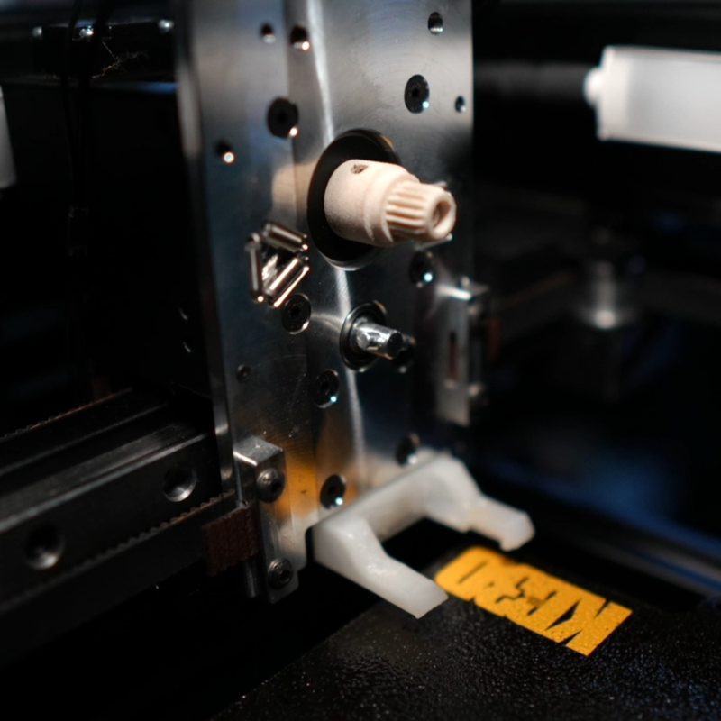</a> | [**Blackbox CE**](https://github.com/Kbreezy24/blackbox) *KB3D (Kbreezy24), orig. Marc Schömann* Enclosed CoreXY tool-changing printer, 300×300×275 mm, with passive water cooling on all tools. One extruder motor on the X carriage drives the Bondtech gears of the mounted tool. TAMV tool alignment. | kinematic, Jubilee wedge plate | twist lock, motor | gears on the tool, motor on the carriage | — | 5 | own printer | RepRapFirmware | V1.1 R1 [2025-02](https://github.com/Kbreezy24/blackbox/releases/tag/V1.1_R1) |  [⏯️⁠9.5K](https://www.youtube.com/watch?v=8-DRsm7HQsg) | [STEP](https://github.com/Kbreezy24/blackbox/tree/master/CAD) [STL](https://github.com/Kbreezy24/blackbox/tree/master/STLs) [DXF](https://github.com/Kbreezy24/blackbox/tree/master/DXF) [BOM](https://github.com/Kbreezy24/blackbox/tree/master/BOM) [Manual](https://github.com/Kbreezy24/blackbox/tree/master/Guides) [Config](https://github.com/Kbreezy24/blackbox/tree/master/Firmware%20+%20Slicer) [Video](https://www.youtube.com/watch?v=8-DRsm7HQsg) | [Discord](https://discord.gg/fVtg7ga) EN 619 |
| <a href="toolchangers/proforge/README.md">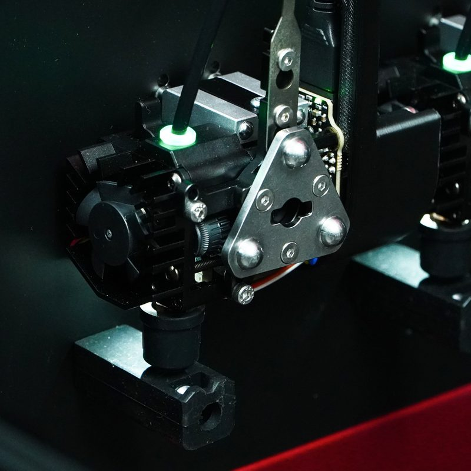</a> | [**ProForge**](https://github.com/Makertech3D/ProForge-5) *Makertech 3D* Quad-CoreXY tool-changer printers, sold as kits, with GPL-3.0 files. A servo turns a spring-loaded cam that locks the tool plate to a master plate on the carriage. The design draws on the E3D ToolChanger. ProForge 4 and 300 have full STEP models, ProForge 5 has only STLs. | kinematic, 3 balls | cam, servo | on the tool | [~7 s](https://www.youtube.com/watch?v=kZDpSXT7a8A) | 5 | own printer | Klipper, own macros | CAD [2026-10](https://github.com/Makertech3D/ProForge-5/commit/d349b1a4c0645e62c620552e2f37b31e9fdfbab9) |  [⏯️⁠34.2K](https://www.youtube.com/watch?v=xs0uCbAai-U) | [STEP (P4)](https://github.com/Makertech3D/Proforge-4/blob/main/Proforge%204.STEP.zip) [STEP (P300)](https://github.com/Makertech3D/ProForge300/blob/main/ProForge%20300.STEP.zip) [STL (P5)](https://github.com/Makertech3D/ProForge-5/tree/main/3D%20Printed%20Parts) [Config (P5)](https://github.com/Makertech3D/ProForge-5/tree/main/Config%20Files) [Manual (P5)](https://makertech-3d.docutize.io/kb/products/proforge-5/guides) [BOM (P300)](https://docs.google.com/spreadsheets/d/11tMFYWeuSdlYLyPoK7uE3kZFWasaUpS3Rfe4Z1YwD74/edit) [BOM (P4)](https://docs.google.com/spreadsheets/d/1Y5VUGZzWMNDWVGi7vUqABhzv31rmcmznpvWCIOyDUW4/edit?usp=sharing) [Video](https://www.youtube.com/watch?v=xs0uCbAai-U) | [Discord](https://discord.com/invite/FwgXFUw4R4) EN 501 [Facebook](https://www.facebook.com/groups/proforge4) EN [Facebook](https://www.facebook.com/groups/proforge5) EN [Facebook](https://www.facebook.com/groups/proforge300) EN |
| <a href="toolchangers/magswitch-toolchanger/README.md">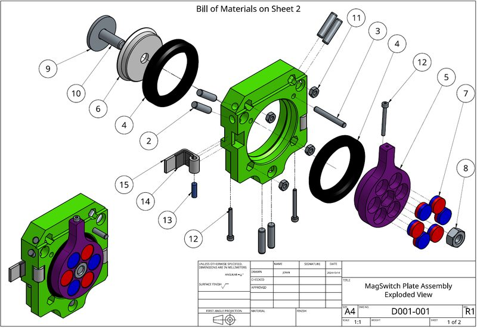</a> | [**MagSwitch Toolchanger**](https://github.com/jera-sea/MagSwitch-Toolchanger) *FrozenBubble (jera-sea)* Magswitch lock: a move against the dock turns an axial-flux-style ring of magnets (6 on the tool, 6 on the carriage) that pulls a printed kinematic coupling together. No servo and no motor. The author reports under 4 seconds per tool change. | kinematic, printed | rotating magnet ring, the dock turns it | on the tool | [~3-4 s](https://www.youtube.com/watch?v=9IsZiHBQRe4) | 2 | CoreXY, fixed gantry | Klipper, own macros | CAD [2026-08](https://cad.onshape.com/documents/0c01c7dd72676bd7e8323898/w/98418f33d58f65eefdbc478d/e/0eb2fa1c1fd68932fc3bc01e) |  [🧡⁠46](https://www.printables.com/model/920073-axial-flux-magswitch-toolchanger-built-on-ratrig-v/files) [⏯️⁠25.4K](https://youtube.com/shorts/qhA7fiyDxwE) | [STEP](https://www.printables.com/model/920073-axial-flux-magswitch-toolchanger-built-on-ratrig-v/files) [CAD](https://cad.onshape.com/documents/0c01c7dd72676bd7e8323898/w/98418f33d58f65eefdbc478d/e/0eb2fa1c1fd68932fc3bc01e) [Config](https://github.com/jera-sea/MagSwitch-Toolchanger/tree/main/config/toolchanger) [Video](https://www.youtube.com/watch?v=AjeeFMp68dM) | — |
| <a href="toolchangers/hydra/README.md">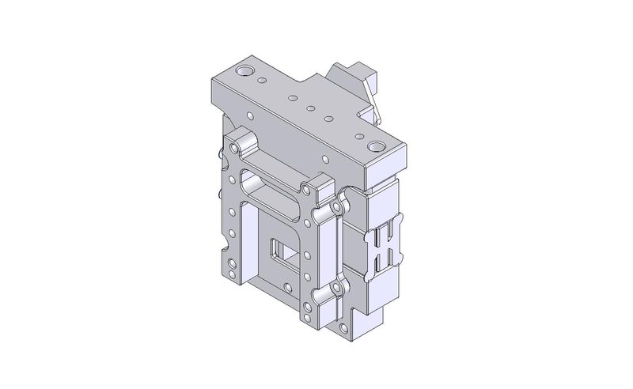</a> | [**Hydra**](https://github.com/alfskaar/Hydra) *alfskaar (Sun & Sea)* A minimal Stealthburner toolchanger for Voron 2.4: the 2025 version uses only 3 pins, 3 bushings per tool and a Voron extruder spring in the shuttle, with no bearings or adjustment screws. It runs on Marlin, with the author's tool-change code sent as a Marlin PR. | pins and bushings | magnets | on the tool | [~23-25 s](https://www.youtube.com/watch?v=dxacGMmqg3s) | 4 | CoreXY, flying gantry | Marlin | Log [2025-03](https://github.com/alfskaar/Hydra#readme) |  [⏯️⁠549](https://www.youtube.com/watch?v=dxacGMmqg3s) | [STL](https://github.com/alfskaar/Hydra/tree/main/STLs) [BOM](https://github.com/alfskaar/Hydra/tree/main/BOM) [FW](https://github.com/MarlinFirmware/Marlin/pull/26956) [Video](https://www.youtube.com/watch?v=dxacGMmqg3s) | — |
| <a href="toolchangers/maxwells-razor/README.md">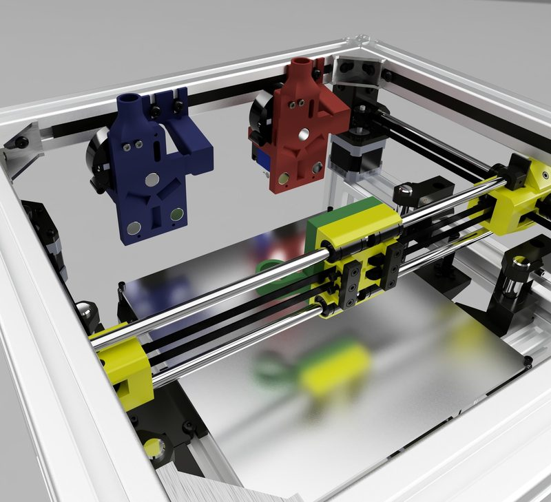</a> | [**Maxwell's Razor**](https://github.com/evanqhuang/maxwells-razor) *Evan Huang (evanqhuang)* A Maxwell kinematic coupling that is fully printed, with half-spheres instead of balls and dowels, held by 6 magnets on the carriage and 3 per tool. The docks are printed and purely mechanical. An optional 'metal' version uses a press-fit ball bearing and dowels. | Maxwell, printed | magnets | on the tool | [~9-11 s](https://github.com/user-attachments/assets/cc918851-83fa-48d1-bb6e-ddeb8659f7ee) | 2 | only HyperCube Evolution | Klipper | v1.0 [2025-06](https://github.com/evanqhuang/maxwells-razor/releases/tag/v1.0) |  | [STEP](https://github.com/evanqhuang/maxwells-razor/tree/main/v1/STEP) [STL](https://github.com/evanqhuang/maxwells-razor/tree/main/v1/STL) [Manual](https://github.com/evanqhuang/maxwells-razor/blob/main/v1/README.md) [Config](https://github.com/evanqhuang/maxwells-razor/tree/main/v1/klipper_config) [Files](https://www.thingiverse.com/thing:7074453) | — |
| <a href="toolchangers/sid-ender-3-toolchanger/README.md">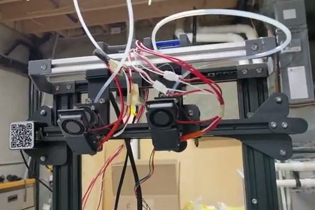</a> | [**Ender 3 Toolchanger**](https://github.com/aximaker/ender-3-toolchanger) *Sid Talks Linux (sidgames5 / Aximaker)* Ender 3 Pro conversion where toolheads under 31 mm wide slide into a side dock raised above the bed; tools include an extruder head, a BLTouch head and a paste dispenser head. | side dock rails | magnets | Bowden | — | 2 | only Ender 3 Pro | Klipper | Last seen [2025-07](https://github.com/aximaker/ender-3-toolchanger) |  [⏯️⁠1.1K](https://www.youtube.com/watch?v=ySKlhTlgmOc) | [CAD](https://github.com/aximaker/ender-3-toolchanger/tree/main/CAD) [BOM](https://github.com/aximaker/ender-3-toolchanger/tree/main/BOM) [Config](https://github.com/aximaker/ender-3-toolchanger/tree/main/Scripts) [Video](https://www.youtube.com/watch?v=ySKlhTlgmOc) [Video](https://www.youtube.com/watch?v=0ltWi0j6fQU) | — |
| <a href="toolchangers/zdehav-changer/README.md">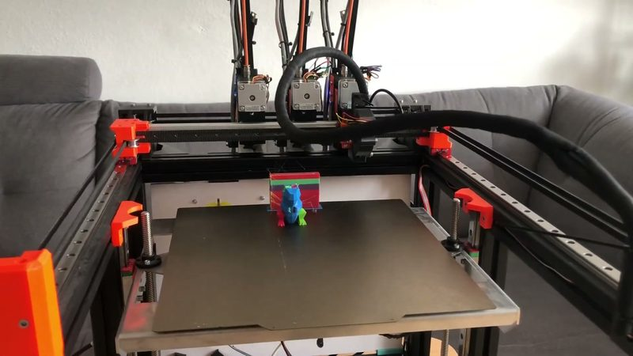</a> | [**ZdeHav Magnetic Toolchanger**](https://github.com/iZboxo/ZdeHav-Changer) *iZboxo (Zdeněk Havlát, ZdeHav)* Three cap nuts on the tool sit in three hex nuts on the carriage, and magnets hold the tool on the carriage and in the dock. Each tool has its own NEMA 14 extruder and a Bambu X1C hotend. The author's CAN toolhead board needs one cable per tool. | cap nuts in hex nuts | magnets | on the tool | [4.7 s](https://www.youtube.com/watch?v=-MmCY37FF60&t=28s) | 3 | — | Klipper | STEP [2026-05](https://github.com/iZboxo/ZdeHav-Changer/commit/3dd9a2f7bad247054bffe6d8fcf5d50fb235dd02) |  [⏯️⁠415](https://www.youtube.com/watch?v=-MmCY37FF60) | [STEP](https://github.com/iZboxo/ZdeHav-Changer/blob/main/ZdeHavChanger.step) [PCB](https://github.com/iZboxo/ZdeHav-Changer-PCB) [PCB BOM](https://izboxo.github.io/ZdeHav-Changer-PCB/bom/ibom.html) [Video](https://www.youtube.com/watch?v=-MmCY37FF60) | — |

## Hotend changers

One extruder stays on the carriage, and only the hotend changes. A servo or a pin on the dock opens the extruder as the hotend leaves.

| Photo | Hotend changer and why it’s interesting | Coupling | Lock | Change time | Tools | Printer | Firmware | Latest version | Stars Likes Views | Links | Groups |
| --- | --- | --- | --- | --- | --- | --- | --- | --- | --- | --- | --- |
| <a href="toolchangers/cxchanger/README.md">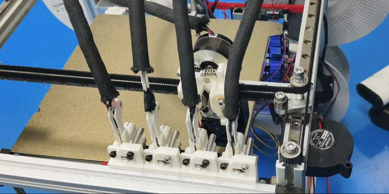</a> | [**CxChanger**](https://github.com/cx330-TXY/CxChanger) *cx330-TXY* Low-cost hotend changer: hotend modules are preheated in the dock before each change (OrcaSlicer ooze prevention), and the head's XY moves alone release the hotend and open the shared extruder. Docks plug parked nozzles with silicone and cool them with fans. | Maxwell | magnets | — | 4 | CoreXY, any gantry | Klipper macros | CAD [2026-09](https://github.com/cx330-TXY/CxChanger/commit/12e6b79) |  | [CAD](https://github.com/cx330-TXY/CxChanger/tree/main/CAD) [BOM](https://github.com/cx330-TXY/CxChanger/blob/main/5.5%E7%89%88%E6%9C%ACbom.xlsx) [Config](https://github.com/cx330-TXY/CxChanger/tree/main/klipper) [Manual](https://github.com/cx330-TXY/CxChanger/blob/main/EN-translation/README-EN.md) [Video](https://www.bilibili.com/video/BV1C15s6UERS/) | — |
| <a href="toolchangers/yudx/README.md">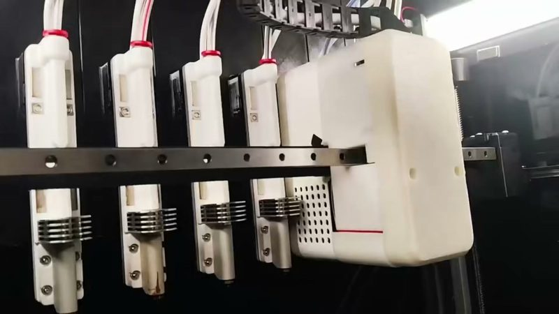</a> | [**YUDX**](https://github.com/dumplinglab/YUDX-tool-changer) *dumpling lab (dumplinglab)* INDX-inspired hotend changer: a one-way-bearing dock mechanism and a shared spring-and-gear 'dynamic extruder' on the head give about 1 s changes. Tools are Bambu hotends that can preheat while parked. The 2026.10 revision makes the Maxwell coupling clamp tighter as extrusion force rises. | Maxwell | push latch, the dock works it | [~1 s](https://github.com/dumplinglab/YUDX-tool-changer) | 7 | CoreXY, any gantry | RepRapFirmware, Klipper | CAD [2026-10](https://github.com/dumplinglab/YUDX-tool-changer/commit/52e8ef6) |  [⏯️⁠54.1K](https://www.youtube.com/watch?v=Vm4MIgcpSWI) | [STEP](https://github.com/dumplinglab/YUDX-tool-changer/tree/main/CAD) [STL](https://github.com/dumplinglab/YUDX-tool-changer/tree/main/STLs) [CAD](https://github.com/dumplinglab/YUDX-tool-changer/tree/main/CNC%20Parts) [BOM](https://github.com/dumplinglab/YUDX-tool-changer/blob/main/BOM.xlsx) [Manual](https://github.com/dumplinglab/YUDX-tool-changer/blob/main/YUDX%20Assembly%20Instruction.pdf) [Config](https://github.com/dumplinglab/YUDX-tool-changer/tree/main/Gcode/RepRapFirmware) [Video](https://www.youtube.com/watch?v=Vm4MIgcpSWI) | [Discord](https://discord.gg/huHw8kzNXp) EN 1.1K |
| <a href="toolchangers/medusahc/README.md">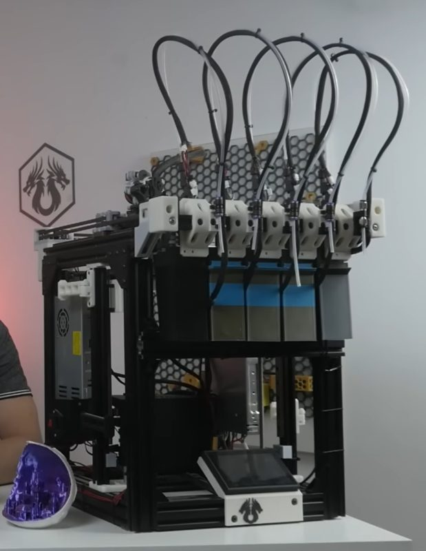</a> | [**MedusaHC**](https://github.com/Irbis3D/MedusaHC) *Irbis3D (Sergei Irbenek)* Budget hotend changer with one extruder on the head. As a hotend leaves, a servo opens the extruder lever. It started as an add-on for the Duender CoreXY and has its own Klipper module. | pins and magnets | magnets | [~6-7 s](https://www.youtube.com/watch?v=F2OpeA6CTm0&t=1831s) | 4 | CoreXY, fixed gantry | Klipper, own module | V0.2 [2026-08](https://github.com/Irbis3D/MedusaHC/blob/main/CHANGELOG.md) |  [🧡⁠150](https://www.printables.com/model/1799766-medusahc-v02-budget-hotend-toolchanger) [⏯️⁠104K](https://www.youtube.com/watch?v=rfKapRc0Rds) | [STEP](https://github.com/Irbis3D/MedusaHC/tree/main/STEP) [STL](https://github.com/Irbis3D/MedusaHC/tree/main/STLs) [Files](https://www.printables.com/model/1799766-medusahc-v02-budget-hotend-toolchanger) [BOM](https://docs.google.com/spreadsheets/d/1xkOzb10DBJzalW4n1tYroh-m_ZFsTQipC1BpUh5ZMWY/edit?gid=1290815756#gid=1290815756) [Manual](https://drive.google.com/file/d/1KkSGdeQZzl4gnCMKlBloHfCNIlD4JwAP/view) [Config](https://github.com/Irbis3D/MedusaHC/tree/main/config) [FW](https://github.com/Irbis3D/MedusaHC/tree/main/klippy) [Video](https://www.youtube.com/watch?v=hpV5Z1TnGdY) | [Discord](https://discord.gg/ae44FHv786) EN 2.9K |
| <a href="toolchangers/e3ng-toolchanger/README.md">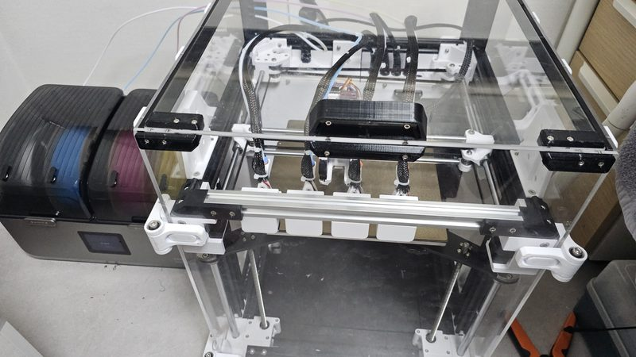</a> | [**E3NG Toolchanger**](https://github.com/emna2881/E3NG-Toolchanger) *EMNA (emna2881)* Hotend-swapping mod for the Ender-3 NG (E3NG by RH3D): one BMG-style extruder and a servo cam that opens the idler, with an extruder inspired by MedusaHC. Docks sit on an extrusion across the front, and tools are TZ-V6 3.0 hotends. Beta. | printed pocket | magnets | — | 5 | only Ender-3 NG | Klipper | Log [2026-07](https://github.com/emna2881/E3NG-Toolchanger/blob/main/Changelog.md) |  [🧡⁠315](https://www.printables.com/model/1786963-e3ng-toolchanger) [⏯️⁠5.2K](https://www.youtube.com/watch?v=WKBszFWHkbQ) | [STEP](https://github.com/emna2881/E3NG-Toolchanger/tree/main/CAD) [STL](https://github.com/emna2881/E3NG-Toolchanger/tree/main/STLs) [Files](https://www.printables.com/model/1786963-e3ng-toolchanger) [Manual](https://github.com/emna2881/E3NG-Toolchanger/blob/main/Docs/build_guide.md) [Video](https://www.youtube.com/watch?v=WKBszFWHkbQ) | — |
| <a href="toolchangers/lineux-hotswap/README.md">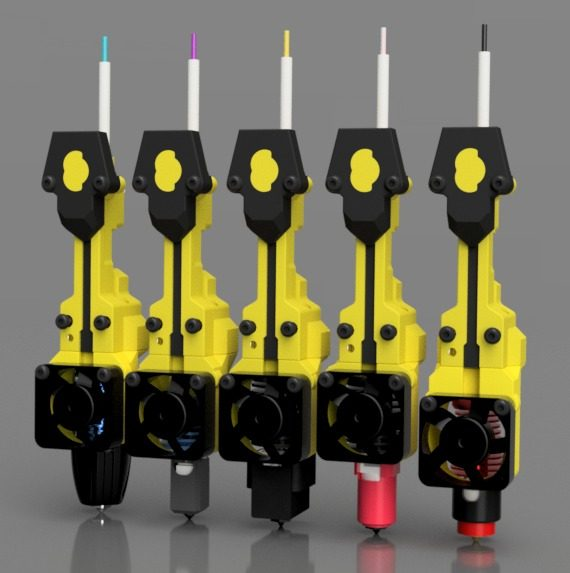</a> | [**Lineux Hotswap**](https://github.com/3dfiyMyLife/Lineux-Hotswap) *3dfiy My Life (3dfiyMyLife), Lineux team* Keeps the extruder, the part fan, and the toolboard on the carriage. A pin on the dock opens the extruder idler as the hotend leaves, so no servo is needed. | cap nuts in ring bushings | magnets | — | 4 | CoreXY, any gantry | Klipper macros | Beta r2 [2026-11](https://github.com/3dfiyMyLife/Lineux-Hotswap/commit/11f9fd8) |  [⏯️⁠19.9K](https://www.youtube.com/watch?v=sOk1mblA44g) | [CAD](https://github.com/3dfiyMyLife/Lineux-Hotswap/tree/main/CAD) [STL](https://github.com/3dfiyMyLife/Lineux-Hotswap/tree/main/STLs) [BOM](https://github.com/3dfiyMyLife/Lineux-Hotswap/tree/main/BOM) [Manual](https://github.com/3dfiyMyLife/Lineux-Hotswap/tree/main/Manuals) [Config](https://github.com/3dfiyMyLife/Lineux-Hotswap/tree/main/Klipper) [Video](https://www.youtube.com/watch?v=sOk1mblA44g) | [Discord](https://discord.gg/Xwqbjj4VjH) EN 1.1K |
| <a href="toolchangers/spark/README.md">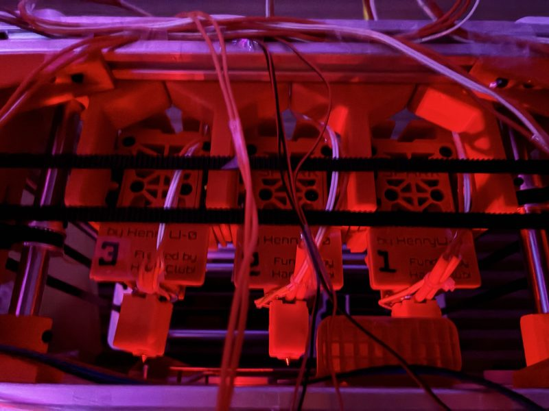</a> | [**Spark**](https://github.com/HenryLi-0/spark) *HenryLi-0 (Henry Li)* Self-built small CoreXY printer (Hack Club Blueprint). A spring latch, magnets, and a guide pick each tool from a docking bay, with no tool-lock motor. One extruder motor on the carriage drives gears on the mounted tool. | latch, magnets, and a guide | spring latch, the dock opens it | — | 3 | own printer | Klipper | CAD [2026-06](https://github.com/HenryLi-0/spark/commit/adde8fd71ce7f7aa92d4ec3a96945d84bf1aa9f9) |  [⏯️⁠136](https://www.youtube.com/watch?v=ktODngPF7UI) | [CAD](https://cad.onshape.com/documents/2b9020a6dc26b5be6a34c293/w/4aea5c5de00aac87e58ab18a/e/e89b27766cadd97ed58f8716) [STEP](https://github.com/HenryLi-0/spark/tree/main/CAD) [BOM](https://github.com/HenryLi-0/spark/blob/main/BOM.csv) [Config](https://github.com/HenryLi-0/spark/blob/main/firmware/config.cfg) [Video](https://www.youtube.com/watch?v=ktODngPF7UI) | — |
| <a href="toolchangers/chimera-toolchanger/README.md">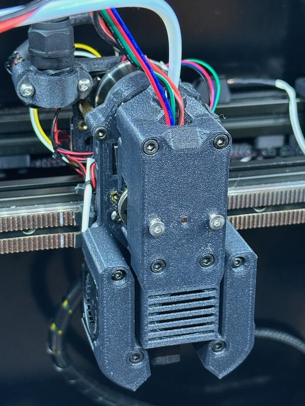</a> | [**Chimera Toolchanger**](https://github.com/rilmar/chimera-toolchanger) *rilmar (Riley Mahr)* Each tool carries its own HGX V2 gears and an X1-style hotend. One NEMA 14 motor on the carriage meshes with the gears of the mounted tool, so no extruder lever has to open. Built around the XOL carriage. The author calls it pre-alpha. | Maxwell | magnets | — | 2 | CoreXY, flying gantry | Klipper, klipper-toolchanger | V0.2.0 [2026-11](https://github.com/rilmar/chimera-toolchanger/commit/2680588585ebd09503c37582c294861874c5c36b) |  [⏯️⁠246](https://youtube.com/shorts/eu6byF03On0) | [STEP](https://github.com/rilmar/chimera-toolchanger/tree/main/CAD) [Files](https://github.com/rilmar/chimera-toolchanger/tree/main/3MF) [BOM](https://github.com/rilmar/chimera-toolchanger#bom) [Video](https://youtube.com/shorts/eu6byF03On0) | — |

## Concepts and prototypes

Designs that are worth a look but are not ready to build: the files are not public yet, or nobody other than the author built one.

| Photo | Toolchanger and why it’s interesting | Type | Status | Coupling | Lock | Latest version | Stars Likes Views | Links |
| --- | --- | --- | --- | --- | --- | --- | --- | --- |
| <a href="toolchangers/quindec/README.md">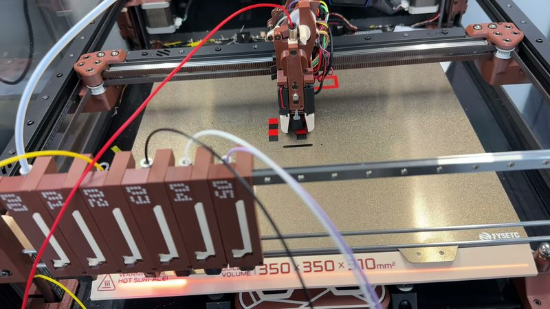</a> | [**Quindec**](https://github.com/srinn/quindec-toolchanger) *Srin (srinn)* High-density hotend changer that fits up to 15 tools on a 350 mm Voron 2.4, with common and cheap parts. Only the Tool Carriage Holder needs changes for other CoreXY printers. The author plans to open the files and now runs a closed beta. | Hotend changer | Closed beta, files not public | Maxwell | magnets | First video [2026-01](https://www.youtube.com/watch?v=Pdesunm21xI) |  [⏯️⁠8K](https://www.youtube.com/watch?v=941lrKT-fIY) | [BOM](https://docs.google.com/spreadsheets/d/1nJBv6CMfGyc1glqEgBD53pvTv2HscVy6cldr4ujhJa0/edit?usp=sharing) [Video](https://www.youtube.com/watch?v=-aM5X-14fe0) [Video](https://www.youtube.com/watch?v=941lrKT-fIY) |

## Legacy designs

Designs that are no longer developed. The files still work. A design is legacy in three cases: it has no update in two years and no group with 100 or more members, its repository is archived, or a newer version replaced it.

| Photo | Toolchanger and why it’s interesting | Type | Coupling | Lock | Change time | Latest version | Stars Likes Views | Links | Groups |
| --- | --- | --- | --- | --- | --- | --- | --- | --- | --- |
| <a href="toolchangers/e3d-toolchanger/README.md">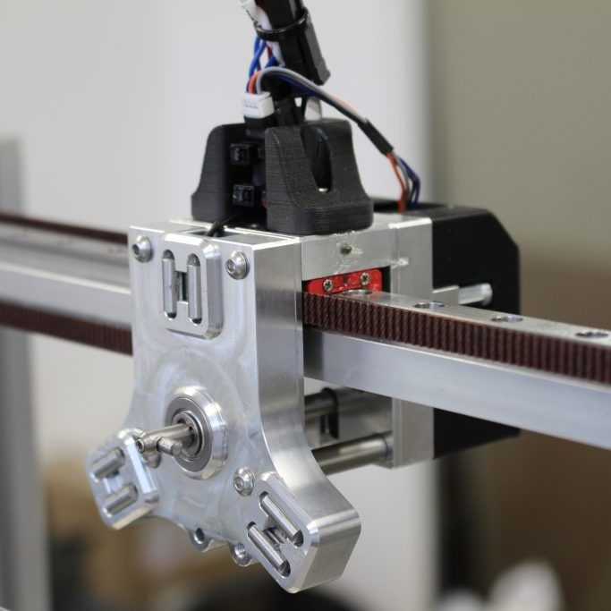</a> | [**E3D ToolChanger**](https://github.com/e3donline/ToolChanger) *E3D* The first widely sold open toolchanger. A tool plate puts 3 balls into 3 pairs of dowel pins, and a motor-driven shaft and ramp twist-locks it. Tools: Hemera, Revo Hemera XS, or V6 with Bowden. The kit is discontinued, but the files stay open. No update since 2024-03. | Tool changer | Maxwell | twist lock, motor | — | Roto tool [2024-03](https://www.printables.com/model/802772-e3d-revo-roto-toolchanger-mount) |  [🧡⁠48](https://www.printables.com/model/386697-motion-system-e3d-toolchanger) [⏯️⁠489K](https://www.youtube.com/watch?v=C7wYfaHT1g0) | [STEP](https://github.com/e3donline/ToolChanger/tree/master/STPs) [STL](https://github.com/e3donline/ToolChanger/tree/master/STLs) [Drawings](https://github.com/e3donline/ToolChanger/tree/master/PDFs) [Motion System files](https://github.com/e3donline/Motion-System) [Config](https://github.com/e3donline/RepRapFirmware-SD) [Slicer](https://github.com/e3donline/Slicer-Profiles) [Files](https://www.printables.com/model/386697-motion-system-e3d-toolchanger) [Video](https://www.youtube.com/watch?v=C7wYfaHT1g0) | — |
| <a href="toolchangers/wp-daksh/README.md">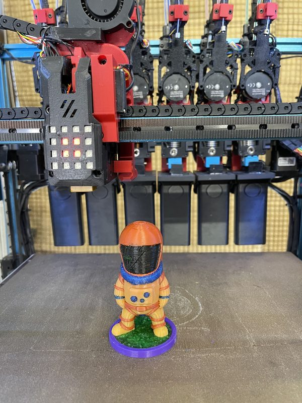</a> | [**WP-DAKSH**](https://github.com/ankurv2k6/wp-daksh-toolchanger) *Ankur Verma (3D Unplugged)* Earlier fully printed DAKSH generation for a Voron Trident. A single servo turns a camshaft that locks the tool. Nozzle wiper on the dock and a 4x4 LED matrix on the toolhead. No update since 2023-03. | Tool changer | pins in printed holes | cam, servo | [~10 s](https://github.com/ankurv2k6/wp-daksh-toolchanger) | STL [2023-03](https://github.com/ankurv2k6/wp-daksh-toolchanger/commit/a113e4f) |  [🧡⁠100](https://www.printables.com/model/565264-wp-daksh-3d-printed-tool-changer) [⏯️⁠60.8K](https://www.youtube.com/watch?v=1WqDcpxC3-o) | [STL](https://github.com/ankurv2k6/wp-daksh-toolchanger/tree/main/STL) [CAD](https://github.com/ankurv2k6/wp-daksh-toolchanger/tree/main/CAD) [Config](https://github.com/ankurv2k6/wp-daksh-toolchanger/tree/main/firmware/config) [BOM](https://docs.google.com/spreadsheets/d/12ISdJoCqgUTPsUwRrQ3VZWM-GBWw20C0cgHo7VGqMWU) [Files](https://www.printables.com/model/565264-wp-daksh-3d-printed-tool-changer) [Video](https://www.youtube.com/watch?v=1WqDcpxC3-o) | [Discord](https://discord.gg/Kz9VC8rWPg) EN 1.3K |

## Other designs

[OTHER.md](OTHER.md) keeps the other designs, for history: more legacy designs, concepts and prototypes, and designs that do not meet the [rules](CONTRIBUTING.md#what-belongs-in-the-catalog), each with the reason. The [gallery](GALLERY.md) shows the main picture of each design in the tables.

## Column notes

**Toolchanger:** If the design has a repository, the name links to it. Otherwise it links to the creator's project page. Within each table, rows are sorted by GitHub stars, highest first. Designs without a repository are sorted by their highest like count.

**Photo:** The main picture of the design. Click it to open the toolchanger page with all pictures, ports, variants, and builds by other people. The [gallery](GALLERY.md) shows the main pictures in one grid.

**Coupling:** How the tool locates on the carriage. Maxwell is three round parts that sit in three pairs of pins or grooves. Pins and bushings means that pins on one side slide into bushings on the other. Cap nuts in ring bushings means that three dome nuts each sit in the hole of a ring.

**Lock:** What holds the tool on the carriage, for example magnets, a latch, a cam, or a twist lock. After the comma, the cell says what opens the lock: a servo, a motor, or a move against the dock.

**Type:** The catalog table that fits the design. `Tool changer, Bowden` means that each tool has its own extruder on the frame.

**Status:** What is public for a concept or prototype: renders, files, a working build, or only a video.

**Extruder:** `on the tool` means that each tool carries its own extruder. `Bowden` means that each tool has its own extruder on the frame. In a hotend changer, one extruder on the carriage is shared by all hotends.

**Change time:** Seconds from the last move of the old tool to the first move of the new tool, without purge, prime, and heating. The link goes to the author's number or to the video that we timed. If sources differ, the cell shows the range. `—` means no reliable figure.

**Tools:** The most tools that the author shows working.

**Printer:** The printer type that the design fits. Flying gantry means that the gantry moves in Z, as in the Voron 2.4. Fixed gantry means that the bed moves in Z, as in the Voron Trident. A model name after `only` means that the parts fit only that printer. `own printer` means that the design is a whole printer. The toolchanger page lists the printers that the author names.

**Latest version:** The date of the latest public revision, linked to its source. A tagged release or a changelog comes first. Next is the last CAD commit or file upload, then the first publication. The label names the revision or the source: `CAD` or `STEP` for a CAD commit, `Files` for a file upload, `Log` for a changelog, and `Last seen` for the latest public post or video.

**Stars Likes Views:** The gray badge shows live GitHub stars. 🧡 is the like count on the author's Printables page. ⏯️ is the view count of the author's most-viewed video about the design. The counts were checked on 2026-10-24. Copies and remixes by other people do not count. `—` means no count was found.

**Links:** `STEP` is a STEP model, `CAD` is native CAD such as Fusion or FreeCAD, and `STL` is printable parts. `Files` is a mixed set of design files, `BOM` is the bill of materials, and `Manual` is the build guide. `Wiki`, `Config`, `FW` (firmware), and `Video` go to those pages. `—` means no direct link was found.

**Groups:** Builder communities for the design, its family, or its creator, checked 2026-10-24. Official groups come first, then the largest. Each line shows the platform, the language, and the member count. No number means the platform hides the count.

## How to contribute

Use the [Add a toolchanger](https://github.com/vvchik/awesome-toolchangers/issues/new?template=add-toolchanger.yml) form to suggest a design, or the [Fix a row](https://github.com/vvchik/awesome-toolchangers/issues/new?template=fix-row.yml) form to correct a value. Pull requests are welcome. [CONTRIBUTING.md](CONTRIBUTING.md) has the inclusion rules, the sections, and the picture rules.

## Similar projects

- [Awesome-Extruders](https://github.com/SartorialGrunt0/Awesome-Extruders): extruders for FDM printers.
- [Awesome-Toolheads](https://github.com/SartorialGrunt0/Awesome-Toolheads): toolheads, many of them used as tools in the changers here.
- [Awesome-Hotends](https://github.com/SartorialGrunt0/Awesome-Hotends): all-metal hotends, also the ones that the hotend changers here swap.
- [Awesome 3D Printers](https://github.com/vvchik/awesome-3d-printers): open-design printers, with the base printers of these changers and the whole printers built around them.

## License

The text of this list is licensed under [CC BY 4.0](LICENSE). The linked projects keep their own licenses. Pictures keep the rights of their authors, who are credited on each toolchanger page.
