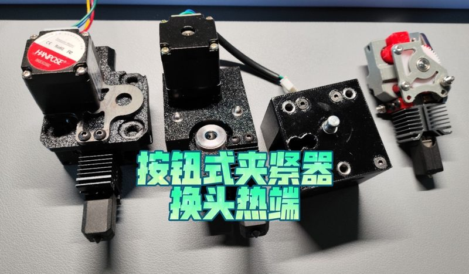
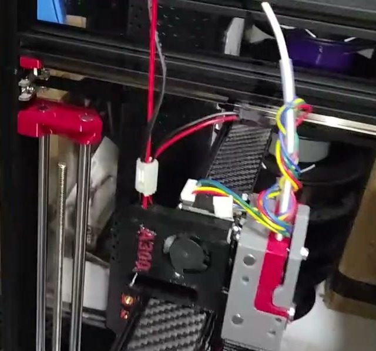
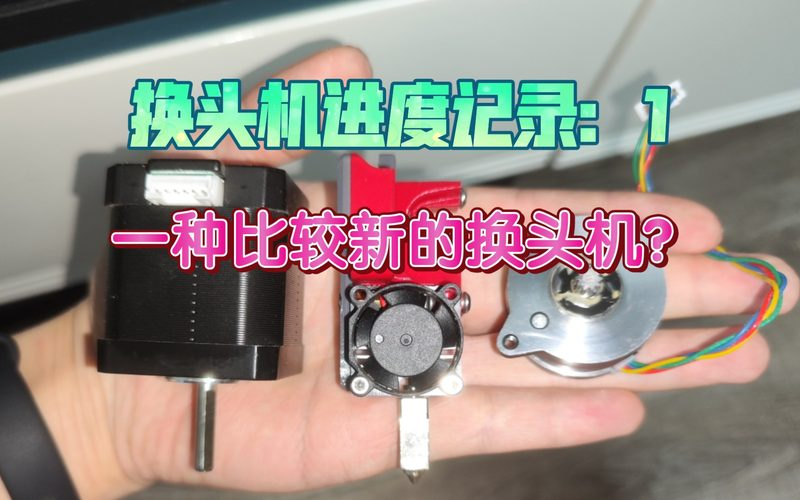
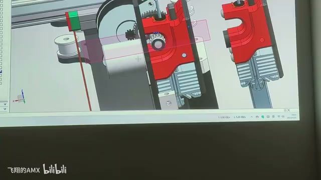

# A300 (AMX hotend changer)

[Catalog row](../../OTHER.md#amx-hotend-changer) · [Gallery](../../GALLERY.md)

| Field | Value |
| --- | --- |
| Section | Concepts and prototypes ([OTHER.md](../../OTHER.md)) |
| Project page | [https://www.bilibili.com/video/BV1cQYReYEu3/](https://www.bilibili.com/video/BV1cQYReYEu3/) |
| Author | 飞翔的AMX |
| About | DIY hotend-changing printer. It started in 2023 as a magnetic shared-extruder hotend changer and moved in 2024 to a push-button clamp. The machine frame and motion run, but no tool change has been shown. |
| Type | Tool changer |
| Status | Prototype, stopped, no files |
| Coupling | locating pins (0604, per the author's comment) |
| Lock | push-button clamp |
| Latest version | Last seen [2024-08](https://www.bilibili.com/video/BV141ecefE18/) |
| Stars Likes Views | [⏯️⁠8.5K](https://www.bilibili.com/video/BV1cQYReYEu3/) |
| Links | [Video (concept, 2023)](https://www.bilibili.com/video/BV1os4y1A71V/) [Video (button clamp)](https://www.bilibili.com/video/BV1ZAicejEcR/) [Video (machine moving)](https://www.bilibili.com/video/BV1cQYReYEu3/) |

## Pictures (4)

<table>
<tr><td align="center" width="33%"> Photo: <a href="https://www.bilibili.com/video/BV1ZAicejEcR/">飞翔的AMX</a></td><td align="center" width="33%"> Photo: <a href="https://www.bilibili.com/video/BV1cQYReYEu3/">飞翔的AMX</a></td><td align="center" width="33%"> Photo: <a href="https://www.bilibili.com/video/BV1os4y1A71V/">飞翔的AMX</a></td></tr>
<tr><td align="center" width="33%"> Photo: <a href="https://www.bilibili.com/video/BV1os4y1A71V/">飞翔的AMX</a></td></tr>
</table>
