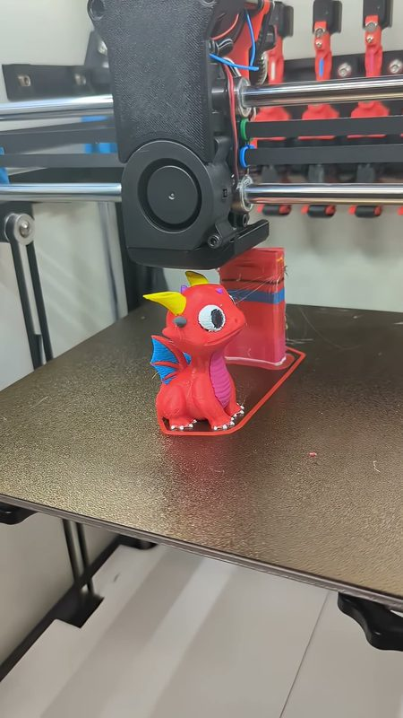
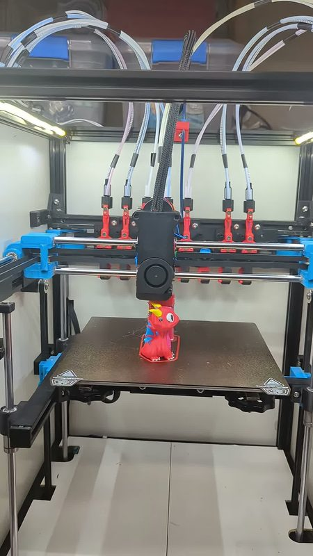
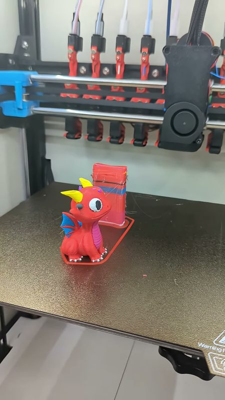
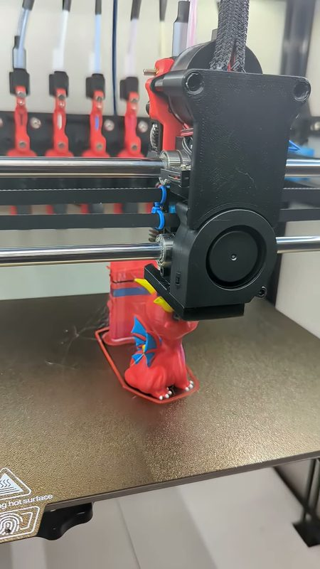
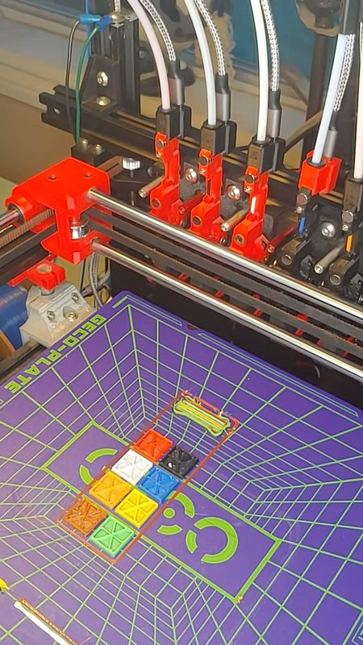
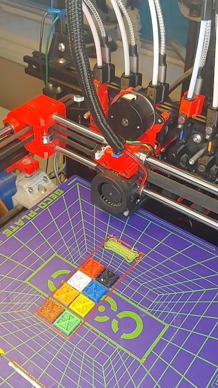
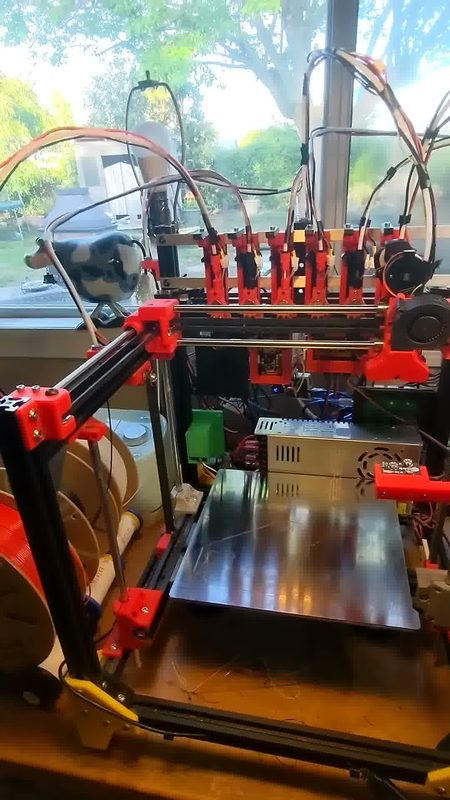

# BBox Toolchanger

[Catalog row](../../OTHER.md#bbox-toolchanger) · [Gallery](../../GALLERY.md)

| Field | Value |
| --- | --- |
| Section | Concepts and prototypes ([OTHER.md](../../OTHER.md)) |
| Project page | [https://github.com/sakitume/BBox-KTC](https://github.com/sakitume/BBox-KTC) |
| Author | sakitume (Sakitume Makes) |
| About | Hotend changer on the author's BBox CoreXY with up to 8 hotends in 3-bay dock triplets on a rear 2020 extrusion. A lateral move in the dock opens the extruder swing arm against a support rod, and screws on the back of the hotend attach magnetically to the dock. The author's own Klipper extension adds a web UI for dock and nozzle-probe calibration. |
| Type | Hotend changer |
| Status | Working build, no files |
| Coupling | — |
| Lock | extruder arm clamp, the dock opens it |
| Latest version | Last seen [2026-09](https://github.com/sakitume/BBox-KTC) |
| Stars Likes Views |  [⏯️⁠13.4K](https://youtube.com/shorts/VmdlazyVDtU) |
| Links | [FW](https://github.com/sakitume/BBox-KTC) [Video (8 tools)](https://youtube.com/shorts/hkDlSAuNtN8) [Video (in action)](https://www.youtube.com/watch?v=QqzJJWBxuFM) |

## Pictures (7)

<table>
<tr><td align="center" width="33%"> Photo: <a href="https://youtube.com/shorts/hkDlSAuNtN8">Sakitume Makes</a></td><td align="center" width="33%"> Photo: <a href="https://youtube.com/shorts/hkDlSAuNtN8">Sakitume Makes</a></td><td align="center" width="33%"> Photo: <a href="https://youtube.com/shorts/hkDlSAuNtN8">Sakitume Makes</a></td></tr>
<tr><td align="center" width="33%"> Photo: <a href="https://youtube.com/shorts/hkDlSAuNtN8">Sakitume Makes</a></td><td align="center" width="33%"> Photo: <a href="https://youtube.com/shorts/VmdlazyVDtU">Sakitume Makes</a></td><td align="center" width="33%"> Photo: <a href="https://youtube.com/shorts/VmdlazyVDtU">Sakitume Makes</a></td></tr>
<tr><td align="center" width="33%"> Photo: <a href="https://youtube.com/shorts/HrMd4Bo3BQE">Sakitume Makes</a></td></tr>
</table>
