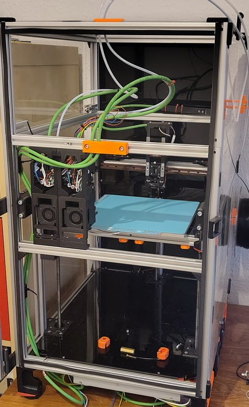

# BiteChanger

[Catalog row](../../OTHER.md#bitechanger) · [Gallery](../../GALLERY.md)

| Field | Value |
| --- | --- |
| Section | Legacy designs ([OTHER.md](../../OTHER.md)) |
| Project page | [https://github.com/gspck/bitechanger](https://github.com/gspck/bitechanger) |
| Author | gspck |
| About | Servo-locked toolchanger for the Voron Trident. Each tool has its own Sherpa Mini extruder and EBB CAN board. Dock and pickup use custom Klipper macros. The author marks it pre-alpha. No update since 2025-10. |
| Type | Tool changer |
| Coupling | — |
| Lock | servo lock |
| Change time | — |
| Latest version | prealpha.1 [2025-10](https://github.com/gspck/bitechanger/releases/tag/prealpha.1) |
| Stars Likes Views |  |
| Links | [STEP](https://github.com/gspck/bitechanger/blob/main/bitechanger.step) [Files](https://github.com/gspck/bitechanger/releases/tag/prealpha.1) [Config](https://github.com/gspck/bitechanger/tree/main/config) |
| Groups | [Discord](https://discord.gg/gnCjt6DTd2) EN 3 |

## Pictures (1)

<table>
<tr><td align="center" width="33%"> Photo: <a href="https://github.com/gspck/bitechanger">gspck</a></td></tr>
</table>
