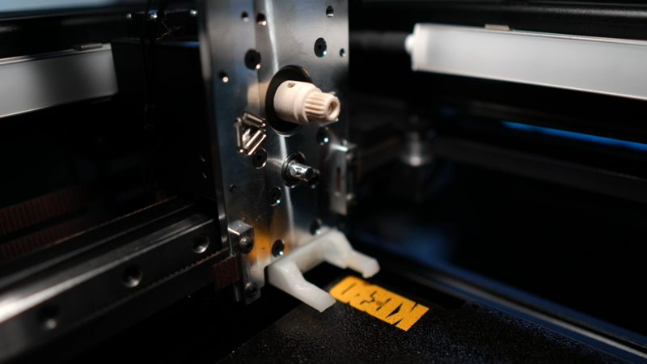
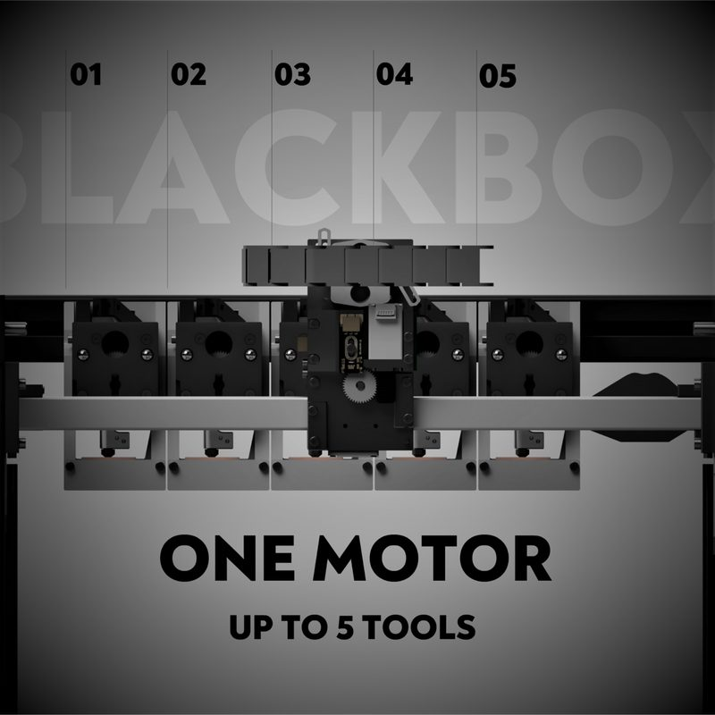
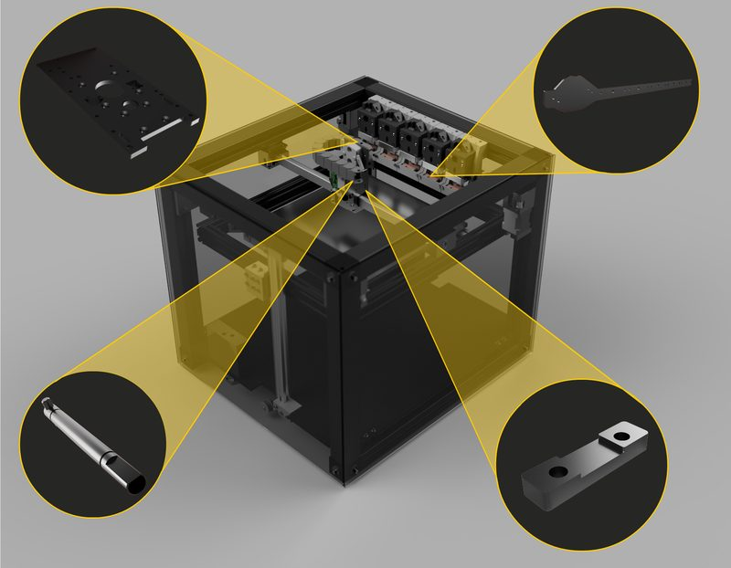
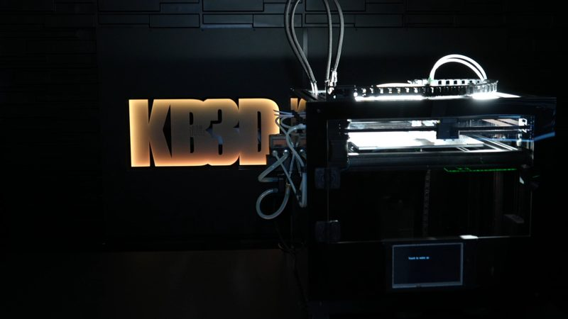
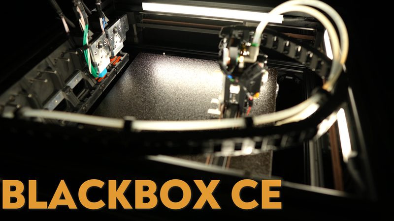
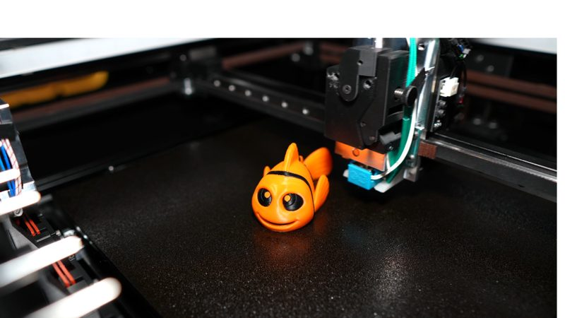
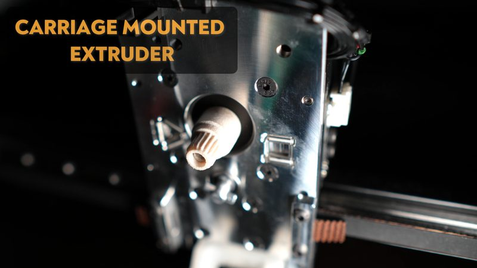
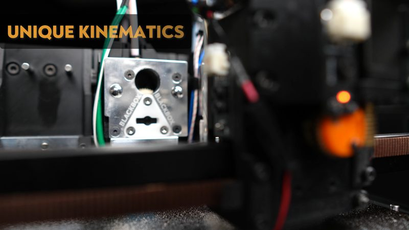
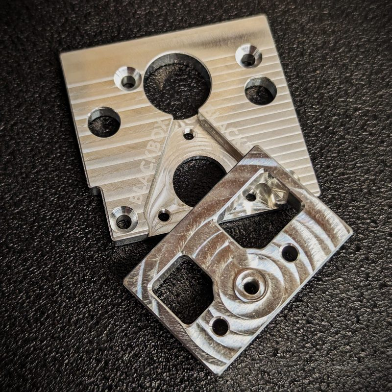

# Blackbox CE

[Catalog row](../../README.md#blackbox) · [Gallery](../../GALLERY.md)

| Field | Value |
| --- | --- |
| Section | Tool changers |
| Project page | [https://github.com/Kbreezy24/blackbox](https://github.com/Kbreezy24/blackbox) |
| Author | KB3D (Kbreezy24), orig. Marc Schömann |
| About | Enclosed CoreXY tool-changing printer, 300×300×275 mm, with passive water cooling on all tools. One extruder motor on the X carriage drives the Bondtech gears of the mounted tool. TAMV tool alignment. |
| Coupling | kinematic, Jubilee wedge plate |
| Lock | twist lock, motor |
| Extruder | gears on the tool, motor on the carriage |
| Change time | — |
| Tools | 5 |
| Base printers | Blackbox CE (own printer) |
| Firmware | RepRapFirmware |
| Latest version | V1.1 R1 [2025-02](https://github.com/Kbreezy24/blackbox/releases/tag/V1.1_R1) |
| Stars Likes Views |  [⏯️⁠9.5K](https://www.youtube.com/watch?v=8-DRsm7HQsg) |
| Links | [STEP](https://github.com/Kbreezy24/blackbox/tree/master/CAD) [STL](https://github.com/Kbreezy24/blackbox/tree/master/STLs) [DXF](https://github.com/Kbreezy24/blackbox/tree/master/DXF) [BOM](https://github.com/Kbreezy24/blackbox/tree/master/BOM) [Manual](https://github.com/Kbreezy24/blackbox/tree/master/Guides) [Config](https://github.com/Kbreezy24/blackbox/tree/master/Firmware%20+%20Slicer) [Video](https://www.youtube.com/watch?v=8-DRsm7HQsg) |
| Groups | [Discord](https://discord.gg/fVtg7ga) EN 619 |

## Pictures (9)

<table>
<tr><td align="center" width="33%"> Photo: <a href="https://kb-3d.com/store/blackbox-kits-packages/581-blackbox-toolchanger-kit-ce-configurator-1656901596020.html">KB3D</a></td><td align="center" width="33%"> Photo: <a href="https://web.archive.org/web/20240228105344/https://blackbox3d.xyz/">KB3D</a></td><td align="center" width="33%"> Photo: <a href="https://kb-3d.com/store/blackbox-kits-packages/27-blackbox-aluminum-printer-motion-kit-ce-1656897668589.html">KB3D</a></td></tr>
<tr><td align="center" width="33%"> Photo: <a href="https://kb-3d.com/store/blackbox-kits-packages/581-blackbox-toolchanger-kit-ce-configurator-1656901596020.html">KB3D</a></td><td align="center" width="33%"> Photo: <a href="https://kb-3d.com/store/blackbox-kits-packages/581-blackbox-toolchanger-kit-ce-configurator-1656901596020.html">KB3D</a></td><td align="center" width="33%"> Photo: <a href="https://kb-3d.com/store/blackbox-kits-packages/581-blackbox-toolchanger-kit-ce-configurator-1656901596020.html">KB3D</a></td></tr>
<tr><td align="center" width="33%"> Photo: <a href="https://kb-3d.com/store/blackbox-kits-packages/581-blackbox-toolchanger-kit-ce-configurator-1656901596020.html">KB3D</a></td><td align="center" width="33%"> Photo: <a href="https://kb-3d.com/store/blackbox-kits-packages/581-blackbox-toolchanger-kit-ce-configurator-1656901596020.html">KB3D</a></td><td align="center" width="33%"> Photo: <a href="https://kb-3d.com/store/blackbox-kits-packages/1009-aluminum-fdm-tool-pack-for-blackbox-revo-1656892588959.html">KB3D</a></td></tr>
</table>

## Notes

- On the original 2019 Blackbox, the designer measured a maximum tool change deviation of 22 microns with a camera. ([source](https://hackaday.io/project/57020/log/158928))
- Each dock has silicone nozzle wipers and a silicone leak blocker. ([source](https://github.com/Kbreezy24/blackbox/blob/master/Guides/Blackbox%20CE%2006%20-%20ToolDock_CE_v1.pdf))
