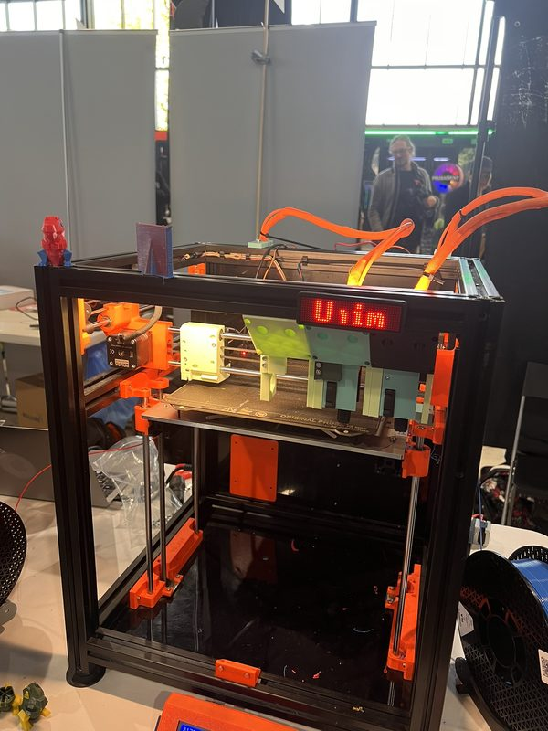
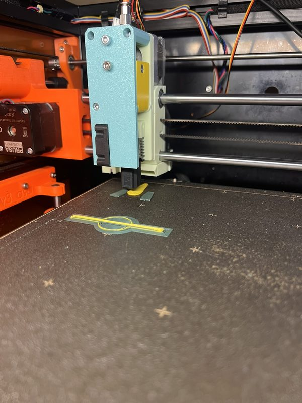

# The Cheapest ToolChanger

[Catalog row](../../OTHER.md#cheapest-toolchanger) · [Gallery](../../GALLERY.md)

| Field | Value |
| --- | --- |
| Section | Concepts and prototypes ([OTHER.md](../../OTHER.md)) |
| Project page | [https://www.printables.com/model/1294704-the-cheapest-toolchanger](https://www.printables.com/model/1294704-the-cheapest-toolchanger) |
| Author | iZboxo |
| About | Two M3 screw heads on each tool slide into 5.6 mm holes in the carriage; a sideways move wedges them under plastic, and a magnet holds the tool. The author presents it as an idea, not a kit. |
| Type | Tool changer |
| Status | Working build, head STEP only |
| Coupling | screws in holes |
| Lock | friction wedge and magnet |
| Latest version | Files [2025-05](https://www.printables.com/model/1294704-the-cheapest-toolchanger/files) |
| Stars Likes Views | [🧡⁠7](https://www.printables.com/model/1294704-the-cheapest-toolchanger/files) [⏯️⁠1.1K](https://www.youtube.com/watch?v=I-BHHJCY7Gk) |
| Links | [STEP](https://www.printables.com/model/1294704-the-cheapest-toolchanger/files) [Video](https://www.youtube.com/watch?v=I-BHHJCY7Gk) [Video 2](https://www.youtube.com/watch?v=M6zyjaL1JsE) |

## Pictures (2)

<table>
<tr><td align="center" width="33%"> Photo: <a href="https://www.printables.com/model/1294704-the-cheapest-toolchanger">iZboxo</a></td><td align="center" width="33%"> Photo: <a href="https://www.printables.com/model/1294704-the-cheapest-toolchanger">iZboxo</a></td></tr>
</table>
