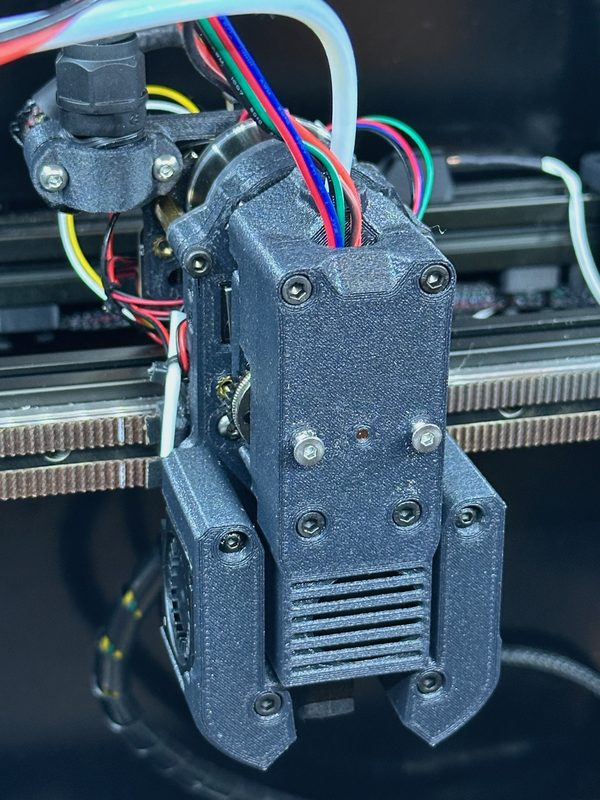
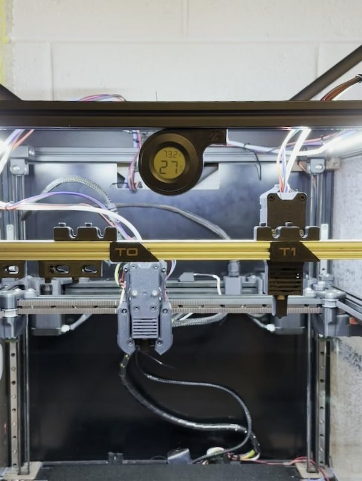
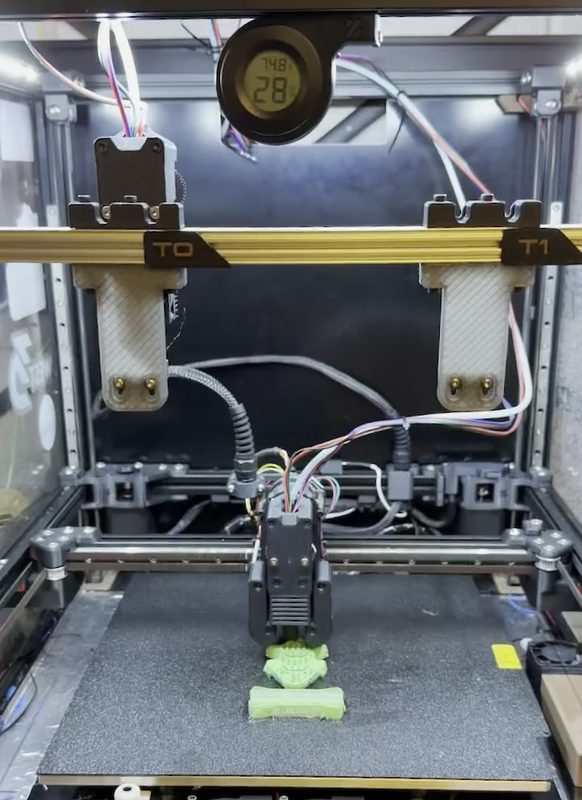
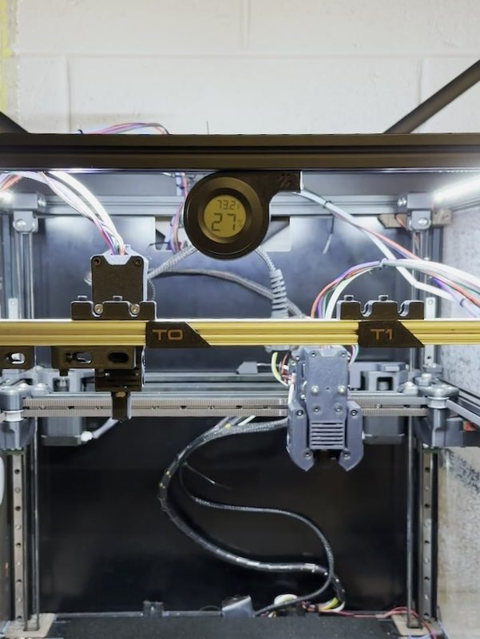
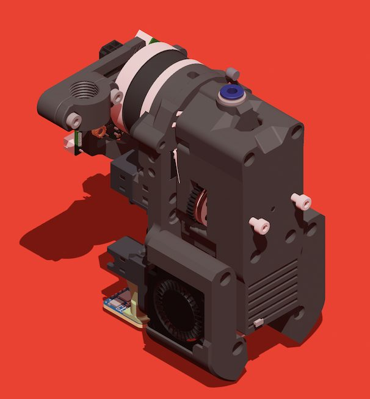
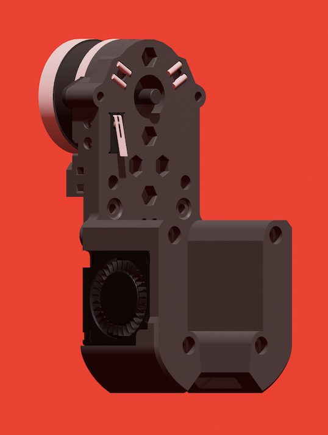
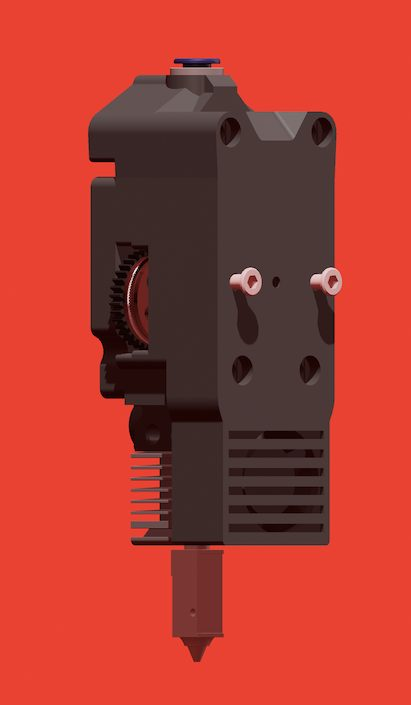
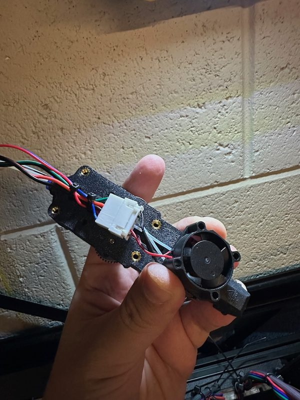

# Chimera Toolchanger

[Catalog row](../../README.md#chimera-toolchanger) · [Gallery](../../GALLERY.md)

| Field | Value |
| --- | --- |
| Section | Hotend changers |
| Project page | [https://github.com/rilmar/chimera-toolchanger](https://github.com/rilmar/chimera-toolchanger) |
| Author | rilmar (Riley Mahr) |
| About | Each tool carries its own HGX V2 gears and an X1-style hotend. One NEMA 14 motor on the carriage meshes with the gears of the mounted tool, so no extruder lever has to open. Built around the XOL carriage. The author calls it pre-alpha. |
| Coupling | Maxwell |
| Lock | magnets |
| Change time | — |
| Tools | 2 |
| Printer | CoreXY, flying gantry |
| Firmware | Klipper, klipper-toolchanger |
| Latest version | V0.2.0 [2026-11](https://github.com/rilmar/chimera-toolchanger/commit/2680588585ebd09503c37582c294861874c5c36b) |
| Stars Likes Views |  [⏯️⁠246](https://youtube.com/shorts/eu6byF03On0) |
| Links | [STEP](https://github.com/rilmar/chimera-toolchanger/tree/main/CAD) [Files](https://github.com/rilmar/chimera-toolchanger/tree/main/3MF) [BOM](https://github.com/rilmar/chimera-toolchanger#bom) [Video](https://youtube.com/shorts/eu6byF03On0) |
| Groups | — |

## Pictures (8)

<table>
<tr><td align="center" width="33%"> Photo: <a href="https://github.com/rilmar/chimera-toolchanger">rilmar</a></td><td align="center" width="33%"> Photo: <a href="https://github.com/rilmar/chimera-toolchanger">rilmar</a></td><td align="center" width="33%"> Photo: <a href="https://youtube.com/shorts/eu6byF03On0">Riley Mahr</a></td></tr>
<tr><td align="center" width="33%"> Photo: <a href="https://github.com/rilmar/chimera-toolchanger">rilmar</a></td><td align="center" width="33%"> Photo: <a href="https://github.com/rilmar/chimera-toolchanger">rilmar</a></td><td align="center" width="33%"> Photo: <a href="https://github.com/rilmar/chimera-toolchanger">rilmar</a></td></tr>
<tr><td align="center" width="33%"> Photo: <a href="https://github.com/rilmar/chimera-toolchanger">rilmar</a></td><td align="center" width="33%"> Photo: <a href="https://github.com/rilmar/chimera-toolchanger">rilmar</a></td></tr>
</table>

## Notes

- Printers that the author names: Voron 2.4. ([source](https://github.com/rilmar/chimera-toolchanger))
