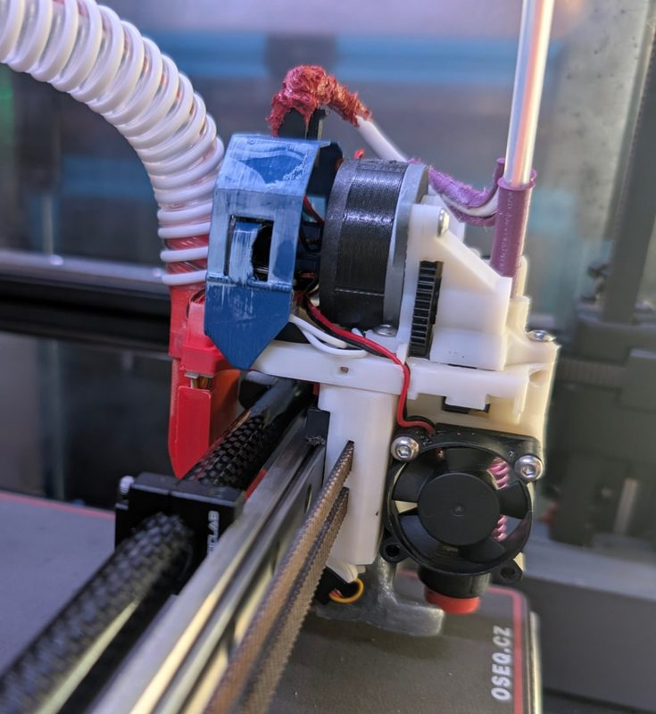
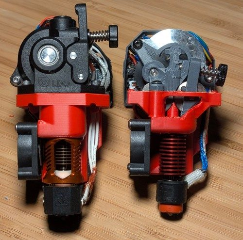
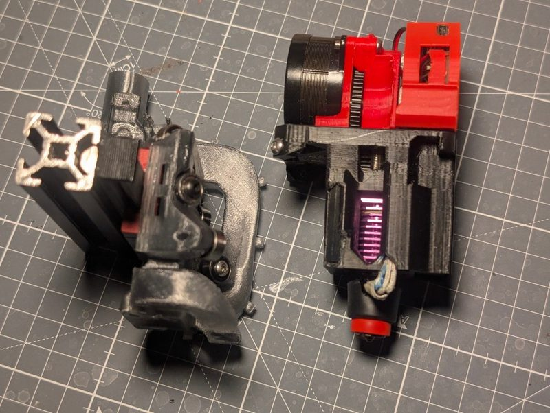
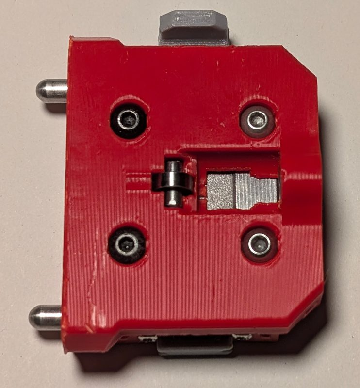
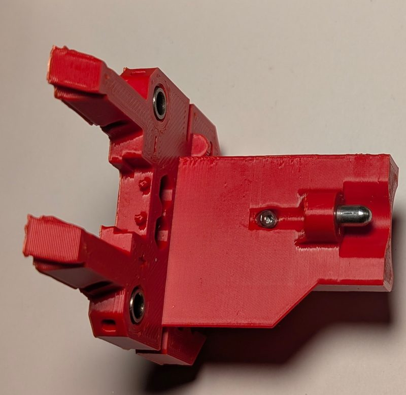
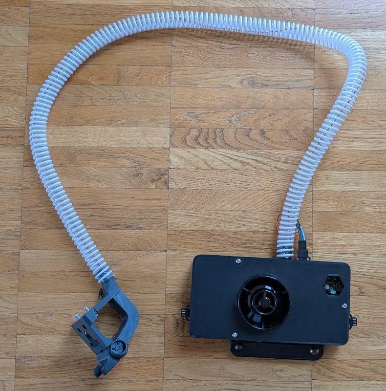
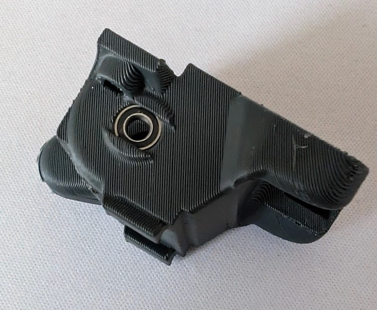
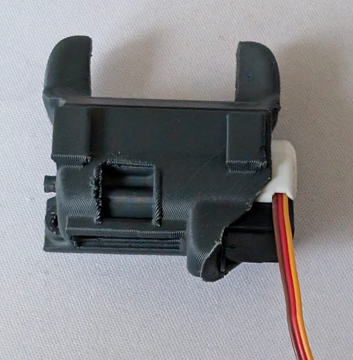

# ClickChanger

[Catalog row](../../README.md#clickchanger) · [Gallery](../../GALLERY.md)

| Field | Value |
| --- | --- |
| Section | Tool changers |
| Project page | [https://github.com/viesturz/ClickChanger](https://github.com/viesturz/ClickChanger) |
| Author | viesturz |
| About | Skeletal toolheads with one shared CPAP part-cooling fan in the shuttle, connected through a servo valve. Two variants: 4 mm pins with bushings, or bearings on square rods. |
| Coupling | pins and bushings |
| Lock | magnets |
| Extruder | on the tool |
| Change time | — |
| Tools | 6 |
| Printer | CoreXY, any gantry |
| Firmware | Klipper, klipper-toolchanger |
| Latest version | 2.0 [2025-06](https://github.com/viesturz/ClickChanger/commit/2d7431fe501753efbc479ef5f6368b5cc72cc0d2) |
| Stars Likes Views |  [⏯️⁠21.9K](https://www.youtube.com/watch?v=bxkY-NfGOMM) |
| Links | [CAD](https://github.com/viesturz/ClickChanger/tree/main/PinsVariant) [BOM](https://github.com/viesturz/ClickChanger/blob/main/README-pins.md#bom) [Manual](https://github.com/viesturz/ClickChanger/blob/main/CPAP.md) [Config](https://github.com/viesturz/klipper-toolchanger/tree/main/examples/z%20probe/probe%20on%20T0) [Video](https://www.youtube.com/playlist?list=PLqU7kX5nUJDT31KPcYAykZ2nuPKu_lhjn) |
| Groups | [Discord](https://discord.com/invite/xmDWrYGwVJ) EN 2.2K |

## Pictures (8)

<table>
<tr><td align="center" width="33%"> Photo: <a href="https://github.com/viesturz/ClickChanger">viesturz</a></td><td align="center" width="33%"> Photo: <a href="https://github.com/viesturz/ClickChanger">viesturz</a></td><td align="center" width="33%"> Photo: <a href="https://github.com/viesturz/ClickChanger">viesturz</a></td></tr>
<tr><td align="center" width="33%"> Photo: <a href="https://github.com/viesturz/ClickChanger">viesturz</a></td><td align="center" width="33%"> Photo: <a href="https://github.com/viesturz/ClickChanger">viesturz</a></td><td align="center" width="33%"> Photo: <a href="https://github.com/viesturz/ClickChanger">viesturz</a></td></tr>
<tr><td align="center" width="33%"> Photo: <a href="https://github.com/viesturz/ClickChanger">viesturz</a></td><td align="center" width="33%"> Photo: <a href="https://github.com/viesturz/ClickChanger">viesturz</a></td></tr>
</table>

## Notes

- Tool 0 probes the bed with a hotend nozzle probe (Revo PZ) or with a Beacon or Cartographer, so the dock motion does not need to be smooth. ([source](https://github.com/viesturz/ClickChanger))
- Printers that the author names: Voron 2.4. ([source](https://github.com/viesturz/ClickChanger))
- Version 2.0 requires a CPAP fan, about 1 m of 15 mm tube, and a 2 g micro servo that drives the air valve. ([source](https://github.com/viesturz/ClickChanger/blob/main/README-pins.md))
- Supported hotends are Revo Voron, Dragon or Dragon High Flow, and Rapido HF (not UHF), and a Revo PZ on T0 can act as the bed probe. ([source](https://github.com/viesturz/ClickChanger/blob/main/README-pins.md))
