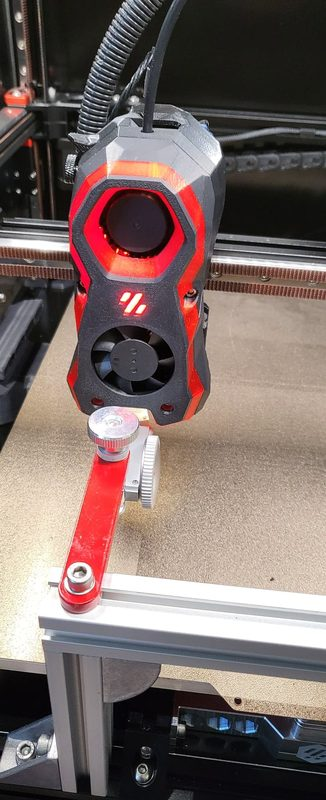
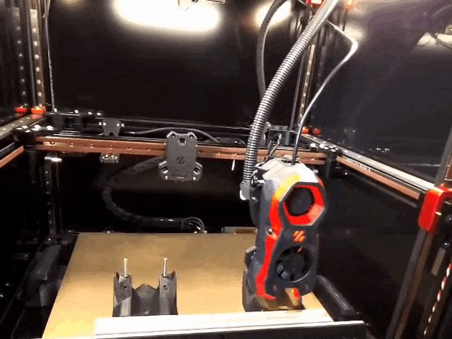

# Constellation

[Catalog row](../../OTHER.md#constellation) · [Gallery](../../GALLERY.md)

| Field | Value |
| --- | --- |
| Section | Concepts and prototypes ([OTHER.md](../../OTHER.md)) |
| Project page | [https://github.com/ben5459/Constellation](https://github.com/ben5459/Constellation) |
| Author | ben5459 (Ben Nickolay) |
| About | Carriage-side changer with no wires to the X carriage: tools are docked at the front and get power and signals through pogo pins on the tool. A toggle lock with no servo or stepper reports lock and tool state through slider switches. Each tool is a full Stealthburner with its own Clockwork 2. |
| Type | Tool changer |
| Status | Working build, no files |
| Coupling | Maxwell |
| Lock | toggle latch with magnets |
| Latest version | Last seen [2022-11](https://github.com/ben5459/Constellation) |
| Stars Likes Views |  |
| Links | [Wiki](https://github.com/ben5459/Constellation/wiki) [BOM](https://github.com/ben5459/Constellation/wiki/BOM) [Config](https://github.com/ben5459/Klipper_ToolChanger) [Specs](https://github.com/ben5459/Constellation/wiki/Current-Specifications) [Testing](https://github.com/ben5459/HybridManufacturingPlatform/tree/main/Automatic%20Tool%20Changer/Testing/Repeatability) |

## Pictures (2)

<table>
<tr><td align="center" width="33%"> Photo: <a href="https://github.com/ben5459/HybridManufacturingPlatform/tree/main/Automatic%20Tool%20Changer/Testing/Repeatability">ben5459</a></td><td align="center" width="33%"> Photo: <a href="https://github.com/ben5459/Constellation">ben5459</a></td></tr>
</table>
