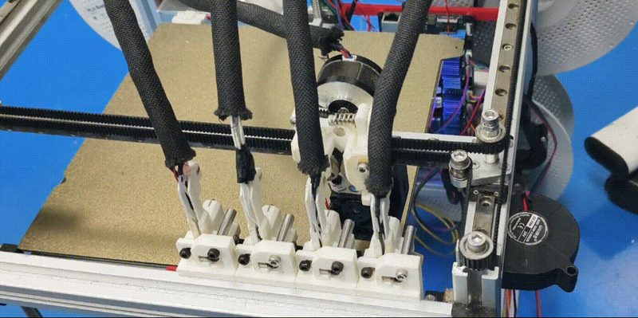
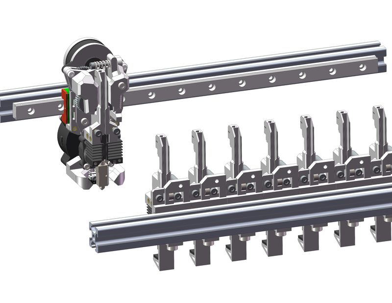
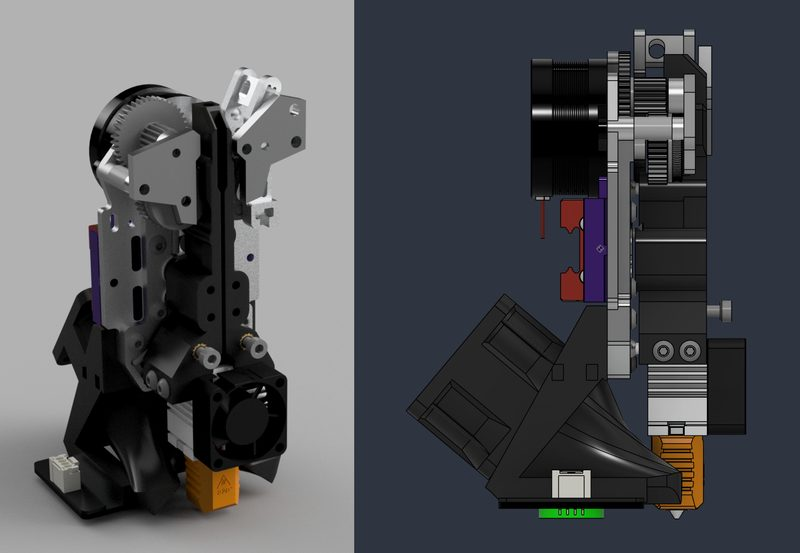

# CxChanger

[Catalog row](../../README.md#cxchanger) · [Gallery](../../GALLERY.md)

| Field | Value |
| --- | --- |
| Section | Hotend changers |
| Project page | [https://github.com/cx330-TXY/CxChanger](https://github.com/cx330-TXY/CxChanger) |
| Author | cx330-TXY |
| About | Low-cost hotend changer: hotend modules are preheated in the dock before each change (OrcaSlicer ooze prevention), and the head's XY moves alone release the hotend and open the shared extruder. Docks plug parked nozzles with silicone and cool them with fans. |
| Coupling | Maxwell |
| Lock | magnets |
| Change time | — |
| Tools | 4 |
| Printer | CoreXY, any gantry |
| Firmware | Klipper macros |
| Latest version | CAD [2026-09](https://github.com/cx330-TXY/CxChanger/commit/12e6b79) |
| Stars Likes Views |  |
| Links | [CAD](https://github.com/cx330-TXY/CxChanger/tree/main/CAD) [BOM](https://github.com/cx330-TXY/CxChanger/blob/main/5.5%E7%89%88%E6%9C%ACbom.xlsx) [Config](https://github.com/cx330-TXY/CxChanger/tree/main/klipper) [Manual](https://github.com/cx330-TXY/CxChanger/blob/main/EN-translation/README-EN.md) [Video](https://www.bilibili.com/video/BV1C15s6UERS/) |
| Groups | — |

## Pictures (3)

<table>
<tr><td align="center" width="33%"> Photo: <a href="https://github.com/cx330-TXY/CxChanger">cx330-TXY</a></td><td align="center" width="33%"> Photo: <a href="https://github.com/cx330-TXY/CxChanger">cx330-TXY</a></td><td align="center" width="33%"> Version: Ronin Photo: <a href="https://github.com/jaak0b/Ronin">jaak0b</a></td></tr>
</table>

## Notes

- Printers that the author names: Voron 2.4, Voron Trident, other printers with an XY head. ([source](https://github.com/cx330-TXY/CxChanger))

## Ports and variants

- [Rear-mounted CxChanger](https://github.com/ers-ye/cxchanger), *叶-3d (GitHub ers-ye, 叶3d)*. Rear-mounted version of the CxChanger preheated hotend changer. It has CNC parts for carbon fibre or aluminium.
- [Ronin](https://github.com/jaak0b/Ronin), *jaak0b (Jakob)*. Hotend changer for the Monolith gantry, derived from CxChanger. The coupling, the magnets, the CNC backplate, the hotend mount, and the extruder position are new, so no part fits the original CxChanger. The author says not to build it yet.

## Builds by other people

- [Voron 2.4 and Trident with CxChanger](https://www.bilibili.com/video/BV1f7h86cETC/), *阿国匠*. Voron 2.4 and Voron Trident fitted with the CxChanger hotend changer, with automatic tool offset calibration (BV11UbQ6aEJB).
