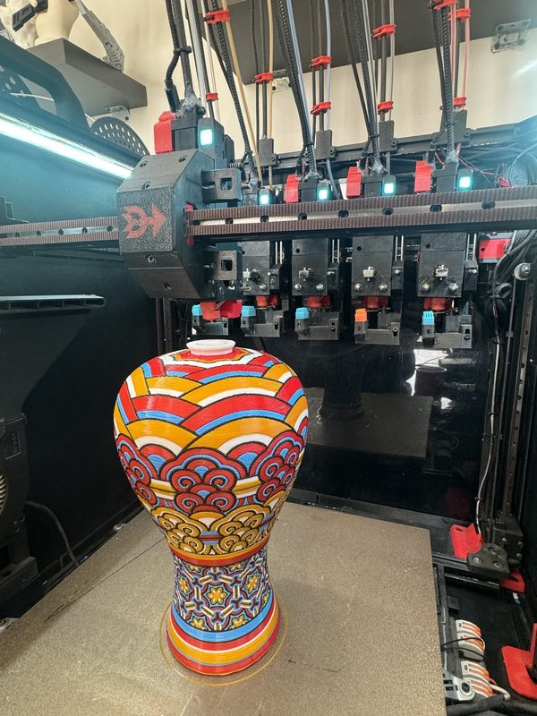
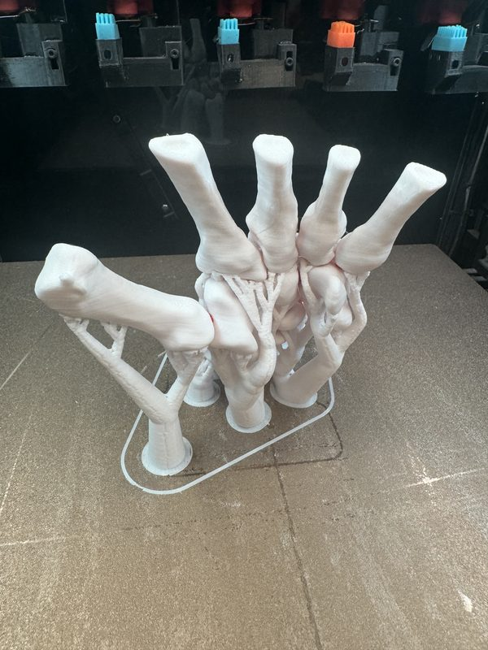
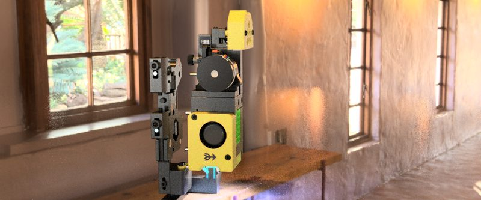
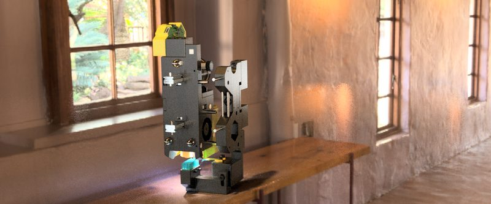
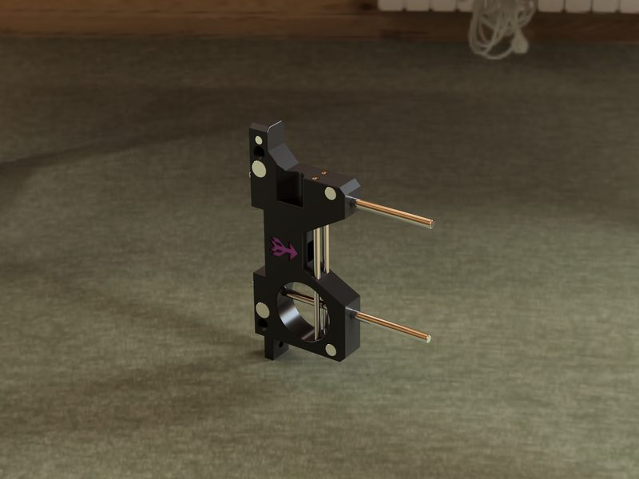
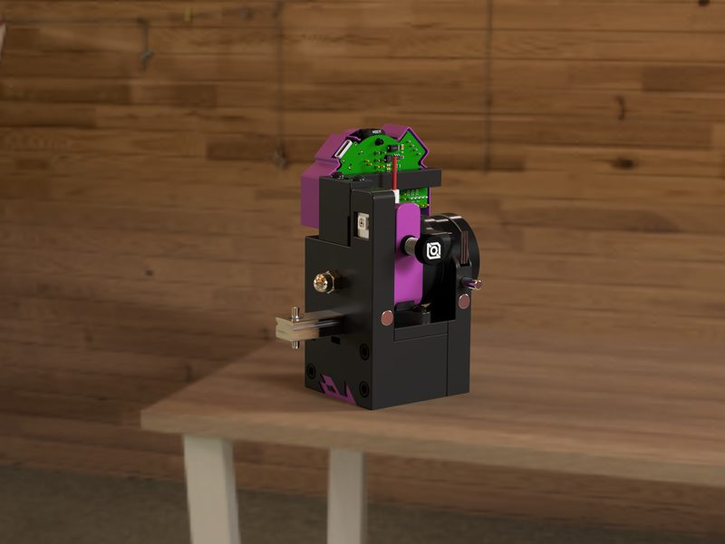
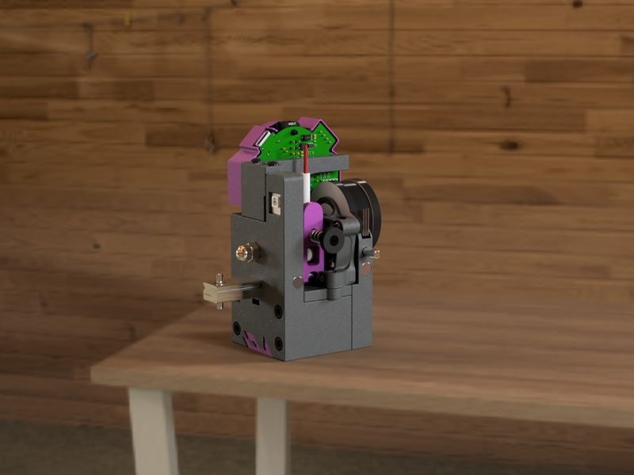
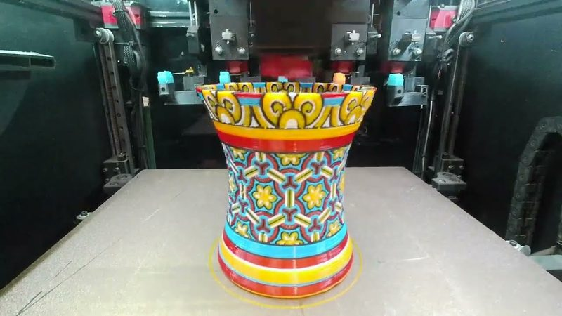
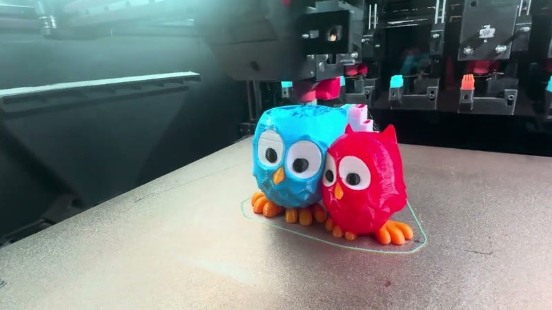

# DAKSH V2

[Catalog row](../../README.md#daksh-v2) · [Gallery](../../GALLERY.md)

| Field | Value |
| --- | --- |
| Section | Tool changers |
| Project page | [https://github.com/ankurv2k6/daksh-toolchanger-v2](https://github.com/ankurv2k6/daksh-toolchanger-v2) |
| Author | Ankur Verma (3D Unplugged) |
| About | Fully printed servo-less latch inspired by the Prusa XL. The carriage locks and unlocks a tool with an X move at the dock. Front-dock and rear-dock tool variants. |
| Coupling | — |
| Lock | spring latch, the dock opens it |
| Extruder | on the tool |
| Change time | [<2.5-4 s](https://github.com/ankurv2k6/daksh-toolchanger-v2) |
| Tools | 5 |
| Base printers | Voron Trident, Voron 2.4, Voron 1.8, RatRig V-Core 3 |
| Firmware | Klipper |
| Latest version | CAD [2024-06](https://github.com/ankurv2k6/daksh-toolchanger-v2/commit/6f9bed3) |
| Stars Likes Views |  [⏯️⁠13.2K](https://www.youtube.com/watch?v=v6QG2y4h36s) |
| Links | [STL](https://github.com/ankurv2k6/daksh-toolchanger-v2/tree/main/STL) [CAD](https://github.com/ankurv2k6/daksh-toolchanger-v2/tree/main/CAD) [BOM](https://github.com/ankurv2k6/daksh-toolchanger-v2/tree/main/BOM) [Config](https://github.com/ankurv2k6/daksh-toolchanger-v2/tree/main/Klipper) [Video](https://www.youtube.com/watch?v=v6QG2y4h36s) |
| Groups | [Discord](https://discord.gg/wJqUzYxYXH) EN 927 |

## Pictures (9)

<table>
<tr><td align="center" width="33%"> Photo: <a href="https://github.com/ankurv2k6/daksh-toolchanger-v2">Ankur Verma</a></td><td align="center" width="33%"> Photo: <a href="https://github.com/ankurv2k6/daksh-toolchanger-v2">Ankur Verma</a></td><td align="center" width="33%"> Photo: <a href="https://github.com/ankurv2k6/daksh-toolchanger-v2/tree/main/CAD/V2ool/Rear_Docking">3dfiy My Life</a></td></tr>
<tr><td align="center" width="33%"> Photo: <a href="https://github.com/ankurv2k6/daksh-toolchanger-v2/tree/main/CAD/V2ool/Rear_Docking">3dfiy My Life</a></td><td align="center" width="33%"> Photo: <a href="https://github.com/ankurv2k6/daksh-toolchanger-v2/tree/main/Usermods/3dfiyMyLife/Sherpa-Mini-Orbiter-Extruder">3dfiy My Life</a></td><td align="center" width="33%"> Photo: <a href="https://github.com/ankurv2k6/daksh-toolchanger-v2/tree/main/Usermods/3dfiyMyLife/Sherpa-Mini-Orbiter-Extruder">3dfiy My Life</a></td></tr>
<tr><td align="center" width="33%"> Photo: <a href="https://github.com/ankurv2k6/daksh-toolchanger-v2/tree/main/Usermods/3dfiyMyLife/Sherpa-Mini-Orbiter-Extruder">3dfiy My Life</a></td><td align="center" width="33%"> Photo: <a href="https://www.youtube.com/watch?v=5WeLoIn3UTw">Ankur Verma</a></td><td align="center" width="33%"> Photo: <a href="https://www.youtube.com/watch?v=GziuQOPYQzA">Ankur Verma</a></td></tr>
</table>

## Notes

- A tool change takes under 4 seconds. ([source](https://github.com/ankurv2k6/daksh-toolchanger-v2))
- The author's 5-color test print ran about 2000 tool changes with no tool or filament jam failures. ([source](https://www.youtube.com/watch?v=5WeLoIn3UTw))
- It detects and recovers from error states, has built-in nozzle ooze blockers, and has a status LED on each toolhead. ([source](https://github.com/ankurv2k6/daksh-toolchanger-v2))
