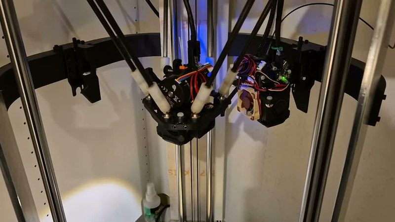
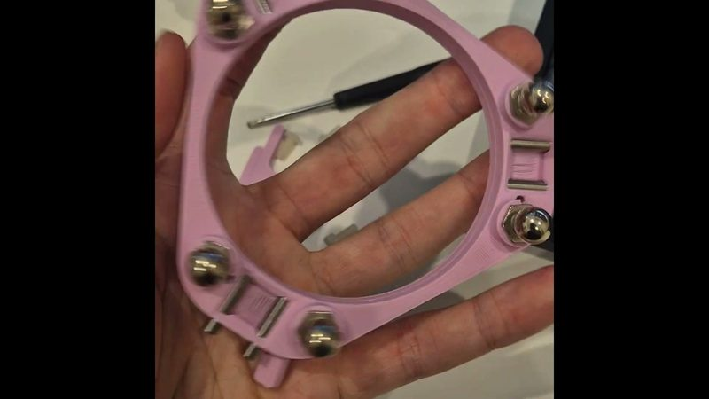
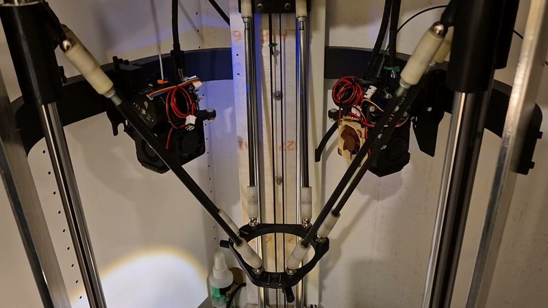
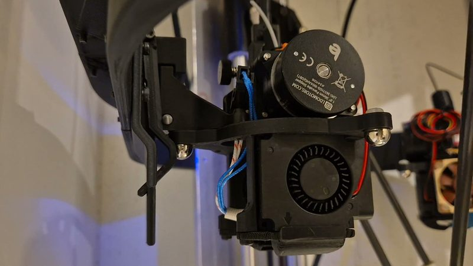
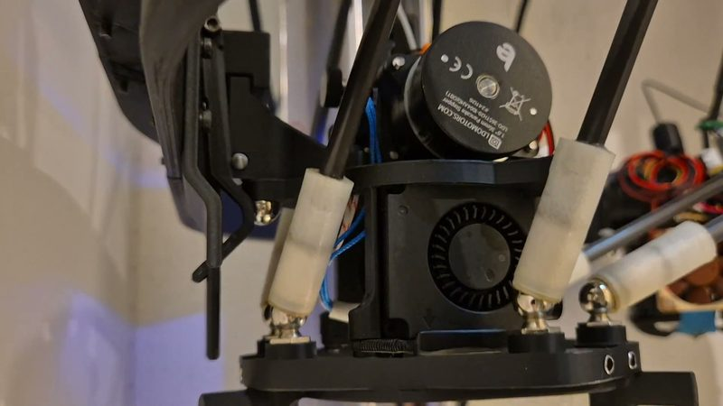

# Delta toolchanger with a magnet ring

[Catalog row](../../OTHER.md#delta-magnet-ring-prototype) · [Gallery](../../GALLERY.md)

| Field | Value |
| --- | --- |
| Section | Concepts and prototypes ([OTHER.md](../../OTHER.md)) |
| Project page | [https://www.youtube.com/watch?v=KamrUvCROx8](https://www.youtube.com/watch?v=KamrUvCROx8) |
| Author | Jason Leppin |
| About | A toolchanger for a custom delta printer. A rotating magnet ring on the end effector locks each tool and shears the magnets to release it. Each dock has a spring-loaded catch and a centring spike. Since 2026 a servo-driven retracting lever handles ooze. |
| Type | Tool changer |
| Status | Working build, no files |
| Coupling | kinematic mount: steel balls on rods |
| Lock | magnet ring, turned to release |
| Latest version | Last seen [2026-09](https://www.youtube.com/watch?v=KamrUvCROx8) |
| Stars Likes Views | [⏯️⁠2.2K](https://www.youtube.com/watch?v=KamrUvCROx8) |
| Links | [Video (prototyping)](https://www.youtube.com/watch?v=KamrUvCROx8) [Video (progress)](https://www.youtube.com/watch?v=Ln2aJkhUCsk) |

## Pictures (5)

<table>
<tr><td align="center" width="33%"> Photo: <a href="https://www.youtube.com/watch?v=KamrUvCROx8">Jason Leppin</a></td><td align="center" width="33%"> Photo: <a href="https://www.youtube.com/watch?v=KamrUvCROx8&amp;t=6s">Jason Leppin</a></td><td align="center" width="33%"> Photo: <a href="https://www.youtube.com/watch?v=KamrUvCROx8&amp;t=28s">Jason Leppin</a></td></tr>
<tr><td align="center" width="33%"> Photo: <a href="https://www.youtube.com/watch?v=KamrUvCROx8&amp;t=48s">Jason Leppin</a></td><td align="center" width="33%"> Photo: <a href="https://www.youtube.com/watch?v=KamrUvCROx8&amp;t=63s">Jason Leppin</a></td></tr>
</table>
