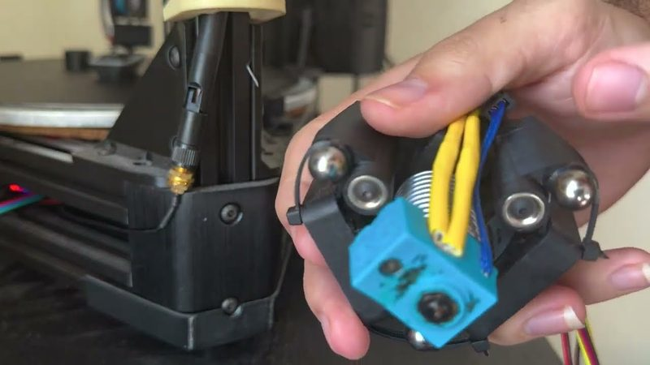
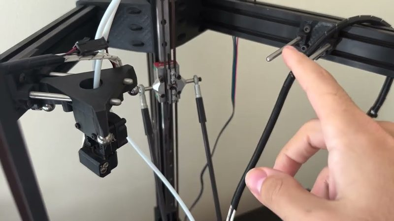

# DeltaToolChanger

[Catalog row](../../OTHER.md#delta-toolchanger) · [Gallery](../../GALLERY.md)

| Field | Value |
| --- | --- |
| Section | Concepts and prototypes ([OTHER.md](../../OTHER.md)) |
| Project page | [https://github.com/BenWolpert/DeltaToolChanger](https://github.com/BenWolpert/DeltaToolChanger) |
| Author | Ben Wolpert (bdw53 on YouTube) |
| About | Tool changer for an existing delta printer: three magnet pairs hold the tool, and a frame-mounted U-axis motor turns a ring in the effector through a cable to separate the magnets for release. Docks are parking posts on the frame braces. |
| Type | Tool changer |
| Status | Files and a working build |
| Coupling | steel balls on pins (3-point) + magnets |
| Lock | magnets, a motor turns a ring to release |
| Latest version | CAD [2022-08](https://github.com/BenWolpert/DeltaToolChanger/commit/d8cef45a1f28e2d65847c3c3a0b14099aaa8e45f) |
| Stars Likes Views |  [⏯️⁠28.2K](https://www.youtube.com/watch?v=AtBPeQnealA) |
| Links | [STEP](https://github.com/BenWolpert/DeltaToolChanger/tree/master/step_files) [STL](https://github.com/BenWolpert/DeltaToolChanger/tree/master/stl_files) [Config](https://github.com/BenWolpert/DeltaToolChanger/tree/master/software/duet2/RepRapFirmware3/sys) [Video](https://www.youtube.com/watch?v=GrMim3Twws8) |

## Pictures (2)

<table>
<tr><td align="center" width="33%"> Photo: <a href="https://www.youtube.com/watch?v=GrMim3Twws8">bdw53</a></td><td align="center" width="33%"> Photo: <a href="https://www.youtube.com/watch?v=GrMim3Twws8">bdw53</a></td></tr>
</table>
