# 3D Printed Magnetic Toolchanger

[Catalog row](../../OTHER.md#dpr-magnetic-toolchanger) · [Gallery](../../GALLERY.md)

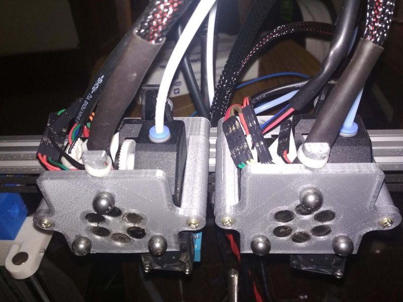

| Field | Value |
| --- | --- |
| Section | Legacy designs ([OTHER.md](../../OTHER.md)) |
| Project page | [https://www.instructables.com/Magnetic-3D-Printed-Toolchnager/](https://www.instructables.com/Magnetic-3D-Printed-Toolchnager/) |
| Author | D_P_R (devalopr) |
| About | A servo turns a ring of alternating-pole magnets on the carriage by 60 degrees, which switches the force between attract and repel. Kinematic coupling with 3 threaded steel balls per tool. Uses only off-the-shelf and printed parts, with no CNC. No update since 2020-02. |
| Type | Tool changer |
| Coupling | kinematic, 3 balls |
| Lock | rotating magnet ring, servo |
| Change time | [~5-6 s](https://www.youtube.com/watch?v=bWBItIszMek) |
| Latest version | First release [2020-02](https://www.instructables.com/Magnetic-3D-Printed-Toolchnager/) |
| Stars Likes Views | [⏯️⁠5.9K](https://www.youtube.com/watch?v=bWBItIszMek) |
| Links | [Manual](https://www.instructables.com/Magnetic-3D-Printed-Toolchnager/) [Video](https://www.youtube.com/watch?v=bWBItIszMek) |
| Groups | — |

## Pictures (12)

<table>
<tr><td align="center" width="33%"> Photo: <a href="https://www.instructables.com/Magnetic-3D-Printed-Toolchnager/">D_P_R</a></td><td align="center" width="33%"><a href="1-dpr-magnetic-toolchanger.jpg">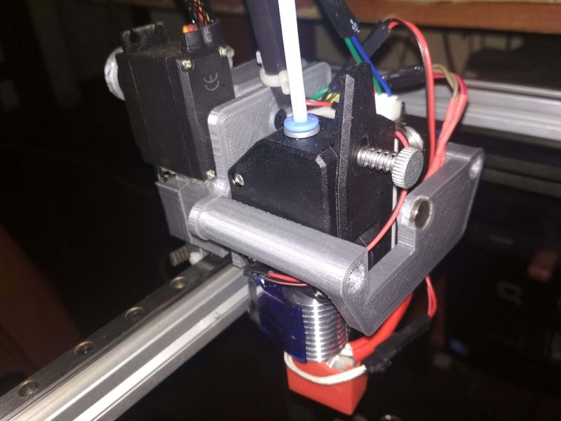</a> Photo: <a href="https://www.instructables.com/Magnetic-3D-Printed-Toolchnager/">D_P_R</a></td><td align="center" width="33%"><a href="2-dpr-magnetic-toolchanger.jpg">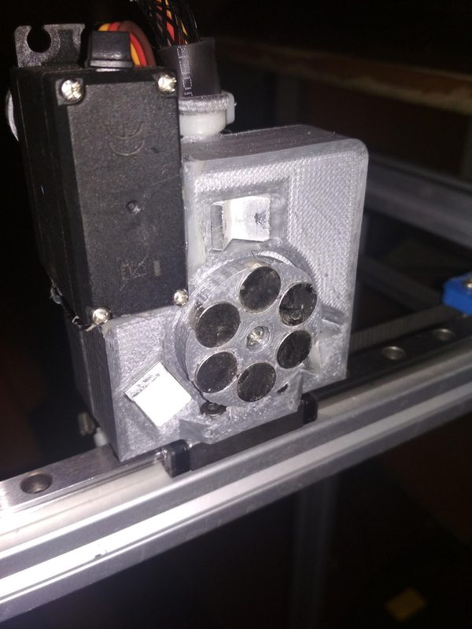</a> Photo: <a href="https://www.instructables.com/Magnetic-3D-Printed-Toolchnager/">D_P_R</a></td></tr>
<tr><td align="center" width="33%"><a href="3-dpr-magnetic-toolchanger.jpg">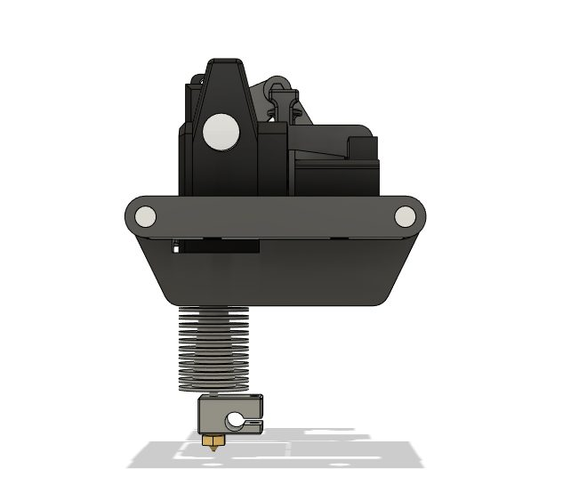</a> Photo: <a href="https://www.instructables.com/Magnetic-3D-Printed-Toolchnager/">D_P_R</a></td><td align="center" width="33%"><a href="4-dpr-magnetic-toolchanger.jpg">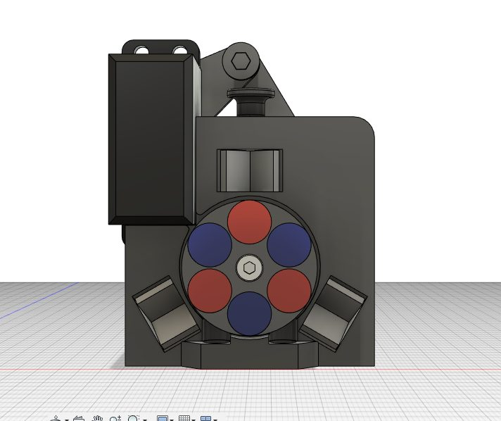</a> Photo: <a href="https://www.instructables.com/Magnetic-3D-Printed-Toolchnager/">D_P_R</a></td><td align="center" width="33%"><a href="5-dpr-magnetic-toolchanger.jpg">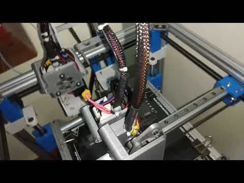</a> Photo: <a href="https://www.instructables.com/Magnetic-3D-Printed-Toolchnager/">D_P_R</a></td></tr>
<tr><td align="center" width="33%"><a href="6-dpr-magnetic-toolchanger.jpg">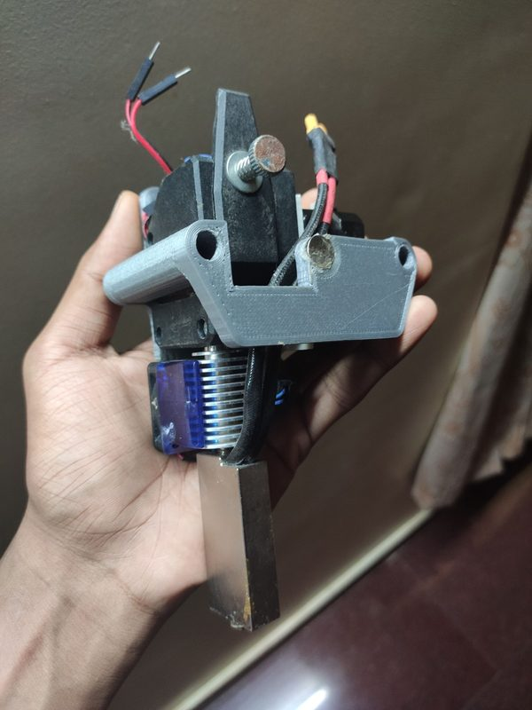</a> Photo: <a href="https://www.instructables.com/Magnetic-3D-Printed-Toolchnager/">D_P_R</a></td><td align="center" width="33%"><a href="7-dpr-magnetic-toolchanger.jpg">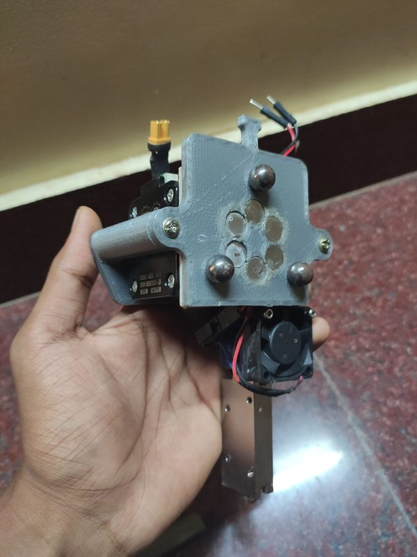</a> Photo: <a href="https://www.instructables.com/Magnetic-3D-Printed-Toolchnager/">D_P_R</a></td><td align="center" width="33%"><a href="8-dpr-magnetic-toolchanger.jpg">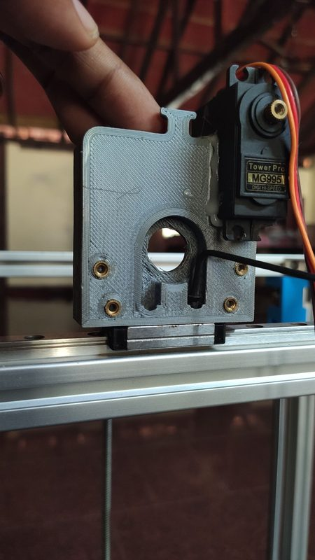</a> Photo: <a href="https://www.instructables.com/Magnetic-3D-Printed-Toolchnager/">D_P_R</a></td></tr>
<tr><td align="center" width="33%"><a href="9-dpr-magnetic-toolchanger.jpg">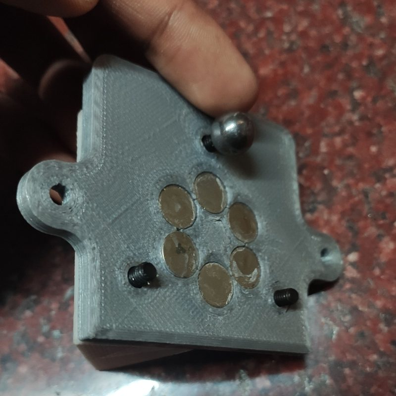</a> Photo: <a href="https://www.instructables.com/Magnetic-3D-Printed-Toolchnager/">D_P_R</a></td><td align="center" width="33%"><a href="10-dpr-magnetic-toolchanger.jpg">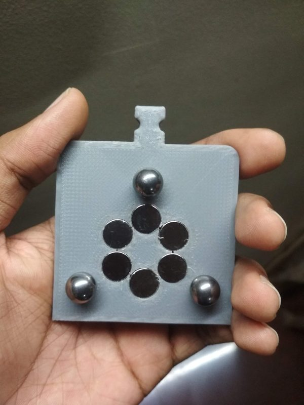</a> Photo: <a href="https://www.instructables.com/Magnetic-3D-Printed-Toolchnager/">D_P_R</a></td><td align="center" width="33%"><a href="11-dpr-magnetic-toolchanger.jpg">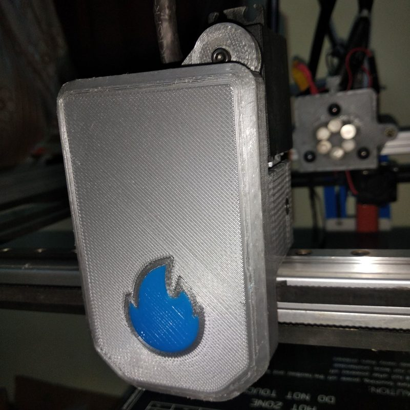</a> Photo: <a href="https://www.instructables.com/Magnetic-3D-Printed-Toolchnager/">D_P_R</a></td></tr>
</table>

## Notes

- It mounts on a CoreXY printer with an MGN9H X rail facing up, and builders must design their own belt adapter. ([source](https://www.instructables.com/Magnetic-3D-Printed-Toolchnager/))
