# E3D ToolChanger

[Catalog row](../../README.md#e3d-toolchanger) · [Gallery](../../GALLERY.md)

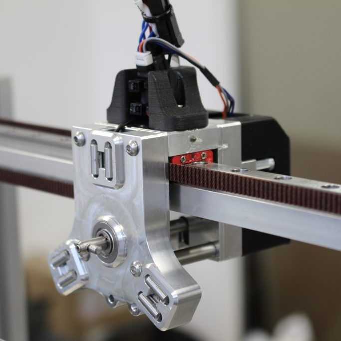

| Field | Value |
| --- | --- |
| Section | Legacy designs |
| Project page | [https://github.com/e3donline/ToolChanger](https://github.com/e3donline/ToolChanger) |
| Author | E3D |
| About | The first widely sold open toolchanger. A tool plate puts 3 balls into 3 pairs of dowel pins, and a motor-driven shaft and ramp twist-locks it. Tools: Hemera, Revo Hemera XS, or V6 with Bowden. The kit is discontinued, but the files stay open. No update since 2023-03. |
| Type | Tool changer |
| Coupling | Maxwell |
| Lock | twist lock, motor |
| Change time | — |
| Latest version | CAD [2023-03](https://github.com/e3donline/ToolChanger/commit/d36e0c7) |
| Stars Likes Views |  [🧡⁠48](https://www.printables.com/model/386697-motion-system-e3d-toolchanger) [⏯️⁠489K](https://www.youtube.com/watch?v=C7wYfaHT1g0) |
| Links | [STEP](https://github.com/e3donline/ToolChanger/tree/master/STPs) [STL](https://github.com/e3donline/ToolChanger/tree/master/STLs) [Drawings](https://github.com/e3donline/ToolChanger/tree/master/PDFs) [Motion System files](https://github.com/e3donline/Motion-System) [Config](https://github.com/e3donline/RepRapFirmware-SD) [Slicer](https://github.com/e3donline/Slicer-Profiles) [Files](https://www.printables.com/model/386697-motion-system-e3d-toolchanger) [Video](https://www.youtube.com/watch?v=C7wYfaHT1g0) |
| Groups | — |

## Pictures (43)

<table>
<tr><td align="center" width="33%"> Photo: <a href="https://www.printables.com/model/386716-toolhead-e3d-toolchanger">E3D</a></td><td align="center" width="33%"><a href="1-e3d-toolchanger.jpg">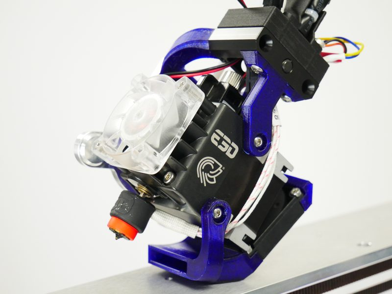</a> Photo: <a href="https://www.printables.com/model/385655-revo-hemera-xs-tool-e3d-toolchanger">E3D</a></td><td align="center" width="33%"><a href="2-e3d-toolchanger.jpg">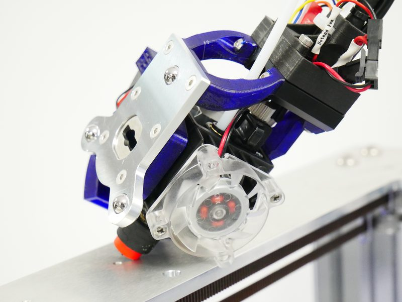</a> Photo: <a href="https://www.printables.com/model/385655-revo-hemera-xs-tool-e3d-toolchanger">E3D</a></td></tr>
<tr><td align="center" width="33%"><a href="3-e3d-toolchanger.jpg">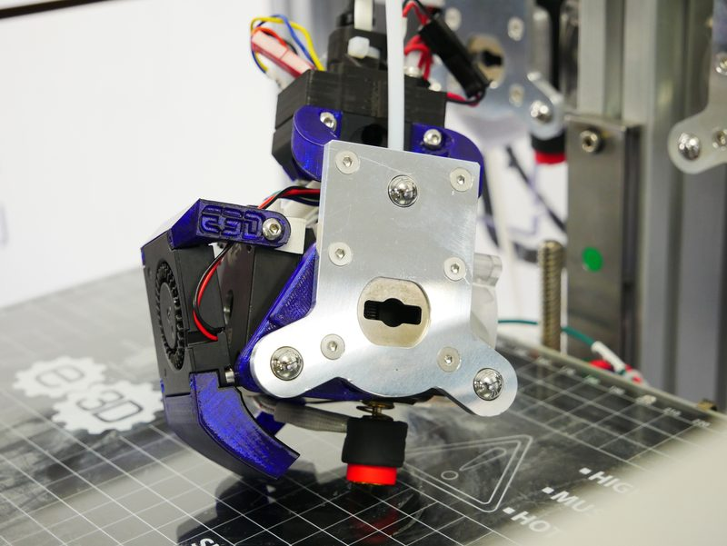</a> Photo: <a href="https://www.printables.com/model/385655-revo-hemera-xs-tool-e3d-toolchanger">E3D</a></td><td align="center" width="33%"><a href="4-e3d-toolchanger.jpg">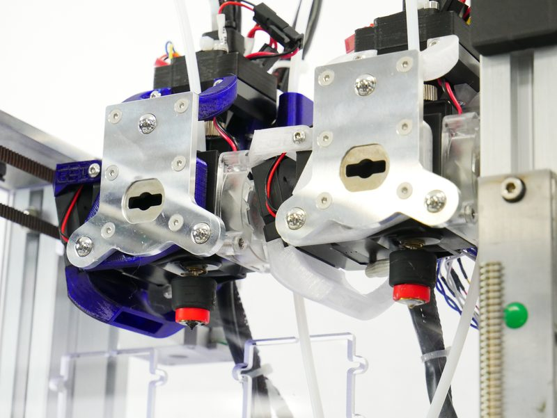</a> Photo: <a href="https://www.printables.com/model/385655-revo-hemera-xs-tool-e3d-toolchanger">E3D</a></td><td align="center" width="33%"><a href="5-e3d-toolchanger.jpg">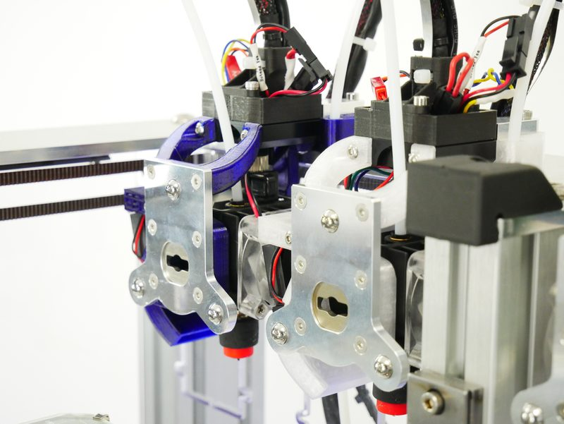</a> Photo: <a href="https://www.printables.com/model/385655-revo-hemera-xs-tool-e3d-toolchanger">E3D</a></td></tr>
<tr><td align="center" width="33%"><a href="6-e3d-toolchanger.jpg">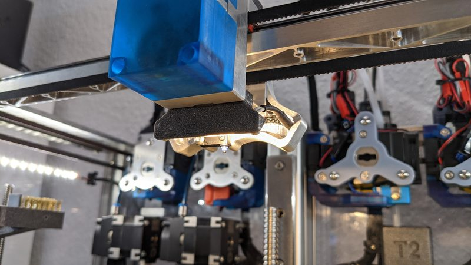</a> Photo: <a href="https://www.printables.com/model/35249-e3d-toolchanger-toolhead-led-illumination">p3t3rp4nd4</a></td><td align="center" width="33%"><a href="7-e3d-toolchanger.jpg">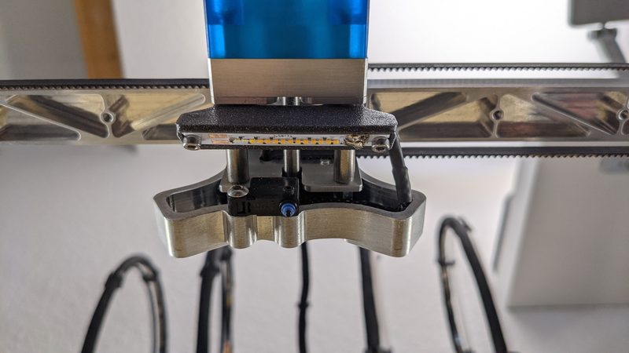</a> Photo: <a href="https://www.printables.com/model/35249-e3d-toolchanger-toolhead-led-illumination">p3t3rp4nd4</a></td><td align="center" width="33%"><a href="8-e3d-toolchanger.jpg">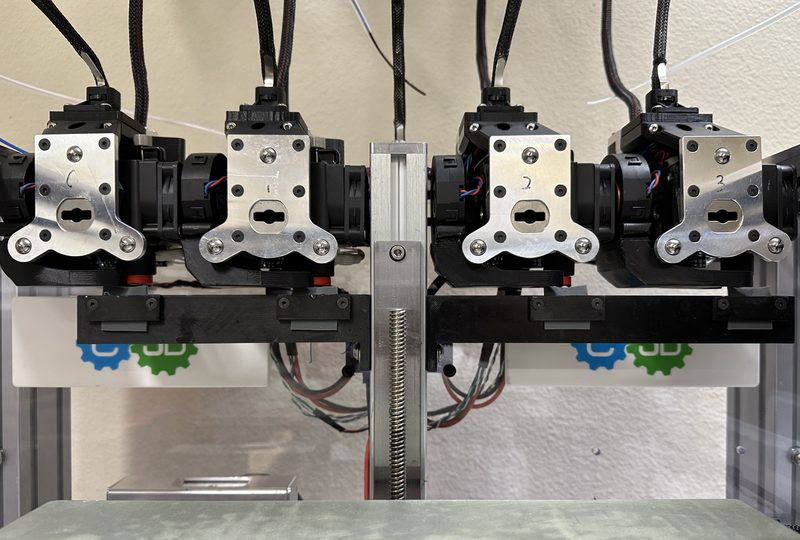</a> Photo: <a href="https://www.printables.com/model/565626-e3d-tool-changer-dock-wiper-bars">Kevin Mardirossian</a></td></tr>
<tr><td align="center" width="33%"><a href="9-e3d-toolchanger.jpg">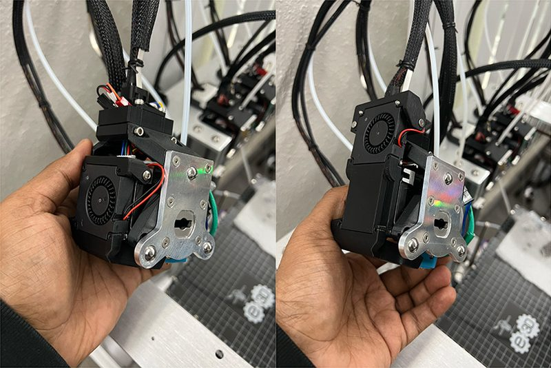</a> Photo: <a href="https://www.printables.com/model/445024-e3d-tool-changer-hemera-direct-extruder-part-cooli">shivdeepak</a></td><td align="center" width="33%"><a href="10-e3d-toolchanger.jpg">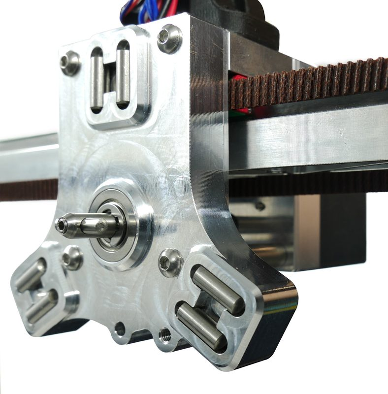</a> Photo: <a href="https://web.archive.org/web/20230922234636/https://e3d-online.com/products/toolchanger-motion-system-bundle">E3D</a></td><td align="center" width="33%"><a href="11-e3d-toolchanger.jpg">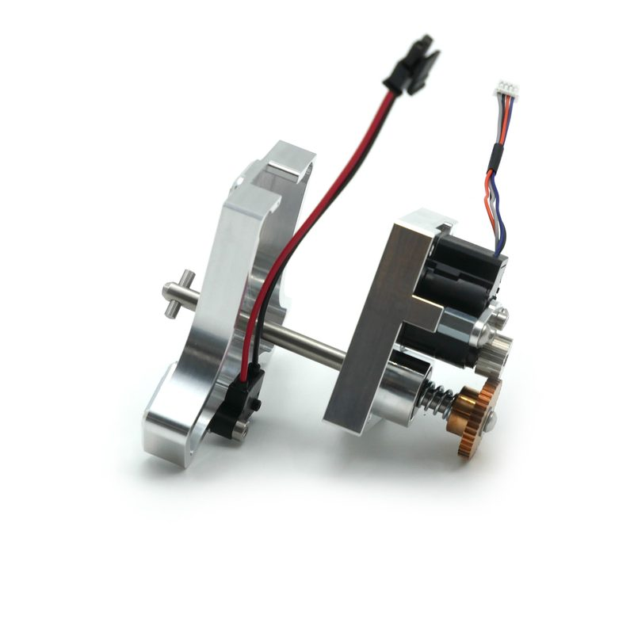</a> Photo: <a href="https://web.archive.org/web/20230922234636/https://e3d-online.com/products/toolchanger-motion-system-bundle">E3D</a></td></tr>
<tr><td align="center" width="33%"><a href="12-e3d-toolchanger.jpg">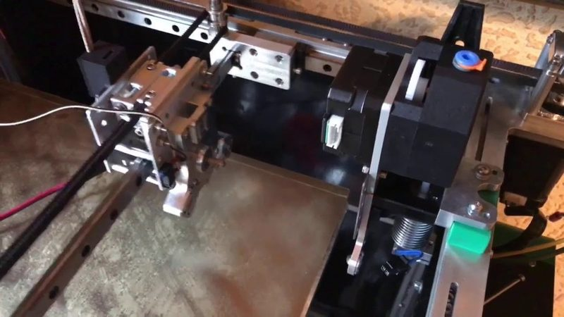</a> Version: Railcore Toolchanger Photo: <a href="https://github.com/railcore/toolchanger">Railcore community, led by Eric K Moyer (with Joshua Vasquez, J. Steve White, Tony Akens)</a></td><td align="center" width="33%"><a href="13-e3d-toolchanger.jpg">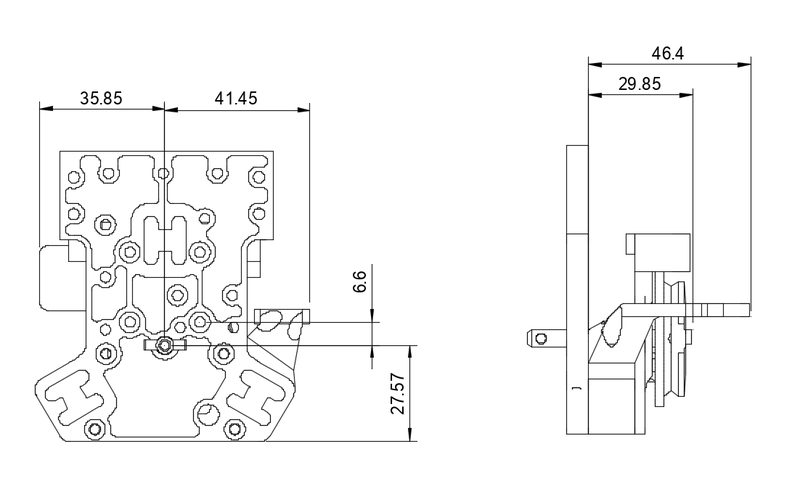</a> Version: RC-TC (Railcore 300 tool changer) Photo: <a href="https://github.com/chernogorsky/rc-tc">chernogorsky</a></td><td align="center" width="33%"><a href="14-e3d-toolchanger.jpg">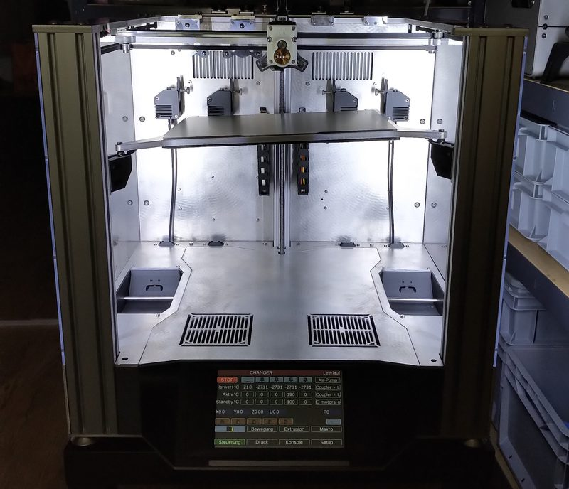</a> Version: CHANGER Photo: <a href="https://hackaday.io/project/175489-changer-a-toolchanger-new-interpreted">Simon Wirz</a></td></tr>
<tr><td align="center" width="33%"><a href="15-e3d-toolchanger.jpg">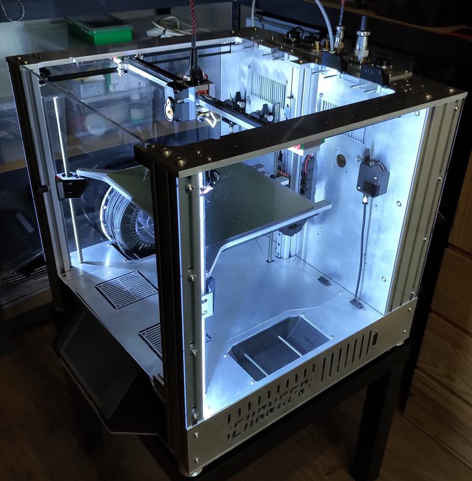</a> Version: CHANGER Photo: <a href="https://hackaday.io/project/175489-changer-a-toolchanger-new-interpreted">Simon Wirz</a></td><td align="center" width="33%"><a href="16-e3d-toolchanger.jpg">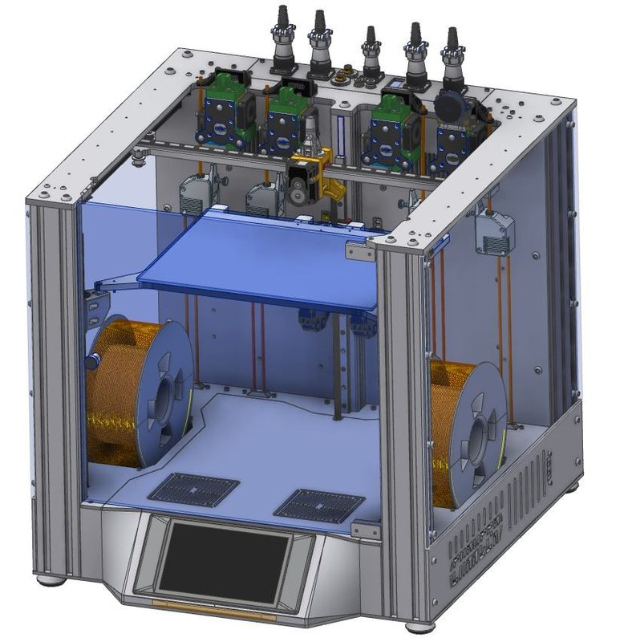</a> Version: CHANGER Photo: <a href="https://hackaday.io/project/175489-changer-a-toolchanger-new-interpreted">Simon Wirz</a></td><td align="center" width="33%"><a href="17-e3d-toolchanger.jpg">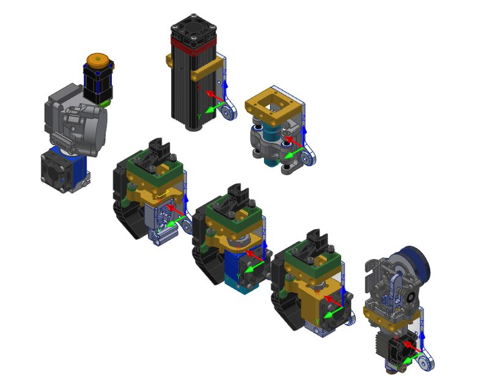</a> Version: CHANGER Photo: <a href="https://hackaday.io/project/175489-changer-a-toolchanger-new-interpreted">Simon Wirz</a></td></tr>
<tr><td align="center" width="33%"><a href="18-e3d-toolchanger.jpg">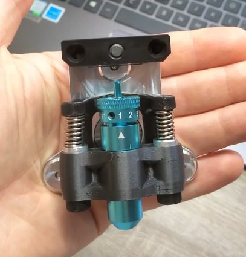</a> Version: CHANGER Photo: <a href="https://hackaday.io/project/175489-changer-a-toolchanger-new-interpreted">Simon Wirz</a></td><td align="center" width="33%"><a href="19-e3d-toolchanger.jpg">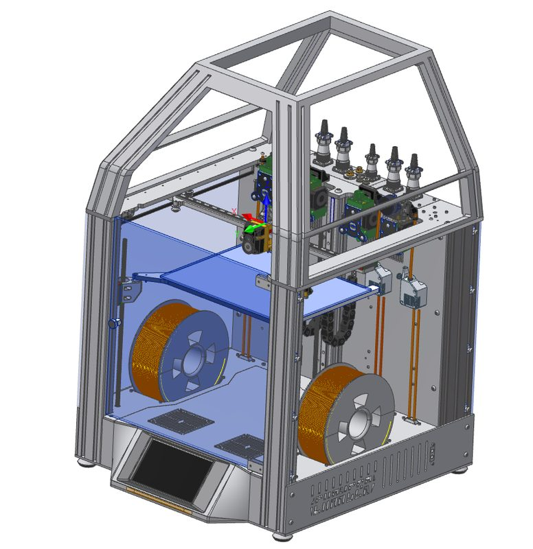</a> Version: CHANGER Photo: <a href="https://hackaday.io/project/175489-changer-a-toolchanger-new-interpreted">Simon Wirz</a></td><td align="center" width="33%"><a href="20-e3d-toolchanger.jpg">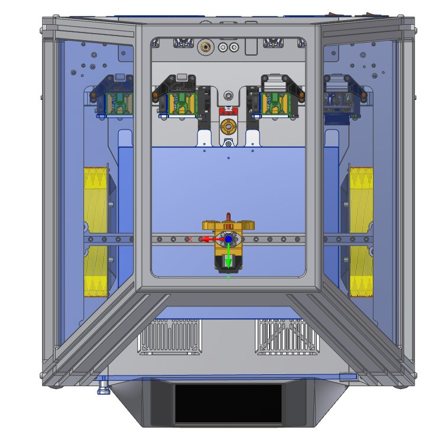</a> Version: CHANGER Photo: <a href="https://hackaday.io/project/175489-changer-a-toolchanger-new-interpreted">Simon Wirz</a></td></tr>
<tr><td align="center" width="33%"><a href="21-e3d-toolchanger.jpg">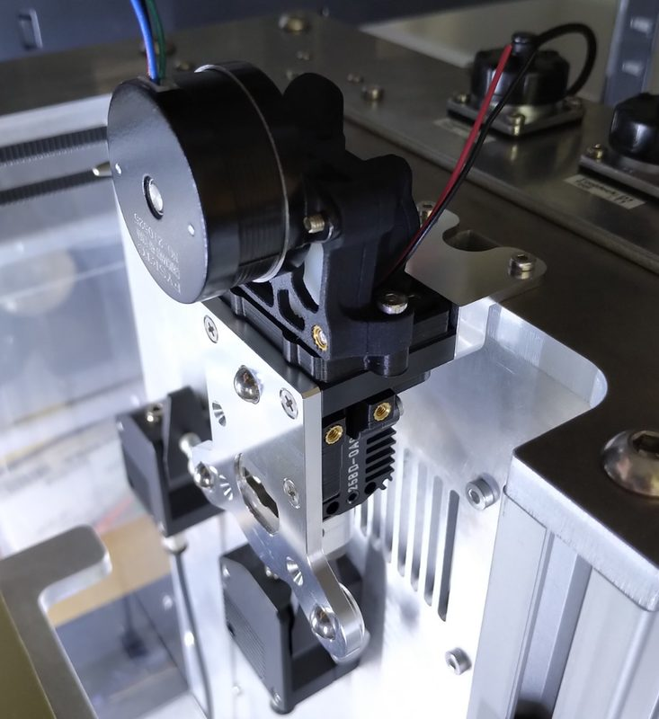</a> Version: CHANGER Photo: <a href="https://hackaday.io/project/175489-changer-a-toolchanger-new-interpreted">Simon Wirz</a></td><td align="center" width="33%"><a href="22-e3d-toolchanger.jpg">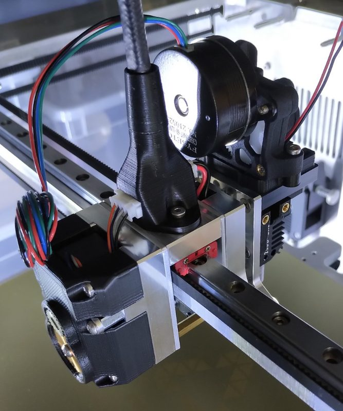</a> Version: CHANGER Photo: <a href="https://hackaday.io/project/175489-changer-a-toolchanger-new-interpreted">Simon Wirz</a></td><td align="center" width="33%"><a href="23-e3d-toolchanger.jpg">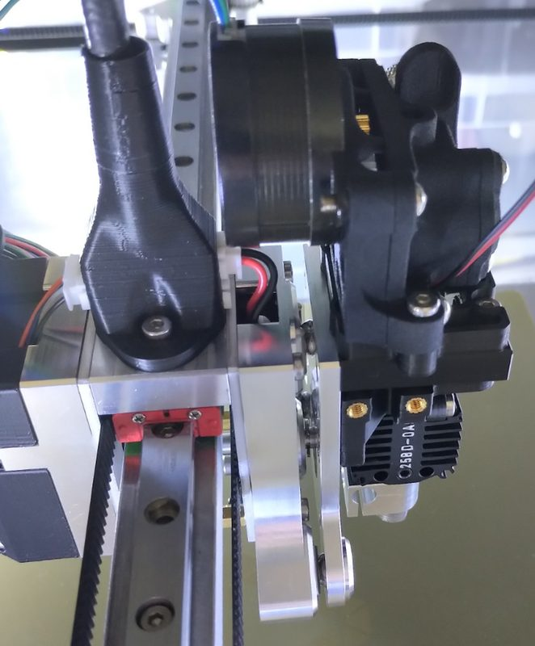</a> Version: CHANGER Photo: <a href="https://hackaday.io/project/175489-changer-a-toolchanger-new-interpreted">Simon Wirz</a></td></tr>
<tr><td align="center" width="33%"><a href="24-e3d-toolchanger.jpg">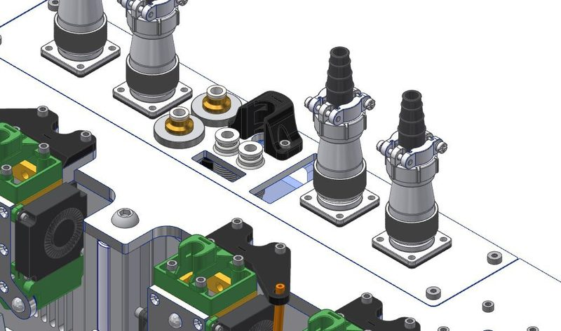</a> Version: CHANGER Photo: <a href="https://hackaday.io/project/175489-changer-a-toolchanger-new-interpreted">Simon Wirz</a></td><td align="center" width="33%"><a href="25-e3d-toolchanger.jpg">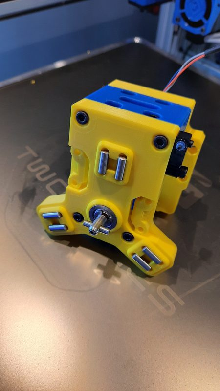</a> Version: RatRig V-Core 3 Tool Changer Photo: <a href="https://www.printables.com/model/137147-ratrig-vcore-3-tool-changer/comments">psyvision</a></td><td align="center" width="33%"><a href="26-e3d-toolchanger.jpg">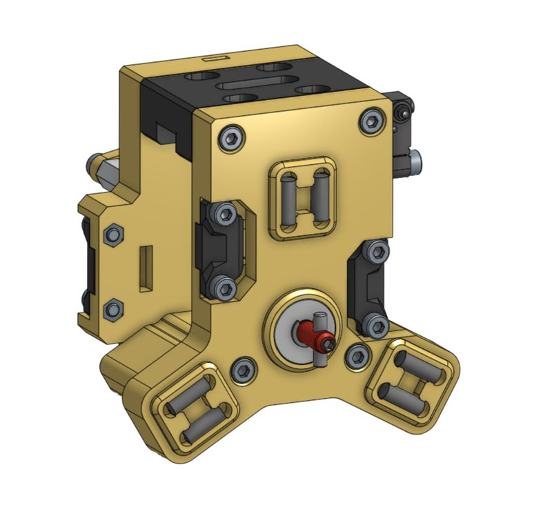</a> Version: RatRig V-Core 3 Tool Changer Photo: <a href="https://www.printables.com/model/137147-ratrig-vcore-3-tool-changer">psyvision</a></td></tr>
<tr><td align="center" width="33%"><a href="27-e3d-toolchanger.jpg">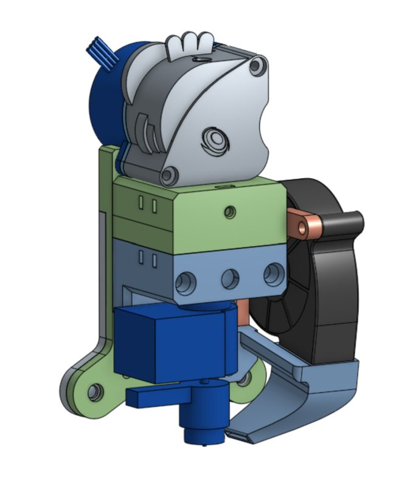</a> Version: RatRig V-Core 3 Tool Changer Photo: <a href="https://www.printables.com/model/137147-ratrig-vcore-3-tool-changer">psyvision</a></td><td align="center" width="33%"><a href="28-e3d-toolchanger.jpg">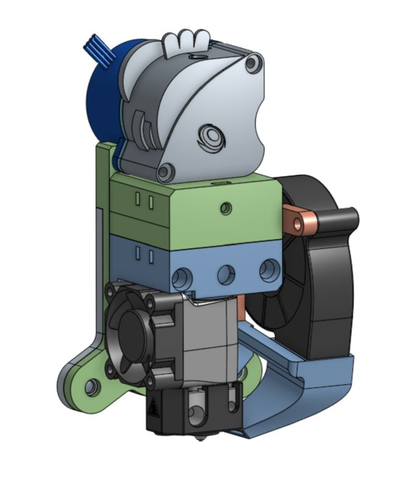</a> Version: RatRig V-Core 3 Tool Changer Photo: <a href="https://www.printables.com/model/137147-ratrig-vcore-3-tool-changer">psyvision</a></td><td align="center" width="33%"><a href="29-e3d-toolchanger.jpg">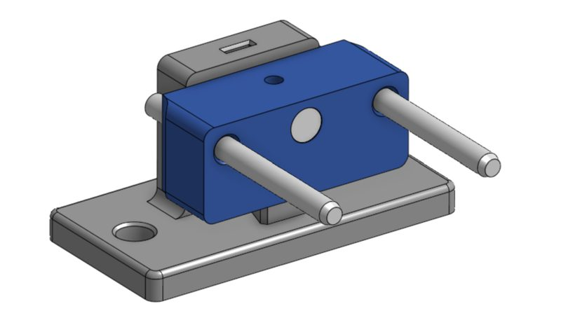</a> Version: RatRig V-Core 3 Tool Changer Photo: <a href="https://www.printables.com/model/137147-ratrig-vcore-3-tool-changer">psyvision</a></td></tr>
<tr><td align="center" width="33%"><a href="30-e3d-toolchanger.jpg">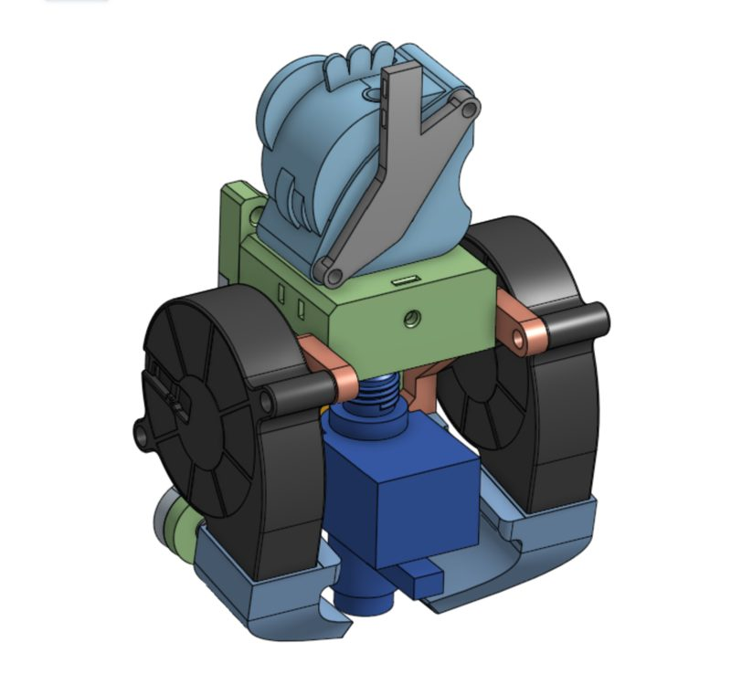</a> Version: RatRig V-Core 3 Tool Changer Photo: <a href="https://www.printables.com/model/137147-ratrig-vcore-3-tool-changer">psyvision</a></td><td align="center" width="33%"><a href="31-e3d-toolchanger.jpg">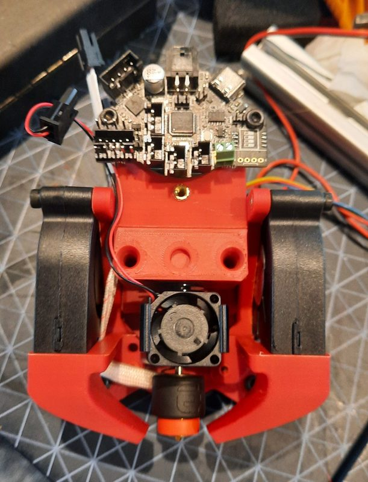</a> Version: RatRig V-Core 3 Tool Changer Photo: <a href="https://www.printables.com/model/137147-ratrig-vcore-3-tool-changer">psyvision</a></td><td align="center" width="33%"><a href="32-e3d-toolchanger.jpg">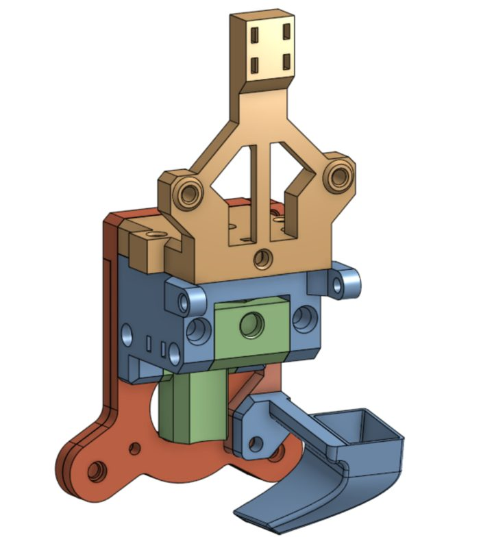</a> Version: RatRig V-Core 3 Tool Changer Photo: <a href="https://www.printables.com/model/137147-ratrig-vcore-3-tool-changer">psyvision</a></td></tr>
<tr><td align="center" width="33%"><a href="33-e3d-toolchanger.jpg">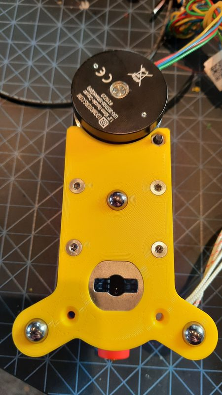</a> Version: RatRig V-Core 3 Tool Changer Photo: <a href="https://www.printables.com/model/137147-ratrig-vcore-3-tool-changer/comments">psyvision</a></td><td align="center" width="33%"><a href="34-e3d-toolchanger.jpg">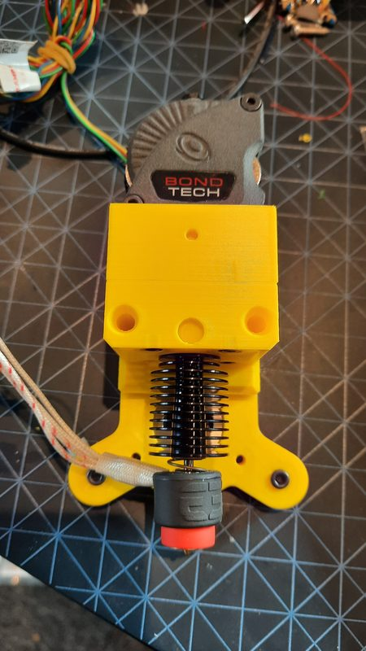</a> Version: RatRig V-Core 3 Tool Changer Photo: <a href="https://www.printables.com/model/137147-ratrig-vcore-3-tool-changer/comments">psyvision</a></td><td align="center" width="33%"><a href="35-e3d-toolchanger.jpg">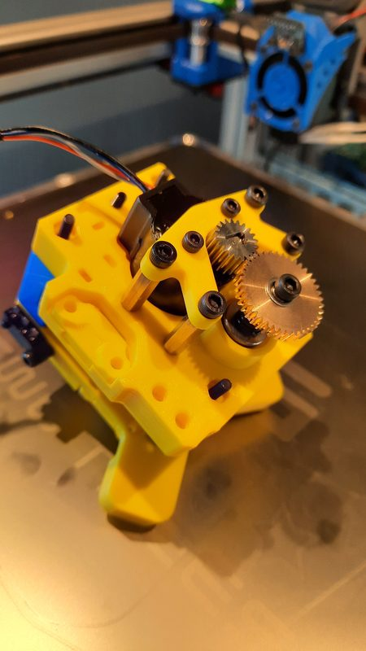</a> Version: RatRig V-Core 3 Tool Changer Photo: <a href="https://www.printables.com/model/137147-ratrig-vcore-3-tool-changer/comments">psyvision</a></td></tr>
<tr><td align="center" width="33%"><a href="36-e3d-toolchanger.jpg">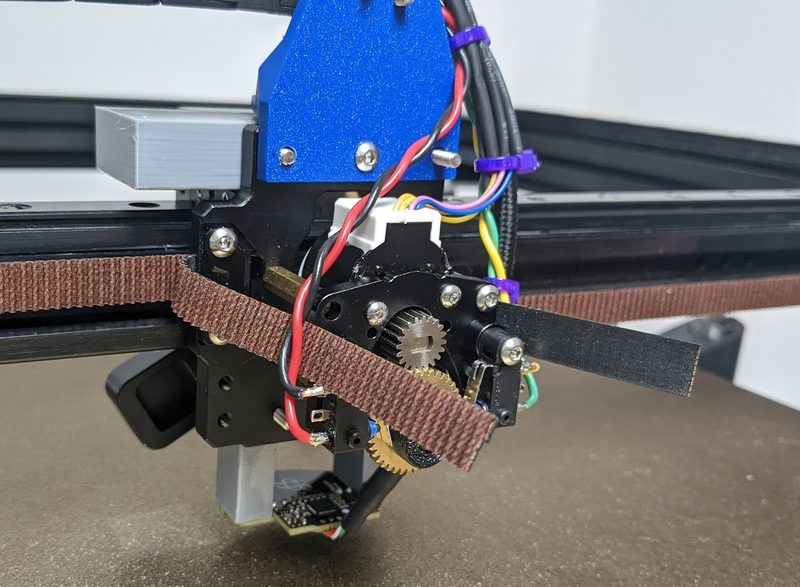</a> Version: RatRig V-Core 3 Tool Changer Photo: <a href="https://www.printables.com/model/137147-ratrig-vcore-3-tool-changer/comments">leejsmith</a></td><td align="center" width="33%"><a href="37-e3d-toolchanger.jpg">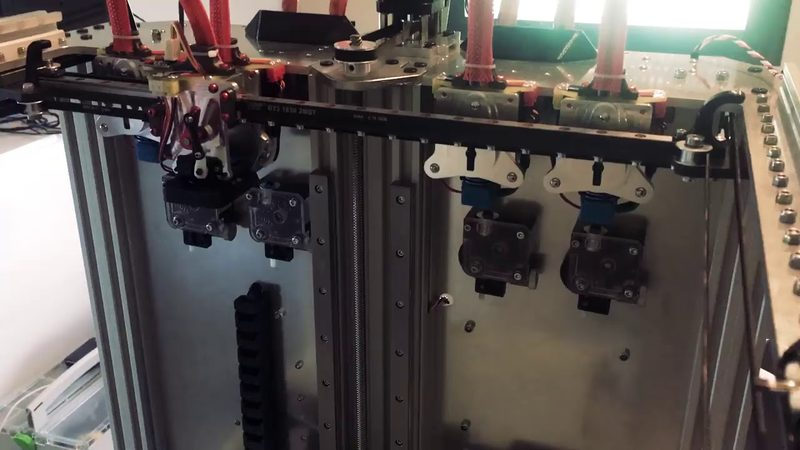</a> Version: FunX4 - Toolchanging 3D printer Photo: <a href="https://www.youtube.com/watch?v=ZuOu4s5om7c">tpra</a></td><td align="center" width="33%"><a href="38-e3d-toolchanger.jpg">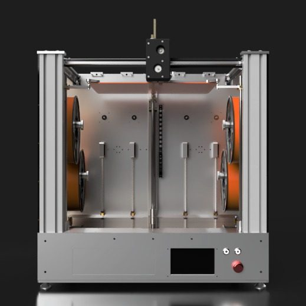</a> Version: CrazyCreatorCube Photo: <a href="https://www.printables.com/model/100893-crazycreatorcube-tool-changer-with-remote-drives-a">CrazyCreator</a></td></tr>
<tr><td align="center" width="33%"><a href="39-e3d-toolchanger.jpg">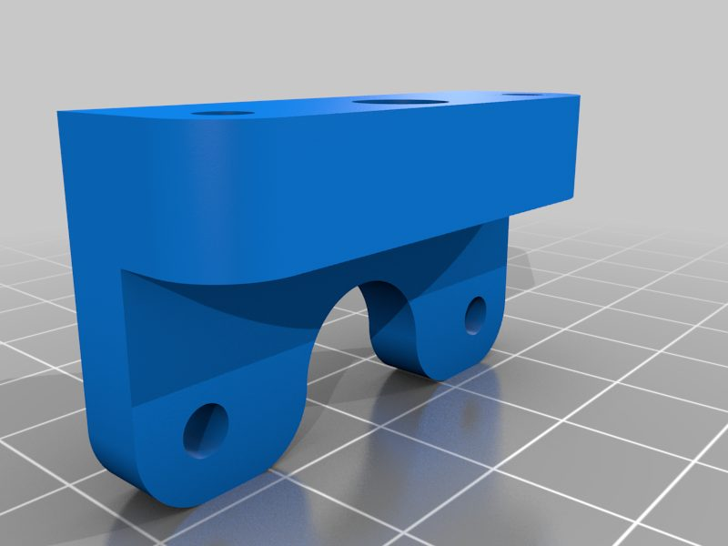</a> Version: CrazyCreatorCube Photo: <a href="https://www.printables.com/model/100893-crazycreatorcube-tool-changer-with-remote-drives-a">CrazyCreator</a></td><td align="center" width="33%"><a href="40-e3d-toolchanger.jpg">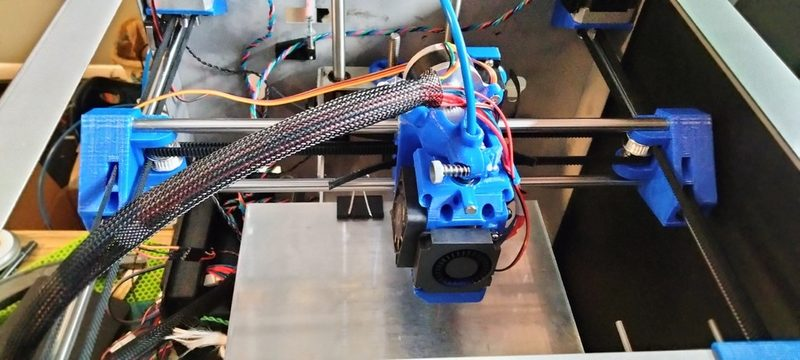</a> Version: Compact CoreXY Toolchanger Photo: <a href="https://www.printables.com/model/290502-compact-toolchanger">aamott</a></td><td align="center" width="33%"><a href="41-e3d-toolchanger.jpg">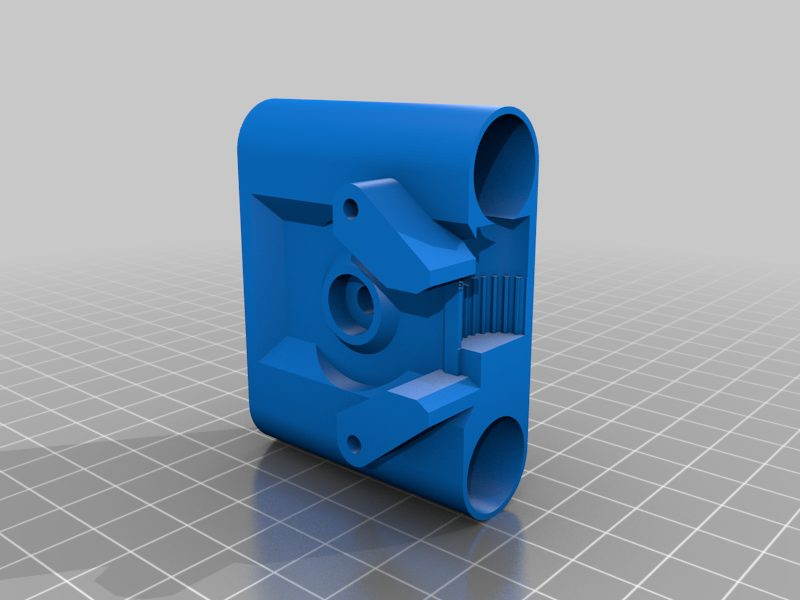</a> Version: Compact CoreXY Toolchanger Photo: <a href="https://www.printables.com/model/290502-compact-toolchanger">aamott</a></td></tr>
<tr><td align="center" width="33%"><a href="42-e3d-toolchanger.jpg">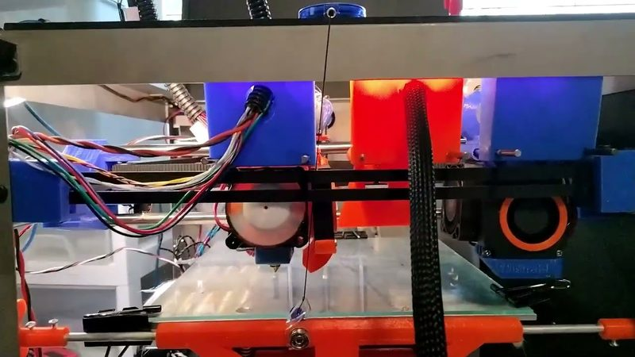</a> Version: Compact CoreXY Toolchanger Photo: <a href="https://www.youtube.com/watch?v=tlMmmSFyGIo">aamott</a></td></tr>
</table>

## Ports and variants

- [Railcore Toolchanger](https://github.com/railcore/toolchanger), *Railcore community, led by Eric K Moyer (with Joshua Vasquez, J. Steve White, Tony Akens)*. Add-on for RailCore II that combines a remixed Jubilee tool plate and remote elastic lock with the original E3D tool face and lock shaft on a new Y carriage. The tool is mostly printed (BMG + V6), and parking posts mount on the frame or the halo.
- [RC-TC (Railcore 300 tool changer)](https://github.com/chernogorsky/rc-tc), *chernogorsky*. RailCore 300 mod that takes standard E3D tool plates and docks, using the Jubilee twist lock and remote lock. It targets a 135 C chamber (HT motors moved out, HT plastics), and the mod can be removed by taking out the shaft.
- [CHANGER](https://hackaday.io/project/175489-changer-a-toolchanger-new-interpreted), *Chuckonelli (Simon Wirz)*. A modular E3D-ToolChanger-based machine for multi-process tools (direct-drive printheads, 20 W laser, drag knife, PnP), with water cooling and HEPA filtering.
- [RatRig V-Core 3 Tool Changer](https://www.printables.com/model/137147-ratrig-vcore-3-tool-changer), *psyvision (PsyVision on YouTube)*. Ports the E3D ToolChanger coupling to the RatRig V-Core 3 on an EVA-style carriage, for the 'OpenFront' belt mod. It adds its own 3030 docks and modular LGX Lite tools.
- [FunX4 - Toolchanging 3D printer](https://www.thingiverse.com/thing:3552566), *tpra*. E3D-style CoreXY printer with 4 tools on machined aluminium plates. Glued steel balls and pins form the kinematic coupling, and a servo turns a spring-loaded T-shaft lock.
- [CrazyCreatorCube](https://www.printables.com/model/100893-crazycreatorcube-tool-changer-with-remote-drives-a), *CrazyCreator (Hendrik and Andy)*. CoreXY tool changer printer that keeps the lock motor on the frame: a remote drive turns the tool-locking bolt, so the head carries no lock motor. It is made to be fully compatible with E3D tools, and the bed is levelled automatically by three Z axes.
- [Compact CoreXY Toolchanger](https://grabcad.com/library/compact-corexy-toolchanger-1), *aamott (Adam Amott)*. Rebuilds a Solidoodle 3 as a CoreXY, with a changer loosely based on the E3D design. Tools are located by salvaged 3 mm DVD-drive rods with magnets, and an SG90 servo turns a pinned lock shaft. The author says the changer costs about $15.
