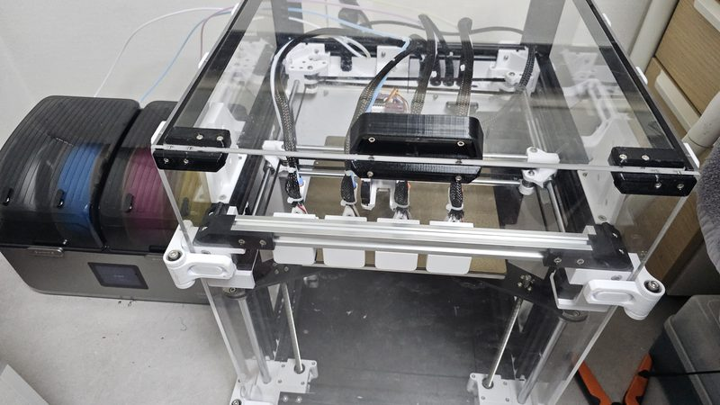
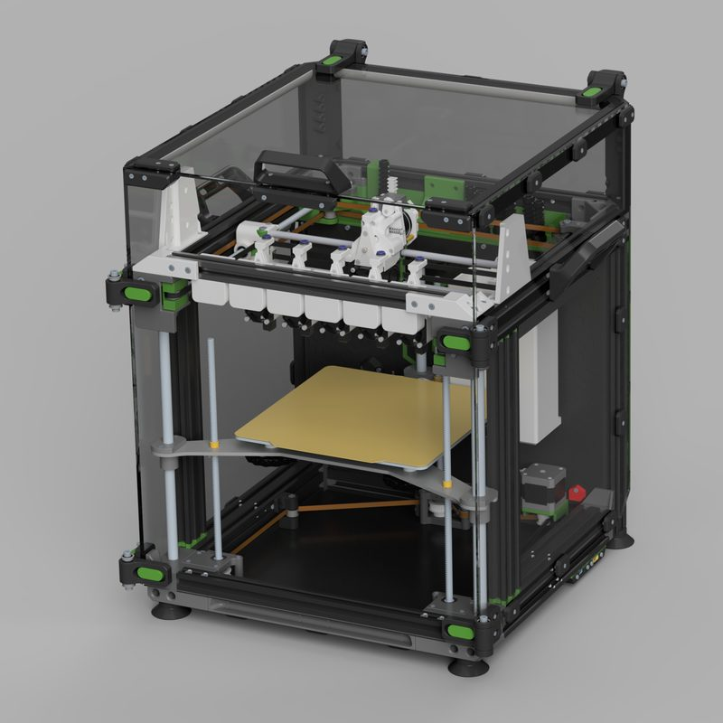
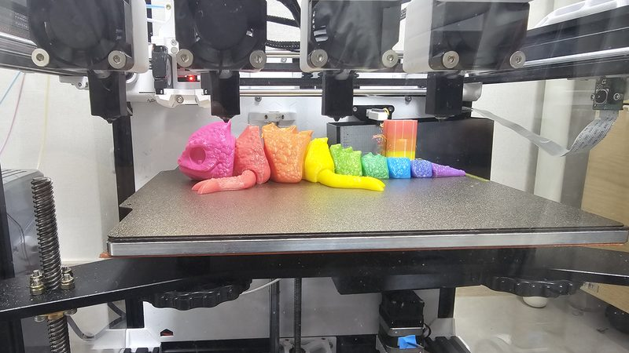
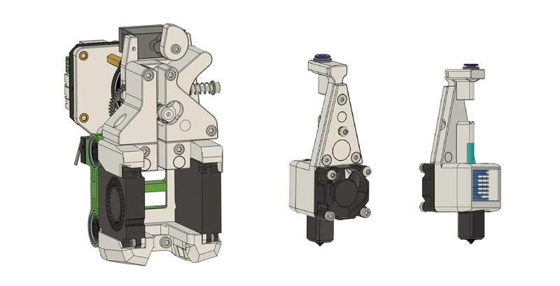
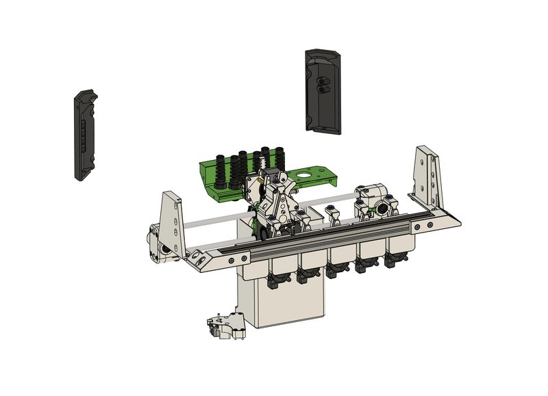
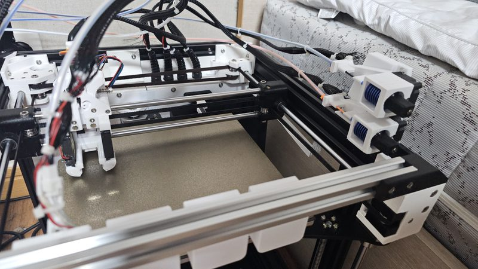
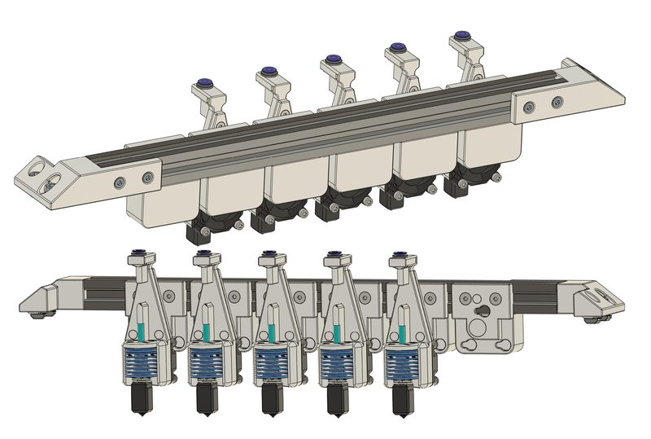
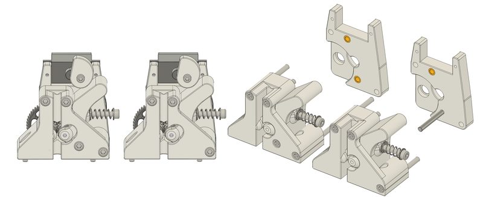
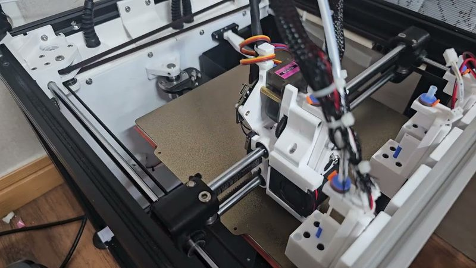

# E3NG Toolchanger

[Catalog row](../../README.md#e3ng-toolchanger) · [Gallery](../../GALLERY.md)

| Field | Value |
| --- | --- |
| Section | Hotend changers |
| Project page | [https://github.com/emna2881/E3NG-Toolchanger](https://github.com/emna2881/E3NG-Toolchanger) |
| Author | EMNA (emna2881) |
| About | Hotend-swapping mod for the Ender-3 NG (E3NG by RH3D): one BMG-style extruder and a servo cam that opens the idler, with an extruder inspired by MedusaHC. Docks sit on an extrusion across the front, and tools are TZ-V6 3.0 hotends. Beta. |
| Coupling | — |
| Lock | magnets |
| Change time | — |
| Tools | — |
| Base printers | Ender-3 NG |
| Firmware | — |
| Latest version | Log [2026-07](https://github.com/emna2881/E3NG-Toolchanger/blob/main/Changelog.md) |
| Stars Likes Views |  [🧡⁠315](https://www.printables.com/model/1786963-e3ng-toolchanger) [⏯️⁠5.2K](https://www.youtube.com/watch?v=WKBszFWHkbQ) |
| Links | [STEP](https://github.com/emna2881/E3NG-Toolchanger/tree/main/CAD) [STL](https://github.com/emna2881/E3NG-Toolchanger/tree/main/STLs) [Files](https://www.printables.com/model/1786963-e3ng-toolchanger) [Manual](https://github.com/emna2881/E3NG-Toolchanger/blob/main/Docs/build_guide.md) [Video](https://www.youtube.com/watch?v=WKBszFWHkbQ) |
| Groups | — |

## Pictures (9)

<table>
<tr><td align="center" width="33%"> Photo: <a href="https://www.printables.com/model/1786963-e3ng-toolchanger">EMNA</a></td><td align="center" width="33%"> Photo: <a href="https://www.printables.com/model/1786963-e3ng-toolchanger">EMNA</a></td><td align="center" width="33%"> Photo: <a href="https://www.printables.com/model/1786963-e3ng-toolchanger">EMNA</a></td></tr>
<tr><td align="center" width="33%"> Photo: <a href="https://www.printables.com/model/1786963-e3ng-toolchanger">EMNA</a></td><td align="center" width="33%"> Photo: <a href="https://www.printables.com/model/1786963-e3ng-toolchanger">EMNA</a></td><td align="center" width="33%"> Photo: <a href="https://github.com/emna2881/E3NG-Toolchanger">EMNA</a></td></tr>
<tr><td align="center" width="33%"> Photo: <a href="https://github.com/emna2881/E3NG-Toolchanger">EMNA</a></td><td align="center" width="33%"> Photo: <a href="https://github.com/emna2881/E3NG-Toolchanger">EMNA</a></td><td align="center" width="33%"> Photo: <a href="https://www.youtube.com/watch?v=9U3lAQLeLpo">EMNA</a></td></tr>
</table>
