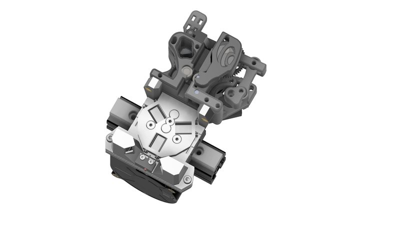
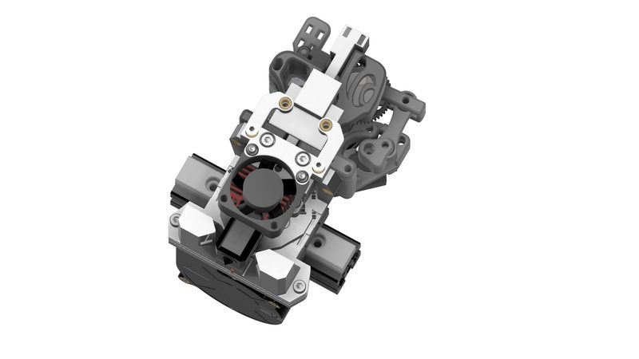
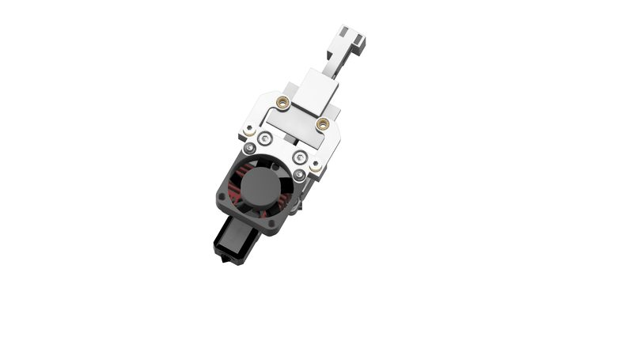
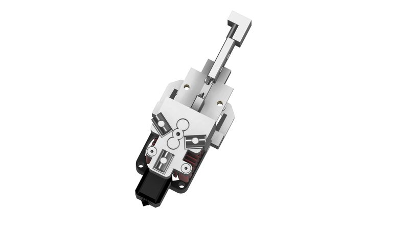
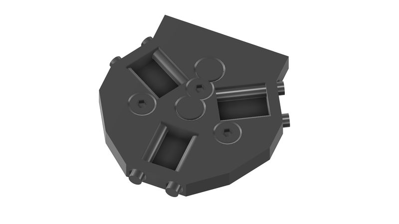
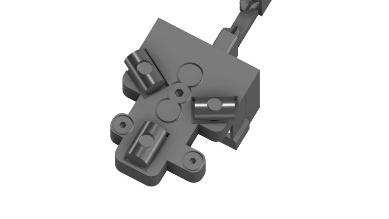
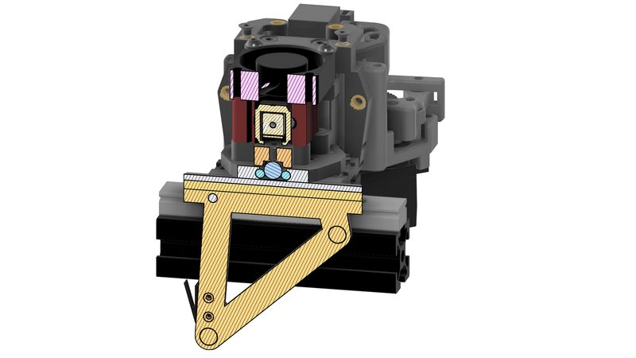
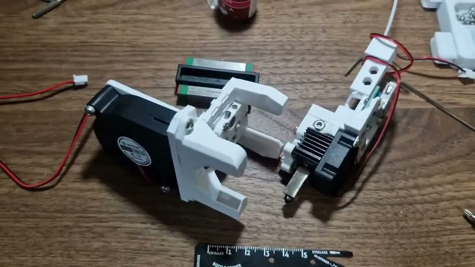

# Euryale

[Catalog row](../../OTHER.md#euryale-toolchanger) · [Gallery](../../GALLERY.md)

| Field | Value |
| --- | --- |
| Section | Concepts and prototypes ([OTHER.md](../../OTHER.md)) |
| Project page | [https://github.com/Blackrosedyin/Euryale-ToolChanger](https://github.com/Blackrosedyin/Euryale-ToolChanger) |
| Author | blackrosedying (GitHub: Blackrosedyin) |
| About | Fork of MedusaHC with a quasi-kinematic line-contact coupling: floating 6 mm dowel barrel bolts sit on parallel 3 mm dowel pins at 35 degrees in a modified Maxwell layout. Tools take power over USB-A/USB-C cables, and direct wiring is also planned. README credits minor inspiration from CxChanger. |
| Type | Hotend changer |
| Status | Renders only |
| Coupling | Maxwell (line contact: floating 6 mm dowel barrels on 3 mm dowel pins) |
| Lock | — |
| Latest version | Last seen [2026-09](https://github.com/Blackrosedyin/Euryale-ToolChanger) |
| Stars Likes Views |  [⏯️⁠92](https://youtu.be/iKWvAJGqXgY) |
| Links | [CAD (Fusion, view only)](https://a360.co/46orMO9) [Video](https://youtu.be/iKWvAJGqXgY) |

## Pictures (8)

<table>
<tr><td align="center" width="33%"> Photo: <a href="https://github.com/Blackrosedyin/Euryale-ToolChanger">Blackrosedyin</a></td><td align="center" width="33%"> Photo: <a href="https://github.com/Blackrosedyin/Euryale-ToolChanger">Blackrosedyin</a></td><td align="center" width="33%"> Photo: <a href="https://github.com/Blackrosedyin/Euryale-ToolChanger">Blackrosedyin</a></td></tr>
<tr><td align="center" width="33%"> Photo: <a href="https://github.com/Blackrosedyin/Euryale-ToolChanger">Blackrosedyin</a></td><td align="center" width="33%"> Photo: <a href="https://github.com/Blackrosedyin/Euryale-ToolChanger">Blackrosedyin</a></td><td align="center" width="33%"> Photo: <a href="https://github.com/Blackrosedyin/Euryale-ToolChanger">Blackrosedyin</a></td></tr>
<tr><td align="center" width="33%"> Photo: <a href="https://github.com/Blackrosedyin/Euryale-ToolChanger">Blackrosedyin</a></td><td align="center" width="33%"> Photo: <a href="https://youtu.be/iKWvAJGqXgY">blackrosedying</a></td></tr>
</table>
