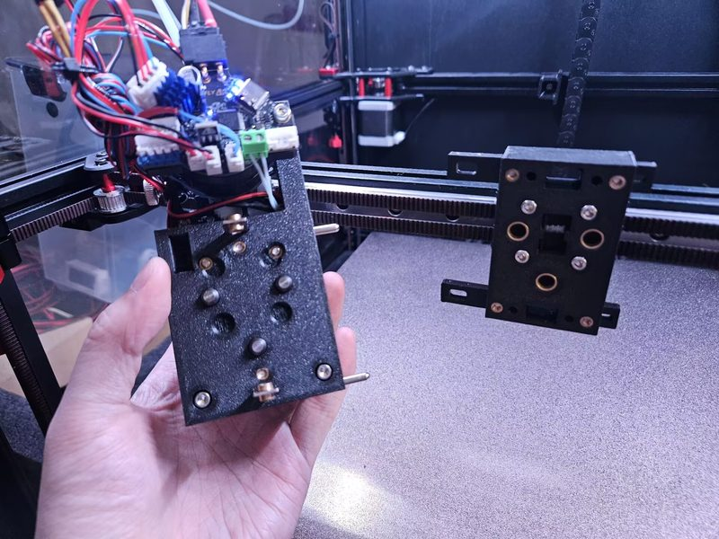
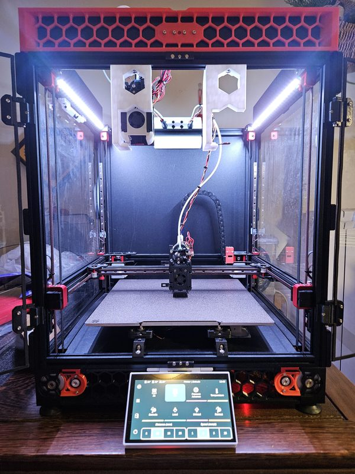
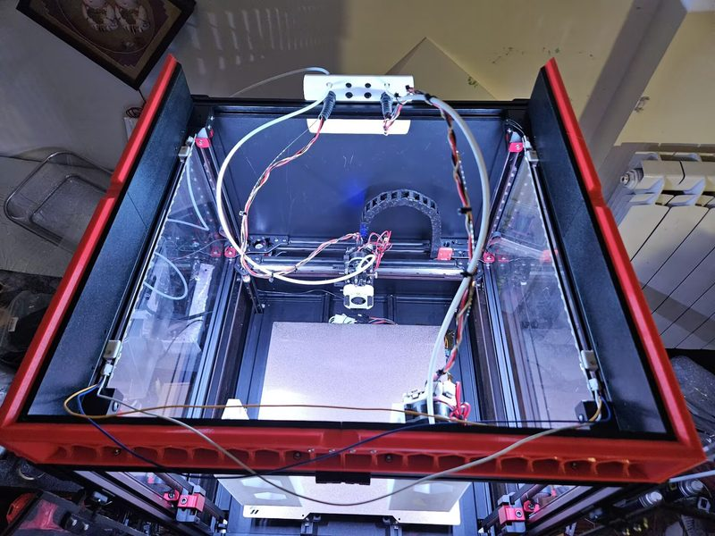
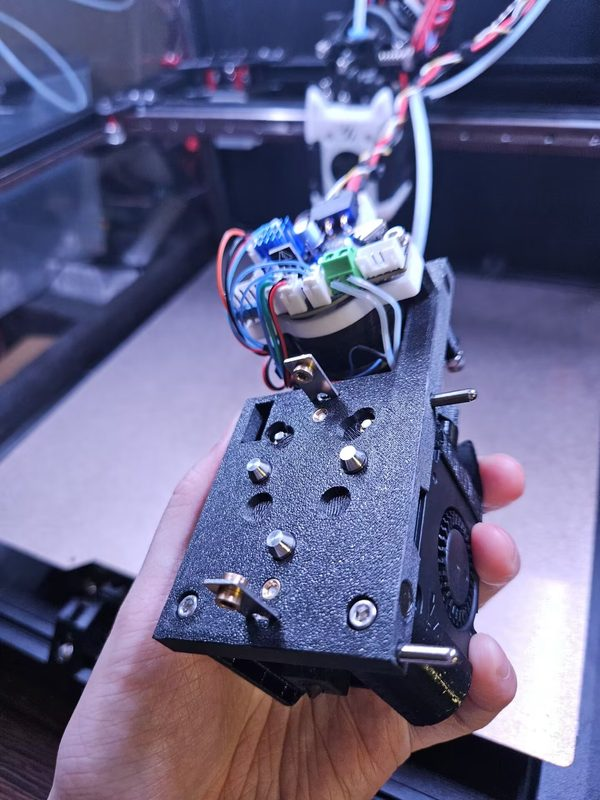
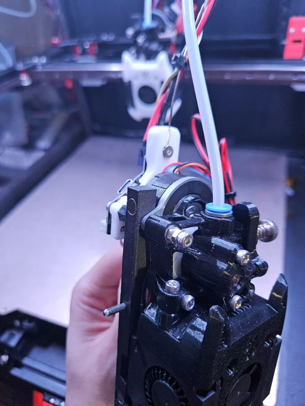
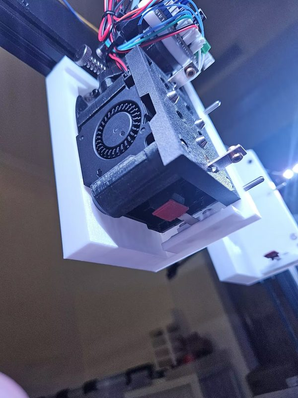
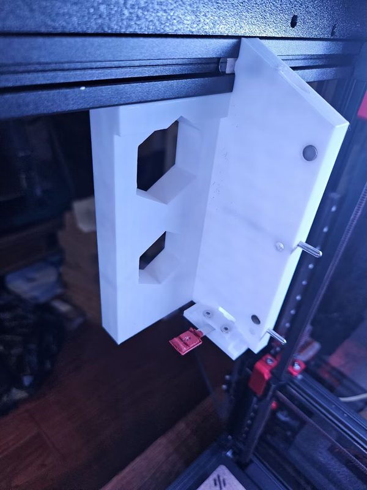
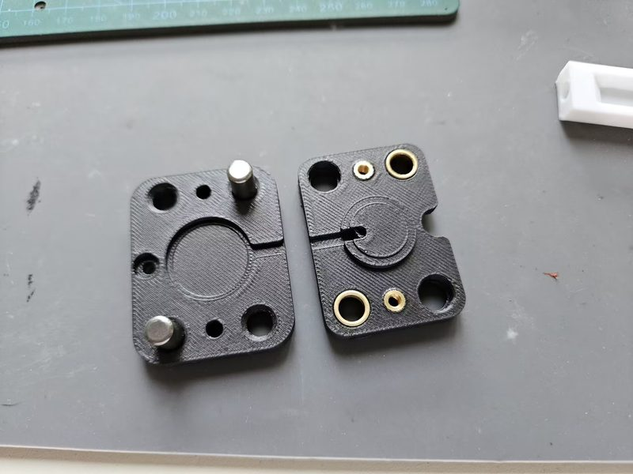

# FoxChanger

[Catalog row](../../OTHER.md#foxchanger) · [Gallery](../../GALLERY.md)

| Field | Value |
| --- | --- |
| Section | Legacy designs ([OTHER.md](../../OTHER.md)) |
| Project page | [https://github.com/Noisyfox/FoxChanger](https://github.com/Noisyfox/FoxChanger) |
| Author | Noisyfox |
| About | Voron 2.4/Trident mod that uses a Prusa XL-style latch made only from off-the-shelf pins, magnets and steel angles, with no custom metal parts. The latch takes the toolhead's Z-probe space, so a piezo bed sensor does Z homing. The repo also has a micro-switch nozzle-align probe. No update since 2024-10. |
| Type | Tool changer |
| Coupling | cone pins in bushings |
| Lock | latch, the dock opens it |
| Change time | — |
| Latest version | CAD [2024-10](https://github.com/Noisyfox/FoxChanger/commit/ed7ae1c) |
| Stars Likes Views |  |
| Links | [STEP](https://github.com/Noisyfox/FoxChanger/tree/main/Toolchanger/CAD) [STL](https://github.com/Noisyfox/FoxChanger/tree/main/Toolchanger/STLs) [Config](https://github.com/Noisyfox/FoxChanger/tree/main/Klipper/config) [Video](https://www.bilibili.com/video/BV1c142117zm) |
| Groups | — |

## Pictures (8)

<table>
<tr><td align="center" width="33%"> Photo: <a href="https://github.com/Noisyfox/FoxChanger">Noisyfox</a></td><td align="center" width="33%"> Photo: <a href="https://github.com/Noisyfox/FoxChanger">Noisyfox</a></td><td align="center" width="33%"> Photo: <a href="https://github.com/Noisyfox/FoxChanger">Noisyfox</a></td></tr>
<tr><td align="center" width="33%"> Photo: <a href="https://github.com/Noisyfox/FoxChanger">Noisyfox</a></td><td align="center" width="33%"> Photo: <a href="https://github.com/Noisyfox/FoxChanger">Noisyfox</a></td><td align="center" width="33%"> Photo: <a href="https://github.com/Noisyfox/FoxChanger">Noisyfox</a></td></tr>
<tr><td align="center" width="33%"> Photo: <a href="https://github.com/Noisyfox/FoxChanger">Noisyfox</a></td><td align="center" width="33%"> Photo: <a href="https://github.com/Noisyfox/FoxChanger">Noisyfox</a></td></tr>
</table>

## Notes

- All metal parts are off the shelf and need no custom machining or modification. ([source](https://github.com/Noisyfox/FoxChanger))
- The latches are printed in PETG-CF at 100% infill. ([source](https://github.com/Noisyfox/FoxChanger))
- Z homing uses a piezo sensor under the heated bed, similar to Bambu Lab P1 and X1 printers. ([source](https://github.com/Noisyfox/FoxChanger))
