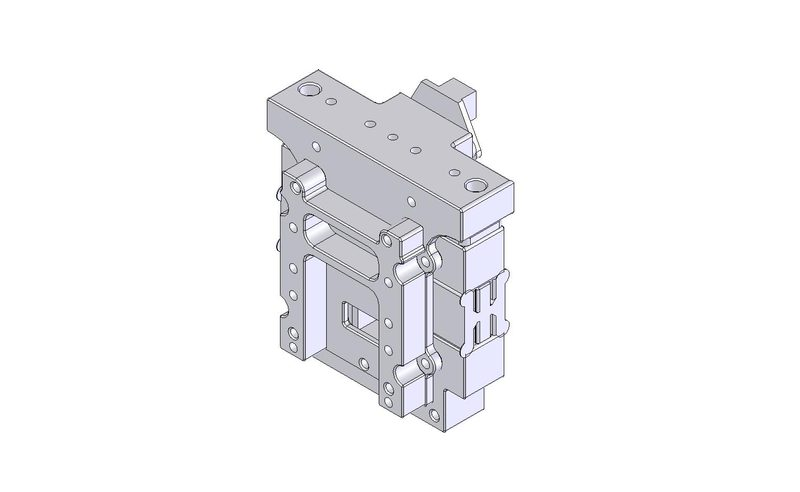
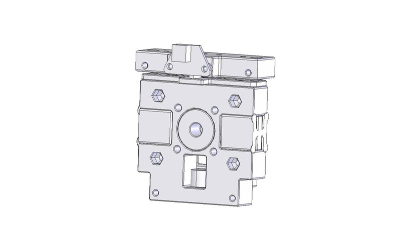
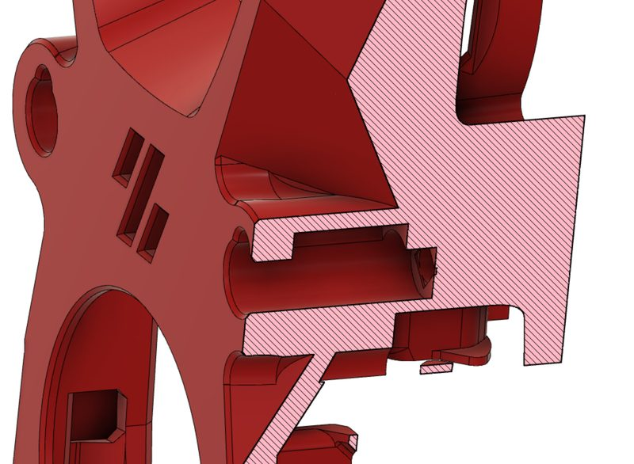
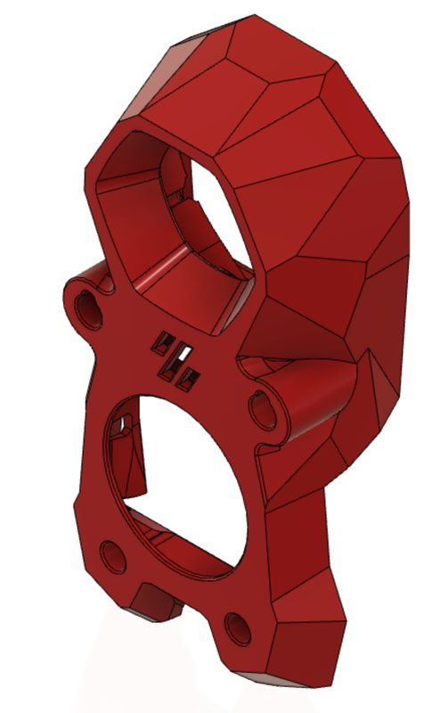
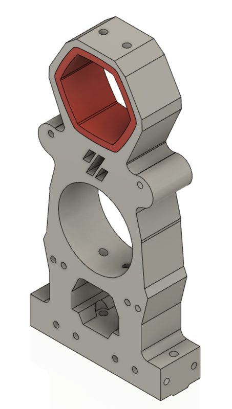
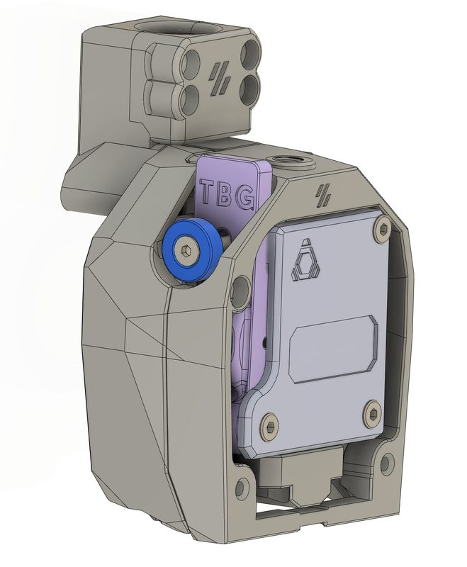

# Hydra

[Catalog row](../../README.md#hydra) · [Gallery](../../GALLERY.md)

| Field | Value |
| --- | --- |
| Section | Tool changers |
| Project page | [https://github.com/alfskaar/Hydra](https://github.com/alfskaar/Hydra) |
| Author | alfskaar (Sun & Sea) |
| About | A minimal Stealthburner toolchanger for Voron 2.4: the 2025 version uses only 3 pins, 3 bushings per tool and a Voron extruder spring in the shuttle, with no bearings or adjustment screws. It runs on Marlin, with the author's tool-change code sent as a Marlin PR. |
| Coupling | pins and bushings |
| Lock | magnets |
| Extruder | on the tool |
| Change time | [~23-25 s](https://www.youtube.com/watch?v=dxacGMmqg3s) |
| Tools | 4 |
| Base printers | Voron 2.4 |
| Firmware | Marlin |
| Latest version | Log [2025-03](https://github.com/alfskaar/Hydra#readme) |
| Stars Likes Views |  [⏯️⁠549](https://www.youtube.com/watch?v=dxacGMmqg3s) |
| Links | [STL](https://github.com/alfskaar/Hydra/tree/main/STLs) [BOM](https://github.com/alfskaar/Hydra/tree/main/BOM) [FW](https://github.com/MarlinFirmware/Marlin/pull/26956) [Video](https://www.youtube.com/watch?v=dxacGMmqg3s) |
| Groups | — |

## Pictures (6)

<table>
<tr><td align="center" width="33%"> Photo: <a href="https://github.com/alfskaar/Hydra">alfskaar</a></td><td align="center" width="33%"> Photo: <a href="https://github.com/alfskaar/Hydra">alfskaar</a></td><td align="center" width="33%"> Photo: <a href="https://github.com/alfskaar/Hydra">alfskaar</a></td></tr>
<tr><td align="center" width="33%"> Photo: <a href="https://github.com/alfskaar/Hydra">alfskaar</a></td><td align="center" width="33%"> Photo: <a href="https://github.com/alfskaar/Hydra">alfskaar</a></td><td align="center" width="33%"> Photo: <a href="https://github.com/alfskaar/Hydra">alfskaar</a></td></tr>
</table>
