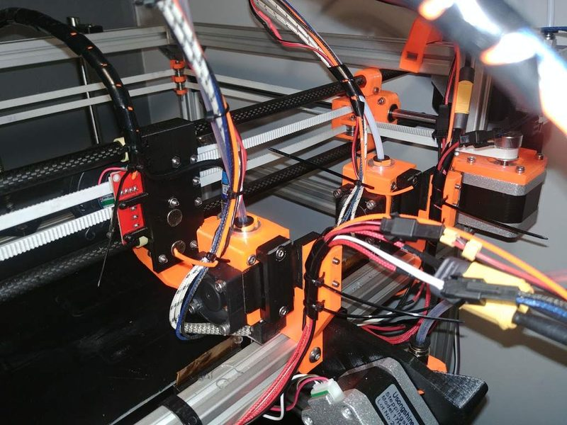
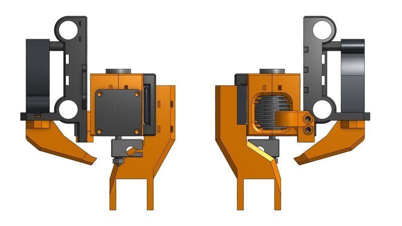
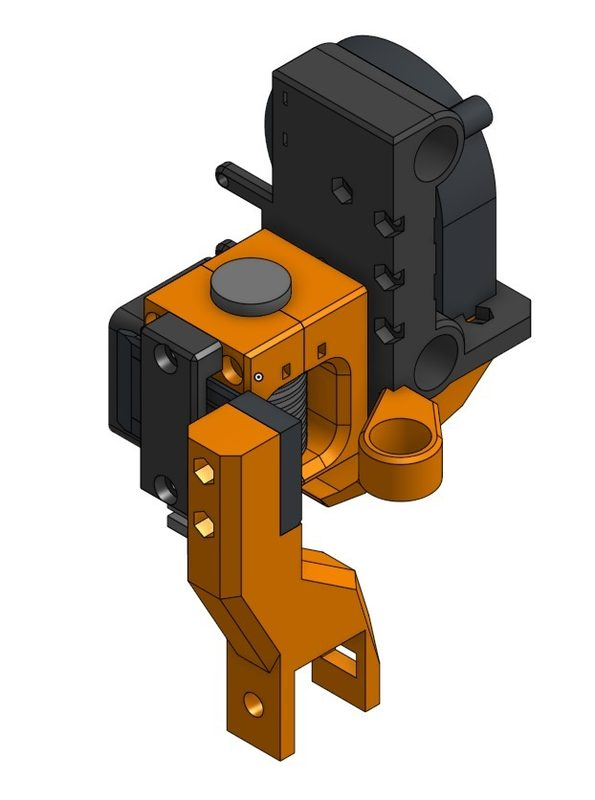
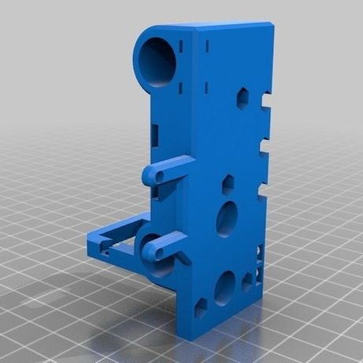
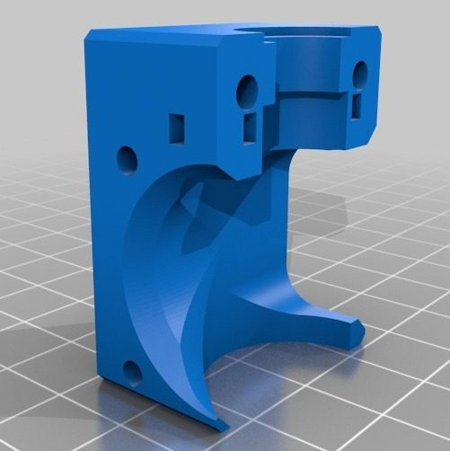
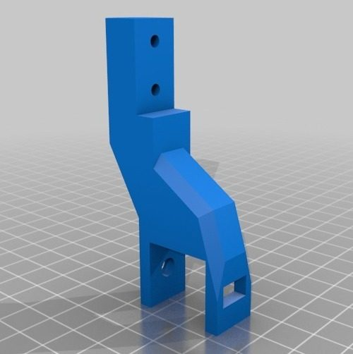

# Hypercube parking extruders

[Catalog row](../../OTHER.md#hypercube-parking-extruders) · [Gallery](../../GALLERY.md)

| Field | Value |
| --- | --- |
| Section | Legacy designs ([OTHER.md](../../OTHER.md)) |
| Project page | [https://www.printables.com/model/202063-hypercube-tool-changermulti-material-parking-extru](https://www.printables.com/model/202063-hypercube-tool-changermulti-material-parking-extru) |
| Author | McAbra (Paweł Kucmus, pkucmus / EVA-3D) |
| About | Parking-extruder heads for the HyperCube: the carriage picks a head off a hook in a fixed dock by moving in Y, and magnets with centering screws hold it. It was built mainly to switch between 0.4 and 0.6 mm nozzles. Tool changes are slicer G-code moves, not firmware. No update since 2018-11. |
| Type | Tool changer, Bowden |
| Coupling | magnets and centering screws |
| Lock | magnets |
| Change time | — |
| Latest version | First release [2018-11](https://www.thingiverse.com/thing:3230818) |
| Stars Likes Views | [🧡⁠11](https://www.printables.com/model/202063-hypercube-tool-changermulti-material-parking-extru/files) [⏯️⁠3K](https://www.youtube.com/watch?v=ODtzj8-Y1U0) |
| Links | [STL](https://www.printables.com/model/202063-hypercube-tool-changermulti-material-parking-extru/files) [FW](https://github.com/pkucmus/Marlin/tree/hypercube-parking-1.1.9) [Video](https://www.youtube.com/watch?v=ODtzj8-Y1U0) [Video (print start)](https://www.youtube.com/watch?v=3nZpMxgXLOU) |
| Groups | — |

## Pictures (6)

<table>
<tr><td align="center" width="33%"> Photo: <a href="https://www.printables.com/model/202063-hypercube-tool-changermulti-material-parking-extru">McAbra</a></td><td align="center" width="33%"> Photo: <a href="https://www.printables.com/model/202063-hypercube-tool-changermulti-material-parking-extru">McAbra</a></td><td align="center" width="33%"> Photo: <a href="https://www.printables.com/model/202063-hypercube-tool-changermulti-material-parking-extru">McAbra</a></td></tr>
<tr><td align="center" width="33%"> Photo: <a href="https://www.printables.com/model/202063-hypercube-tool-changermulti-material-parking-extru">McAbra</a></td><td align="center" width="33%"> Photo: <a href="https://www.printables.com/model/202063-hypercube-tool-changermulti-material-parking-extru">McAbra</a></td><td align="center" width="33%"> Photo: <a href="https://www.printables.com/model/202063-hypercube-tool-changermulti-material-parking-extru">McAbra</a></td></tr>
</table>
