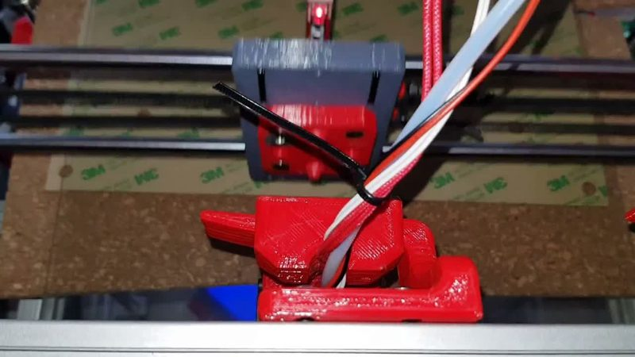
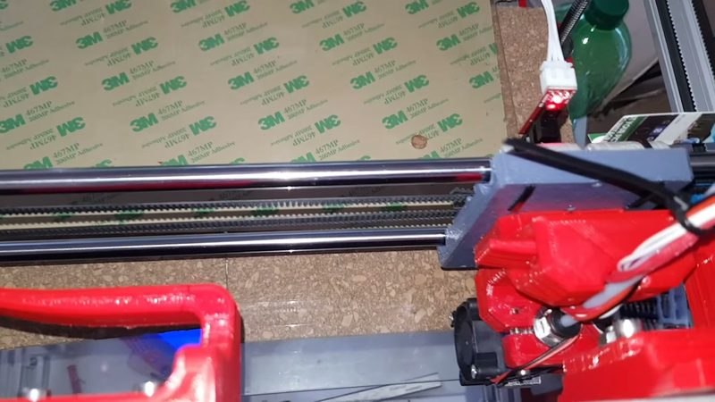
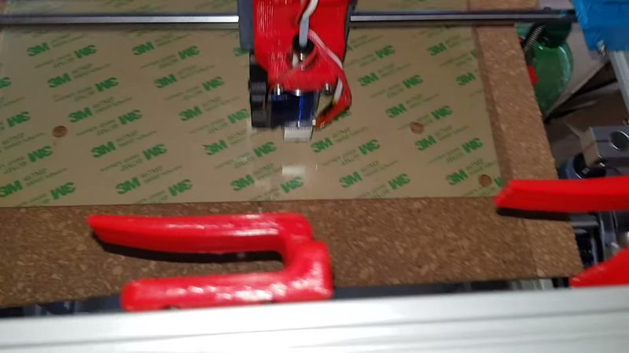
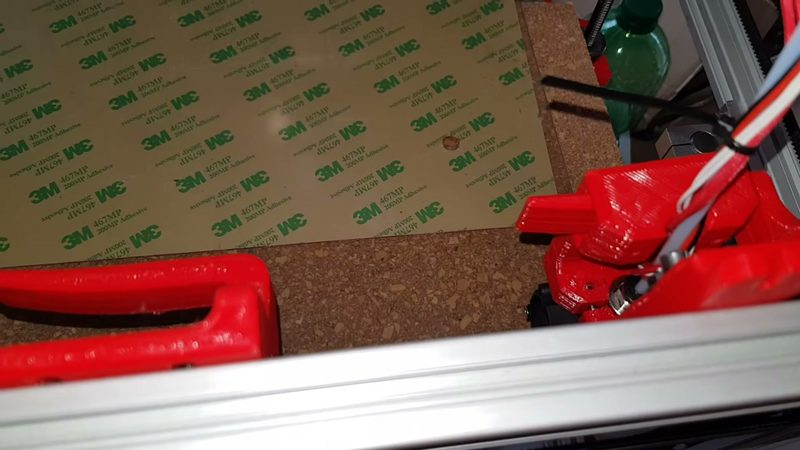

# Hotend changer (Idriss Razgani)

[Catalog row](../../OTHER.md#idriss-razgani-hotend-changer) · [Gallery](../../GALLERY.md)

| Field | Value |
| --- | --- |
| Section | Concepts and prototypes ([OTHER.md](../../OTHER.md)) |
| Project page | [https://www.youtube.com/watch?v=So9vmKJjUbg](https://www.youtube.com/watch?v=So9vmKJjUbg) |
| Author | Idriss Razgani |
| About | Head for a Hypercube-style CoreXY that sits on four centering cones and is held by neodymium magnets; the holder profile snaps the parked head in place. |
| Type | Hotend changer |
| Status | One video, no files |
| Coupling | 4 centering cones |
| Lock | magnets |
| Latest version | Last seen [2018-10](https://www.youtube.com/watch?v=So9vmKJjUbg) |
| Stars Likes Views | [⏯️⁠1.5K](https://www.youtube.com/watch?v=So9vmKJjUbg) |
| Links | [Video](https://www.youtube.com/watch?v=So9vmKJjUbg) |

## Pictures (4)

<table>
<tr><td align="center" width="33%"> Photo: <a href="https://www.youtube.com/watch?v=So9vmKJjUbg">Idriss Razgani</a></td><td align="center" width="33%"> Photo: <a href="https://www.youtube.com/watch?v=So9vmKJjUbg">Idriss Razgani</a></td><td align="center" width="33%"> Photo: <a href="https://www.youtube.com/watch?v=So9vmKJjUbg">Idriss Razgani</a></td></tr>
<tr><td align="center" width="33%"> Photo: <a href="https://www.youtube.com/watch?v=So9vmKJjUbg">Idriss Razgani</a></td></tr>
</table>
