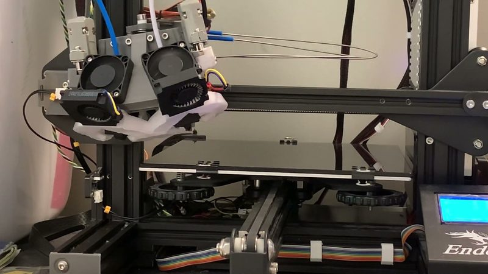
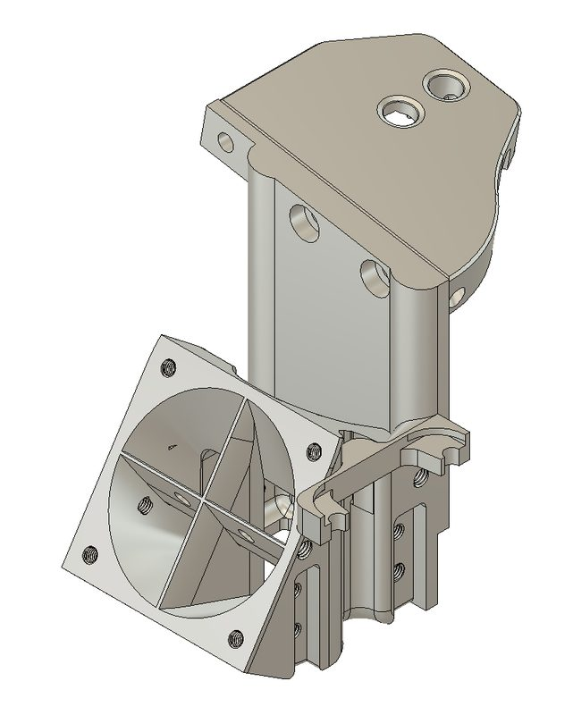
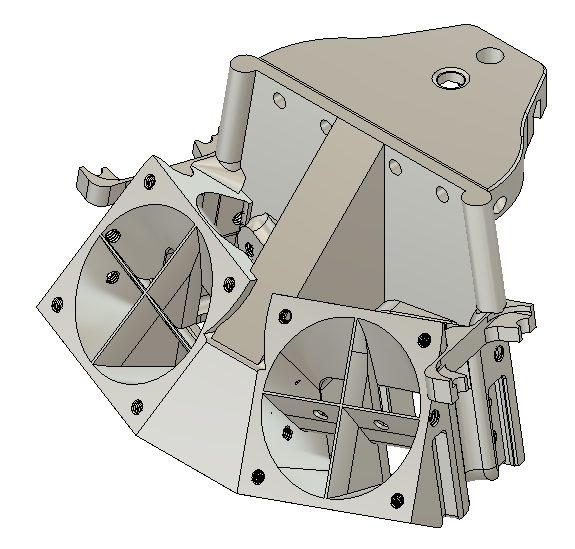
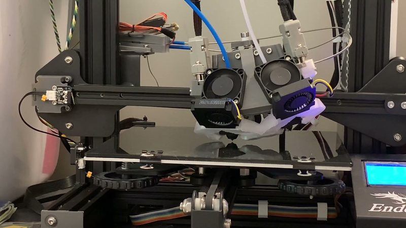
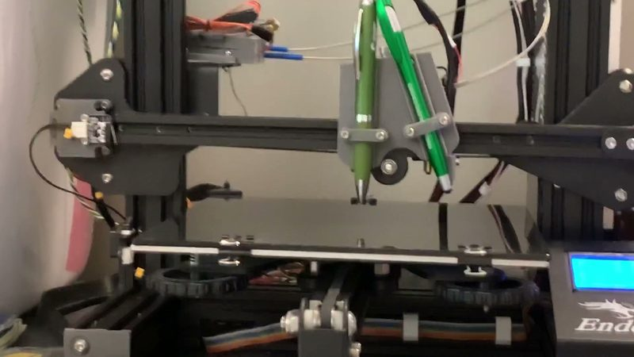

# IITC

[Catalog row](../../OTHER.md#iitc) · [Gallery](../../GALLERY.md)

| Field | Value |
| --- | --- |
| Section | Concepts and prototypes ([OTHER.md](../../OTHER.md)) |
| Project page | [https://github.com/dotdash32/IITC](https://github.com/dotdash32/IITC) |
| Author | dotdash32 (Josh DeWitt) |
| About | Mostly printed add-on for Ender 3 and other V-slot printers. A Bowden-cable servo tilts a dual head between two nozzles (intra). Tool groups on a screw-head kinematic mount are swapped by hand (inter). The spring-loaded mount also works as a nozzle probe. |
| Type | Tool changer, Bowden |
| Status | Files; changes between tool groups are manual |
| Coupling | Kelvin (socket head cap screws, kinematic mount) |
| Lock | manual |
| Latest version | v0.1.1 [2021-07](https://github.com/dotdash32/IITC/releases/tag/v0.1.1) |
| Stars Likes Views |  [⏯️⁠1K](https://www.youtube.com/watch?v=5y99OYjvCSE) |
| Links | [CAD](https://github.com/dotdash32/IITC/tree/main/CAD) [FW](https://github.com/dotdash32/IITC/tree/main/Firmware) [Video](https://www.youtube.com/watch?v=5y99OYjvCSE) |

## Pictures (5)

<table>
<tr><td align="center" width="33%"> Photo: <a href="https://www.youtube.com/watch?v=5y99OYjvCSE">Josh DeWitt</a></td><td align="center" width="33%"> Photo: <a href="https://github.com/dotdash32/IITC">Josh DeWitt (dotdash32)</a></td><td align="center" width="33%"> Photo: <a href="https://github.com/dotdash32/IITC">Josh DeWitt (dotdash32)</a></td></tr>
<tr><td align="center" width="33%"> Photo: <a href="https://www.youtube.com/watch?v=5y99OYjvCSE">Josh DeWitt</a></td><td align="center" width="33%"> Photo: <a href="https://www.youtube.com/watch?v=5y99OYjvCSE">Josh DeWitt</a></td></tr>
</table>
