# Jubilee

[Catalog row](../../README.md#jubilee) · [Gallery](../../GALLERY.md)

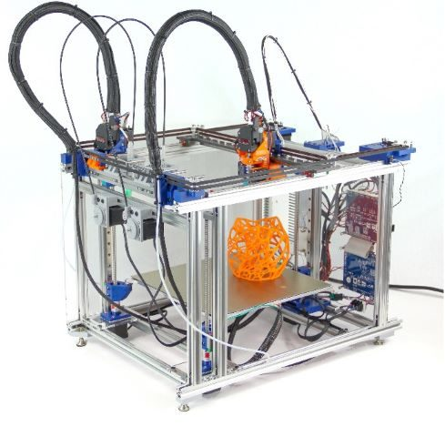

| Field | Value |
| --- | --- |
| Section | Tool changers |
| Project page | [https://github.com/machineagency/jubilee](https://github.com/machineagency/jubilee) |
| Author | Machine Agency (Joshua Vasquez) |
| About | Complete open multi-tool CoreXY platform (300×300×300 mm) for printing, plotting, and lab tools. A twist lock that senses torque pulls the tool plate onto a kinematic coupling. The tool plates fit E3D tools. |
| Coupling | Maxwell and wedge plate |
| Lock | twist lock, motor |
| Extruder | on the tool |
| Change time | — |
| Tools | 4 |
| Printer | own printer |
| Firmware | RepRapFirmware |
| Latest version | V2.2.2 [2021-10](https://github.com/machineagency/jubilee/releases/tag/v2.2.2) |
| Stars Likes Views |  |
| Links | [STEP](https://github.com/machineagency/jubilee/tree/main/frame) [Files](https://github.com/machineagency/jubilee/tree/main/tools) [BOM](https://docs.google.com/spreadsheets/d/1pRzBQxVzL9c4T9b1RrKvSjlSwJJhJ7NcbSV6iJUv0X0/edit#gid=0) [Manual](https://jubilee3d.com/index.php?title=Assembly_Instructions) [Wiki](https://jubilee3d.com/index.php?title=Main_Page) [Config](https://github.com/machineagency/jubilee/tree/main/software/duet_config_files) |
| Groups | [Discord](https://discord.gg/XkphRqb) EN 2K [Reddit](https://www.reddit.com/r/Jubilee3D/) EN |

## Pictures (29)

<table>
<tr><td align="center" width="33%"> Photo: <a href="https://github.com/machineagency/jubilee">Poofjunior</a></td><td align="center" width="33%"><a href="1-jubilee.jpg">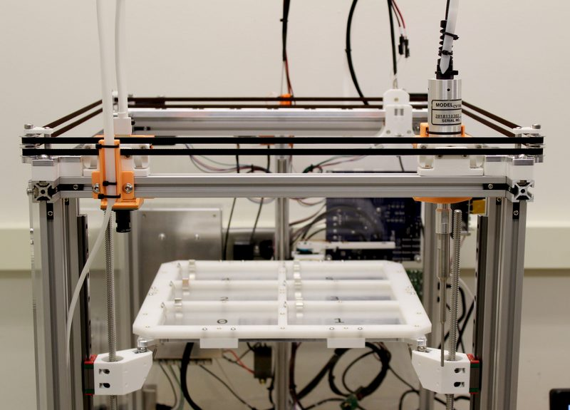</a> Photo: <a href="https://jubilee3d.com/index.php?title=File:Ss-unloaded.jpg">Poofjunior</a></td><td align="center" width="33%"><a href="2-jubilee.jpg">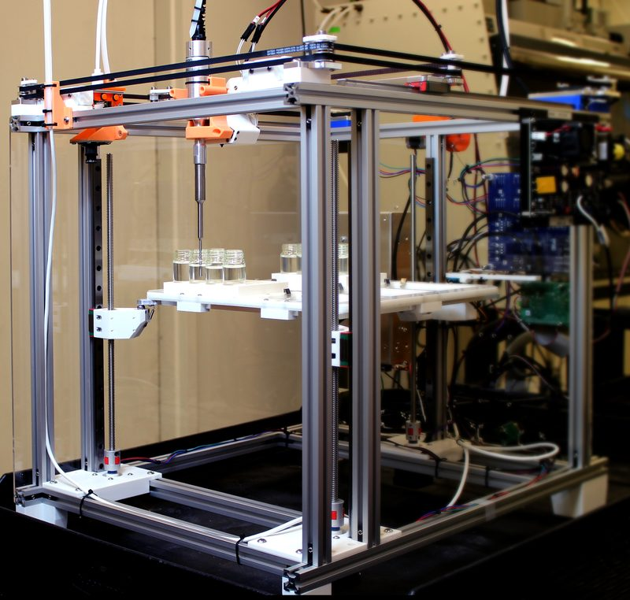</a> Photo: <a href="https://jubilee3d.com/index.php?title=File:Ss-sit.jpg">Poofjunior</a></td></tr>
<tr><td align="center" width="33%"><a href="3-jubilee.jpg">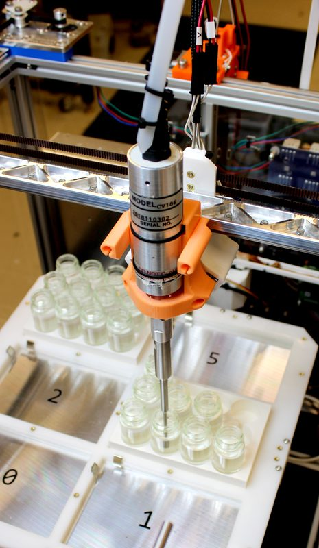</a> Photo: <a href="https://jubilee3d.com/index.php?title=File:Ss-tool.jpg">Poofjunior</a></td><td align="center" width="33%"><a href="4-jubilee.jpg">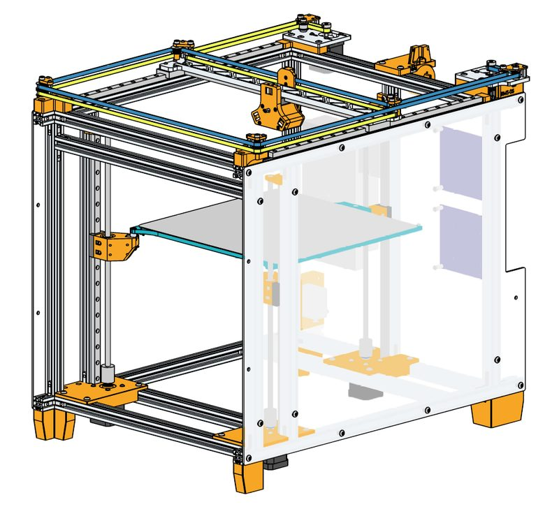</a> Photo: <a href="https://jubilee3d.com/index.php?title=File:Jubilee_v2.1.2.png">Poofjunior</a></td><td align="center" width="33%"><a href="5-jubilee.jpg">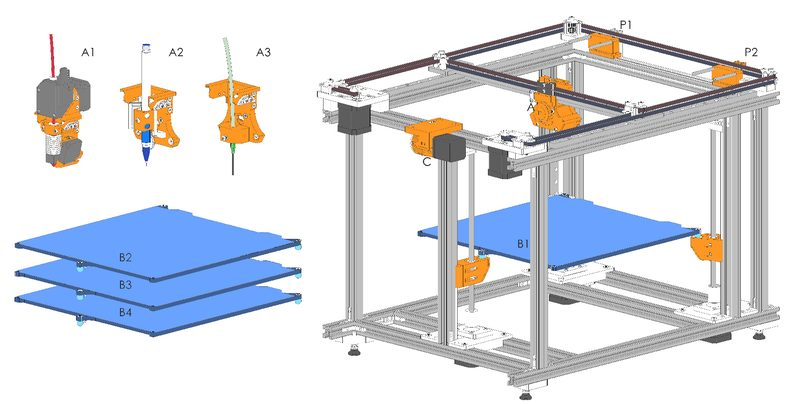</a> Photo: <a href="https://jubilee3d.com/index.php?title=File:Jubilee_Splash.png">Poofjunior</a></td></tr>
<tr><td align="center" width="33%"><a href="6-jubilee.jpg">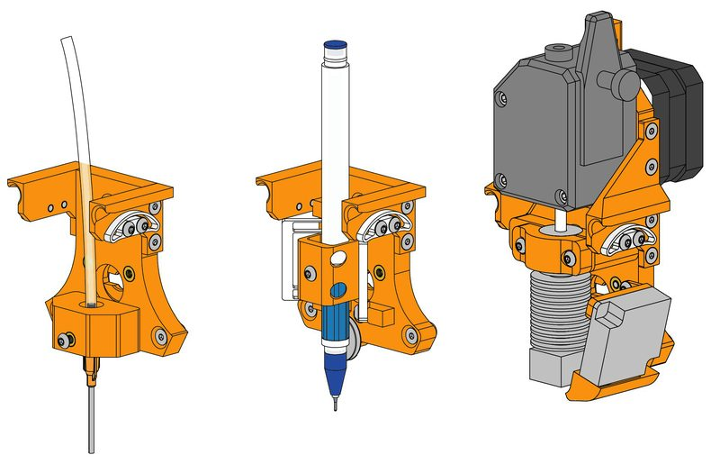</a> Photo: <a href="https://jubilee3d.com/index.php?title=File:Tool_layout.png">Poofjunior</a></td><td align="center" width="33%"><a href="7-jubilee.jpg">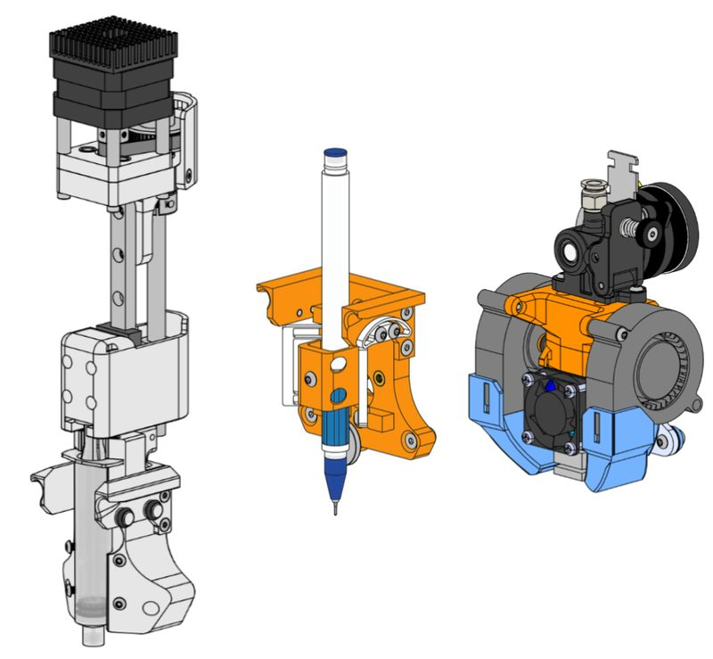</a> Photo: <a href="https://jubilee3d.com/index.php?title=File:Tool_library_pics.png">Poofjunior</a></td><td align="center" width="33%"><a href="8-jubilee.jpg">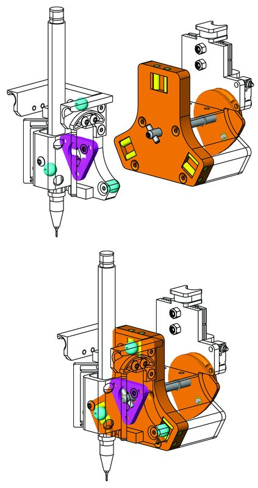</a> Photo: <a href="https://jubilee3d.com/index.php?title=File:Locking_tool.jpg">Poofjunior</a></td></tr>
<tr><td align="center" width="33%"><a href="9-jubilee.jpg">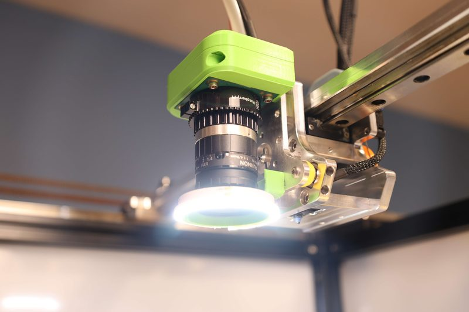</a> Photo: <a href="https://jubilee3d.com/index.php?title=File:Mounted_camera_inspection_tool.jpg">Poofjunior</a></td><td align="center" width="33%"><a href="10-jubilee.jpg">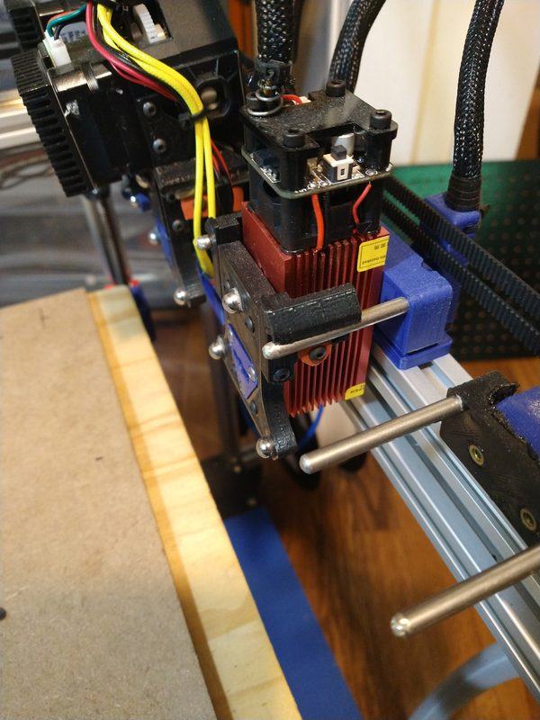</a> Photo: <a href="https://jubilee3d.com/index.php?title=File:Laser_tool.jpg">Chris was here</a></td><td align="center" width="33%"><a href="11-jubilee.jpg">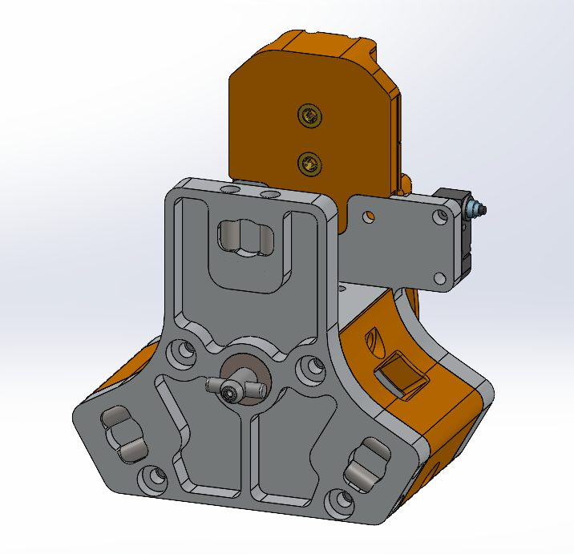</a> Photo: <a href="https://jubilee3d.com/index.php?title=File:Metal_tool_plate.png">Poofjunior</a></td></tr>
<tr><td align="center" width="33%"><a href="12-jubilee.jpg">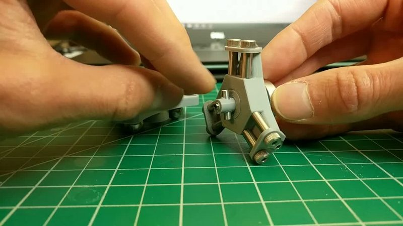</a> Version: 3D Printed Tool Changer, proof of concept Photo: <a href="https://www.youtube.com/watch?v=5lv6IPu8Qyc">Sonya Vasquez</a></td><td align="center" width="33%"><a href="13-jubilee.jpg">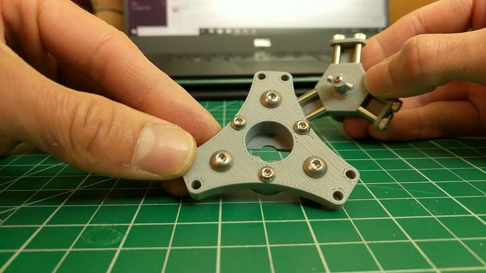</a> Version: 3D Printed Tool Changer, proof of concept Photo: <a href="https://www.youtube.com/watch?v=5lv6IPu8Qyc&amp;t=32s">Sonya Vasquez</a></td><td align="center" width="33%"><a href="14-jubilee.jpg">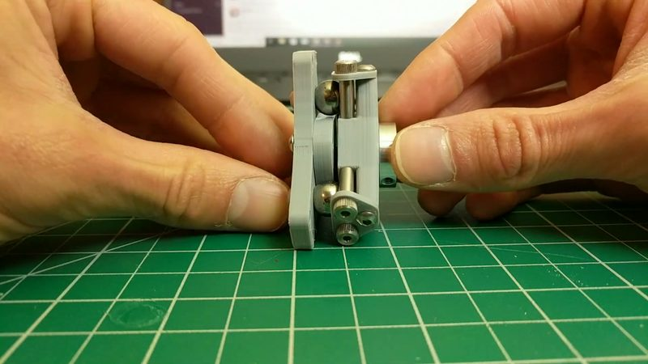</a> Version: 3D Printed Tool Changer, proof of concept Photo: <a href="https://www.youtube.com/watch?v=5lv6IPu8Qyc&amp;t=14s">Sonya Vasquez</a></td></tr>
<tr><td align="center" width="33%"><a href="15-jubilee.jpg">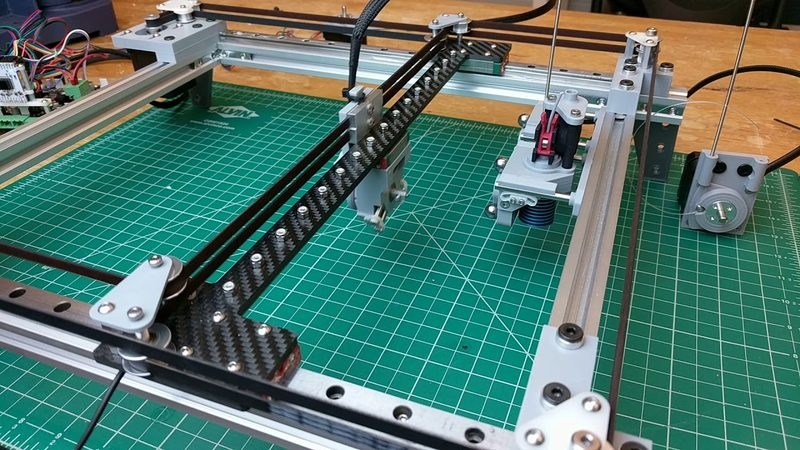</a> Version: Cable-Driven Toolchanger V2 Photo: <a href="https://www.youtube.com/watch?v=fRo3FUWs4Sg">Sonya Vasquez</a></td><td align="center" width="33%"><a href="16-jubilee.jpg">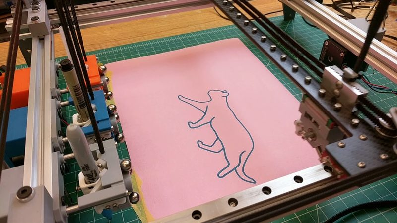</a> Version: Cable-Driven Toolchanger V2 Photo: <a href="https://www.youtube.com/watch?v=yCwlqF1J5I8">Sonya Vasquez</a></td><td align="center" width="33%"><a href="17-jubilee.jpg">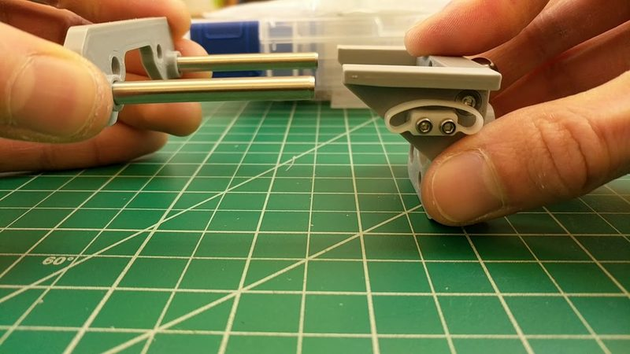</a> Version: Cable-Driven Toolchanger V2 Photo: <a href="https://www.youtube.com/watch?v=QcsXqRd0ouY">Sonya Vasquez</a></td></tr>
<tr><td align="center" width="33%"><a href="18-jubilee.jpg">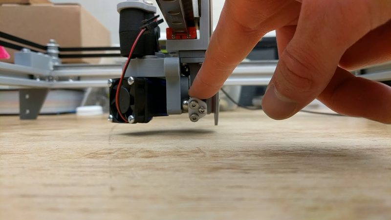</a> Version: Cable-Driven Toolchanger V2 Photo: <a href="https://www.youtube.com/watch?v=JSYYPvQmFVI">Sonya Vasquez</a></td><td align="center" width="33%"><a href="19-jubilee.jpg">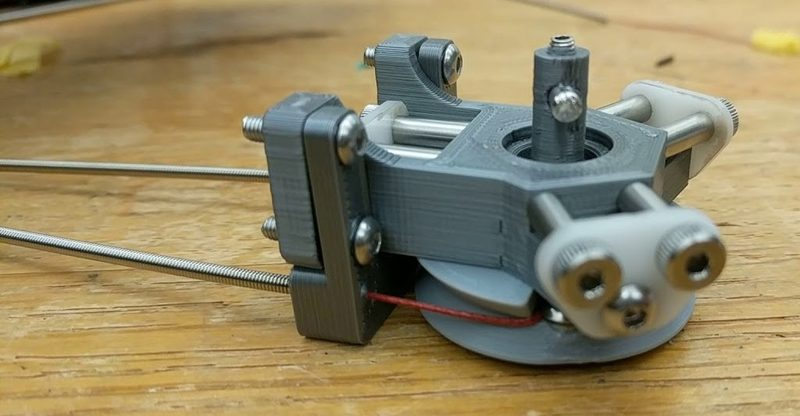</a> Version: Cable-Driven Toolchanger V2 Photo: <a href="https://www.youtube.com/watch?v=vFxDNbAok28">Sonya Vasquez</a></td><td align="center" width="33%"><a href="20-jubilee.jpg">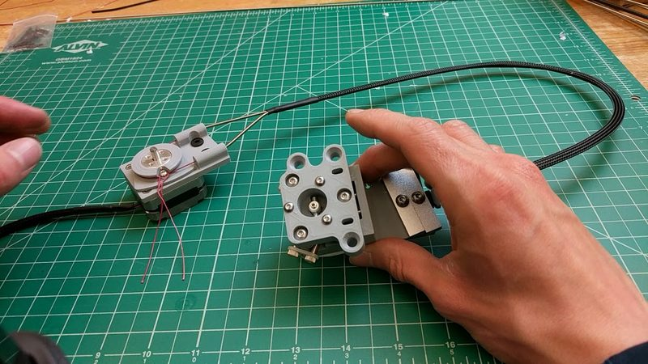</a> Version: Cable-Driven Toolchanger V2 Photo: <a href="https://www.youtube.com/watch?v=ibJpjYAcjaM">Sonya Vasquez</a></td></tr>
<tr><td align="center" width="33%"><a href="21-jubilee.jpg">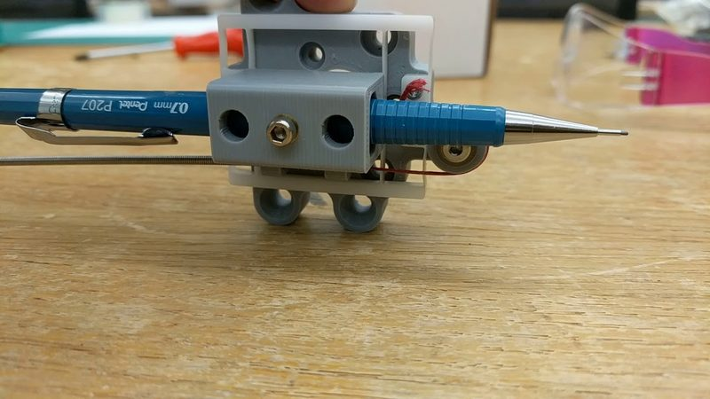</a> Version: Cable-Driven Toolchanger V2 Photo: <a href="https://www.youtube.com/watch?v=vk-KnCFU3vs">Sonya Vasquez</a></td><td align="center" width="33%"><a href="22-jubilee.jpg">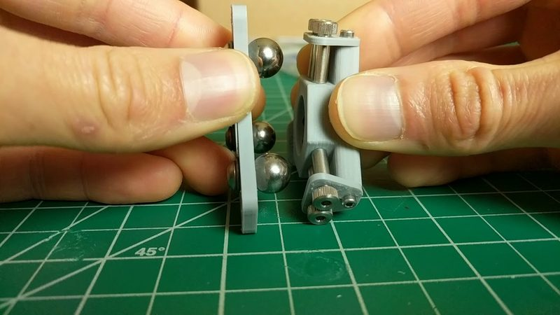</a> Version: Cable-Driven Toolchanger V2 Photo: <a href="https://www.youtube.com/watch?v=cfSHss5j5KU">Sonya Vasquez</a></td><td align="center" width="33%"><a href="23-jubilee.jpg">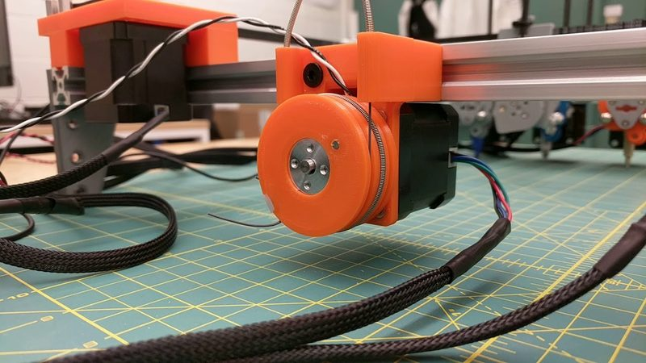</a> Version: Cable-Driven Toolchanger V2 Photo: <a href="https://www.youtube.com/watch?v=HDDvr3DhQMw">Sonya Vasquez</a></td></tr>
<tr><td align="center" width="33%"><a href="24-jubilee.jpg">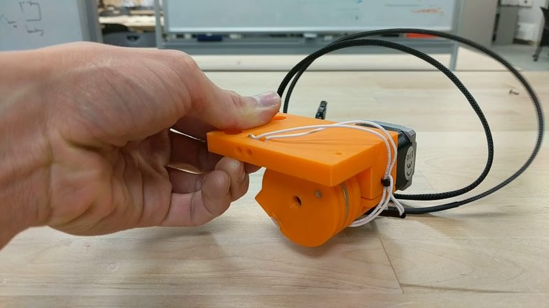</a> Version: Cable-Driven Toolchanger V2 Photo: <a href="https://www.youtube.com/watch?v=65SgrvFtzXE">Sonya Vasquez</a></td><td align="center" width="33%"><a href="25-jubilee.jpg">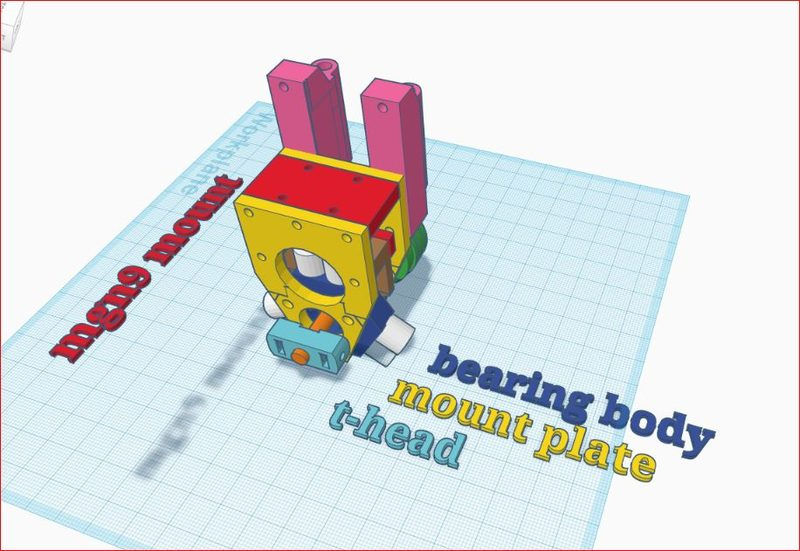</a> Version: 3D-printed toolchanger (vladbabii) Photo: <a href="https://github.com/vladbabii/3d_printed_toolchanger">vladbabii</a></td><td align="center" width="33%"><a href="26-jubilee.jpg">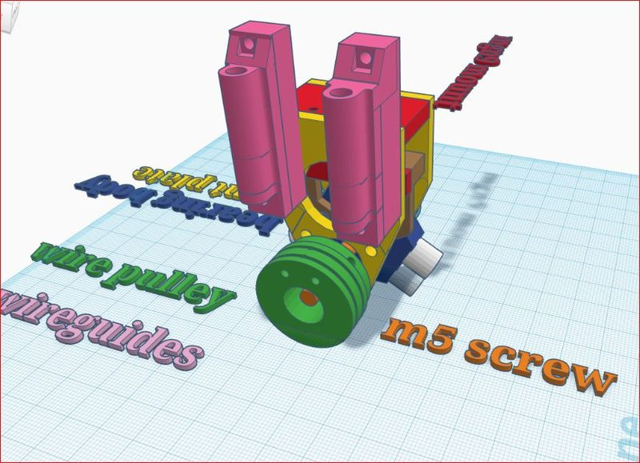</a> Version: 3D-printed toolchanger (vladbabii) Photo: <a href="https://github.com/vladbabii/3d_printed_toolchanger">vladbabii</a></td></tr>
<tr><td align="center" width="33%"><a href="27-jubilee.jpg">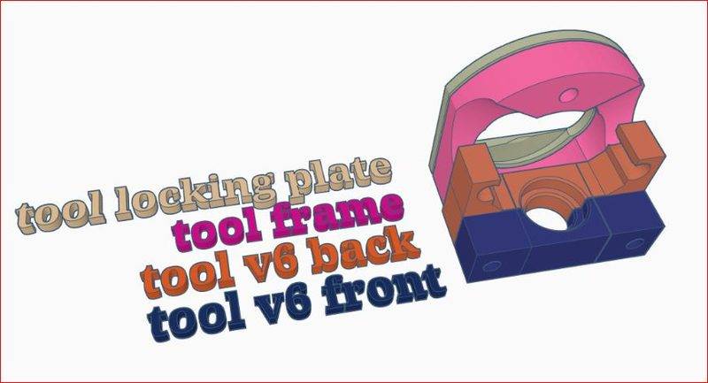</a> Version: 3D-printed toolchanger (vladbabii) Photo: <a href="https://github.com/vladbabii/3d_printed_toolchanger">vladbabii</a></td><td align="center" width="33%"><a href="28-jubilee.jpg">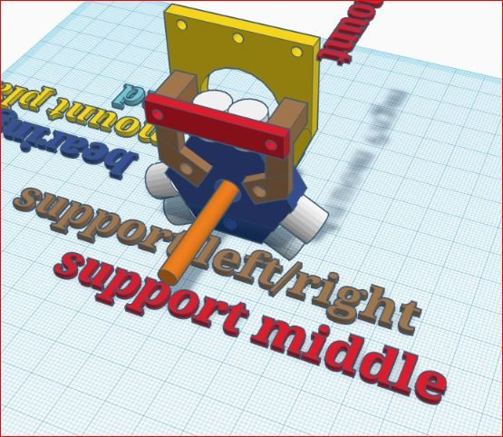</a> Version: 3D-printed toolchanger (vladbabii) Photo: <a href="https://github.com/vladbabii/3d_printed_toolchanger">vladbabii</a></td></tr>
</table>

## Notes

- The twist lock rubs on the wedge plate, so the wedge plate wears out after thousands of lock cycles and needs replacement. ([source](https://jubilee3d.com/index.php?title=The_Remote_Elastic_Lock))
- Jubilee ships RepRapFirmware config files for Duet boards, and its wiki lists community Klipper ports such as JubileeKlipper but no official Klipper path. ([source](https://jubilee3d.com/index.php?title=Assembly_Instructions))
- The 409 mm tool rack holds 4 default extruder tools. ([source](https://jubilee3d.com/index.php?title=Specs))

## Ports and variants

- [3D Printed Tool Changer, proof of concept](https://www.youtube.com/watch?v=5lv6IPu8Qyc), *Sonya Vasquez (poofjunior, Machine Agency)*. A 2018 proof of concept of a 3D-printed kinematic-coupling toolchanger. It became Jubilee.
- [Cable-Driven Toolchanger V2](https://www.thingiverse.com/thing:3805144), *poofjunior (YouTube channel now under the name Sonya Vasquez)*. Remote twist lock driven by a stepper over a Bowden-style spring-guide cable. In V2 a series-elastic spring and limit switches lock by torque instead of by position, so worn printed tool plates still lock. Accepts E3D tool plates and an all-printed plate.
- [3D-printed toolchanger (vladbabii)](https://github.com/vladbabii/3d_printed_toolchanger), *Vlad Babii (vladbabii / wladq66 on Thingiverse)*. Fully printed toolchanger, remixed from Jubilee, with a T-head, a locking plate, an MGN9 carriage mount, and a magnetic tool park. Renders and Klipper macros only, no build.
