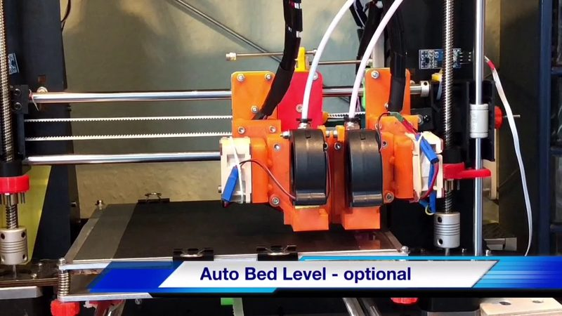
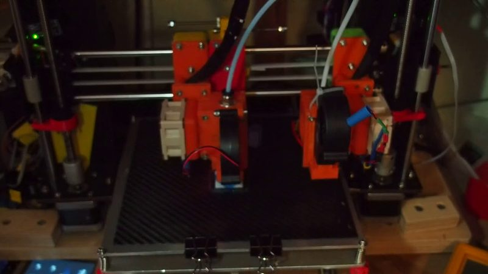
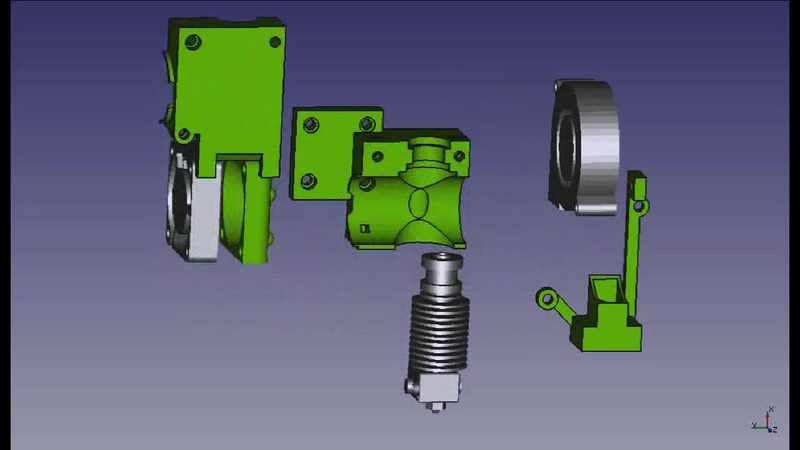
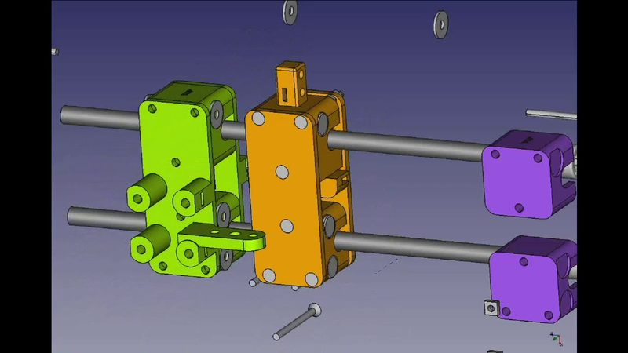
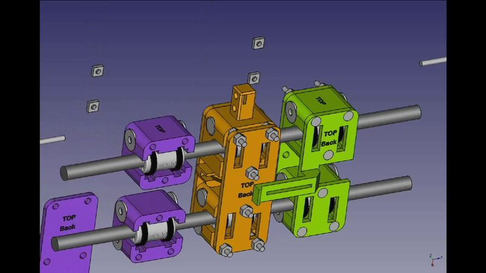

# Magnetic Parking Extruder

[Catalog row](../../OTHER.md#kinematic-magnetic-parking-extruder) · [Gallery](../../GALLERY.md)

| Field | Value |
| --- | --- |
| Section | Concepts and prototypes ([OTHER.md](../../OTHER.md)) |
| Project page | [https://www.thingiverse.com/thing:3080893](https://www.thingiverse.com/thing:3080893) |
| Author | Rolf Werum (Weruminger) |
| About | A dual-tool parking changer for i3 Mendel. One transport slider on the X rail grabs either of two hotend sliders parked at the X ends, using side magnets and moves only (no solenoid or servo). It is supported in mainline Marlin as MAGNETIC_PARKING_EXTRUDER. |
| Type | Tool changer, Bowden |
| Status | Files, Marlin feature |
| Coupling | magnets (transport slider to tool slider, on a shared X rail) |
| Lock | magnets |
| Latest version | CAD [2019-11](https://github.com/Weruminger/Magnetic_Parking_Extruder/commit/b160ca9) |
| Stars Likes Views |  [⏯️⁠2.6K](https://www.youtube.com/watch?v=smjgnP-W-VE) |
| Links | [Files](https://www.thingiverse.com/thing:3080893/files) [STL](https://github.com/Weruminger/Magnetic_Parking_Extruder/tree/master/stl) [STEP](https://github.com/Weruminger/Magnetic_Parking_Extruder/tree/master/STEP) [CAD](https://github.com/Weruminger/Magnetic_Parking_Extruder/tree/master/model) [FW](https://github.com/MarlinFirmware/Marlin/pull/12351) [Video](https://www.youtube.com/watch?v=smjgnP-W-VE) [Video](https://www.youtube.com/watch?v=Bqbcs0CU2FE) |

## Pictures (5)

<table>
<tr><td align="center" width="33%"> Photo: <a href="https://www.youtube.com/watch?v=wqeN-WCvvuk">Rolf Werum</a></td><td align="center" width="33%"> Photo: <a href="https://www.youtube.com/watch?v=smjgnP-W-VE">Rolf Werum</a></td><td align="center" width="33%"> Photo: <a href="https://www.youtube.com/watch?v=lSvIlkPQppQ">Rolf Werum</a></td></tr>
<tr><td align="center" width="33%"> Photo: <a href="https://www.youtube.com/watch?v=5bK26TFqL6c">Rolf Werum</a></td><td align="center" width="33%"> Photo: <a href="https://www.youtube.com/watch?v=pBWbshZkAkQ">Rolf Werum</a></td></tr>
</table>
