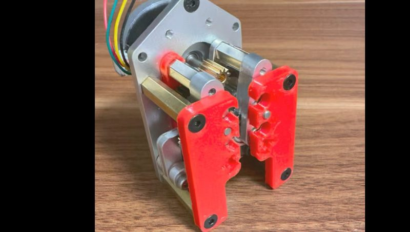
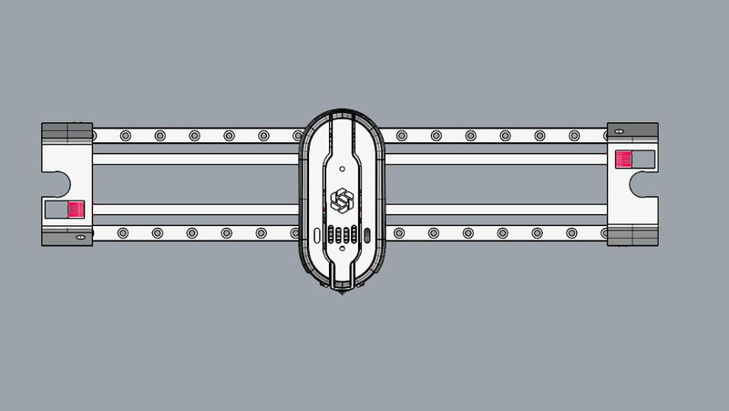

# 酷酷ad hotend changer

[Catalog row](../../OTHER.md#kukuad-hotend-changer) · [Gallery](../../GALLERY.md)

| Field | Value |
| --- | --- |
| Section | Concepts and prototypes ([OTHER.md](../../OTHER.md)) |
| Project page | [https://www.bilibili.com/video/BV1VSYC6eExu/](https://www.bilibili.com/video/BV1VSYC6eExu/) |
| Author | 酷酷ad |
| About | Shared-extruder hotend changer built from standard parts (K1 gear pack, rack-and-pinion arm spreader). It is front-mounted on a Bambu P1 frame running Klipper. The author chose front mounting because rear mounting loses about 20 mm of travel. |
| Type | Hotend changer |
| Status | Prototype in testing |
| Coupling | — |
| Lock | — |
| Latest version | Last seen [2026-09](https://www.bilibili.com/video/BV1VSYC6eExu/) |
| Stars Likes Views | [⏯️⁠2.5K](https://www.bilibili.com/video/BV1VSYC6eExu/) |
| Links | [Video (extruder test)](https://www.bilibili.com/video/BV1VSYC6eExu/) [Video (P1 hotend changer)](https://www.bilibili.com/video/BV1Miao6oEJF/) |

## Pictures (2)

<table>
<tr><td align="center" width="33%"> Photo: <a href="https://www.bilibili.com/video/BV1VSYC6eExu/">酷酷ad</a></td><td align="center" width="33%"> Photo: <a href="https://www.bilibili.com/video/BV1Miao6oEJF/">酷酷ad</a></td></tr>
</table>
