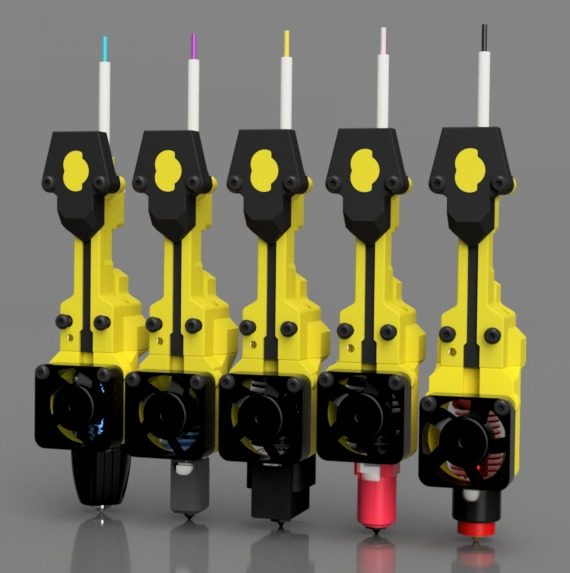
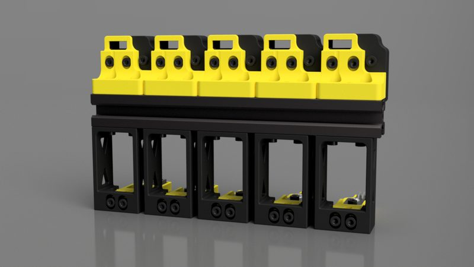
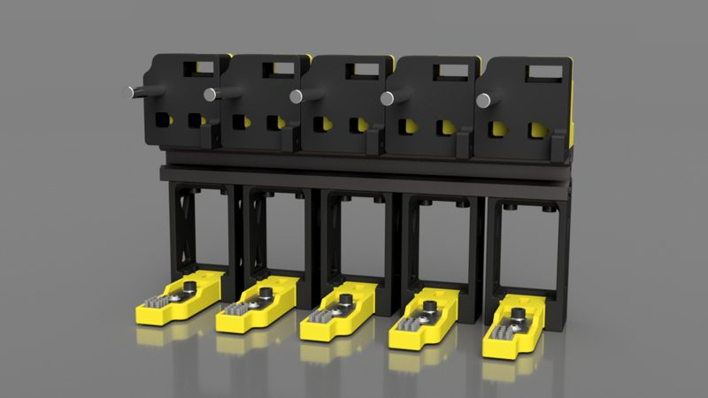
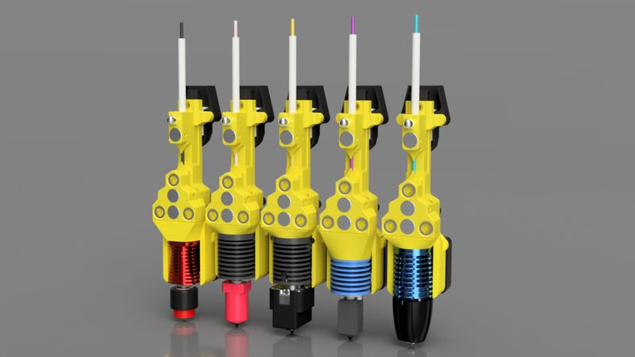
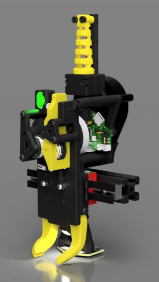
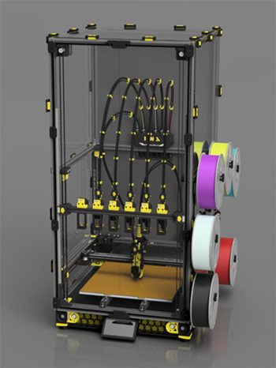
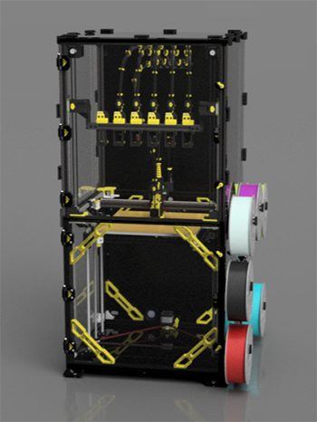
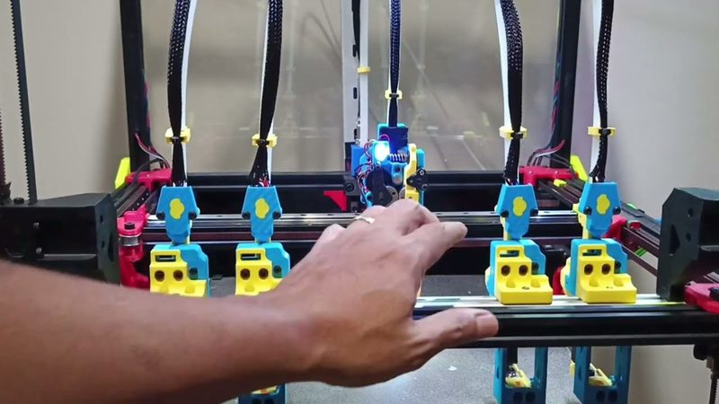

# Lineux Hotswap

[Catalog row](../../README.md#lineux-hotswap) · [Gallery](../../GALLERY.md)

| Field | Value |
| --- | --- |
| Section | Hotend changers |
| Project page | [https://github.com/3dfiyMyLife/Lineux-Hotswap](https://github.com/3dfiyMyLife/Lineux-Hotswap) |
| Author | 3dfiy My Life (3dfiyMyLife), Lineux team |
| About | Keeps the extruder, the part fan, and the toolboard on the carriage. A pin on the dock opens the extruder idler as the hotend leaves, so no servo is needed. |
| Coupling | cap nuts in ring bushings |
| Lock | magnets |
| Change time | — |
| Tools | 4 |
| Printer | CoreXY, any gantry |
| Firmware | Klipper macros |
| Latest version | CAD [2026-10](https://github.com/3dfiyMyLife/Lineux-Hotswap/commit/dc33a1a) |
| Stars Likes Views |  [⏯️⁠19.9K](https://www.youtube.com/watch?v=sOk1mblA44g) |
| Links | [CAD](https://github.com/3dfiyMyLife/Lineux-Hotswap/tree/main/CAD) [STL](https://github.com/3dfiyMyLife/Lineux-Hotswap/tree/main/STLs) [BOM](https://github.com/3dfiyMyLife/Lineux-Hotswap/tree/main/BOM) [Manual](https://github.com/3dfiyMyLife/Lineux-Hotswap/tree/main/Manuals) [Config](https://github.com/3dfiyMyLife/Lineux-Hotswap/tree/main/Klipper) [Video](https://www.youtube.com/watch?v=sOk1mblA44g) |
| Groups | [Discord](https://discord.gg/Xwqbjj4VjH) EN 1.1K |

## Pictures (8)

<table>
<tr><td align="center" width="33%"> Photo: <a href="https://github.com/3dfiyMyLife/Lineux-Hotswap">3dfiyMyLife</a></td><td align="center" width="33%"> Photo: <a href="https://github.com/3dfiyMyLife/Lineux-Hotswap">3dfiyMyLife</a></td><td align="center" width="33%"> Photo: <a href="https://github.com/3dfiyMyLife/Lineux-Hotswap">3dfiyMyLife</a></td></tr>
<tr><td align="center" width="33%"> Photo: <a href="https://github.com/3dfiyMyLife/Lineux-Hotswap">3dfiyMyLife</a></td><td align="center" width="33%"> Photo: <a href="https://github.com/3dfiyMyLife/Lineux-Hotswap">3dfiyMyLife</a></td><td align="center" width="33%"> Photo: <a href="https://github.com/3dfiyMyLife/Lineux-Hotswap">3dfiyMyLife</a></td></tr>
<tr><td align="center" width="33%"> Photo: <a href="https://github.com/3dfiyMyLife/Lineux-Hotswap">3dfiyMyLife</a></td><td align="center" width="33%"> Photo: <a href="https://www.youtube.com/watch?v=0Oj_Gnd-bEA">3dfiy My Life</a></td></tr>
</table>

## Notes

- Printers that the author names: VzBot 330, Voron 2.4, Voron Trident. ([source](https://github.com/3dfiyMyLife/Lineux-Hotswap))
