# Lineux Toolchanger

[Catalog row](../../README.md#lineux-toolchanger) · [Gallery](../../GALLERY.md)

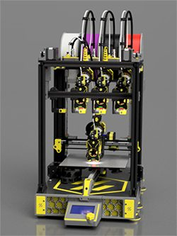

| Field | Value |
| --- | --- |
| Section | Tool changers |
| Project page | [https://github.com/3dfiyMyLife/Lineux-Toolchanger](https://github.com/3dfiyMyLife/Lineux-Toolchanger) |
| Author | 3dfiy My Life (formerly Bikin-Creative) |
| About | Front-mounted changer with Dockslide, a dock that slides away so the stock build volume stays usable. Tool changes run on plain Klipper macros (BTC) without a plugin. The Sling variant fits an Ender-style bed slinger. |
| Coupling | pins and bushings |
| Lock | magnets |
| Extruder | on the tool |
| Change time | — |
| Tools | 5 |
| Base printers | VzBot 330, Voron 2.4, Ender 3 (Sling) |
| Firmware | Klipper macros |
| Latest version | CAD [2026-07](https://github.com/3dfiyMyLife/Lineux-Toolchanger/commit/033836a) |
| Stars Likes Views |  [🧡⁠73](https://www.printables.com/model/1109204-lineux-tool-changer) [⏯️⁠48K](https://www.youtube.com/watch?v=LZql-NJ3cAA) |
| Links | [CAD](https://github.com/3dfiyMyLife/Lineux-Toolchanger/tree/main/CAD) [STL](https://github.com/3dfiyMyLife/Lineux-Toolchanger/tree/main/STL) [BOM](https://github.com/3dfiyMyLife/Lineux-Toolchanger/tree/main/BOM) [Manual](https://github.com/3dfiyMyLife/Lineux-Toolchanger/tree/main/Manual) [Config](https://github.com/3dfiyMyLife/Lineux-Toolchanger/tree/main/Klipper) [Files](https://www.printables.com/model/1109204-lineux-tool-changer) [Video](https://www.youtube.com/watch?v=LZql-NJ3cAA) |
| Groups | [Discord](https://discord.gg/Xwqbjj4VjH) EN 1.1K |

## Pictures (27)

<table>
<tr><td align="center" width="33%"> Photo: <a href="https://github.com/3dfiyMyLife/Lineux-Toolchanger">3dfiyMyLife</a></td><td align="center" width="33%"><a href="1-lineux-toolchanger.jpg">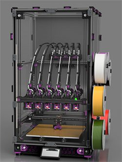</a> Photo: <a href="https://github.com/3dfiyMyLife/Lineux-Toolchanger">3dfiyMyLife</a></td><td align="center" width="33%"><a href="2-lineux-toolchanger.jpg">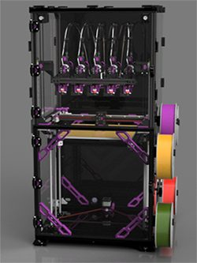</a> Photo: <a href="https://github.com/3dfiyMyLife/Lineux-Toolchanger">3dfiyMyLife</a></td></tr>
<tr><td align="center" width="33%"><a href="3-lineux-toolchanger.jpg">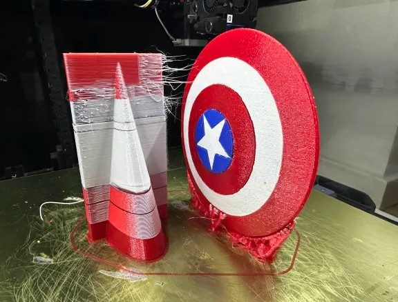</a> Photo: <a href="https://github.com/3dfiyMyLife/Lineux-Toolchanger">art</a></td><td align="center" width="33%"><a href="4-lineux-toolchanger.jpg">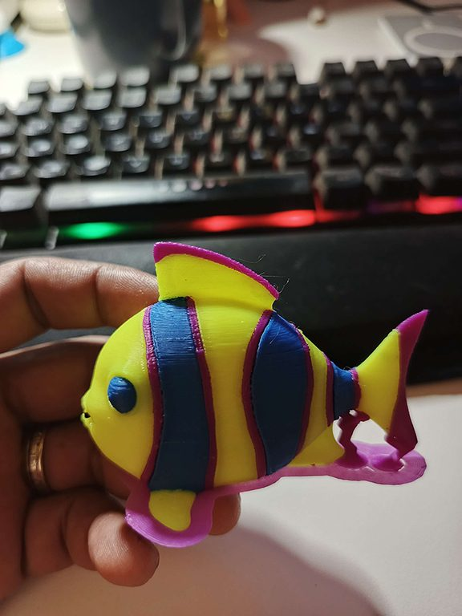</a> Photo: <a href="https://github.com/3dfiyMyLife/Lineux-Toolchanger">3dfiy My Life</a></td><td align="center" width="33%"> Photo: <a href="https://github.com/3dfiyMyLife/Lineux-Toolchanger">3dfiy My Life</a></td></tr>
<tr><td align="center" width="33%"><a href="6-lineux-toolchanger.jpg">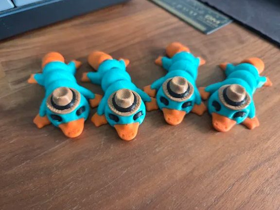</a> Photo: <a href="https://github.com/3dfiyMyLife/Lineux-Toolchanger">guy</a></td><td align="center" width="33%"><a href="7-lineux-toolchanger.jpg">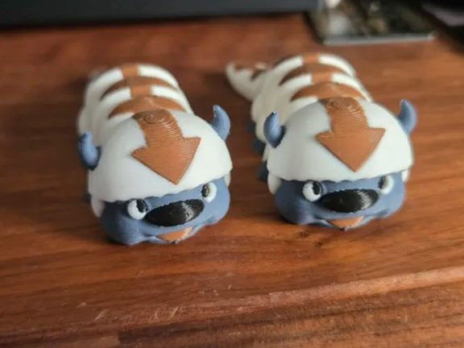</a> Photo: <a href="https://github.com/3dfiyMyLife/Lineux-Toolchanger">guy</a></td><td align="center" width="33%"><a href="8-lineux-toolchanger.jpg">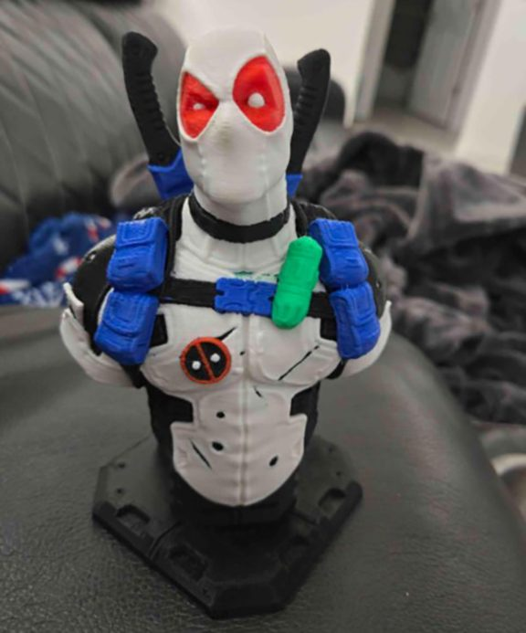</a> Photo: <a href="https://github.com/3dfiyMyLife/Lineux-Toolchanger">camtab</a></td></tr>
<tr><td align="center" width="33%"><a href="9-lineux-toolchanger.jpg">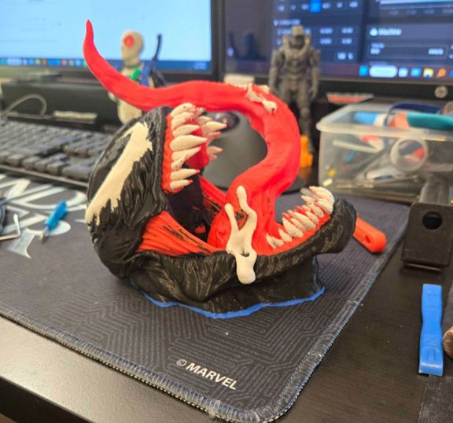</a> Photo: <a href="https://github.com/3dfiyMyLife/Lineux-Toolchanger">camtab</a></td><td align="center" width="33%"><a href="10-lineux-toolchanger.jpg">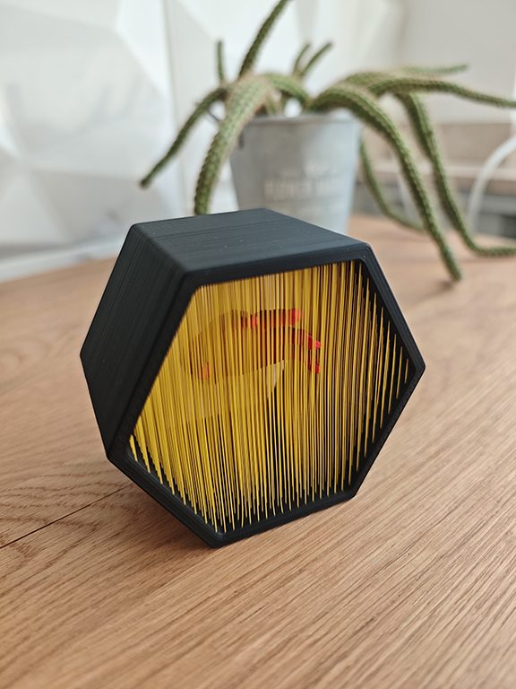</a> Photo: <a href="https://github.com/3dfiyMyLife/Lineux-Toolchanger">cass</a></td><td align="center" width="33%"><a href="11-lineux-toolchanger.jpg">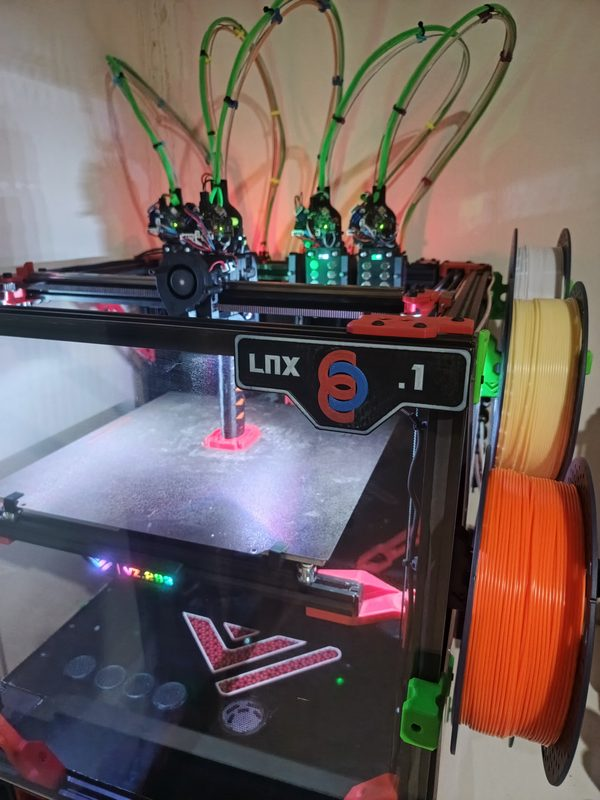</a> Photo: <a href="https://www.printables.com/model/1109204-lineux-tool-changer">3dfiy My Life</a></td></tr>
<tr><td align="center" width="33%"><a href="12-lineux-toolchanger.jpg">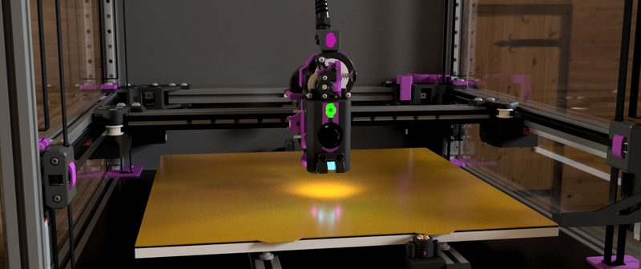</a> Photo: <a href="https://github.com/3dfiyMyLife/Lineux-Toolchanger">3dfiyMyLife</a></td><td align="center" width="33%"><a href="13-lineux-toolchanger.jpg">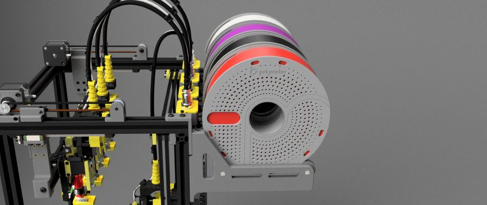</a> Photo: <a href="https://github.com/3dfiyMyLife/Lineux-Toolchanger">3dfiyMyLife</a></td><td align="center" width="33%"><a href="14-lineux-toolchanger.jpg">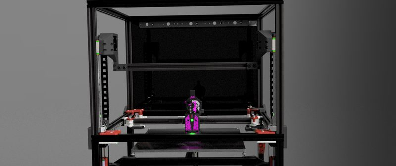</a> Photo: <a href="https://github.com/3dfiyMyLife/Lineux-Toolchanger">3dfiyMyLife</a></td></tr>
<tr><td align="center" width="33%"><a href="15-lineux-toolchanger.jpg">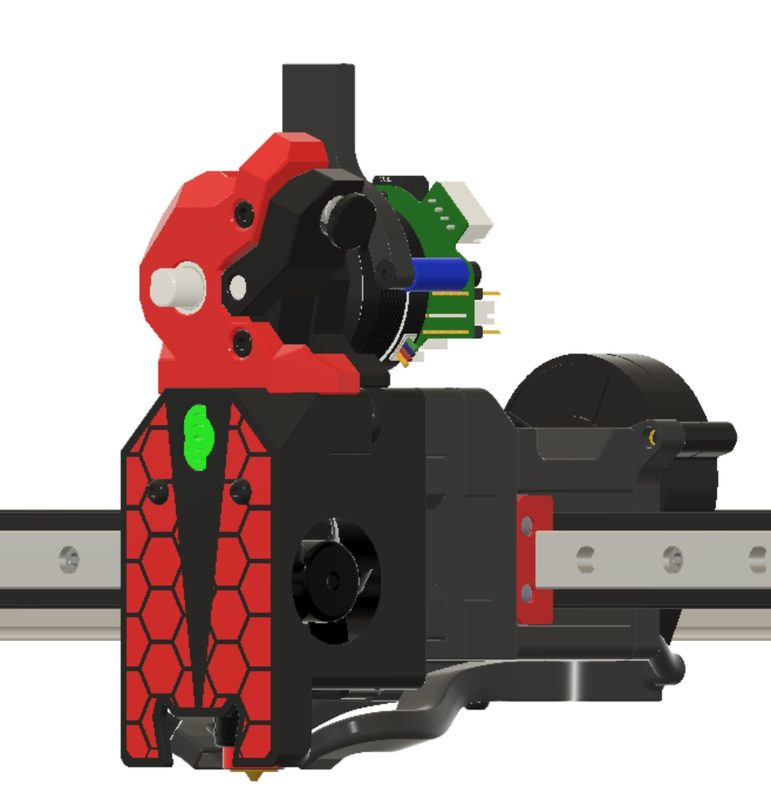</a> Photo: <a href="https://www.printables.com/model/1247133-lineux-dockslide-toolchanger-for-voron-trident">1ri</a></td><td align="center" width="33%"><a href="16-lineux-toolchanger.jpg">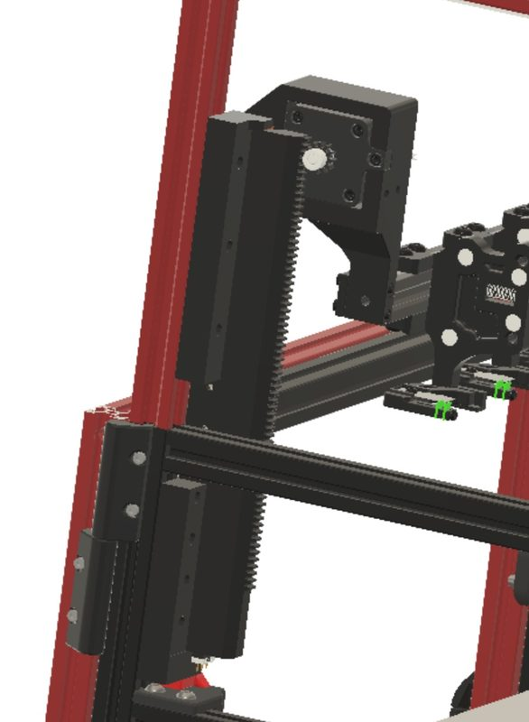</a> Photo: <a href="https://www.printables.com/model/1247133-lineux-dockslide-toolchanger-for-voron-trident">1ri</a></td><td align="center" width="33%"><a href="17-lineux-toolchanger.jpg">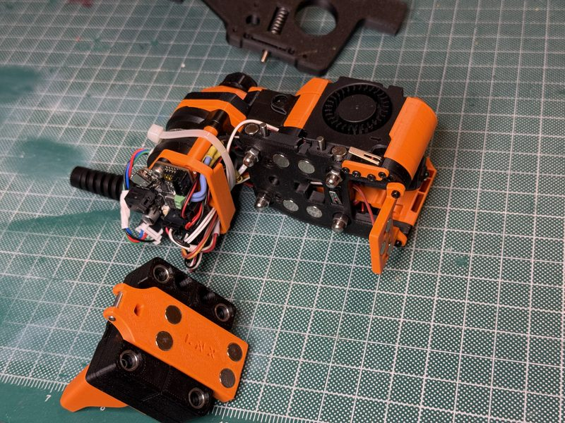</a> Photo: <a href="https://www.printables.com/model/1461594-lineux-dragonburner-mod-xy-endstops-for-voron-24">David BWD</a></td></tr>
<tr><td align="center" width="33%"><a href="18-lineux-toolchanger.jpg">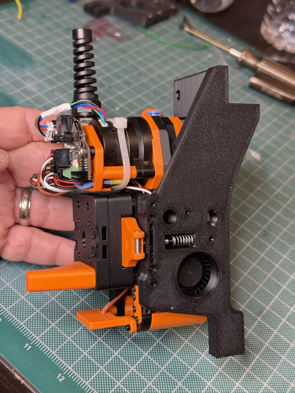</a> Photo: <a href="https://www.printables.com/model/1461594-lineux-dragonburner-mod-xy-endstops-for-voron-24">David BWD</a></td><td align="center" width="33%"><a href="19-lineux-toolchanger.jpg">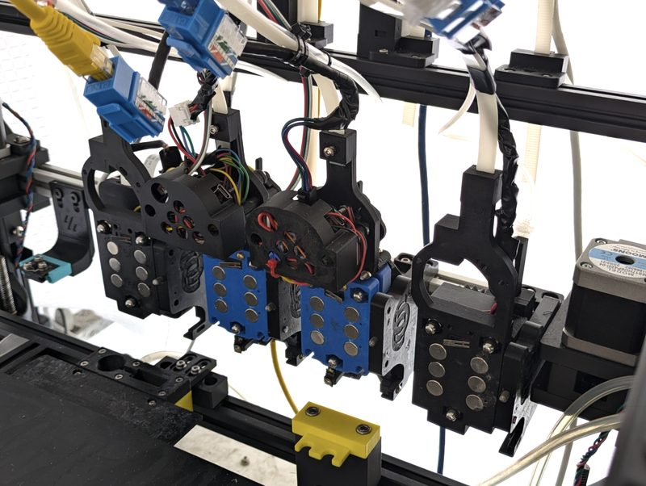</a> Version: Rister Toolchanger Photo: <a href="https://github.com/htsrjdrouse/rister-toolchanger/tree/main/system_overview">htsrjdrouse</a></td><td align="center" width="33%"><a href="20-lineux-toolchanger.jpg">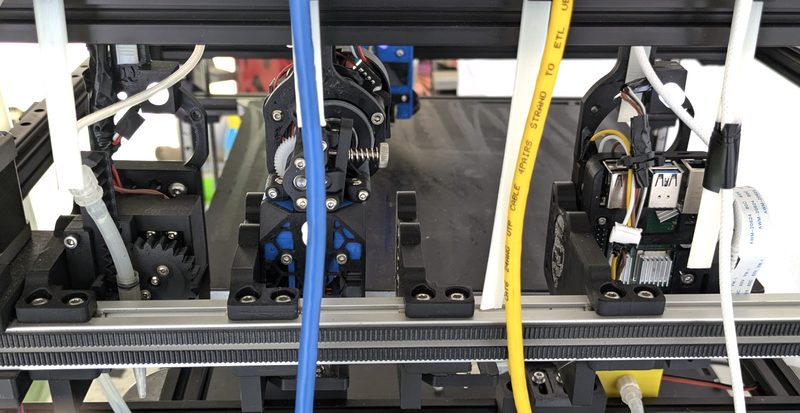</a> Version: Rister Toolchanger Photo: <a href="https://github.com/htsrjdrouse/rister-toolchanger/tree/main/system_overview">htsrjdrouse</a></td></tr>
<tr><td align="center" width="33%"><a href="21-lineux-toolchanger.jpg">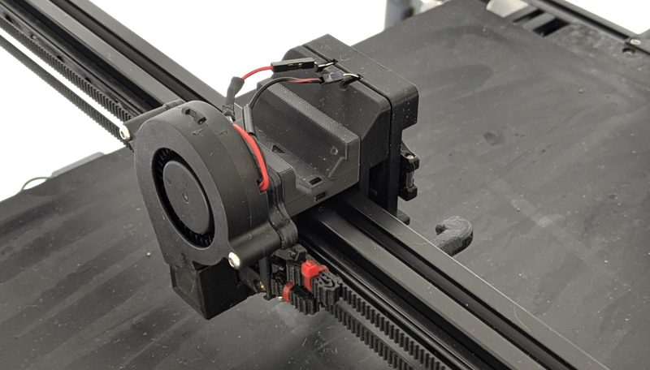</a> Version: Rister Toolchanger Photo: <a href="https://github.com/htsrjdrouse/rister-toolchanger/tree/main/system_overview">htsrjdrouse</a></td><td align="center" width="33%"><a href="22-lineux-toolchanger.jpg">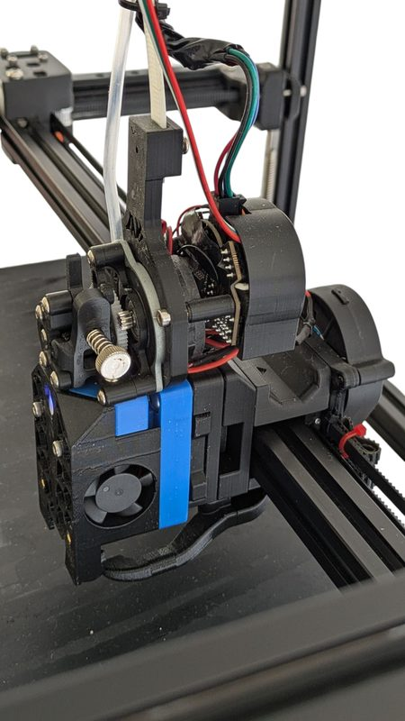</a> Version: Rister Toolchanger Photo: <a href="https://github.com/htsrjdrouse/rister-toolchanger/tree/main/images/share">htsrjdrouse</a></td><td align="center" width="33%"><a href="23-lineux-toolchanger.jpg">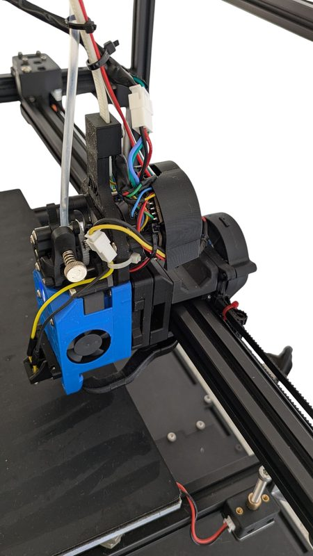</a> Version: Rister Toolchanger Photo: <a href="https://github.com/htsrjdrouse/rister-toolchanger/tree/main/images/share">htsrjdrouse</a></td></tr>
<tr><td align="center" width="33%"><a href="24-lineux-toolchanger.jpg">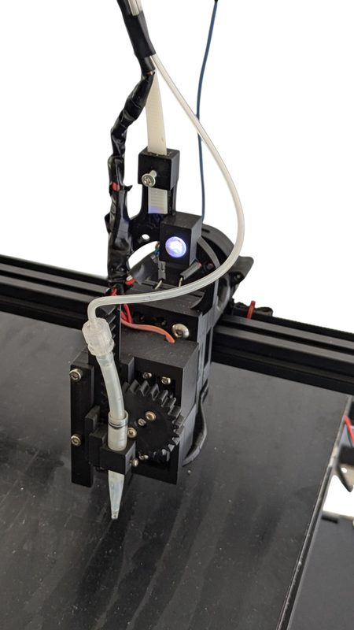</a> Version: Rister Toolchanger Photo: <a href="https://github.com/htsrjdrouse/rister-toolchanger/tree/main/images/share">htsrjdrouse</a></td><td align="center" width="33%"><a href="25-lineux-toolchanger.jpg">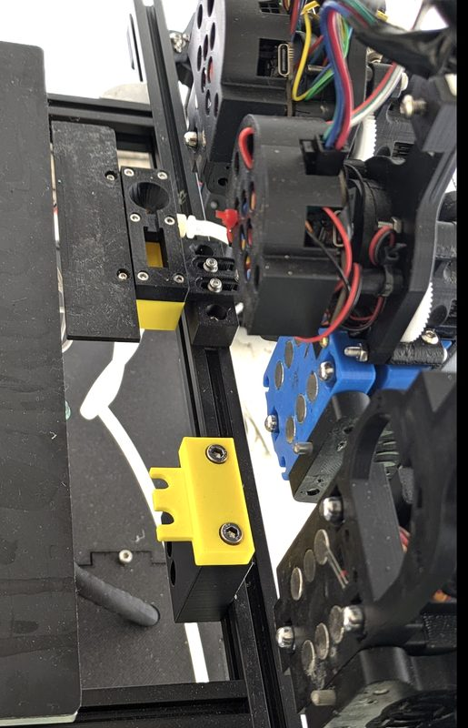</a> Version: Rister Toolchanger Photo: <a href="https://github.com/htsrjdrouse/rister-toolchanger/tree/main/system_overview">htsrjdrouse</a></td><td align="center" width="33%"><a href="26-lineux-toolchanger.jpg">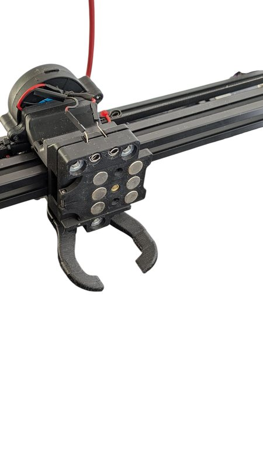</a> Version: Rister Toolchanger Photo: <a href="https://github.com/htsrjdrouse/rister-toolchanger/tree/main/images/share">htsrjdrouse</a></td></tr>
</table>

## Notes

- Tiga is the latest supported toolhead, and the README names E3D Revo Voron and Trianglelab CHC as example hotends. ([source](https://github.com/3dfiyMyLife/Lineux-Toolchanger/tree/main/CAD/Toolhead))

## Ports and variants

- [Rister Toolchanger](https://github.com/htsrjdrouse/rister-toolchanger), *Richard Rouse (htsrjdrouse, HTS Resources)*. Klipper CoreXY toolchanger for lab automation that mixes two FDM tools with a pipette liquid dispenser and a programmable-focus camera tool. It adds a wash station and click-to-coordinate camera calibration.
