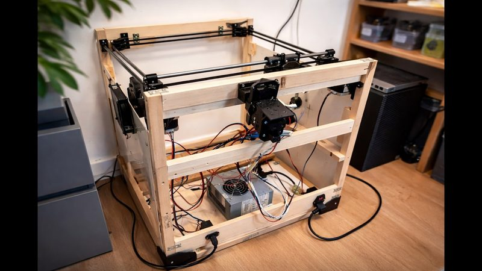

# Linker3D Toolchanger

[Catalog row](../../OTHER.md#linker3d-toolchanger) · [Gallery](../../GALLERY.md)

| Field | Value |
| --- | --- |
| Section | Not in the catalog ([OTHER.md](../../OTHER.md)) |
| Project page | [https://github.com/privt00/Linker3DToolchanger](https://github.com/privt00/Linker3DToolchanger) |
| Author | privt00 (Privt) |
| Type | Tool changer |
| Reason | Planned, but nothing of the toolchanger is published. The repository has only the base CoreXY frame and a board for four extruders. |
| Coupling | — |
| Lock | — |
| Latest version | Last seen [2026-04](https://github.com/privt00/Linker3DToolchanger) |
| Links | [Video](https://www.youtube.com/watch?v=XlKTBpUcuso) [Video](https://www.youtube.com/watch?v=YI5guWG1CF4) [Video](https://www.youtube.com/watch?v=idBv9-dRqzA) [STL](https://github.com/privt00/Linker3DToolchanger/tree/main/Frame) [PCB](https://github.com/privt00/rp2040-extruder) |

## Pictures (1)

<table>
<tr><td align="center" width="33%"> Photo: <a href="https://www.youtube.com/watch?v=idBv9-dRqzA">Privt</a></td></tr>
</table>
