# MadMax

[Catalog row](../../README.md#madmax) · [Gallery](../../GALLERY.md)

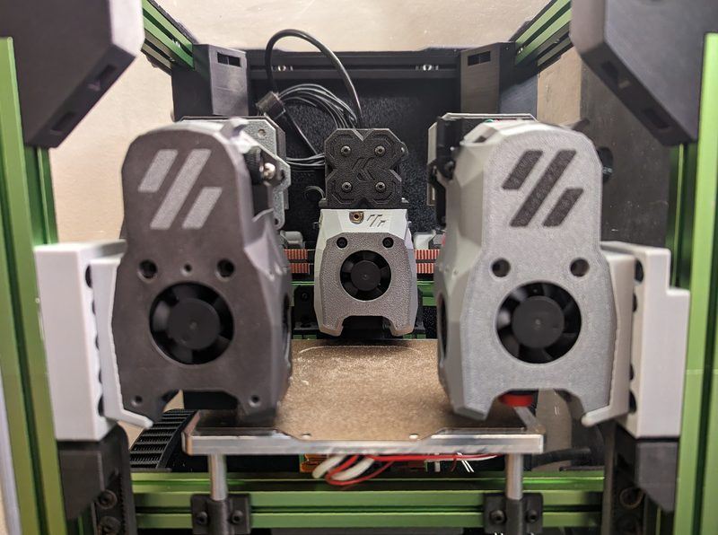

| Field | Value |
| --- | --- |
| Section | Tool changers |
| Project page | [https://github.com/zruncho3d/madmax](https://github.com/zruncho3d/madmax) |
| Author | Zruncho |
| About | Converts an existing CoreXY with a front MGN9 or MGN12 X rail, such as the Voron Trident and Voron 0 families. The docks attach to the front corners of the gantry, so the printer needs no front beam at gantry level. A magnetic Maxwell coupling of pins and screws holds the tool. |
| Coupling | Maxwell |
| Lock | magnets |
| Extruder | on the tool |
| Change time | [~4-5 s](https://github.com/zruncho3d/madmax/blob/main/DESIGN.md) |
| Tools | 2 |
| Printer | CoreXY, any gantry, front MGN9 or MGN12 X rail |
| Firmware | Klipper, klipper-toolchanger |
| Latest version | CAD [2025-03](https://github.com/zruncho3d/madmax/commit/b375a90) |
| Stars Likes Views |  [⏯️⁠9.1K](https://www.youtube.com/watch?v=5X3DfevA83A) |
| Links | [CAD](https://github.com/zruncho3d/madmax/tree/main/CAD) [STL](https://github.com/zruncho3d/madmax/tree/main/STL) [BOM](https://github.com/zruncho3d/madmax/blob/main/BOM.md) [Manual](https://github.com/zruncho3d/madmax/blob/main/INSTRUCTIONS.md) [Config](https://github.com/zruncho3d/madmax/blob/main/CONFIGURATION.md) [Video](https://www.youtube.com/watch?v=5X3DfevA83A) |
| Groups | [Discord](https://discord.gg/doomcube) EN 6.9K |

## Pictures (17)

<table>
<tr><td align="center" width="33%"> Photo: <a href="https://github.com/zruncho3d/madmax">zruncho3d</a></td><td align="center" width="33%"><a href="1-madmax.jpg">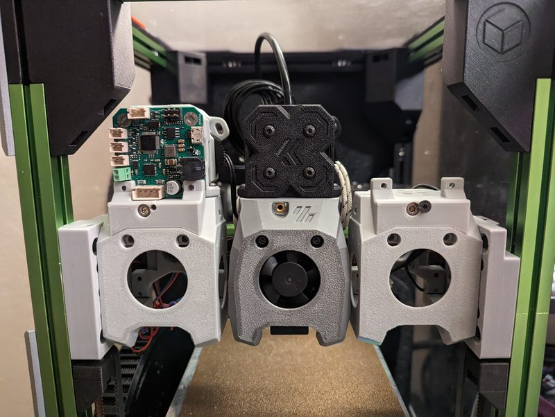</a> Photo: <a href="https://github.com/zruncho3d/madmax">zruncho3d</a></td><td align="center" width="33%"><a href="2-madmax.jpg">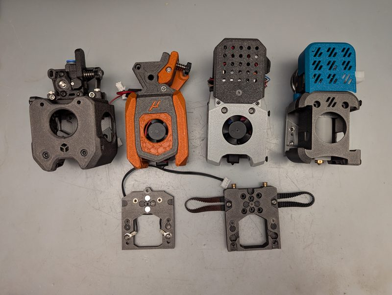</a> Photo: <a href="https://github.com/zruncho3d/madmax">zruncho3d</a></td></tr>
<tr><td align="center" width="33%"><a href="3-madmax.jpg">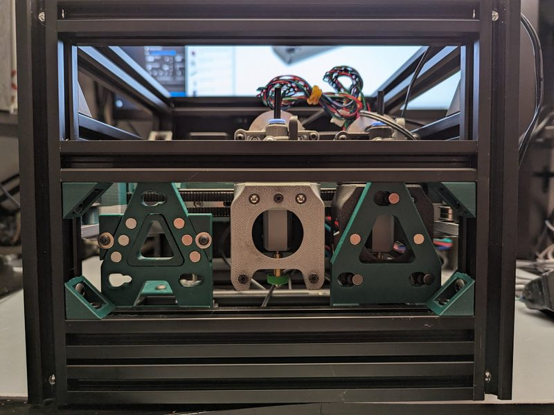</a> Photo: <a href="https://github.com/zruncho3d/madmax">zruncho3d</a></td><td align="center" width="33%"><a href="4-madmax.jpg">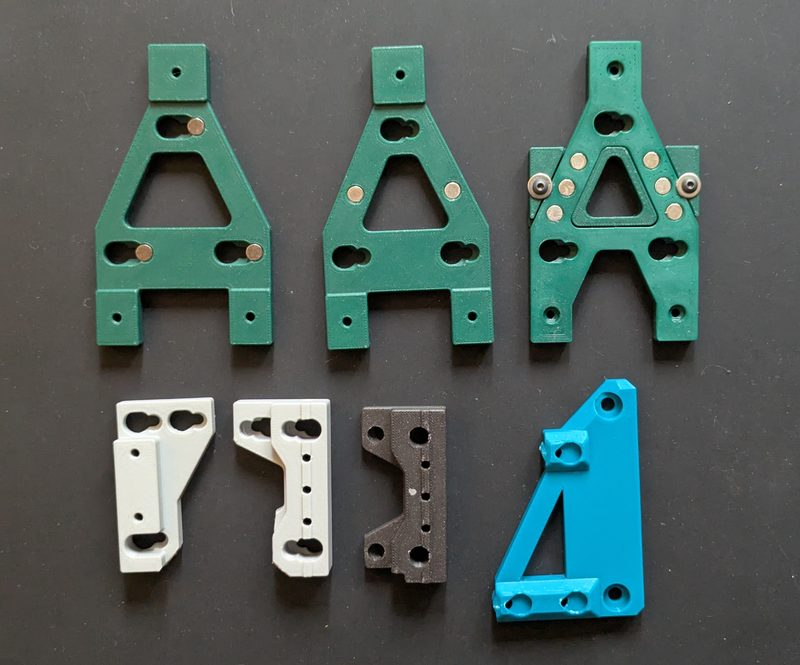</a> Photo: <a href="https://github.com/zruncho3d/madmax">zruncho3d</a></td><td align="center" width="33%"><a href="5-madmax.jpg">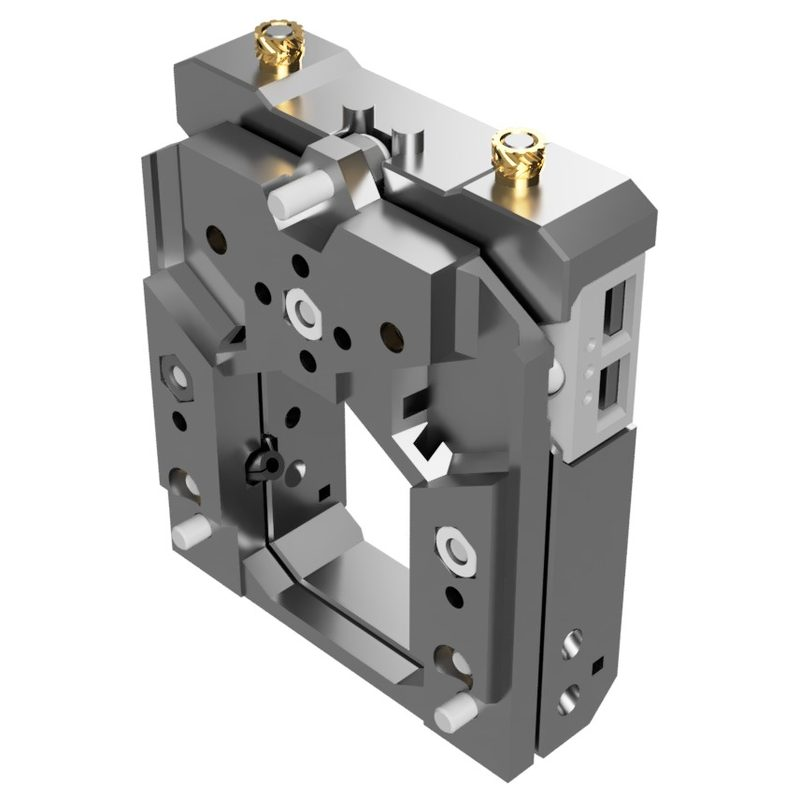</a> Photo: <a href="https://github.com/zruncho3d/madmax">zruncho3d</a></td></tr>
<tr><td align="center" width="33%"><a href="6-madmax.jpg">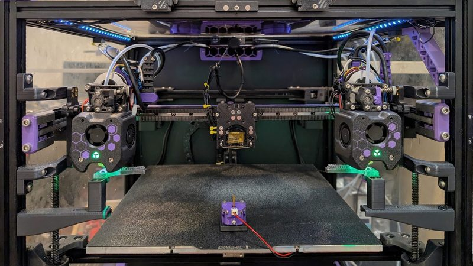</a> Photo: <a href="https://github.com/zruncho3d/madmax">andrewmcgr</a></td><td align="center" width="33%"><a href="7-madmax.jpg">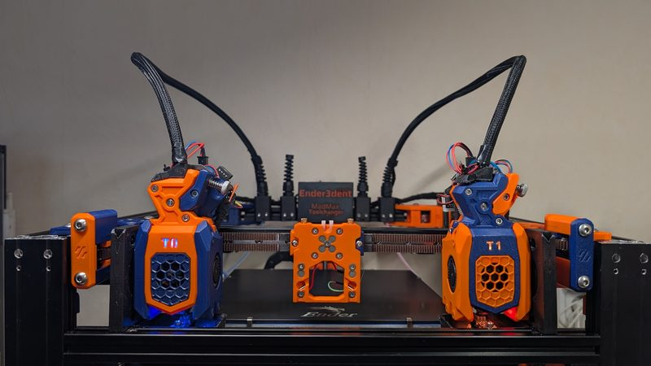</a> Photo: <a href="https://github.com/zruncho3d/madmax">Yell</a></td><td align="center" width="33%"><a href="8-madmax.jpg">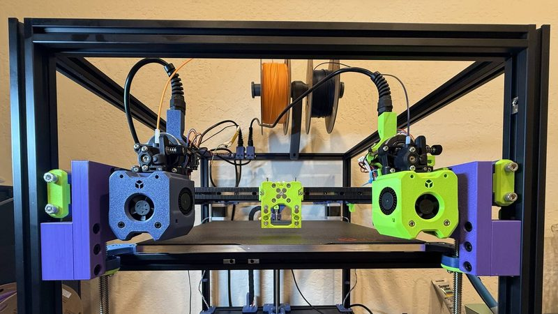</a> Photo: <a href="https://github.com/zruncho3d/madmax">Vlad</a></td></tr>
<tr><td align="center" width="33%"><a href="9-madmax.jpg">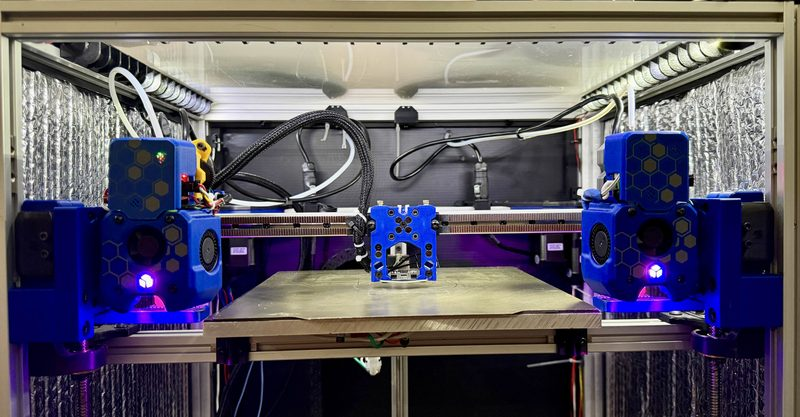</a> Photo: <a href="https://github.com/zruncho3d/madmax">Telxoid</a></td><td align="center" width="33%"><a href="10-madmax.jpg">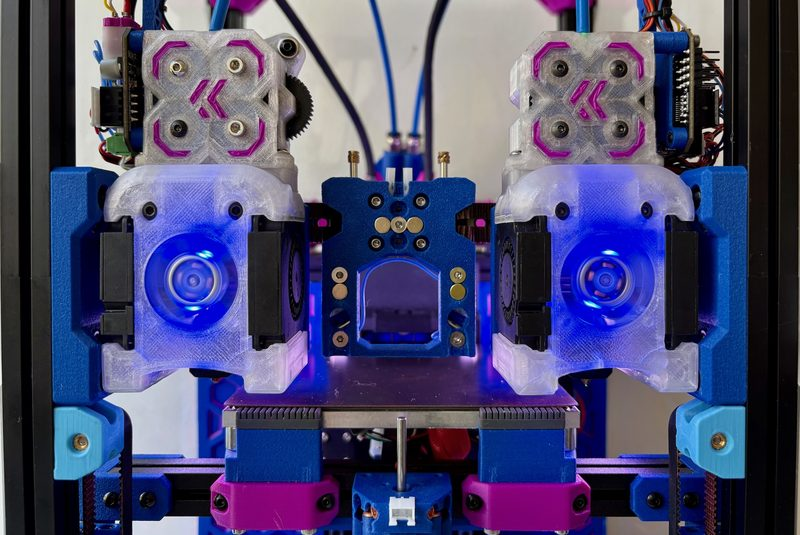</a> Photo: <a href="https://github.com/zruncho3d/madmax">Max</a></td><td align="center" width="33%"><a href="11-madmax.jpg">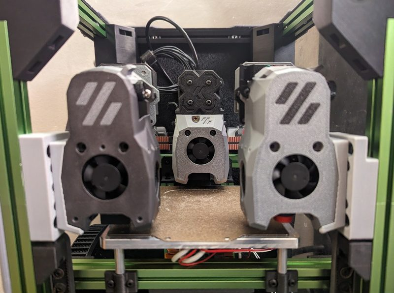</a> Photo: <a href="https://github.com/zruncho3d/madmax">Zruncho</a></td></tr>
<tr><td align="center" width="33%"><a href="12-madmax.jpg">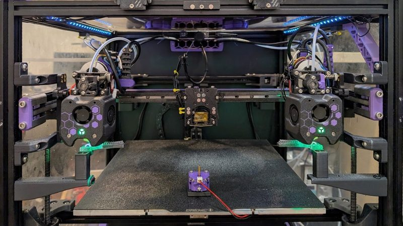</a> Photo: <a href="https://github.com/zruncho3d/madmax">Zruncho</a></td><td align="center" width="33%"><a href="13-madmax.jpg">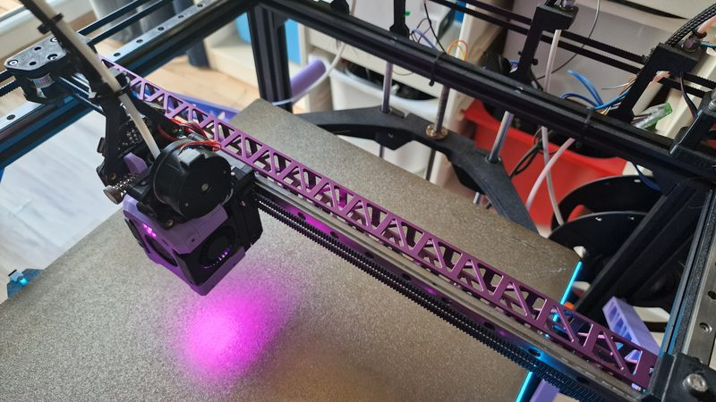</a> Version: Cocoanix 3D Printing build Photo: <a href="https://www.printables.com/model/1740227-lightweight-x-axis-bar-for-cocoanix-printer-zero-g">Cocoanix Designs</a></td><td align="center" width="33%"><a href="14-madmax.jpg">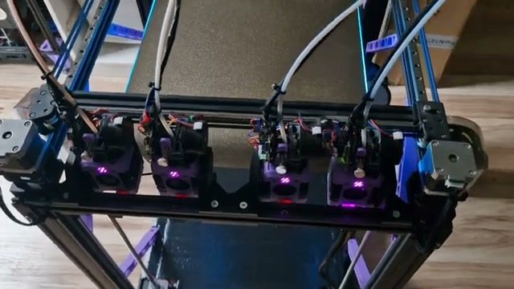</a> Version: Cocoanix 3D Printing build Photo: <a href="https://www.youtube.com/watch?v=y__r9sv_BTE">Cocoanix 3D Printing</a></td></tr>
<tr><td align="center" width="33%"><a href="15-madmax.jpg">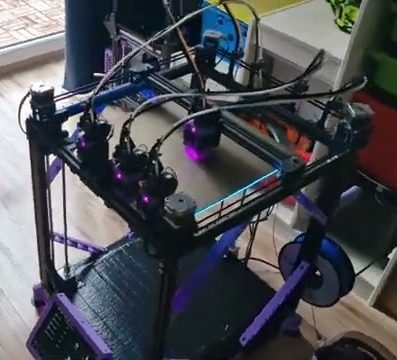</a> Version: Cocoanix 3D Printing build Photo: <a href="https://www.youtube.com/watch?v=y__r9sv_BTE">Cocoanix 3D Printing</a></td><td align="center" width="33%"><a href="16-madmax.jpg">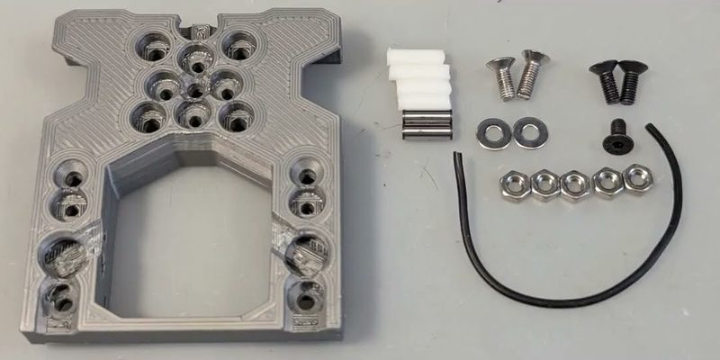</a> Version: Cocoanix 3D Printing build Photo: <a href="https://www.youtube.com/watch?v=y__r9sv_BTE">Cocoanix 3D Printing</a></td></tr>
</table>

## Notes

- The magnetic Maxwell coupling can also work as the nozzle probe, in place of Tap or Boop. ([source](https://github.com/zruncho3d/madmax))
- Printers that the author names: Voron Trident, Voron 0, Micron, Salad Fork, any CoreXY with a front MGN9 or MGN12 rail. ([source](https://github.com/zruncho3d/madmax))
- Used as a nozzle probe, the coupling gave a range of 0.002 mm and a standard deviation of 0.0005 mm in the author's sample probe run. ([source](https://github.com/zruncho3d/madmax))
- The author estimates the conversion at about $100, and the conversion is fully reversible. ([source](https://github.com/zruncho3d/madmax))
- Tool offset calibration is automatic with the Nudge probe. ([source](https://github.com/zruncho3d/madmax))

## Ports and variants

- [MadMax for E3NG](https://www.printables.com/model/1557998-madmax-for-e3ng), *Michael Cadiz*. Port to the Ender-3 NG. CC BY-NC-SA.

## Builds by other people

- [Cocoanix Printer Zero G+ build](https://www.youtube.com/watch?v=y__r9sv_BTE), *Cocoanix 3D Printing*. MadMax conversion on the author's own Cocoanix Printer Zero G+ (a printer based on the Tronxy X5SA, 35 x 32 x 45 cm). The docks were redesigned to fit a fifth tool. Uses EBB36 CAN boards and Klipper.
