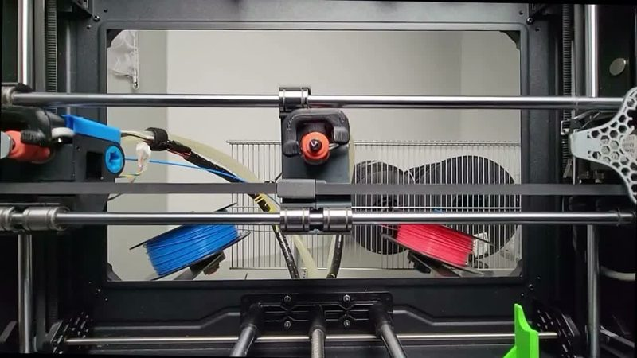
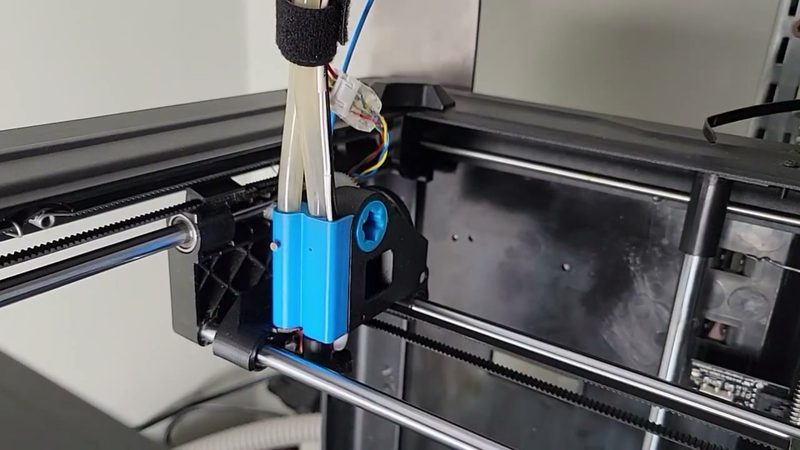
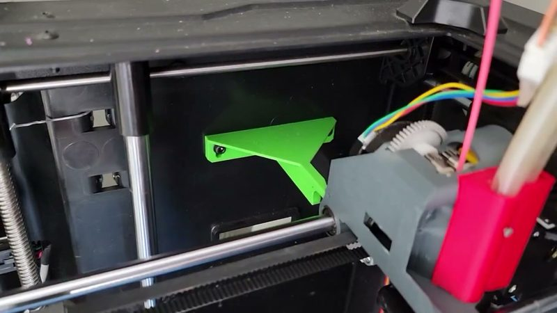

# Magnetic IDEX push-push latch

[Catalog row](../../OTHER.md#magnetic-idex-push-push-latch) · [Gallery](../../GALLERY.md)

| Field | Value |
| --- | --- |
| Section | Not in the catalog ([OTHER.md](../../OTHER.md)) |
| Project page | [https://www.youtube.com/watch?v=EZoxpfzPa4U](https://www.youtube.com/watch?v=EZoxpfzPa4U) |
| Author | Magnetic IDEX 3D Printer (m_IDEX, dmitryr / dromanovich) |
| Type | Tool changer |
| Reason | A latch that parks the heads of an IDEX printer. It is not a changer, although the latch files are public. |
| Coupling | — |
| Lock | push-push latch |
| Latest version | Files [2026-05](https://www.printables.com/model/567323-push-push-latch-actuator-aka-strike) |
| Links | [Video](https://www.youtube.com/watch?v=EZoxpfzPa4U) [BOM](https://docs.google.com/spreadsheets/d/1fb1T2YSfM-OhzU3zWx77bUNyia4o-GPZsPlaNYT4-vA/edit?usp=sharing) [STEP](https://www.printables.com/model/567323-push-push-latch-actuator-aka-strike/files) |

## Pictures (3)

<table>
<tr><td align="center" width="33%"> Photo: <a href="https://www.youtube.com/watch?v=EZoxpfzPa4U">Magnetic IDEX 3D Printer</a></td><td align="center" width="33%"> Photo: <a href="https://www.youtube.com/watch?v=EZoxpfzPa4U">Magnetic IDEX 3D Printer</a></td><td align="center" width="33%"> Photo: <a href="https://www.youtube.com/watch?v=EZoxpfzPa4U">Magnetic IDEX 3D Printer</a></td></tr>
</table>
