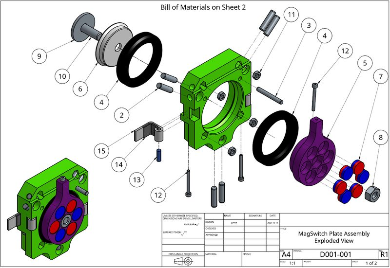
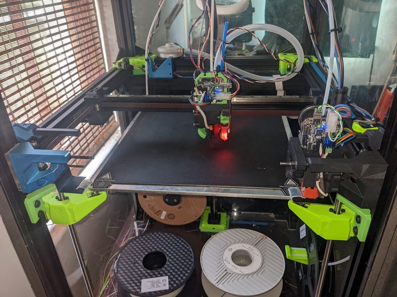
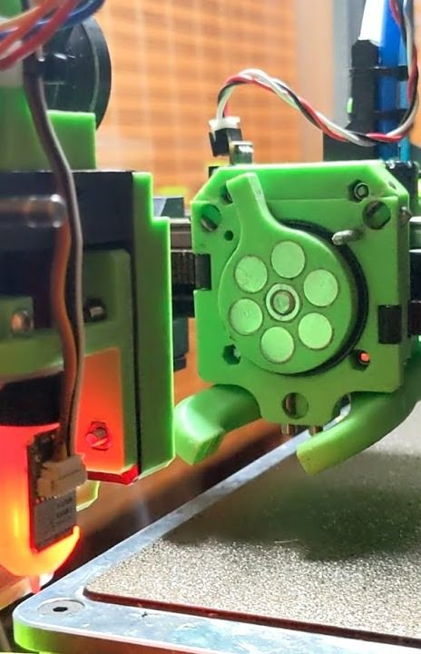
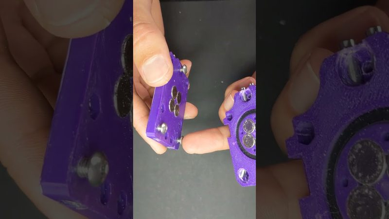
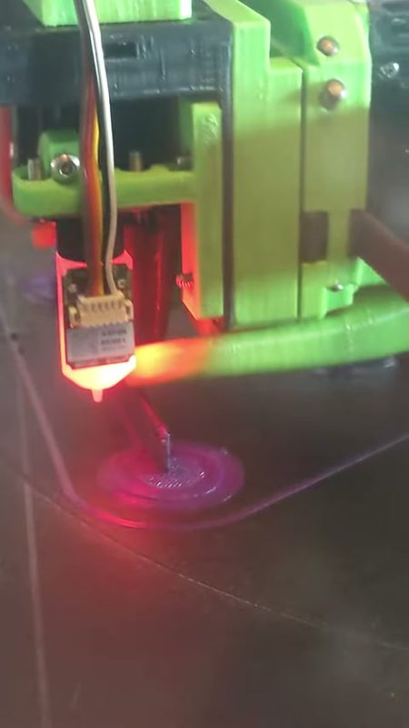
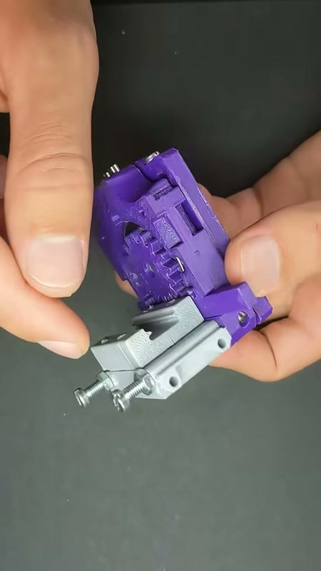
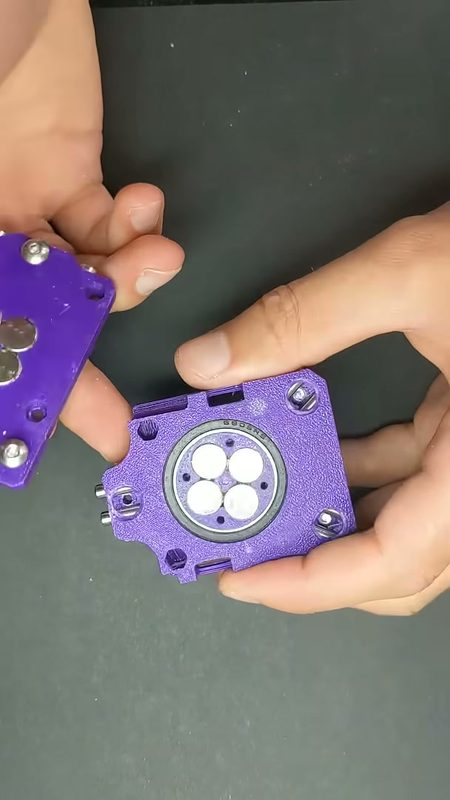
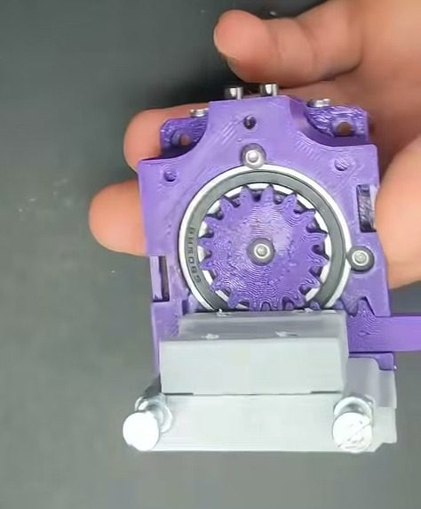

# MagSwitch Toolchanger

[Catalog row](../../README.md#magswitch-toolchanger) · [Gallery](../../GALLERY.md)

| Field | Value |
| --- | --- |
| Section | Tool changers |
| Project page | [https://github.com/jera-sea/MagSwitch-Toolchanger](https://github.com/jera-sea/MagSwitch-Toolchanger) |
| Author | FrozenBubble (jera-sea) |
| About | Magswitch lock: a move against the dock turns an axial-flux-style ring of magnets (6 on the tool, 6 on the carriage) that pulls a printed kinematic coupling together. No servo and no motor. The author reports under 4 seconds per tool change. |
| Coupling | kinematic, printed |
| Lock | rotating magnet ring, the dock turns it |
| Extruder | on the tool |
| Change time | [~3-4 s](https://www.youtube.com/watch?v=9IsZiHBQRe4) |
| Tools | 2 |
| Printer | CoreXY, fixed gantry |
| Firmware | Klipper, own macros |
| Latest version | CAD [2026-08](https://cad.onshape.com/documents/0c01c7dd72676bd7e8323898/w/98418f33d58f65eefdbc478d/e/0eb2fa1c1fd68932fc3bc01e) |
| Stars Likes Views |  [🧡⁠46](https://www.printables.com/model/920073-axial-flux-magswitch-toolchanger-built-on-ratrig-v/files) [⏯️⁠25.4K](https://youtube.com/shorts/qhA7fiyDxwE) |
| Links | [STEP](https://www.printables.com/model/920073-axial-flux-magswitch-toolchanger-built-on-ratrig-v/files) [CAD](https://cad.onshape.com/documents/0c01c7dd72676bd7e8323898/w/98418f33d58f65eefdbc478d/e/0eb2fa1c1fd68932fc3bc01e) [Config](https://github.com/jera-sea/MagSwitch-Toolchanger/tree/main/config/toolchanger) [Video](https://www.youtube.com/watch?v=AjeeFMp68dM) |
| Groups | — |

## Pictures (8)

<table>
<tr><td align="center" width="33%"> Photo: <a href="https://www.printables.com/model/920073-axial-flux-magswitch-toolchanger-built-on-ratrig-v">FrozenBubble</a></td><td align="center" width="33%"> Photo: <a href="https://www.printables.com/model/920073-axial-flux-magswitch-toolchanger-built-on-ratrig-v">FrozenBubble</a></td><td align="center" width="33%"> Photo: <a href="https://www.youtube.com/watch?v=XZpk5XKl0d8">FrozenBubble</a></td></tr>
<tr><td align="center" width="33%"> Photo: <a href="https://youtube.com/shorts/qhA7fiyDxwE">FrozenBubble</a></td><td align="center" width="33%"> Photo: <a href="https://www.youtube.com/watch?v=XZpk5XKl0d8">FrozenBubble</a></td><td align="center" width="33%"> Photo: <a href="https://youtube.com/shorts/qhA7fiyDxwE">FrozenBubble</a></td></tr>
<tr><td align="center" width="33%"> Photo: <a href="https://youtube.com/shorts/qhA7fiyDxwE">FrozenBubble</a></td><td align="center" width="33%"> Photo: <a href="https://youtube.com/shorts/qhA7fiyDxwE">FrozenBubble</a></td></tr>
</table>

## Notes

- Printers that the author names: RatRig V-Core 3.1. ([source](https://github.com/jera-sea/MagSwitch-Toolchanger))
