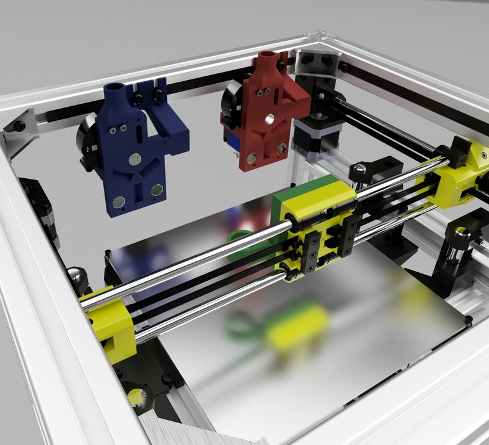
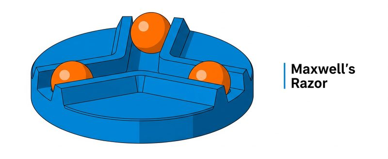
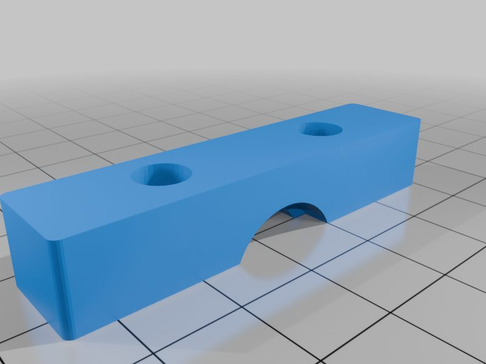
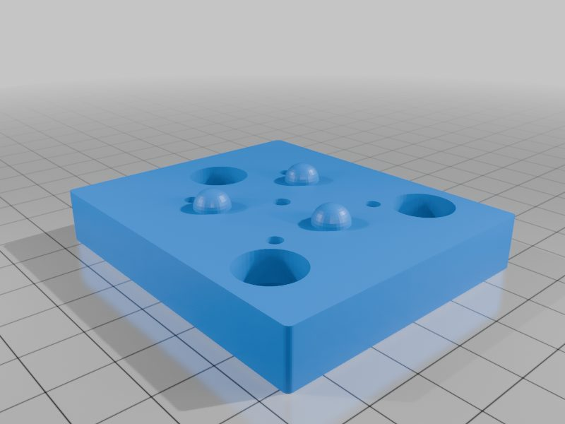
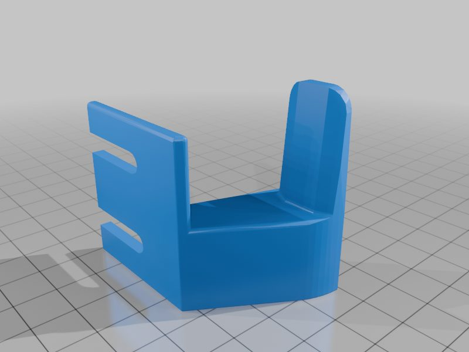
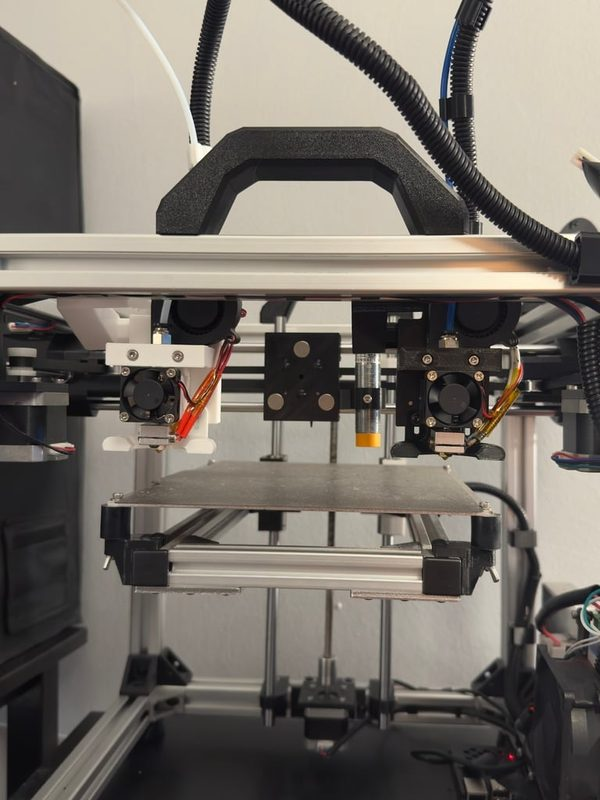
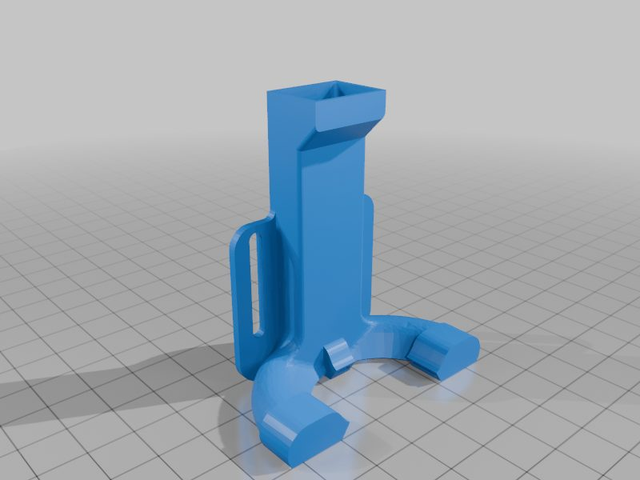
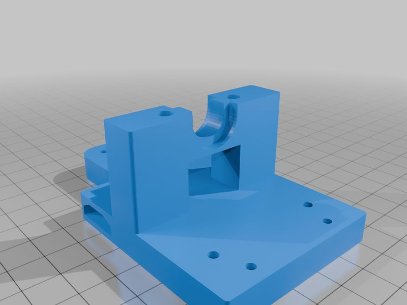
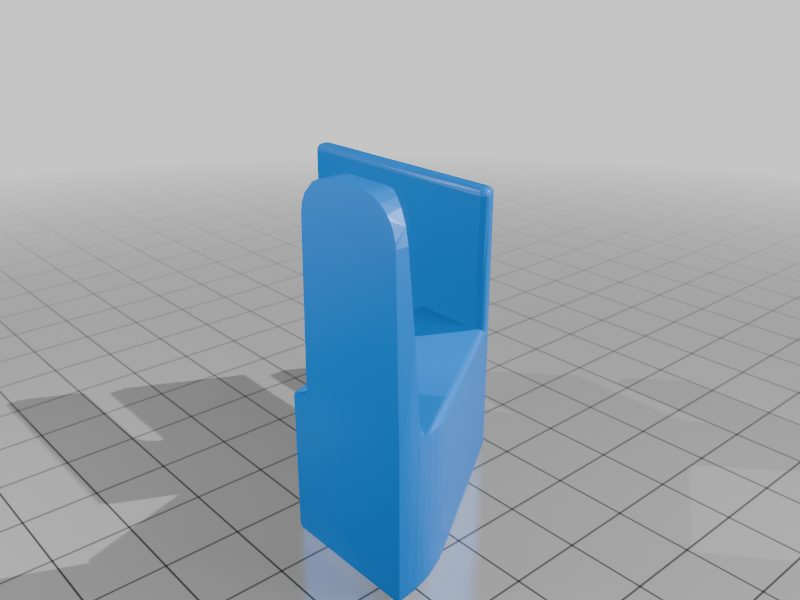

# Maxwell's Razor

[Catalog row](../../README.md#maxwells-razor) · [Gallery](../../GALLERY.md)

| Field | Value |
| --- | --- |
| Section | Tool changers |
| Project page | [https://github.com/evanqhuang/maxwells-razor](https://github.com/evanqhuang/maxwells-razor) |
| Author | Evan Huang (evanqhuang) |
| About | A Maxwell kinematic coupling that is fully printed, with half-spheres instead of balls and dowels, held by 6 magnets on the carriage and 3 per tool. The docks are printed and purely mechanical. An optional 'metal' version uses a press-fit ball bearing and dowels. |
| Coupling | Maxwell, printed |
| Lock | magnets |
| Extruder | on the tool |
| Change time | [~9-11 s](https://github.com/user-attachments/assets/cc918851-83fa-48d1-bb6e-ddeb8659f7ee) |
| Tools | 2 |
| Base printers | HyperCube Evolution |
| Firmware | Klipper |
| Latest version | v1.0 [2025-06](https://github.com/evanqhuang/maxwells-razor/releases/tag/v1.0) |
| Stars Likes Views |  |
| Links | [STEP](https://github.com/evanqhuang/maxwells-razor/tree/main/v1/STEP) [STL](https://github.com/evanqhuang/maxwells-razor/tree/main/v1/STL) [Manual](https://github.com/evanqhuang/maxwells-razor/blob/main/v1/README.md) [Config](https://github.com/evanqhuang/maxwells-razor/tree/main/v1/klipper_config) [Files](https://www.thingiverse.com/thing:7074453) |
| Groups | — |

## Pictures (10)

<table>
<tr><td align="center" width="33%"> Photo: <a href="https://github.com/evanqhuang/maxwells-razor">evanqhuang</a></td><td align="center" width="33%"> Photo: <a href="https://github.com/evanqhuang/maxwells-razor">evanqhuang</a></td><td align="center" width="33%"> Photo: <a href="https://www.printables.com/model/1381988-maxwells-razor-v1-90-printed-toolchanger">Evan Huang</a></td></tr>
<tr><td align="center" width="33%"> Photo: <a href="https://www.printables.com/model/1381988-maxwells-razor-v1-90-printed-toolchanger">Evan Huang</a></td><td align="center" width="33%"> Photo: <a href="https://www.printables.com/model/1381988-maxwells-razor-v1-90-printed-toolchanger">Evan Huang</a></td><td align="center" width="33%"> Photo: <a href="https://www.printables.com/model/1381988-maxwells-razor-v1-90-printed-toolchanger">Evan Huang</a></td></tr>
<tr><td align="center" width="33%"> Photo: <a href="https://www.printables.com/model/1381988-maxwells-razor-v1-90-printed-toolchanger">Evan Huang</a></td><td align="center" width="33%"> Photo: <a href="https://www.printables.com/model/1381988-maxwells-razor-v1-90-printed-toolchanger">Evan Huang</a></td><td align="center" width="33%"> Photo: <a href="https://www.printables.com/model/1381988-maxwells-razor-v1-90-printed-toolchanger">Evan Huang</a></td></tr>
<tr><td align="center" width="33%"> Photo: <a href="https://www.printables.com/model/1381988-maxwells-razor-v1-90-printed-toolchanger">Evan Huang</a></td></tr>
</table>
