# MedusaHC

[Catalog row](../../README.md#medusahc) · [Gallery](../../GALLERY.md)

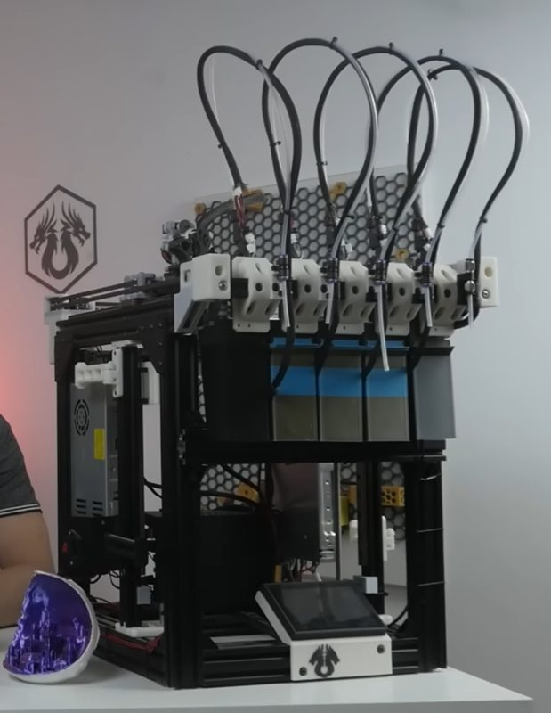

| Field | Value |
| --- | --- |
| Section | Hotend changers |
| Project page | [https://github.com/Irbis3D/MedusaHC](https://github.com/Irbis3D/MedusaHC) |
| Author | Irbis3D (Sergei Irbenek) |
| About | Budget hotend changer with one extruder on the head. As a hotend leaves, a servo opens the extruder lever. It started as an add-on for the Duender CoreXY and has its own Klipper module. |
| Coupling | pins and magnets |
| Lock | magnets |
| Change time | [~6-7 s](https://www.youtube.com/watch?v=F2OpeA6CTm0&t=1831s) |
| Tools | 4 |
| Printer | CoreXY, fixed gantry |
| Firmware | Klipper, own module |
| Latest version | V0.2 [2026-08](https://github.com/Irbis3D/MedusaHC/blob/main/CHANGELOG.md) |
| Stars Likes Views |  [🧡⁠150](https://www.printables.com/model/1799766-medusahc-v02-budget-hotend-toolchanger) [⏯️⁠104K](https://www.youtube.com/watch?v=rfKapRc0Rds) |
| Links | [STEP](https://github.com/Irbis3D/MedusaHC/tree/main/STEP) [STL](https://github.com/Irbis3D/MedusaHC/tree/main/STLs) [Files](https://www.printables.com/model/1799766-medusahc-v02-budget-hotend-toolchanger) [BOM](https://docs.google.com/spreadsheets/d/1xkOzb10DBJzalW4n1tYroh-m_ZFsTQipC1BpUh5ZMWY/edit?gid=1290815756#gid=1290815756) [Manual](https://drive.google.com/file/d/1KkSGdeQZzl4gnCMKlBloHfCNIlD4JwAP/view) [Config](https://github.com/Irbis3D/MedusaHC/tree/main/config) [FW](https://github.com/Irbis3D/MedusaHC/tree/main/klippy) [Video](https://www.youtube.com/watch?v=hpV5Z1TnGdY) |
| Groups | [Discord](https://discord.gg/ae44FHv786) EN 2.9K |

## Pictures (11)

<table>
<tr><td align="center" width="33%"> Photo: <a href="https://www.youtube.com/@Irbis3D">Irbis3D</a></td><td align="center" width="33%"><a href="1-medusahc.jpg">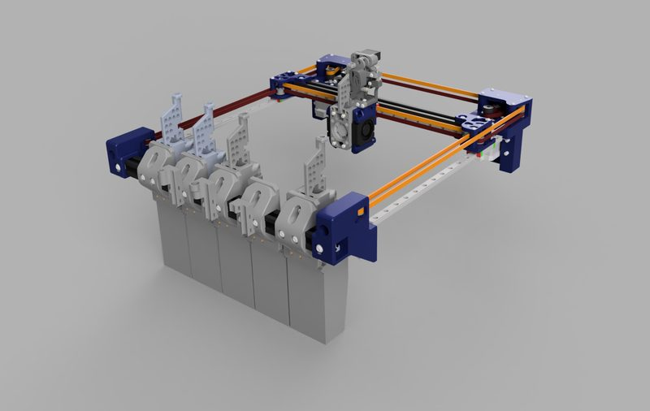</a> Photo: <a href="https://github.com/Irbis3D/MedusaHC">Irbis3D</a></td><td align="center" width="33%"><a href="2-medusahc.jpg">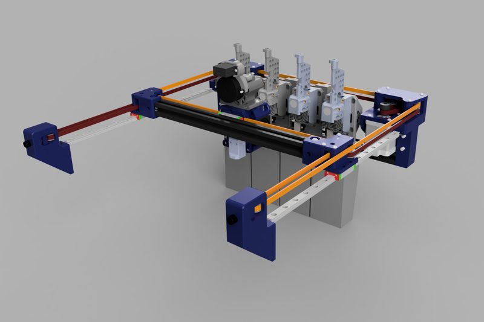</a> Photo: <a href="https://github.com/Irbis3D/MedusaHC">Irbis3D</a></td></tr>
<tr><td align="center" width="33%"><a href="3-medusahc.jpg">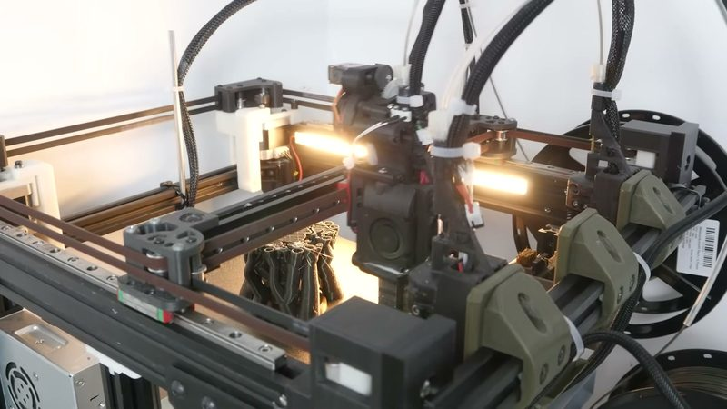</a> Photo: <a href="https://www.youtube.com/watch?v=hpV5Z1TnGdY">Irbis3D</a></td><td align="center" width="33%"><a href="4-medusahc.jpg">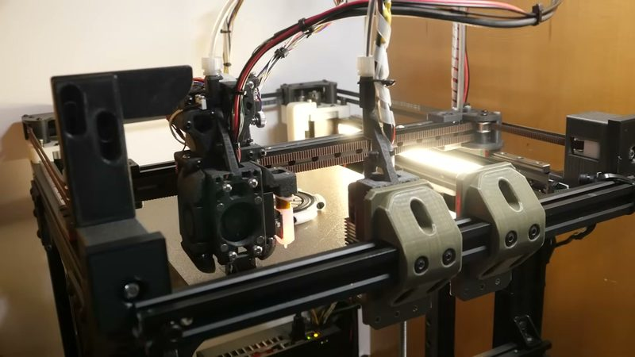</a> Photo: <a href="https://www.youtube.com/watch?v=hpV5Z1TnGdY">Irbis3D</a></td><td align="center" width="33%"><a href="5-medusahc.jpg">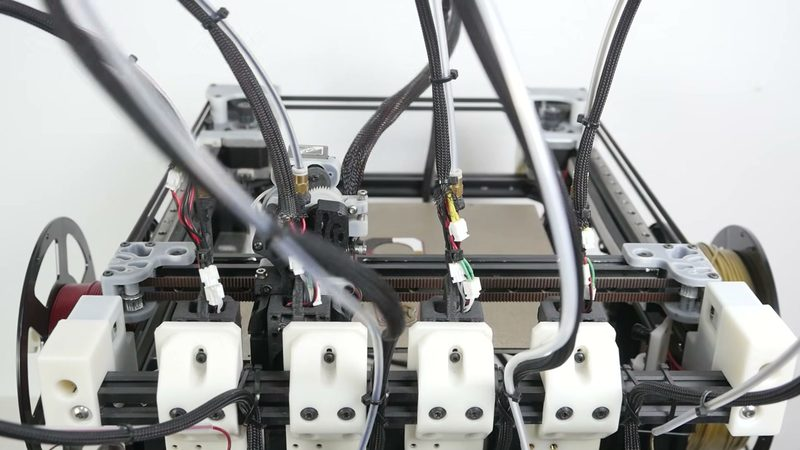</a> Photo: <a href="https://www.youtube.com/watch?v=F2OpeA6CTm0">Irbis3D</a></td></tr>
<tr><td align="center" width="33%"><a href="6-medusahc.jpg">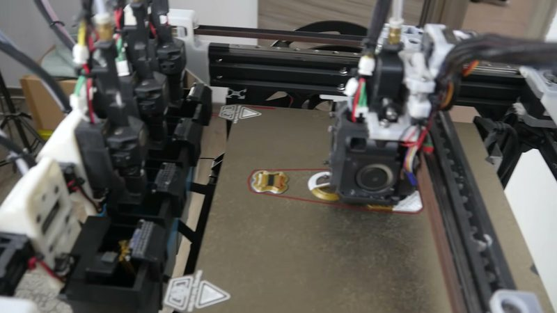</a> Photo: <a href="https://www.youtube.com/watch?v=F2OpeA6CTm0">Irbis3D</a></td><td align="center" width="33%"><a href="7-medusahc.jpg">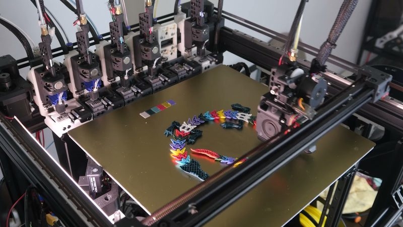</a> Photo: <a href="https://www.youtube.com/watch?v=hww29XsamMw">Irbis3D</a></td><td align="center" width="33%"><a href="8-medusahc.jpg">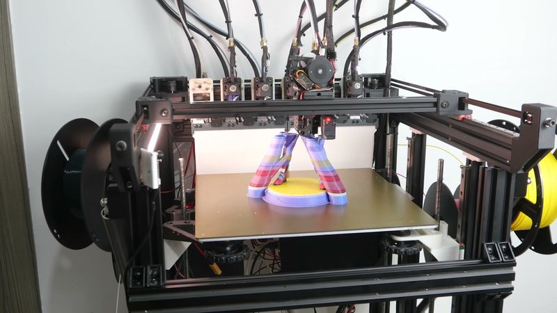</a> Photo: <a href="https://www.youtube.com/watch?v=hww29XsamMw">Irbis3D</a></td></tr>
<tr><td align="center" width="33%"><a href="9-medusahc.jpg">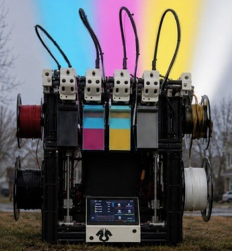</a> Photo: <a href="https://github.com/Irbis3D/MedusaHC">Irbis3D (Sergei Irbenek)</a></td><td align="center" width="33%"><a href="10-medusahc.jpg">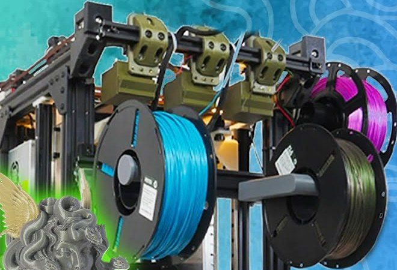</a> Photo: <a href="https://github.com/Irbis3D/MedusaHC">Irbis3D (Sergei Irbenek)</a></td></tr>
</table>

## Notes

- Printers that the author names: Duender; other CoreXY with changes. ([source](https://github.com/Irbis3D/MedusaHC))
