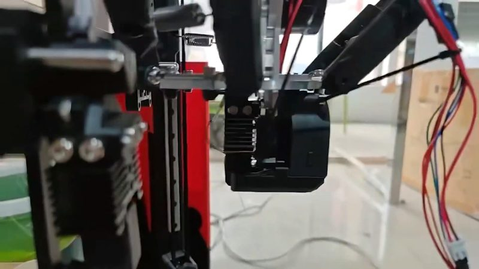
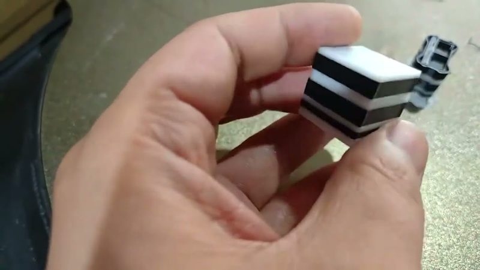
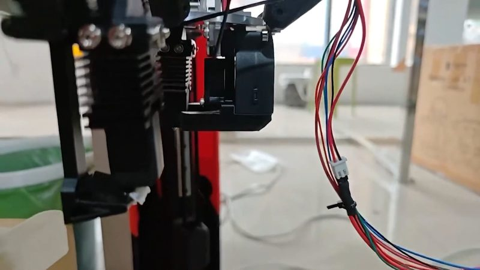
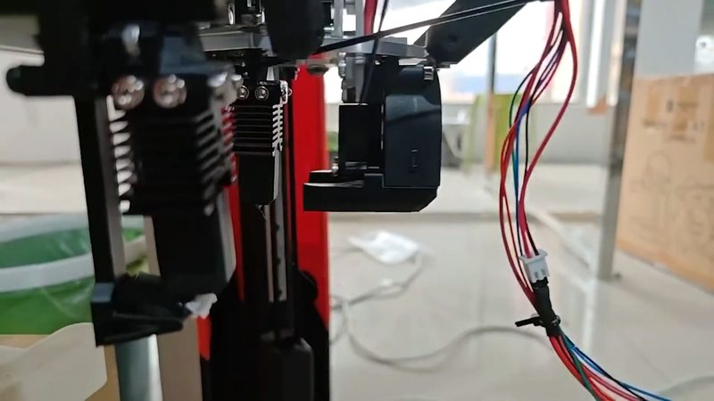
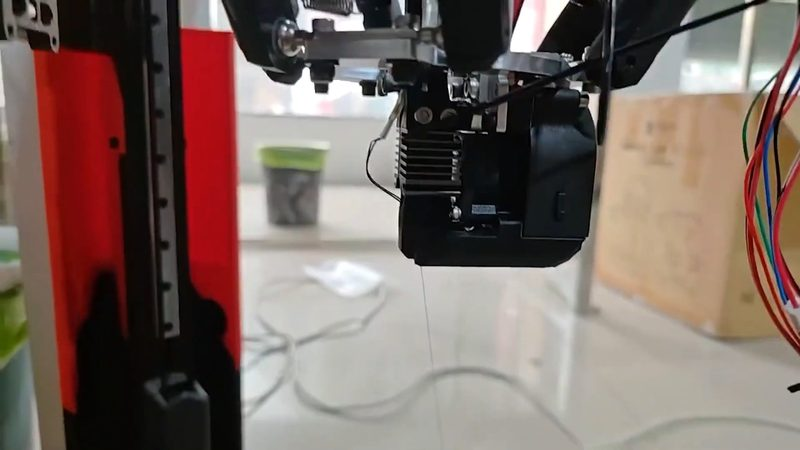
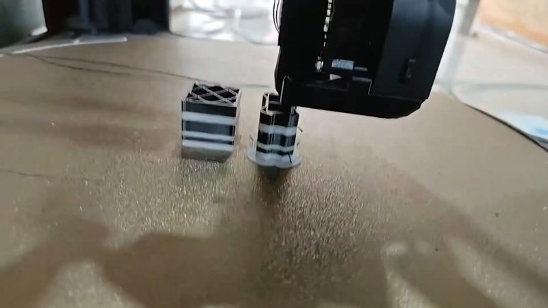
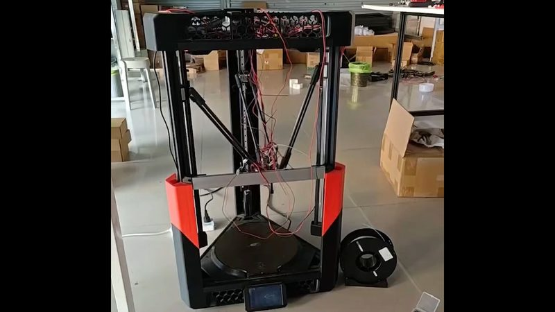

# INDX & KliTek magnetic tool changer for delta

[Catalog row](../../OTHER.md#micro-make-delta-changer) · [Gallery](../../GALLERY.md)

| Field | Value |
| --- | --- |
| Section | Not in the catalog ([OTHER.md](../../OTHER.md)) |
| Project page | [https://www.youtube.com/watch?v=SCrmRJolNY8](https://www.youtube.com/watch?v=SCrmRJolNY8) |
| Author | MICRO MAKE |
| Type | Hotend changer |
| Reason | One prototype video and no changer files. The public Venture Delta files cover only the base printer. |
| Coupling | — |
| Lock | — |
| Latest version | Last seen [2026-07](https://www.youtube.com/watch?v=SCrmRJolNY8) |
| Links | [Video](https://www.youtube.com/watch?v=SCrmRJolNY8) |

## Pictures (7)

<table>
<tr><td align="center" width="33%"> Photo: <a href="https://www.youtube.com/watch?v=SCrmRJolNY8">MICRO MAKE</a></td><td align="center" width="33%"> Photo: <a href="https://www.youtube.com/watch?v=SCrmRJolNY8">MICRO MAKE</a></td><td align="center" width="33%"> Photo: <a href="https://www.youtube.com/watch?v=SCrmRJolNY8">MICRO MAKE</a></td></tr>
<tr><td align="center" width="33%"> Photo: <a href="https://www.youtube.com/watch?v=SCrmRJolNY8">MICRO MAKE</a></td><td align="center" width="33%"> Photo: <a href="https://www.youtube.com/watch?v=SCrmRJolNY8">MICRO MAKE</a></td><td align="center" width="33%"> Photo: <a href="https://www.youtube.com/watch?v=SCrmRJolNY8">MICRO MAKE</a></td></tr>
<tr><td align="center" width="33%"> Photo: <a href="https://www.youtube.com/watch?v=SCrmRJolNY8">MICRO MAKE</a></td></tr>
</table>
