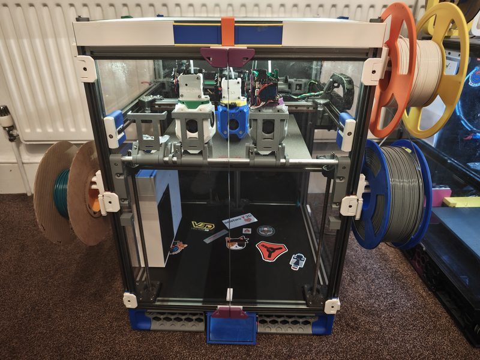
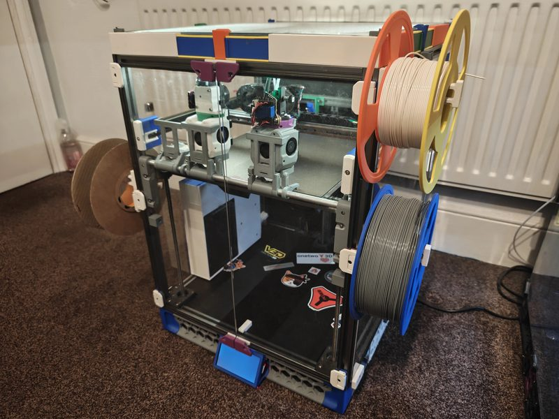
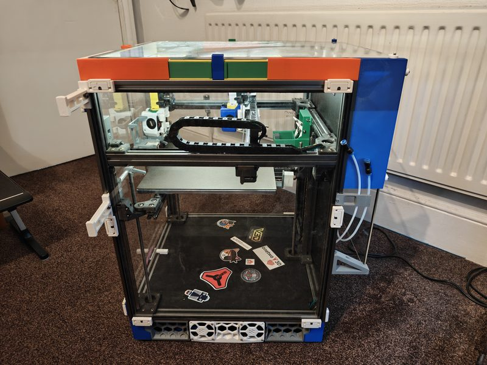
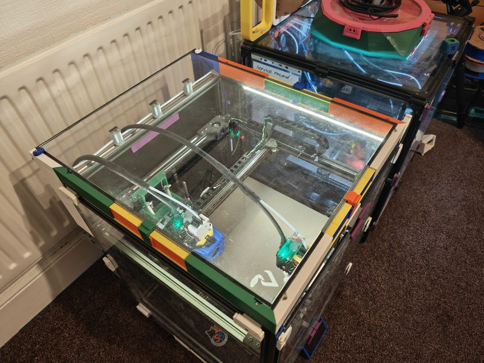
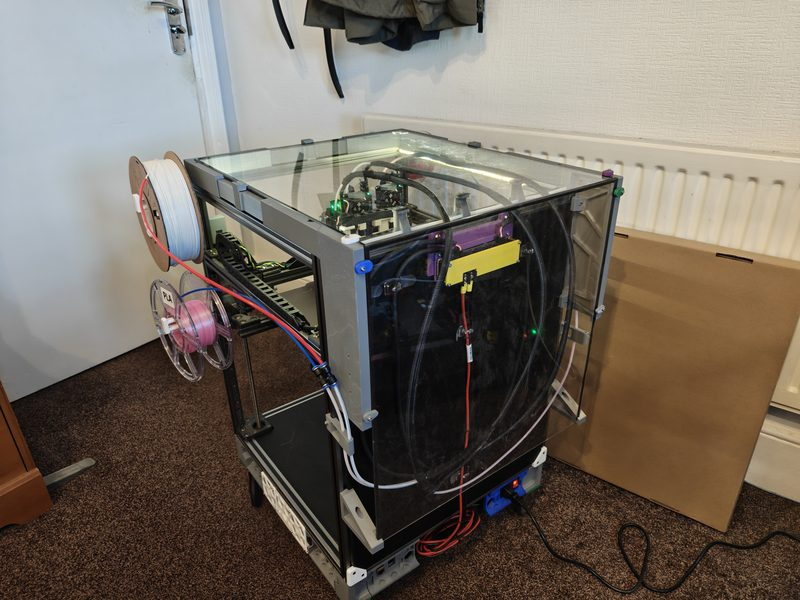
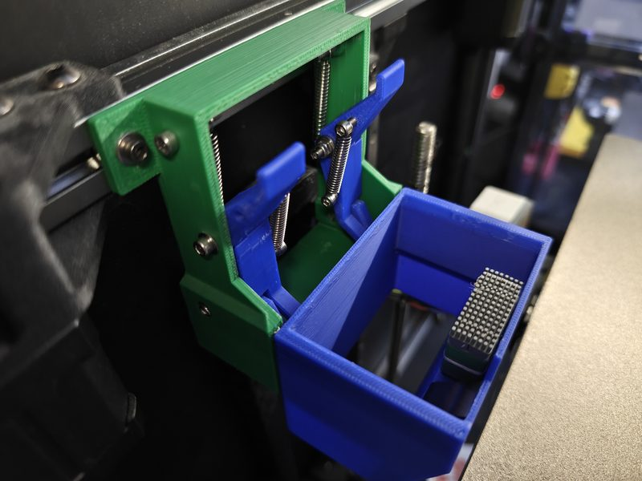
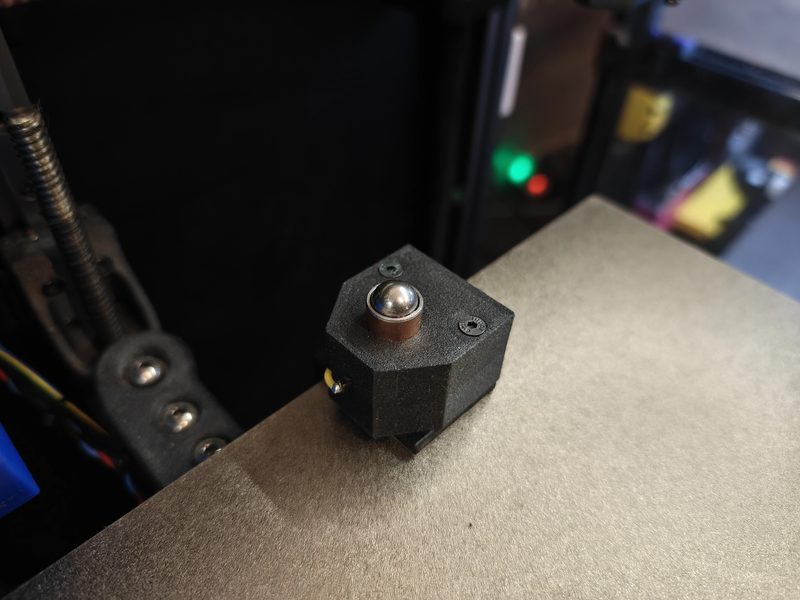
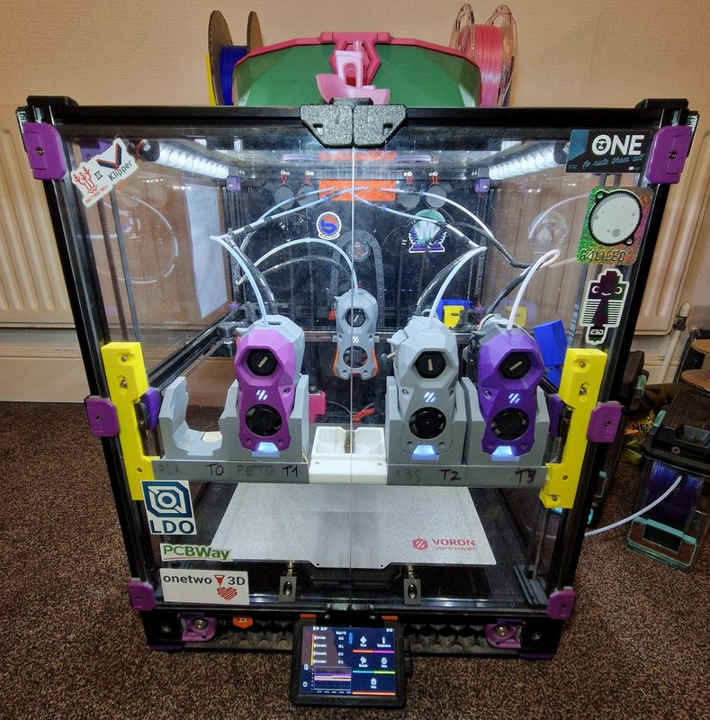
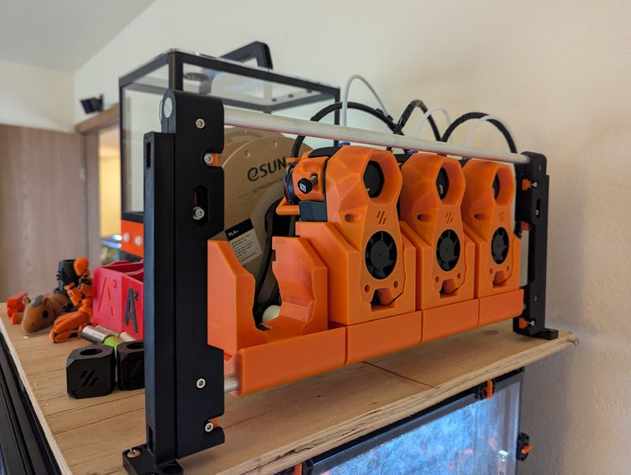

# MissChanger

[Catalog row](../../README.md#misschanger) · [Gallery](../../GALLERY.md)

| Field | Value |
| --- | --- |
| Section | Tool changers |
| Project page | [https://github.com/VIN-y/MissChanger](https://github.com/VIN-y/MissChanger) |
| Author | VIN-y |
| About | Four corner pins with N52 magnets hold the tool, and a sliding ramp on the dock does the Z part of the docking move. You can convert back to a single Stealth Burner without tools. MCv2 moves the design to the Voron Trident with the A4T toolhead. |
| Coupling | pins and bushings |
| Lock | magnets |
| Extruder | on the tool |
| Change time | — |
| Tools | 4 |
| Base printers | Voron 2.4, Voron Trident |
| Firmware | Klipper, klipper-toolchanger fork |
| Latest version | MCv2 [2026-07](https://www.printables.com/model/1533585-misschanger-v2) |
| Stars Likes Views |  [🧡⁠20](https://www.printables.com/model/1533585-misschanger-v2) |
| Links | [CAD](https://github.com/VIN-y/MissChanger/tree/main/CADs) [STL](https://github.com/VIN-y/MissChanger/tree/main/STL_%26_Assembly) [Manual](https://github.com/VIN-y/MissChanger/blob/main/STL_%26_Assembly/MissChanger_Assembly_Manual.pdf) [BOM](https://github.com/VIN-y/MissChanger/blob/main/STL_%26_Assembly/BOM.pdf) [Config](https://github.com/VIN-y/MissChanger/tree/main/Klipper_Config) [FW](https://github.com/VIN-y/klipper-toolchanger) [Wiki](https://github.com/VIN-y/MissChanger/wiki) [MCv2 Wiki](https://gitlab.com/misschanger/misschanger-v2/-/wikis/home) [MCv2 Files](https://www.printables.com/model/1533585-misschanger-v2) |
| Groups | [Discord](https://discord.gg/qrb6HXNYxs) EN 2.2K |

## Pictures (9)

<table>
<tr><td align="center" width="33%"> Photo: <a href="https://www.printables.com/model/1533585-misschanger-v2">Vin</a></td><td align="center" width="33%"> Photo: <a href="https://gitlab.com/misschanger/misschanger-v2">VIN-y</a></td><td align="center" width="33%"> Photo: <a href="https://www.printables.com/model/1533585-misschanger-v2">Vin</a></td></tr>
<tr><td align="center" width="33%"> Photo: <a href="https://www.printables.com/model/1533585-misschanger-v2">Vin</a></td><td align="center" width="33%"> Photo: <a href="https://www.printables.com/model/1533585-misschanger-v2">Vin</a></td><td align="center" width="33%"> Photo: <a href="https://www.printables.com/model/1533585-misschanger-v2">Vin</a></td></tr>
<tr><td align="center" width="33%"> Photo: <a href="https://www.printables.com/model/1533585-misschanger-v2">Vin</a></td><td align="center" width="33%"> Photo: <a href="https://github.com/VIN-y/MissChanger">VIN-y</a></td><td align="center" width="33%"> Photo: <a href="https://github.com/VIN-y/MissChanger/tree/main/UserMods/Psychosis5150/Idle%20Dock%20Mount">Psychosis5150</a></td></tr>
</table>

## Notes

- Probing is separate from the tool change: the MGN9H rail of Voron Tap does the probing. ([source](https://github.com/VIN-y/MissChanger))
- Each dock is 80 mm wide. ([source](https://github.com/VIN-y/MissChanger))
- MissChanger uses its own fork of klipper-toolchanger, and its config files do not work with upstream TapChanger or StealthChanger setups. ([source](https://github.com/VIN-y/MissChanger))
