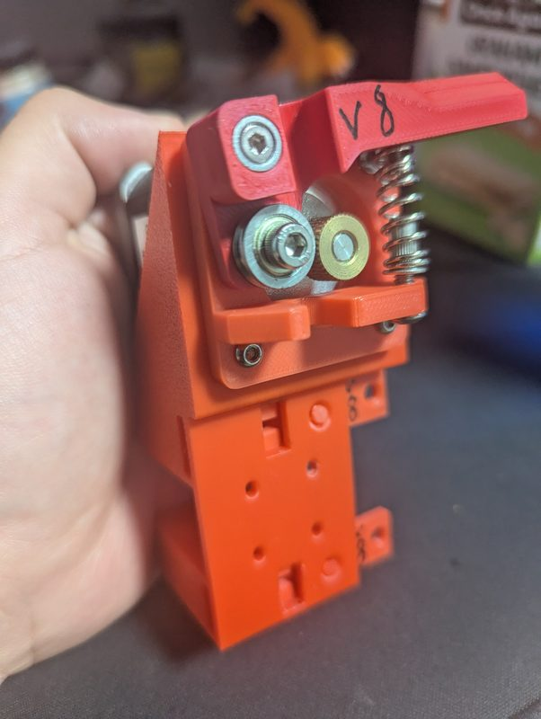

# Mk8 hotend changer

[Catalog row](../../OTHER.md#mk8-hotend-changer) · [Gallery](../../GALLERY.md)

| Field | Value |
| --- | --- |
| Section | Concepts and prototypes ([OTHER.md](../../OTHER.md)) |
| Project page | [https://www.printables.com/model/1784948-mk8-hotend-changer](https://www.printables.com/model/1784948-mk8-hotend-changer) |
| Author | Dreadnought 3D |
| About | Early MK8 hotend swapper published as a single STEP at viewers' request; the author never tested it on a printer and has since moved to a different design. |
| Type | Hotend changer |
| Status | STEP file, never tested |
| Coupling | — |
| Lock | — |
| Latest version | First release [2026-07](https://www.printables.com/model/1784948-mk8-hotend-changer) |
| Stars Likes Views | — |
| Links | [STEP](https://www.printables.com/model/1784948-mk8-hotend-changer/files) |

## Pictures (1)

<table>
<tr><td align="center" width="33%"> Photo: <a href="https://www.printables.com/model/1784948-mk8-hotend-changer">Dreadnought 3D</a></td></tr>
</table>
