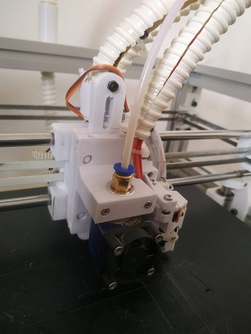
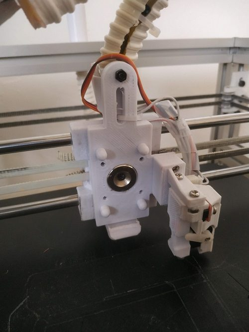
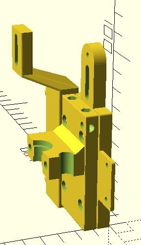
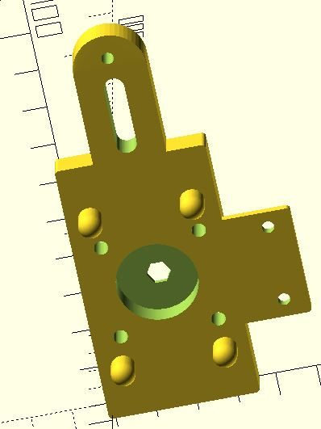
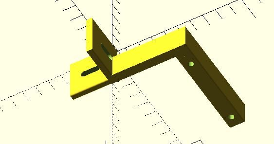
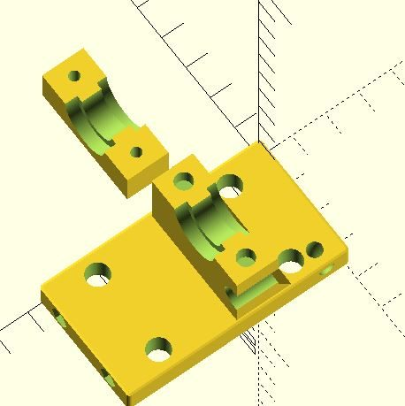

# Magnetic Tool Changing (MTC)

[Catalog row](../../OTHER.md#mtc) · [Gallery](../../GALLERY.md)

| Field | Value |
| --- | --- |
| Section | Legacy designs ([OTHER.md](../../OTHER.md)) |
| Project page | [https://github.com/doryosef/mtc](https://github.com/doryosef/mtc) |
| Author | dor yosef (doryosef) |
| About | OpenSCAD magnetic carriage adapter and tool catchers for the Hypercube Evolution. It holds a V6 hotend, a pen or a laser, with Duet tfree/tpost G-code. No update since 2020-04. |
| Type | Tool changer, Bowden |
| Coupling | — |
| Lock | magnets |
| Change time | — |
| Latest version | First release [2020-04](https://github.com/doryosef/mtc/commit/c942a3ca2351fc18b56528e58f0129dbb641455b) |
| Stars Likes Views |  |
| Links | [CAD](https://github.com/doryosef/mtc) [Config](https://github.com/doryosef/mtc/blob/master/setTool.gcode) |
| Groups | — |

## Pictures (6)

<table>
<tr><td align="center" width="33%"> Photo: <a href="https://github.com/doryosef/mtc">doryosef</a></td><td align="center" width="33%"> Photo: <a href="https://github.com/doryosef/mtc">doryosef</a></td><td align="center" width="33%"> Photo: <a href="https://github.com/doryosef/mtc">doryosef</a></td></tr>
<tr><td align="center" width="33%"> Photo: <a href="https://github.com/doryosef/mtc">doryosef</a></td><td align="center" width="33%"> Photo: <a href="https://github.com/doryosef/mtc">doryosef</a></td><td align="center" width="33%"> Photo: <a href="https://github.com/doryosef/mtc">doryosef</a></td></tr>
</table>
