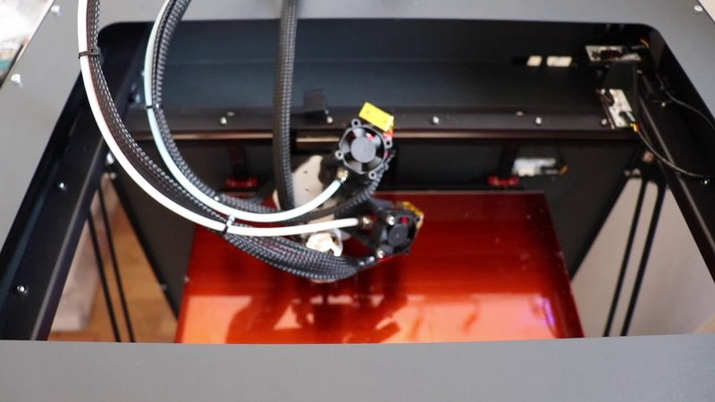
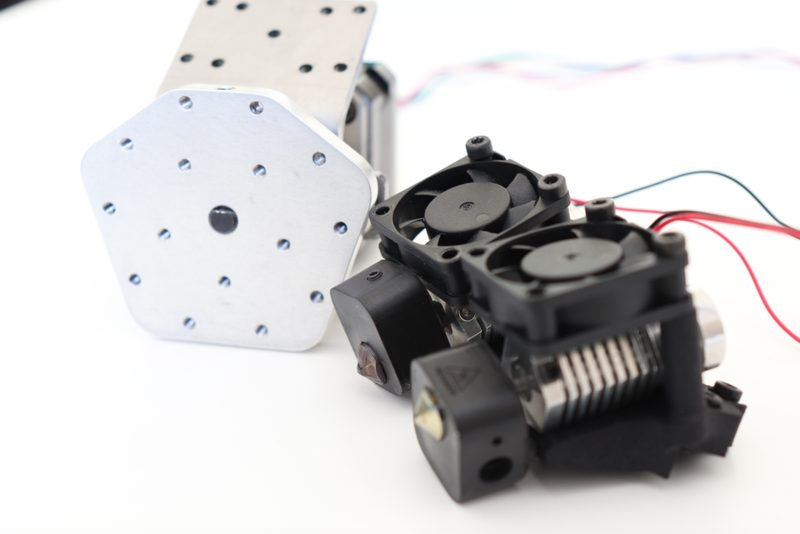
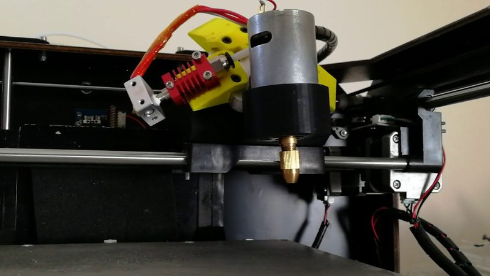

# OctoHead

[Catalog row](../../OTHER.md#octohead) · [Gallery](../../GALLERY.md)

| Field | Value |
| --- | --- |
| Section | Not in the catalog ([OTHER.md](../../OTHER.md)) |
| Project page | [http://octohead.com/](http://octohead.com/) |
| Author | octohead project (Raybot, France) |
| Type | Tool changer |
| Reason | Rotary turret: three tools on a swivel head, with no dock and no lock. It was sold as a commercial product. |
| Coupling | — |
| Lock | — |
| Latest version | First video [2018-09](https://www.youtube.com/watch?v=d1BWFsc4pcQ) |
| Links | [Video](https://www.youtube.com/watch?v=d1BWFsc4pcQ) [Video](https://www.youtube.com/watch?v=V4W0I0hq6hI) |

## Pictures (3)

<table>
<tr><td align="center" width="33%"> Photo: <a href="https://www.youtube.com/watch?v=d1BWFsc4pcQ">octohead project</a></td><td align="center" width="33%"> Photo: <a href="https://web.archive.org/web/20190609154106/https://raybot.fr/">octohead project</a></td><td align="center" width="33%"> Photo: <a href="https://www.youtube.com/watch?v=V4W0I0hq6hI">octohead project</a></td></tr>
</table>
