# ProForge

[Catalog row](../../README.md#proforge) · [Gallery](../../GALLERY.md)

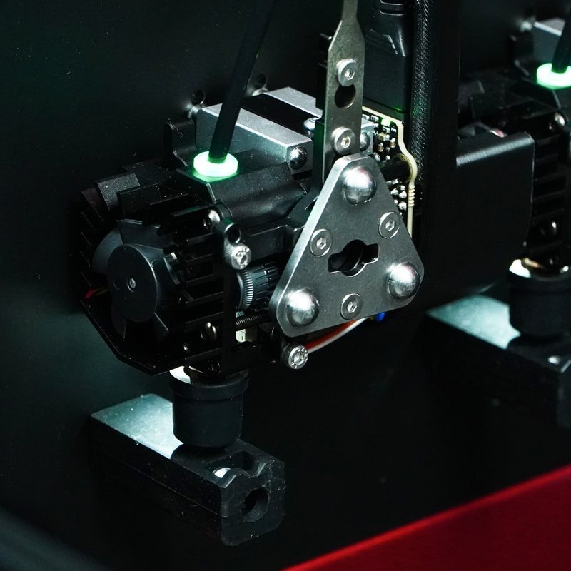

| Field | Value |
| --- | --- |
| Section | Tool changers |
| Project page | [https://github.com/Makertech3D/ProForge-5](https://github.com/Makertech3D/ProForge-5) |
| Author | Makertech 3D |
| About | Quad-CoreXY tool-changer printers, sold as kits, with GPL-3.0 files. A servo turns a spring-loaded cam that locks the tool plate to a master plate on the carriage. The design draws on the E3D ToolChanger. ProForge 4 and 300 have full STEP models, ProForge 5 has only STLs. |
| Coupling | — |
| Lock | cam, servo |
| Extruder | on the tool |
| Change time | [~7 s](https://www.youtube.com/watch?v=kZDpSXT7a8A) |
| Tools | 5 |
| Base printers | ProForge 4, 4.2, 300, and 5 (own printers) |
| Firmware | Klipper, own macros |
| Latest version | CAD [2026-10](https://github.com/Makertech3D/ProForge-5/commit/d349b1a4c0645e62c620552e2f37b31e9fdfbab9) |
| Stars Likes Views |  [⏯️⁠34.2K](https://www.youtube.com/watch?v=xs0uCbAai-U) |
| Links | [STEP (P4)](https://github.com/Makertech3D/Proforge-4/blob/main/Proforge%204.STEP.zip) [STEP (P300)](https://github.com/Makertech3D/ProForge300/blob/main/ProForge%20300.STEP.zip) [STL (P5)](https://github.com/Makertech3D/ProForge-5/tree/main/3D%20Printed%20Parts) [Config (P5)](https://github.com/Makertech3D/ProForge-5/tree/main/Config%20Files) [Manual (P5)](https://makertech-3d.dozuki.com/c/ProForge_5) [BOM (P300)](https://docs.google.com/spreadsheets/d/11tMFYWeuSdlYLyPoK7uE3kZFWasaUpS3Rfe4Z1YwD74/edit) [BOM (P4)](https://docs.google.com/spreadsheets/d/1Y5VUGZzWMNDWVGi7vUqABhzv31rmcmznpvWCIOyDUW4/edit?usp=sharing) [Video](https://www.youtube.com/watch?v=xs0uCbAai-U) |
| Groups | [Discord](https://discord.com/invite/FwgXFUw4R4) EN 501 [Facebook](https://www.facebook.com/groups/proforge4) EN [Facebook](https://www.facebook.com/groups/proforge5) EN [Facebook](https://www.facebook.com/groups/proforge300) EN |

## Pictures (12)

<table>
<tr><td align="center" width="33%"> Photo: <a href="https://www.makertech3d.com/products/proforge-5-print-head">Makertech3D</a></td><td align="center" width="33%"><a href="1-proforge.jpg">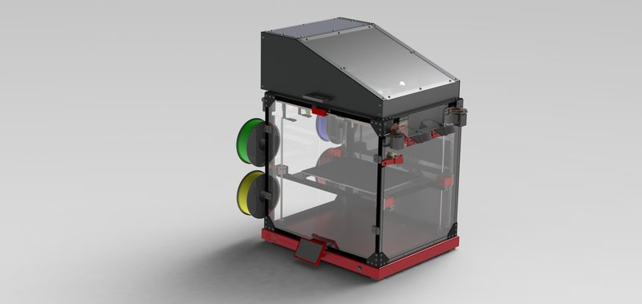</a> Photo: <a href="https://github.com/Makertech3D/Proforge-4">Makertech3D</a></td><td align="center" width="33%"><a href="2-proforge.jpg">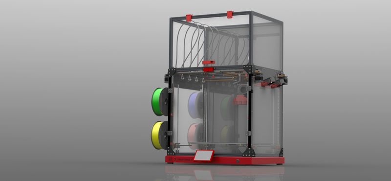</a> Photo: <a href="https://github.com/Makertech3D/ProForge-4.2">Makertech3D</a></td></tr>
<tr><td align="center" width="33%"><a href="3-proforge.jpg">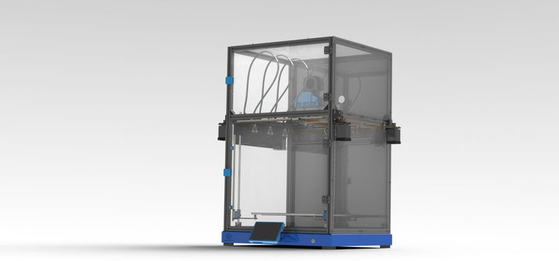</a> Photo: <a href="https://github.com/Makertech3D/ProForge300">Makertech3D</a></td><td align="center" width="33%"><a href="4-proforge.jpg">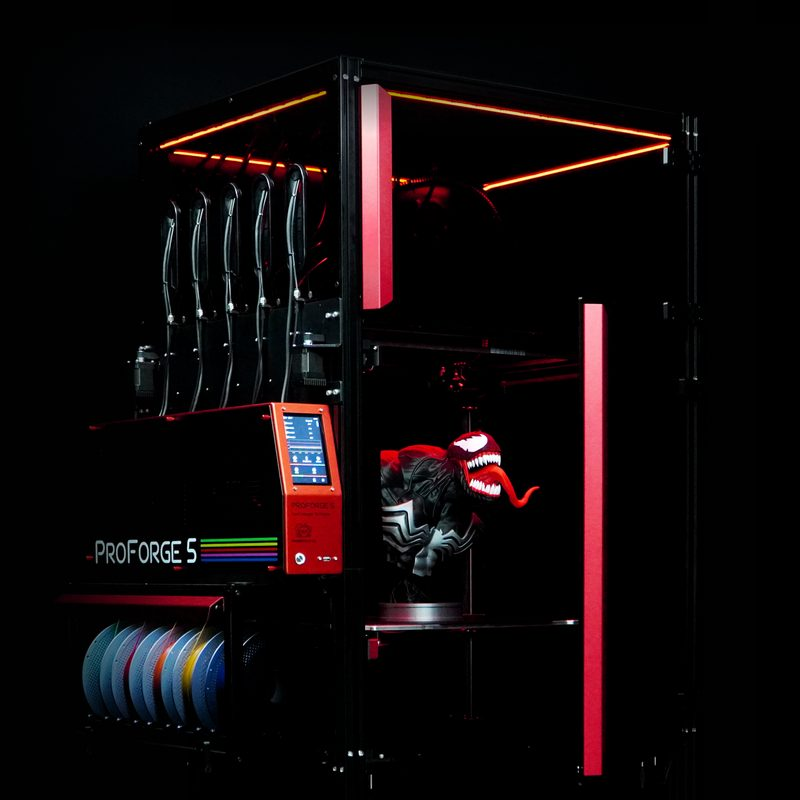</a> Photo: <a href="https://www.makertech3d.com/products/proforge-5-ultra">Makertech3D</a></td><td align="center" width="33%"><a href="5-proforge.jpg">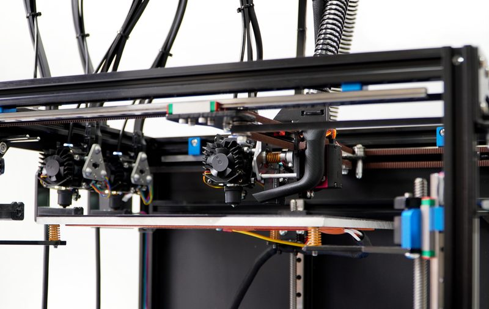</a> Photo: <a href="https://www.makertech3d.com/products/proforge-300-tool-changer-3d-printer-kit">Makertech3D</a></td></tr>
<tr><td align="center" width="33%"><a href="6-proforge.jpg">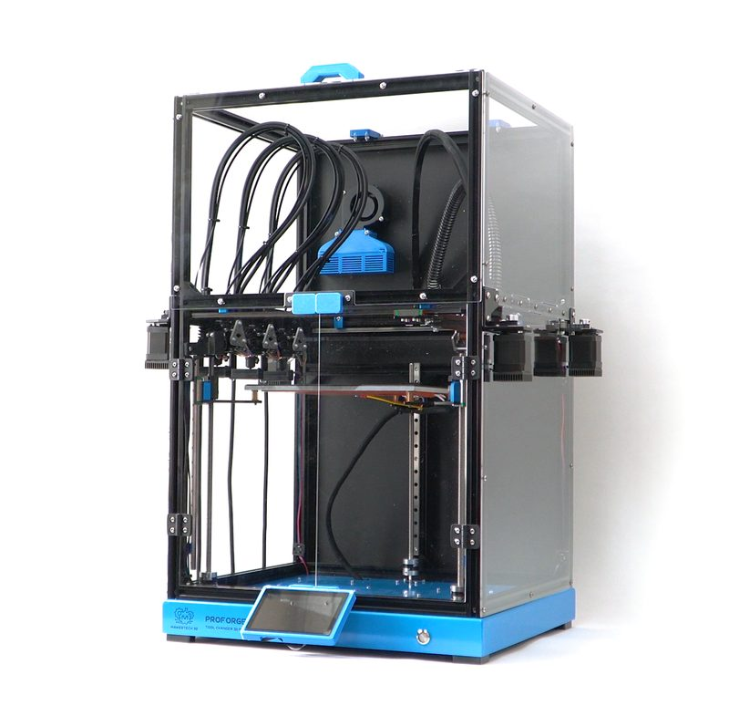</a> Photo: <a href="https://www.makertech3d.com/products/proforge-300-ultra-tool-changer-3d-printer-kit">Makertech3D</a></td><td align="center" width="33%"><a href="7-proforge.jpg">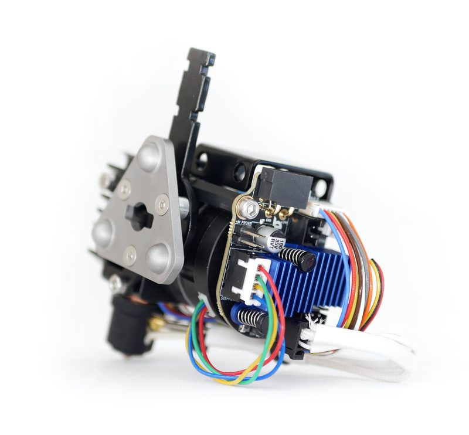</a> Photo: <a href="https://www.makertech3d.com/products/proforge-4-2-print-head">Makertech3D</a></td><td align="center" width="33%"><a href="8-proforge.jpg">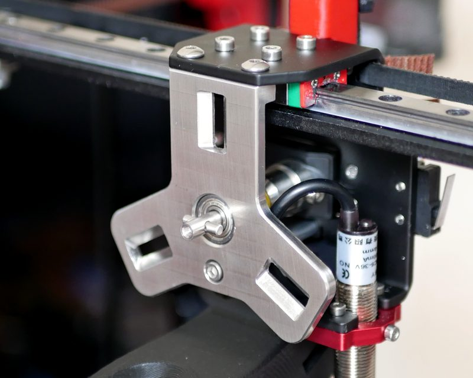</a> Photo: <a href="https://www.makertech3d.com/products/proforge-4-tool-changer-master-plate">Makertech3D</a></td></tr>
<tr><td align="center" width="33%"><a href="9-proforge.jpg">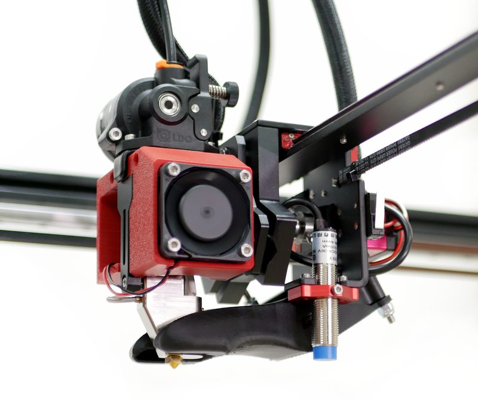</a> Photo: <a href="https://www.makertech3d.com/products/proforge-4-print-head">Makertech3D</a></td><td align="center" width="33%"><a href="10-proforge.jpg">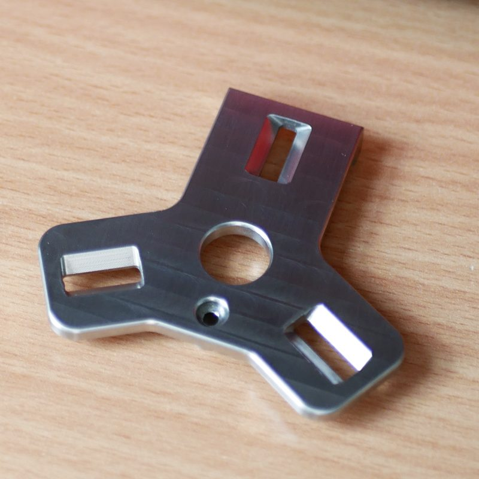</a> Photo: <a href="https://www.makertech3d.com/products/proforge-4-tool-changer-master-plate">Makertech3D</a></td><td align="center" width="33%"><a href="11-proforge.jpg">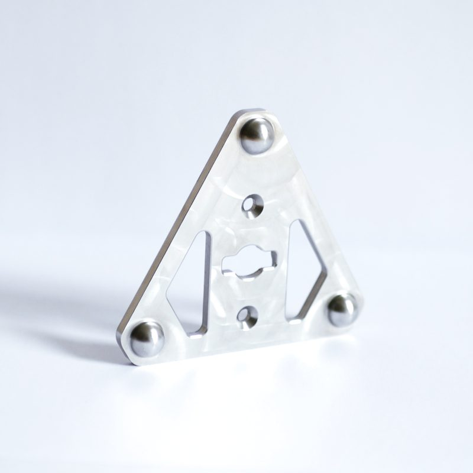</a> Photo: <a href="https://www.makertech3d.com/products/proforge-4-tool-changer-tool-plate">Makertech3D</a></td></tr>
</table>

## Notes

- The ProForge 4 has a 400 x 300 x 400 mm build volume, and its stock Klipper config sets up four tools. ([source](https://github.com/Makertech3D/Proforge-4))
