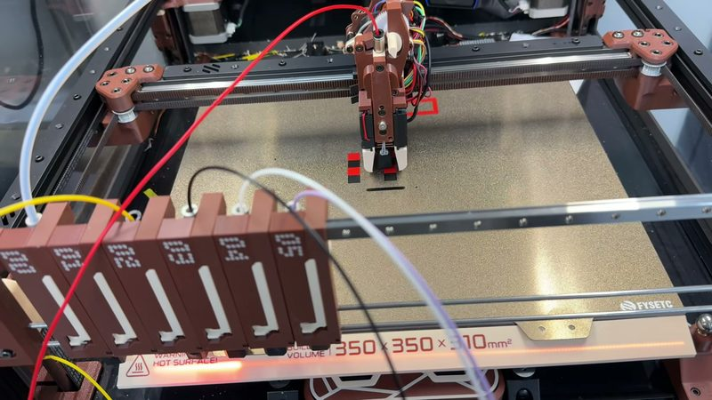
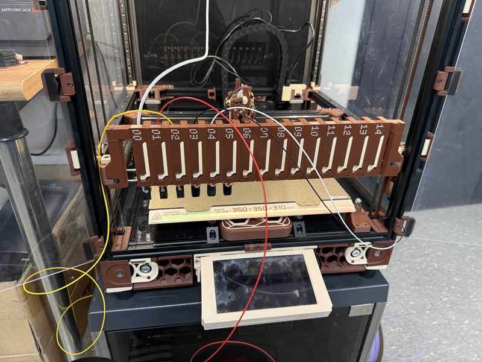
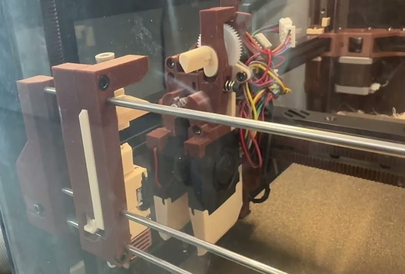
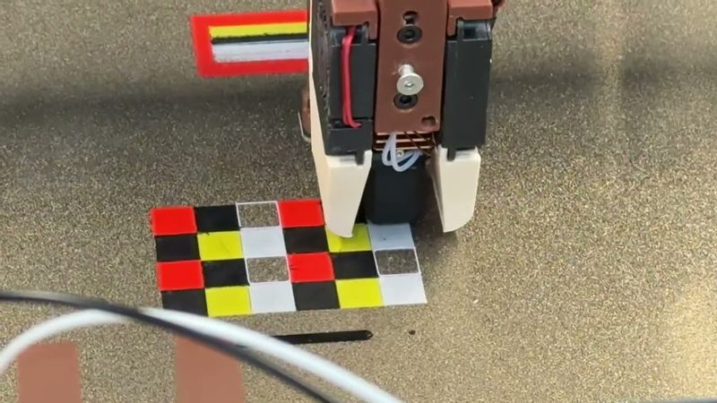
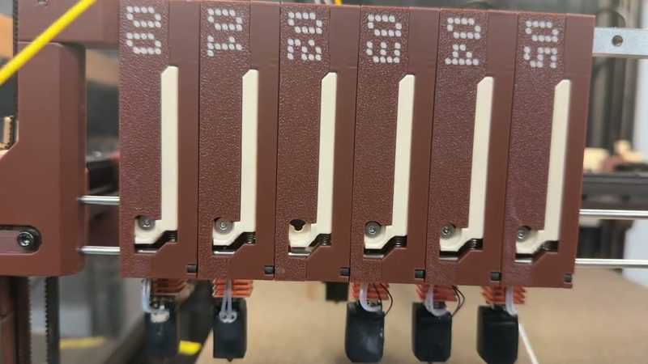
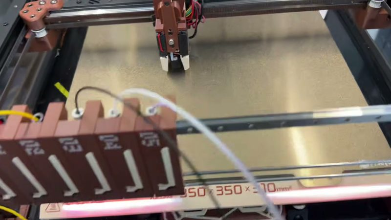
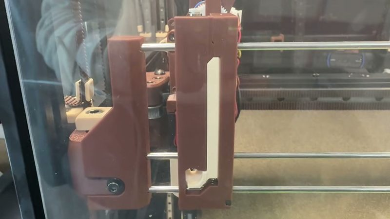
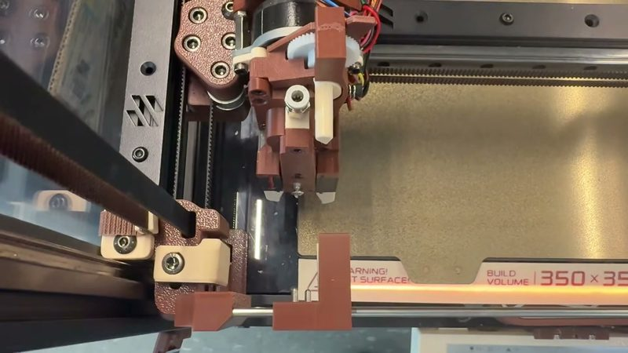

# Quindec

[Catalog row](../../README.md#quindec) · [Gallery](../../GALLERY.md)

| Field | Value |
| --- | --- |
| Section | Concepts and prototypes |
| Project page | [https://github.com/srinn/quindec-toolchanger](https://github.com/srinn/quindec-toolchanger) |
| Author | Srin (srinn) |
| About | High-density hotend changer that fits up to 15 tools on a 350 mm Voron 2.4, with common and cheap parts. Only the Tool Carriage Holder needs changes for other CoreXY printers. The author plans to open the files and now runs a closed beta. |
| Type | Hotend changer |
| Status | Closed beta, files not public |
| Coupling | Maxwell |
| Lock | magnets |
| Latest version | First video [2026-01](https://www.youtube.com/watch?v=Pdesunm21xI) |
| Stars Likes Views |  [⏯️⁠8K](https://www.youtube.com/watch?v=941lrKT-fIY) |
| Links | [BOM](https://docs.google.com/spreadsheets/d/1nJBv6CMfGyc1glqEgBD53pvTv2HscVy6cldr4ujhJa0/edit?usp=sharing) [Video](https://www.youtube.com/watch?v=-aM5X-14fe0) [Video](https://www.youtube.com/watch?v=941lrKT-fIY) |

## Pictures (8)

<table>
<tr><td align="center" width="33%"> Photo: <a href="https://youtu.be/941lrKT-fIY">Srin</a></td><td align="center" width="33%"> Photo: <a href="https://github.com/srinn/quindec-toolchanger">Srin</a></td><td align="center" width="33%"> Photo: <a href="https://youtu.be/Pdesunm21xI">Srin</a></td></tr>
<tr><td align="center" width="33%"> Photo: <a href="https://youtu.be/941lrKT-fIY">Srin</a></td><td align="center" width="33%"> Photo: <a href="https://youtu.be/-aM5X-14fe0">Srin</a></td><td align="center" width="33%"> Photo: <a href="https://youtu.be/941lrKT-fIY">Srin</a></td></tr>
<tr><td align="center" width="33%"> Photo: <a href="https://youtu.be/Pdesunm21xI">Srin</a></td><td align="center" width="33%"> Photo: <a href="https://youtu.be/Pdesunm21xI">Srin</a></td></tr>
</table>
