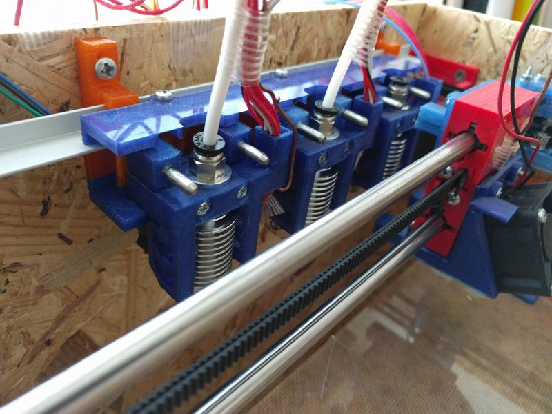
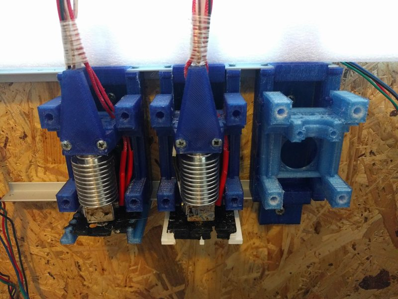
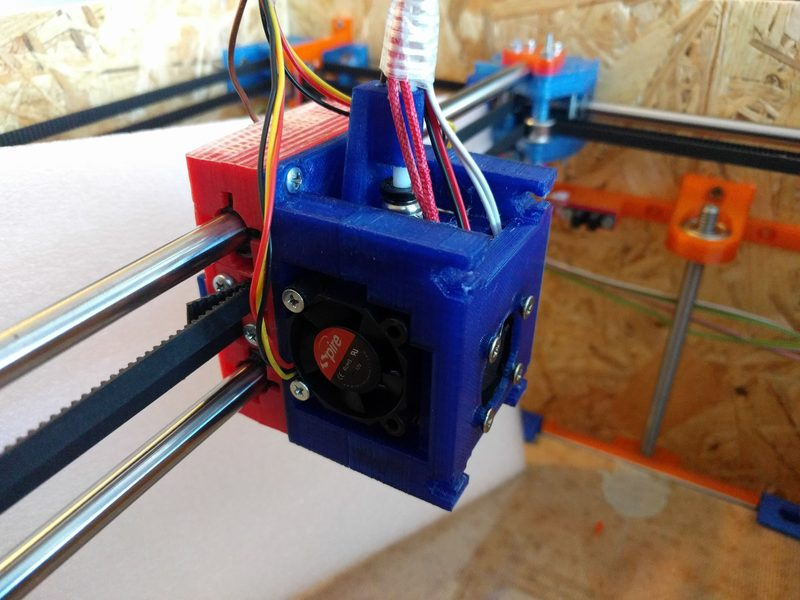
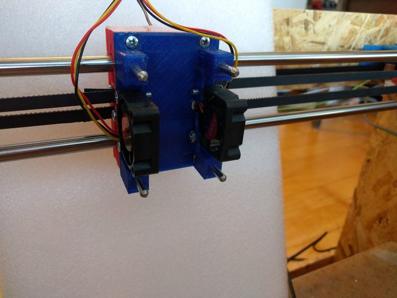
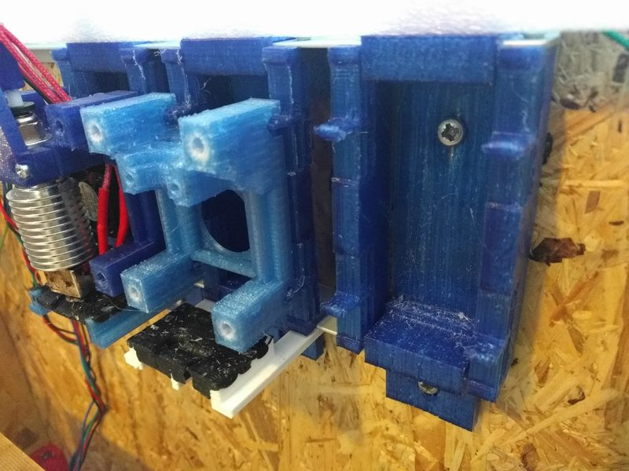
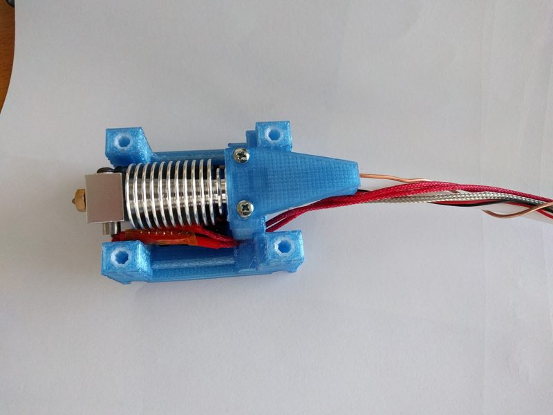
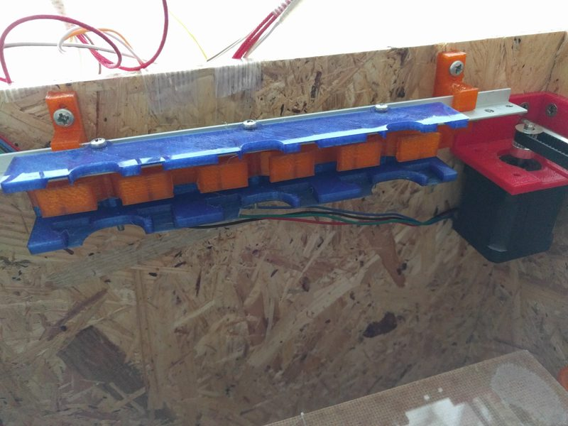

# Tool Switching

[Catalog row](../../OTHER.md#rolmie-tool-changer) · [Gallery](../../GALLERY.md)

| Field | Value |
| --- | --- |
| Section | Legacy designs ([OTHER.md](../../OTHER.md)) |
| Project page | [https://hackaday.io/project/26053-tool-switching-multi-extrusion](https://hackaday.io/project/26053-tool-switching-multi-extrusion) |
| Author | rolmie (GitHub: rmie) |
| About | Early magnetic tool switching on four 4 mm shafts, with OpenSCAD files on Hackaday.io. The logs show dual-colour prints and 200 load and unload cycles. No update since 2017-10. |
| Type | Tool changer, Bowden |
| Coupling | pins and bushings |
| Lock | magnets |
| Change time | — |
| Latest version | Last seen [2017-10](https://hackaday.io/project/26053-tool-switching-multi-extrusion) |
| Stars Likes Views | [⏯️⁠23.3K](https://www.youtube.com/watch?v=eOKCvtaMa08) |
| Links | [Files](https://hackaday.io/project/26053/files) [Manual](https://hackaday.io/project/26053/instructions) [Video](https://www.youtube.com/watch?v=eOKCvtaMa08) [Video (redesign first print)](https://www.youtube.com/watch?v=NvcBKoBVFjo) [Config (offset calibration tool)](https://github.com/rmie/NozzleOffsetCalibrationTool) |
| Groups | — |

## Pictures (7)

<table>
<tr><td align="center" width="33%"> Photo: <a href="https://hackaday.io/project/26053-tool-switching-multi-extrusion">rolmie</a></td><td align="center" width="33%"> Photo: <a href="https://hackaday.io/project/26053-tool-switching-multi-extrusion">rolmie</a></td><td align="center" width="33%"> Photo: <a href="https://hackaday.io/project/26053-tool-switching-multi-extrusion">rolmie</a></td></tr>
<tr><td align="center" width="33%"> Photo: <a href="https://hackaday.io/project/26053-tool-switching-multi-extrusion">rolmie</a></td><td align="center" width="33%"> Photo: <a href="https://hackaday.io/project/26053-tool-switching-multi-extrusion">rolmie</a></td><td align="center" width="33%"> Photo: <a href="https://hackaday.io/project/26053-tool-switching-multi-extrusion">rolmie</a></td></tr>
<tr><td align="center" width="33%"> Photo: <a href="https://hackaday.io/project/26053-tool-switching-multi-extrusion">rolmie</a></td></tr>
</table>
