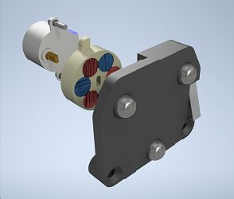
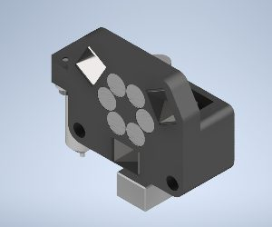
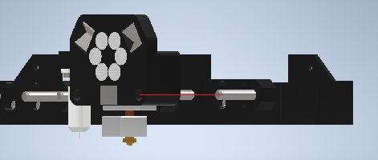
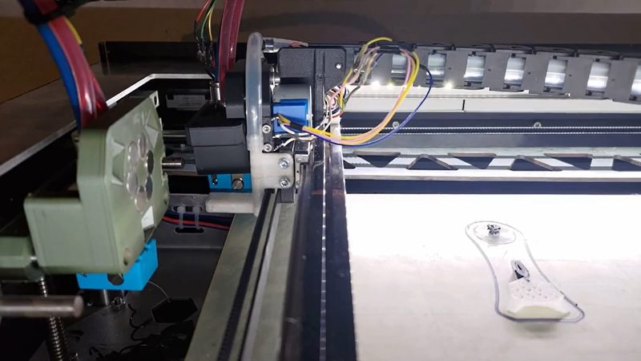

# Rotating Magnet Toolchanger

[Catalog row](../../OTHER.md#rotating-magnet-toolchanger) · [Gallery](../../GALLERY.md)

| Field | Value |
| --- | --- |
| Section | Legacy designs ([OTHER.md](../../OTHER.md)) |
| Project page | [https://github.com/totaldesaster/toolchanger](https://github.com/totaldesaster/toolchanger) |
| Author | totaldesaster (Remo) |
| About | A 28BYJ-48 geared stepper turns a ring of alternating-pole magnets on the head, so the head either pulls the tool on or pushes it off. It needs no servo, only a free stepper driver. Steel balls on the head and L profiles on the tool form a Maxwell coupling. The parts are almost all printed, and the design suits only light Bowden tools. No update since 2023-02. |
| Type | Tool changer, Bowden |
| Coupling | Maxwell |
| Lock | rotating magnet ring, motor |
| Change time | — |
| Latest version | CAD [2023-02](https://github.com/totaldesaster/toolchanger/commit/6910d2d) |
| Stars Likes Views |  |
| Links | [CAD](https://github.com/totaldesaster/toolchanger/tree/main/Version%201/Inventor%20Files) [Manual](https://github.com/totaldesaster/toolchanger/tree/main/Version%201/Assembly%20Drawings) [Config](https://github.com/totaldesaster/toolchanger/blob/main/Version%201/Klipper%20Config.txt) |
| Groups | — |

## Pictures (4)

<table>
<tr><td align="center" width="33%"> Photo: <a href="https://github.com/totaldesaster/toolchanger">totaldesaster (Remo)</a></td><td align="center" width="33%"> Photo: <a href="https://github.com/totaldesaster/toolchanger">totaldesaster (Remo)</a></td><td align="center" width="33%"> Photo: <a href="https://github.com/totaldesaster/toolchanger">totaldesaster (Remo)</a></td></tr>
<tr><td align="center" width="33%"> Photo: <a href="https://www.reddit.com/r/3Dprinting/comments/100lugi/my_opensource_mostly_printed_magnetic_toolchanger/">u/total_desaster</a></td></tr>
</table>

## Notes

- The tool and the toolhead each carry a ring of magnets with alternating poles, and a geared stepper turns the toolhead ring so opposite poles pull the tool on and same poles push it off. ([source](https://github.com/totaldesaster/toolchanger))
- In the author's tests, a tool hit hard enough to overpower the magnets flips up a little and then seats itself again. ([source](https://github.com/totaldesaster/toolchanger))
