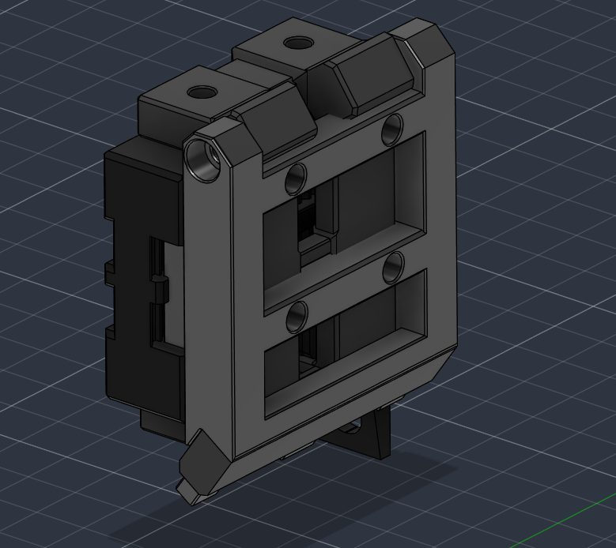

# Saddleback V1

[Catalog row](../../OTHER.md#saddleback) · [Gallery](../../GALLERY.md)

| Field | Value |
| --- | --- |
| Section | Not in the catalog ([OTHER.md](../../OTHER.md)) |
| Project page | [https://www.printables.com/model/1805729-saddleback-v1-tollhead-change-system-for-voron-24](https://www.printables.com/model/1805729-saddleback-v1-tollhead-change-system-for-voron-24) |
| Author | Palimino Productions |
| Type | Not a changer |
| Reason | The files show no dock, no lock, and no automatic change. |
| Coupling | — |
| Lock | — |
| Latest version | Last seen [2026-08](https://www.printables.com/model/1805729-saddleback-v1-tollhead-change-system-for-voron-24) |
| Links | [STL](https://www.printables.com/model/1805729-saddleback-v1-tollhead-change-system-for-voron-24/files) |

## Pictures (1)

<table>
<tr><td align="center" width="33%"> Photo: <a href="https://www.printables.com/model/1805729-saddleback-v1-tollhead-change-system-for-voron-24">Palimino Productions</a></td></tr>
</table>
