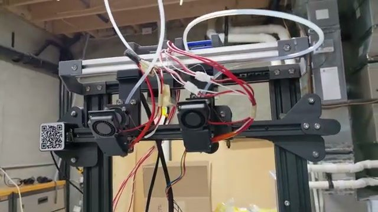
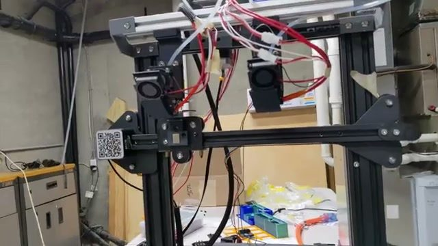
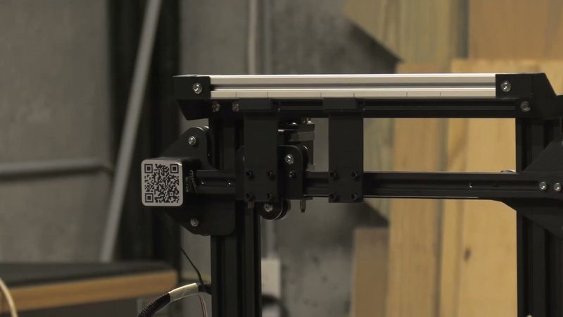
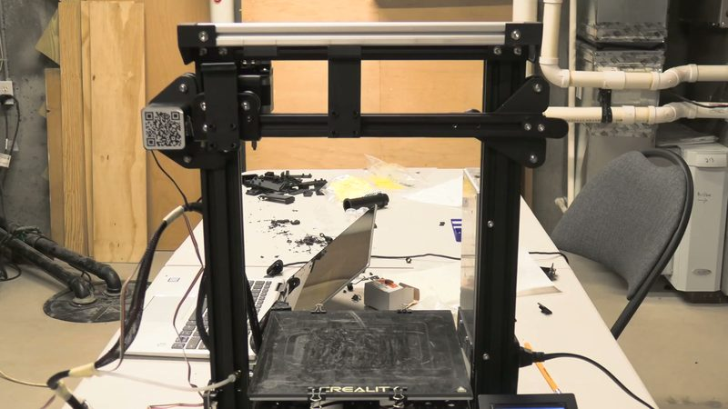
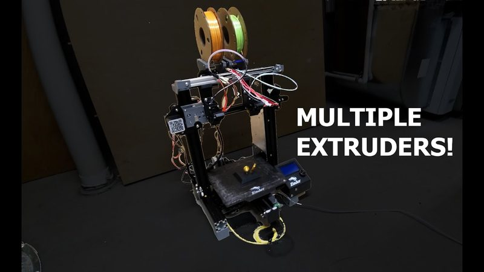

# Ender 3 Toolchanger

[Catalog row](../../README.md#sid-ender-3-toolchanger) · [Gallery](../../GALLERY.md)

| Field | Value |
| --- | --- |
| Section | Tool changers |
| Project page | [https://github.com/aximaker/ender-3-toolchanger](https://github.com/aximaker/ender-3-toolchanger) |
| Author | Sid Talks Linux (sidgames5 / Aximaker) |
| About | Ender 3 Pro conversion where toolheads under 31 mm wide slide into a side dock raised above the bed; tools include an extruder head, a BLTouch head and a paste dispenser head. |
| Coupling | side dock rails |
| Lock | — |
| Extruder | Bowden |
| Change time | — |
| Tools | 2 |
| Base printers | Ender 3 Pro |
| Firmware | Klipper |
| Latest version | Last seen [2025-07](https://github.com/aximaker/ender-3-toolchanger) |
| Stars Likes Views |  [⏯️⁠1.1K](https://www.youtube.com/watch?v=ySKlhTlgmOc) |
| Links | [CAD](https://github.com/aximaker/ender-3-toolchanger/tree/main/CAD) [BOM](https://github.com/aximaker/ender-3-toolchanger/tree/main/BOM) [Config](https://github.com/aximaker/ender-3-toolchanger/tree/main/Scripts) [Video](https://www.youtube.com/watch?v=ySKlhTlgmOc) [Video](https://www.youtube.com/watch?v=0ltWi0j6fQU) |
| Groups | — |

## Pictures (5)

<table>
<tr><td align="center" width="33%"> Photo: <a href="https://www.youtube.com/watch?v=0ltWi0j6fQU">Sid Talks Linux</a></td><td align="center" width="33%"> Photo: <a href="https://www.youtube.com/watch?v=0ltWi0j6fQU">Sid Talks Linux</a></td><td align="center" width="33%"> Photo: <a href="https://www.youtube.com/watch?v=ySKlhTlgmOc">Sid Talks Linux</a></td></tr>
<tr><td align="center" width="33%"> Photo: <a href="https://www.youtube.com/watch?v=ySKlhTlgmOc">Sid Talks Linux</a></td><td align="center" width="33%"> Photo: <a href="https://www.youtube.com/watch?v=0ltWi0j6fQU">Sid Talks Linux</a></td></tr>
</table>
