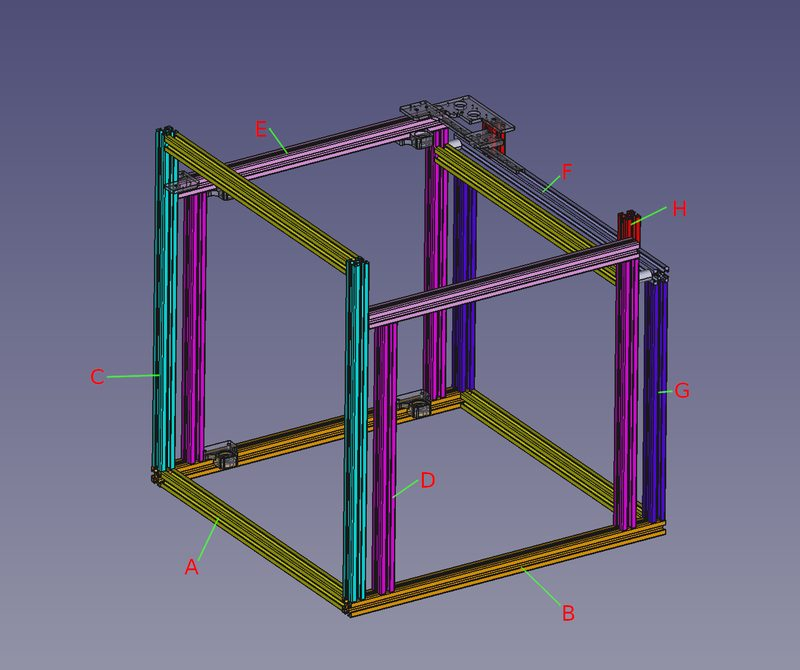
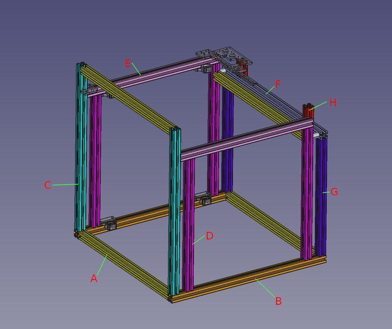

# SnakeOil-Changer

[Catalog row](../../OTHER.md#snakeoil-changer) · [Gallery](../../GALLERY.md)

| Field | Value |
| --- | --- |
| Section | Not in the catalog ([OTHER.md](../../OTHER.md)) |
| Project page | [https://github.com/ChipCE/SnakeOil-Changer](https://github.com/ChipCE/SnakeOil-Changer) |
| Author | ChipCE (Chip, snakeoildev.com) |
| Type | Not sorted |
| Reason | The files show only the base printer. No coupling, lock, dock, or tool change is documented. |
| Coupling | — |
| Lock | — |
| Latest version | Last seen [2026-04](https://github.com/ChipCE/SnakeOil-Changer) |
| Links | [Files](https://github.com/ChipCE/SnakeOil-Changer/tree/master/src) [STEP](https://github.com/ChipCE/SnakeOil-Changer/blob/master/doc/frame/frame_260111.step) [BOM](https://github.com/ChipCE/SnakeOil-Changer/blob/master/doc/frame/frame.md) |

## Pictures (2)

<table>
<tr><td align="center" width="33%"> Photo: <a href="https://github.com/ChipCE/SnakeOil-Changer/blob/master/doc/frame/frame.md">ChipCE</a></td><td align="center" width="33%"> Photo: <a href="https://github.com/ChipCE/SnakeOil-Changer">ChipCE (Chip, snakeoildev.com)</a></td></tr>
</table>
