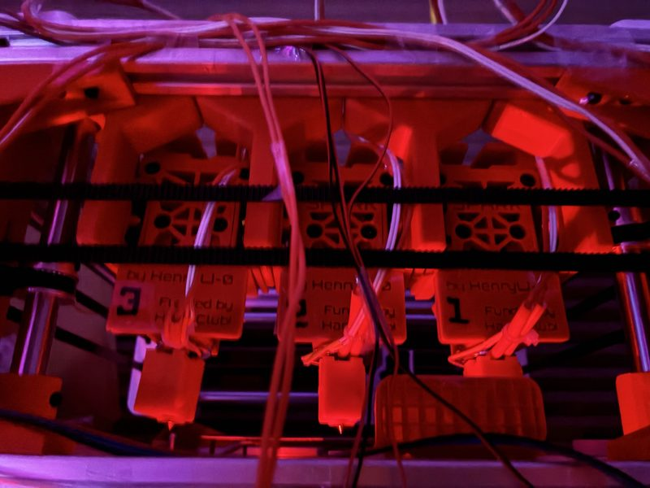
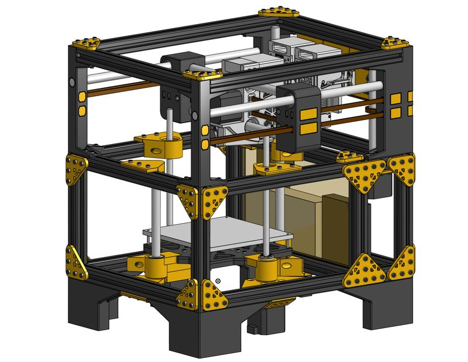
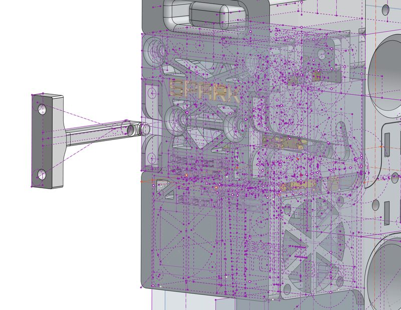
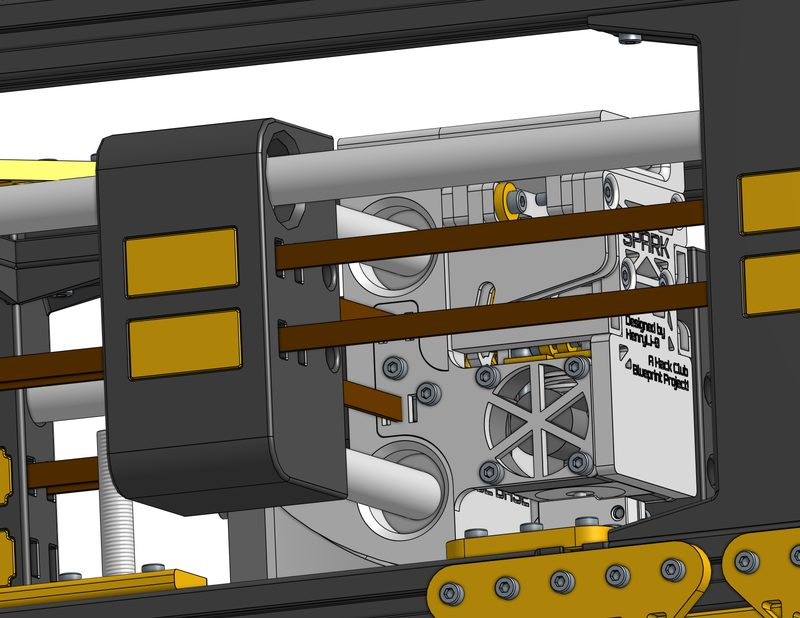
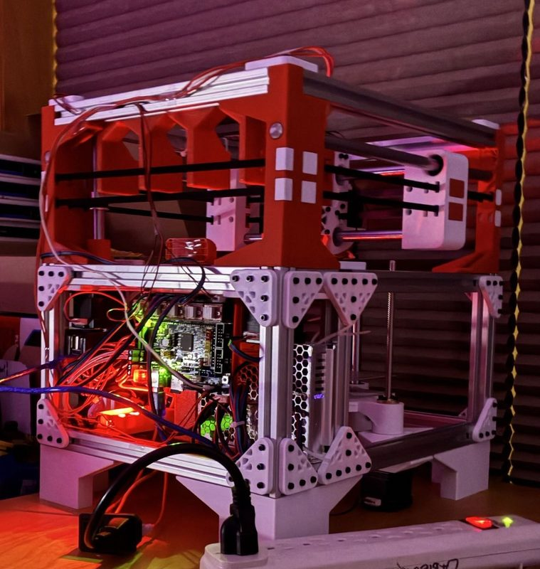
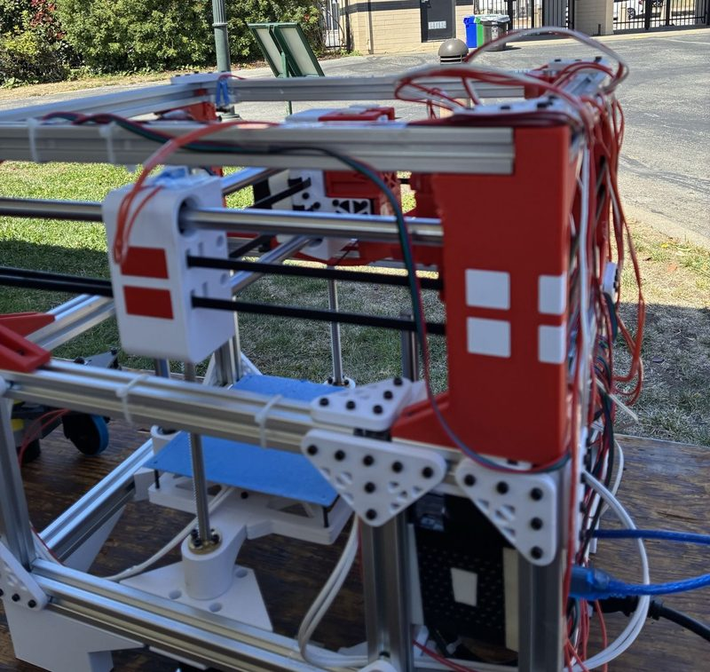
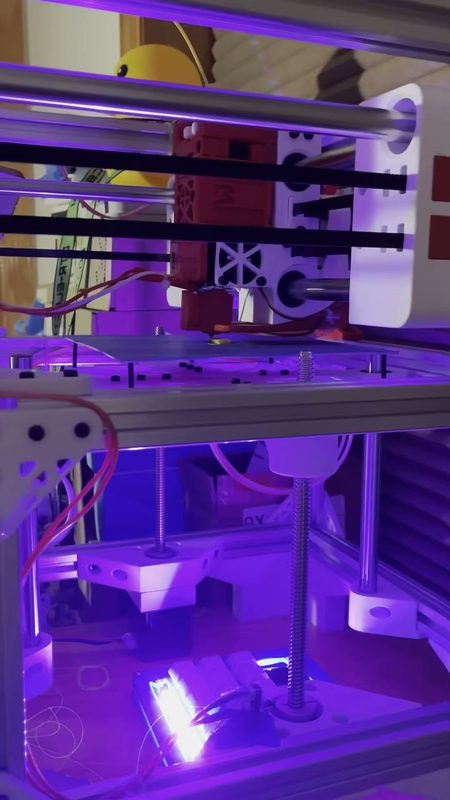

# Spark

[Catalog row](../../README.md#spark) · [Gallery](../../GALLERY.md)

| Field | Value |
| --- | --- |
| Section | Hotend changers |
| Project page | [https://github.com/HenryLi-0/spark](https://github.com/HenryLi-0/spark) |
| Author | HenryLi-0 (Henry Li) |
| About | Self-built small CoreXY printer (Hack Club Blueprint). A spring latch, magnets, and a guide pick each tool from a docking bay, with no tool-lock motor. One extruder motor on the carriage drives gears on the mounted tool. |
| Coupling | latch, magnets, and a guide |
| Lock | spring latch, the dock opens it |
| Change time | — |
| Tools | 3 |
| Printer | own printer |
| Firmware | Klipper |
| Latest version | CAD [2026-06](https://github.com/HenryLi-0/spark/commit/adde8fd71ce7f7aa92d4ec3a96945d84bf1aa9f9) |
| Stars Likes Views |  [⏯️⁠136](https://www.youtube.com/watch?v=ktODngPF7UI) |
| Links | [CAD](https://cad.onshape.com/documents/2b9020a6dc26b5be6a34c293/w/4aea5c5de00aac87e58ab18a/e/e89b27766cadd97ed58f8716) [STEP](https://github.com/HenryLi-0/spark/tree/main/CAD) [BOM](https://github.com/HenryLi-0/spark/blob/main/BOM.csv) [Config](https://github.com/HenryLi-0/spark/blob/main/firmware/config.cfg) [Video](https://www.youtube.com/watch?v=ktODngPF7UI) |
| Groups | — |

## Pictures (7)

<table>
<tr><td align="center" width="33%"> Photo: <a href="https://github.com/HenryLi-0/spark">Henry Li (HenryLi-0)</a></td><td align="center" width="33%"> Photo: <a href="https://github.com/HenryLi-0/spark">Henry Li (HenryLi-0)</a></td><td align="center" width="33%"> Photo: <a href="https://github.com/HenryLi-0/spark">Henry Li (HenryLi-0)</a></td></tr>
<tr><td align="center" width="33%"> Photo: <a href="https://github.com/HenryLi-0/spark">Henry Li (HenryLi-0)</a></td><td align="center" width="33%"> Photo: <a href="https://github.com/HenryLi-0/spark">Henry Li (HenryLi-0)</a></td><td align="center" width="33%"> Photo: <a href="https://github.com/HenryLi-0/spark">Henry Li (HenryLi-0)</a></td></tr>
<tr><td align="center" width="33%"> Photo: <a href="https://www.youtube.com/watch?v=ktODngPF7UI">Henry</a></td></tr>
</table>

## Notes

- The successor is in progress: [fermion (Spark v2)](https://github.com/HenryLi-0/fermion), a folding scissor-lift CoreXY with 3 tools that packs into a filament box. As of 2026-09 it has only design logs and sketches, with no CAD.
