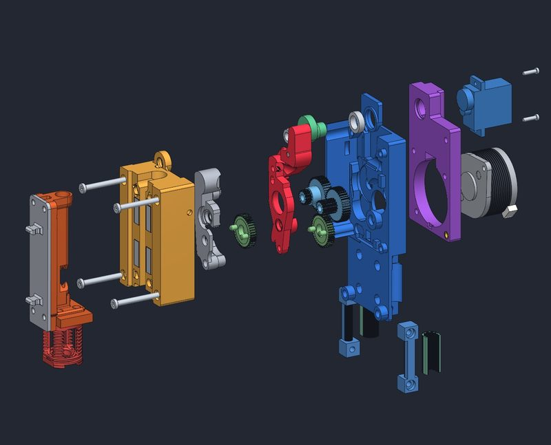
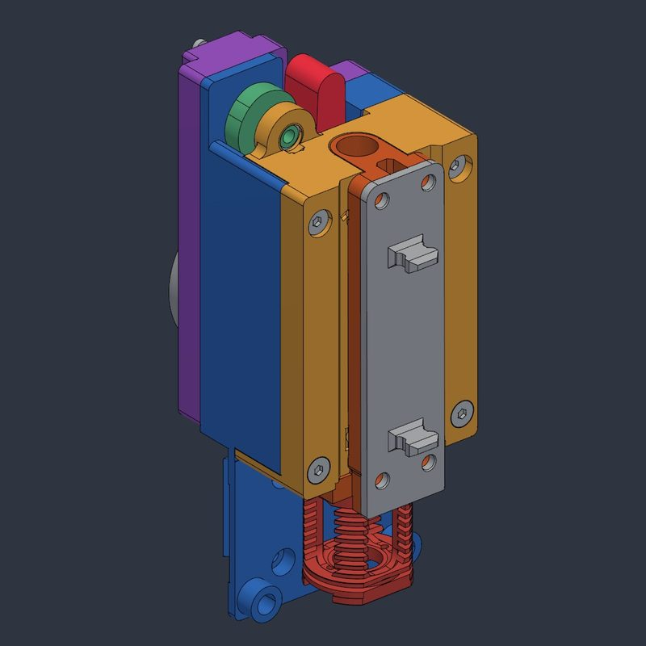
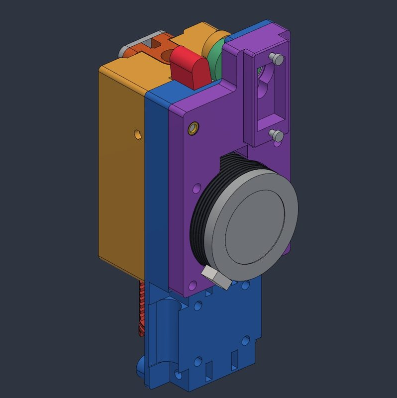
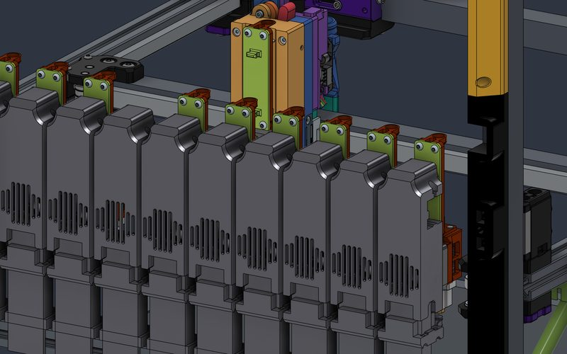
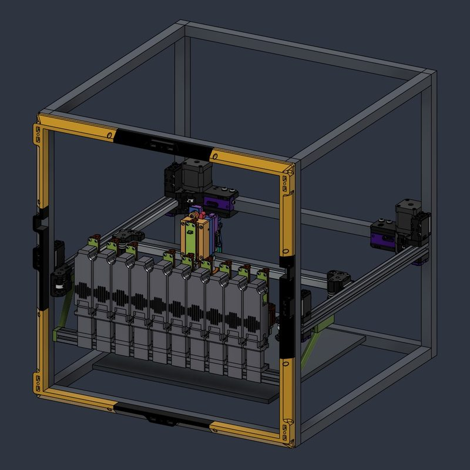
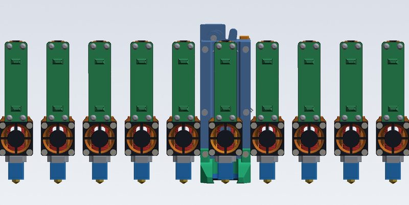
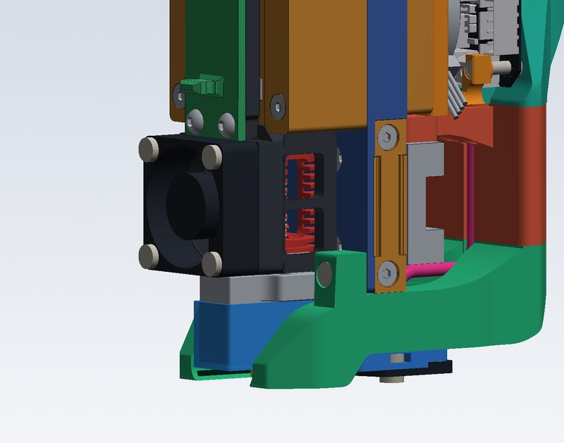

# SparkShift

[Catalog row](../../OTHER.md#sparkshift) · [Gallery](../../GALLERY.md)

| Field | Value |
| --- | --- |
| Section | Concepts and prototypes ([OTHER.md](../../OTHER.md)) |
| Project page | [https://github.com/nisparks/SparkShift](https://github.com/nisparks/SparkShift) |
| Author | Nicholas Sparks (nisparks) |
| About | Hotend changer for the Voron 2.4 350, derived from YUDX and CxChanger. A separate servo cam opens the extruder, so normal extrusion cannot release it. CAD only: the author has not built it yet. |
| Type | Hotend changer |
| Status | CAD only, not built yet |
| Coupling | Maxwell |
| Lock | magnets |
| Latest version | v26j [2026-10](https://github.com/nisparks/SparkShift/commit/38aa617) |
| Stars Likes Views |  |
| Links | [CAD](https://github.com/nisparks/SparkShift/tree/main/cad) [STL](https://github.com/nisparks/SparkShift/tree/main/stl_v26) [BOM](https://github.com/nisparks/SparkShift/blob/main/BOM.md) |

## Pictures (7)

<table>
<tr><td align="center" width="33%"> Photo: <a href="https://github.com/nisparks/SparkShift">nisparks</a></td><td align="center" width="33%"> Photo: <a href="https://github.com/nisparks/SparkShift">nisparks</a></td><td align="center" width="33%"> Photo: <a href="https://github.com/nisparks/SparkShift">nisparks</a></td></tr>
<tr><td align="center" width="33%"> Photo: <a href="https://github.com/nisparks/SparkShift">nisparks</a></td><td align="center" width="33%"> Photo: <a href="https://github.com/nisparks/SparkShift">nisparks</a></td><td align="center" width="33%"> Photo: <a href="https://github.com/nisparks/SparkShift">nisparks</a></td></tr>
<tr><td align="center" width="33%"> Photo: <a href="https://github.com/nisparks/SparkShift">nisparks</a></td></tr>
</table>

## Notes

- Printers that the author names: Voron 2.4. ([source](https://github.com/nisparks/SparkShift))
