# StealthChanger

[Catalog row](../../README.md#stealthchanger) · [Gallery](../../GALLERY.md)

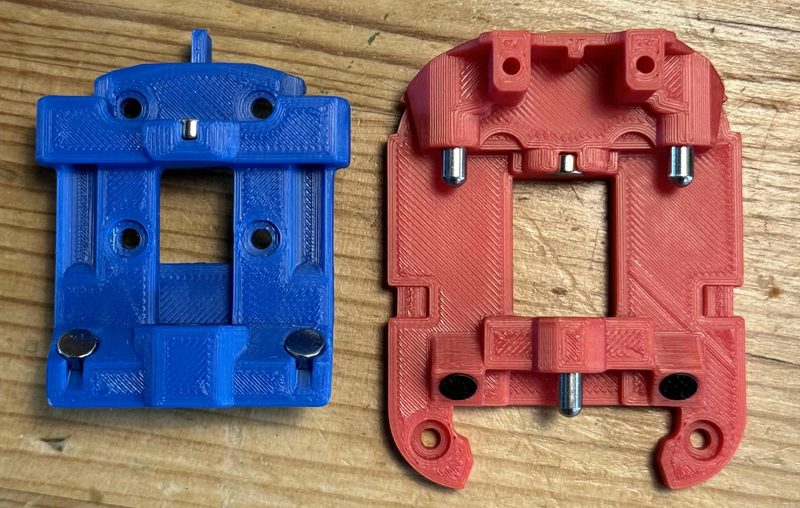

| Field | Value |
| --- | --- |
| Section | Tool changers |
| Project page | [https://github.com/DraftShift/StealthChanger](https://github.com/DraftShift/StealthChanger) |
| Author | DraftShift Design |
| About | Shuttle on the X carriage with pins and bushings. Fork of TapChanger with fewer parts. V1.1 parts do not fit V1.0. |
| Coupling | pins and bushings |
| Lock | magnets |
| Extruder | on the tool |
| Change time | [~5-12 s](https://github.com/Rich-Nelson/voron-stealthchanger-cmyk/tree/main/toolchange-tuning) |
| Tools | 6 |
| Printer | CoreXY, flying gantry, front MGN9 or MGN12 X rail |
| Firmware | Klipper, klipper-toolchanger-easy |
| Latest version | V1.1 [2024-06](https://github.com/DraftShift/StealthChanger/commit/785a7b19f94e84e928ec93a0ecc2198cabb71e5b) |
| Stars Likes Views |  [🧡⁠223](https://www.printables.com/model/837771-stealthchanger-tool-changer) [⏯️⁠68.2K](https://www.youtube.com/shorts/ftX2LirTnoE) |
| Links | [CAD](https://github.com/DraftShift/StealthChanger/tree/main/CAD) [STL](https://github.com/DraftShift/StealthChanger/tree/main/STLs) [BOM](https://github.com/DraftShift/StealthChanger/wiki/Bill-of-Materials) [Manual](https://github.com/DraftShift/StealthChanger/tree/main/Manual) [Wiki](https://github.com/DraftShift/StealthChanger/wiki) [Config](https://github.com/DraftShift/StealthChanger/tree/main/Klipper) [Files](https://www.printables.com/model/837771-stealthchanger-tool-changer) [Video](https://www.youtube.com/shorts/ftX2LirTnoE) |
| Groups | [Discord](https://discord.gg/draftshift) EN 4.4K [Facebook](https://www.facebook.com/groups/449879874593718/) EN |

## Pictures (19)

<table>
<tr><td align="center" width="33%"> Photo: <a href="https://github.com/DraftShift/StealthChanger">BT123D</a></td><td align="center" width="33%"><a href="1-stealthchanger.jpg">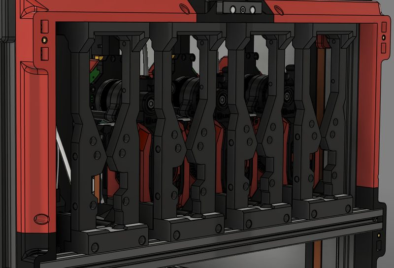</a> Photo: <a href="https://stealthchanger.com/hardware/guides/modular_docks/">N3MI-DG</a></td><td align="center" width="33%"><a href="2-stealthchanger.jpg">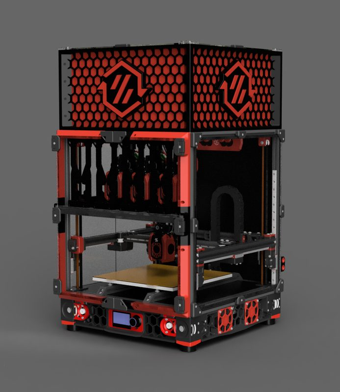</a> Photo: <a href="https://stealthchanger.com/hardware/guides/stealthchanger_assembly/">MikeYankeeOscarBeta</a></td></tr>
<tr><td align="center" width="33%"><a href="3-stealthchanger.jpg">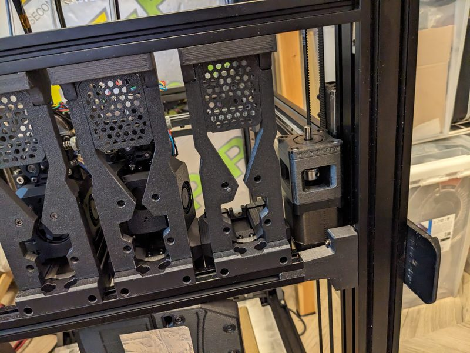</a> Photo: <a href="https://github.com/DraftShift/ModularDock/tree/main/UserMods/MikeYankeeOscarBeta/Monolith_Crossbar">MikeYankeeOscarBeta</a></td><td align="center" width="33%"><a href="4-stealthchanger.jpg">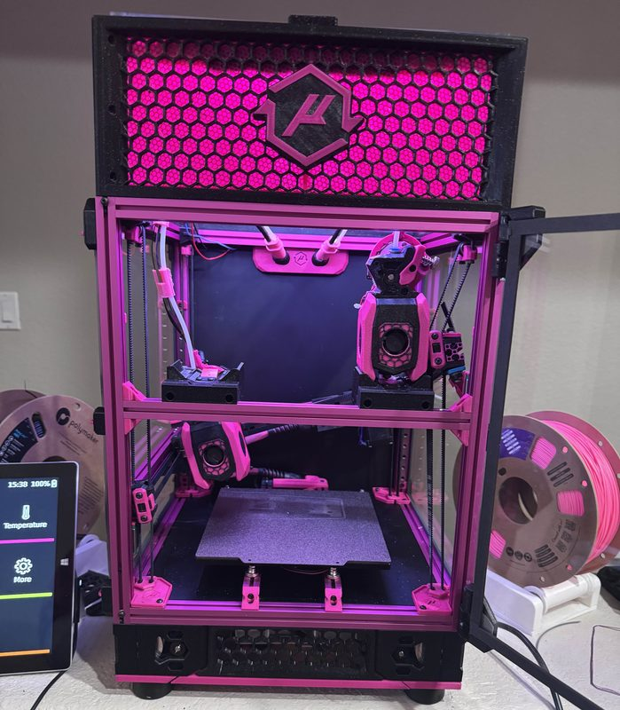</a> Photo: <a href="https://stealthchanger.com/calibration/tuning/">fireishott</a></td><td align="center" width="33%"><a href="5-stealthchanger.jpg">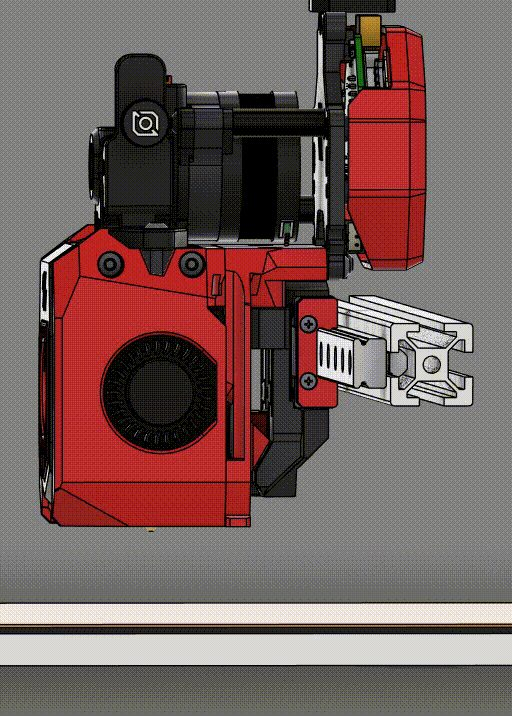</a> Photo: <a href="https://stealthchanger.com/hardware/stealthchanger/">cekim-git</a></td></tr>
<tr><td align="center" width="33%"><a href="6-stealthchanger.jpg">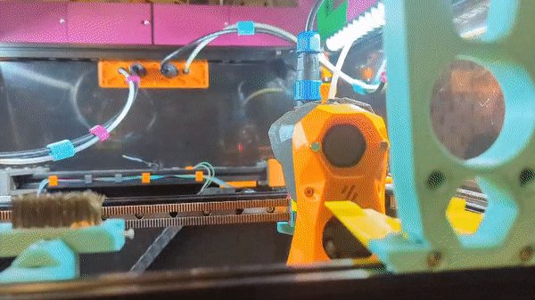</a> Photo: <a href="https://github.com/DraftShift/StealthChanger">TheSin-</a></td><td align="center" width="33%"><a href="7-stealthchanger.jpg">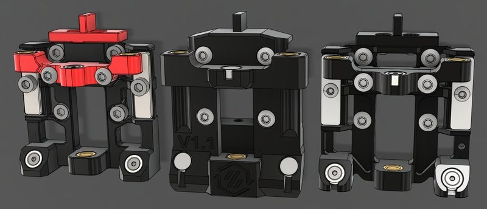</a> Photo: <a href="https://stealthchanger.com/hardware/stealthchanger/">N3MI-DG</a></td><td align="center" width="33%"><a href="8-stealthchanger.jpg">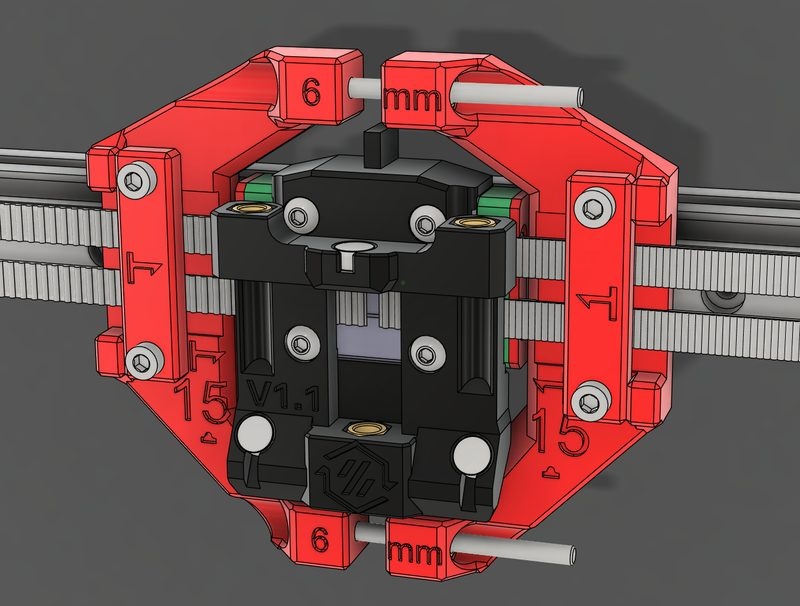</a> Photo: <a href="https://stealthchanger.com/hardware/guides/shuttles/">N3MI-DG</a></td></tr>
<tr><td align="center" width="33%"><a href="9-stealthchanger.jpg">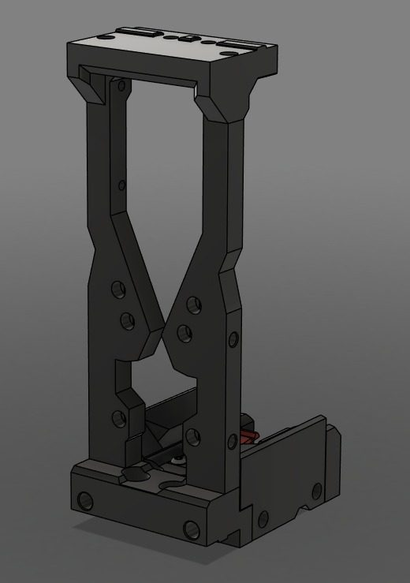</a> Photo: <a href="https://stealthchanger.com/hardware/guides/modular_docks/">N3MI-DG</a></td><td align="center" width="33%"><a href="10-stealthchanger.jpg">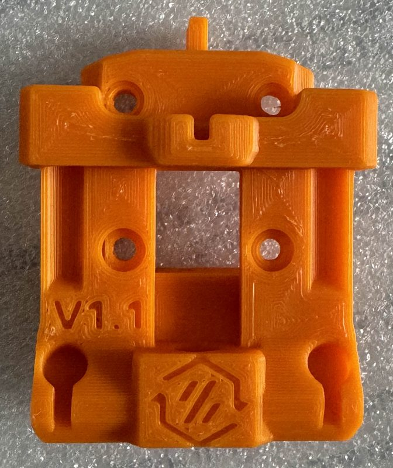</a> Photo: <a href="https://github.com/DraftShift/StealthChanger">BT123D</a></td><td align="center" width="33%"><a href="11-stealthchanger.jpg">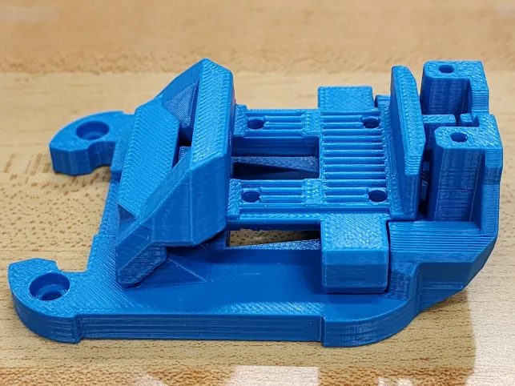</a> Photo: <a href="https://github.com/DraftShift/StealthChanger">TheSin-</a></td></tr>
<tr><td align="center" width="33%"><a href="12-stealthchanger.jpg">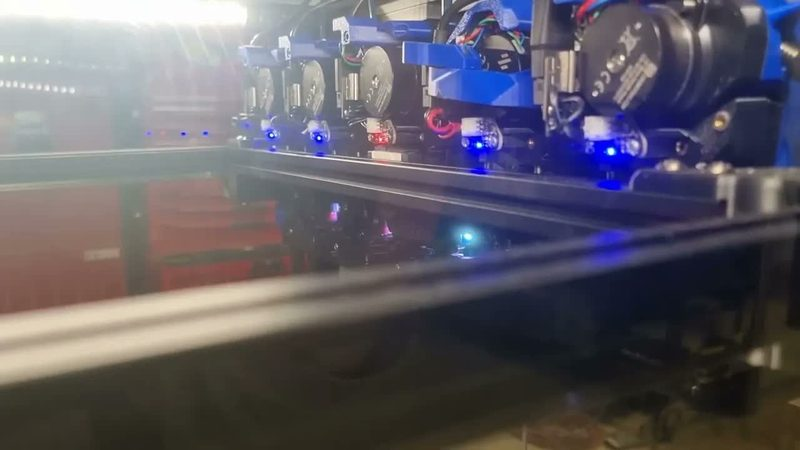</a> Version: Adrian Bear build Photo: <a href="https://www.youtube.com/watch?v=B1Xh_jFcCas">Adrian Bear</a></td><td align="center" width="33%"><a href="13-stealthchanger.jpg">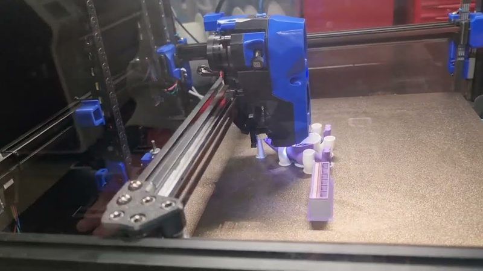</a> Version: Adrian Bear build Photo: <a href="https://www.youtube.com/watch?v=B1Xh_jFcCas">Adrian Bear</a></td><td align="center" width="33%"><a href="14-stealthchanger.jpg">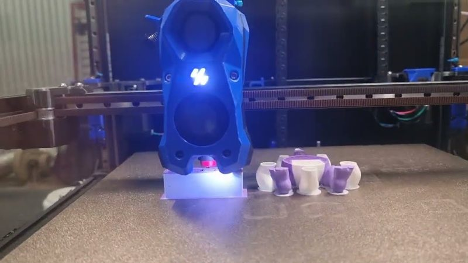</a> Version: Adrian Bear build Photo: <a href="https://www.youtube.com/watch?v=B1Xh_jFcCas">Adrian Bear</a></td></tr>
<tr><td align="center" width="33%"><a href="15-stealthchanger.jpg">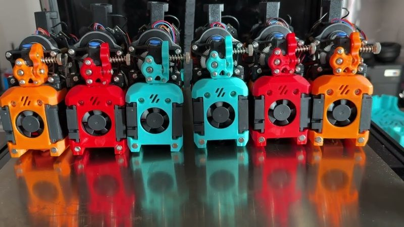</a> Version: Pat&#x27;s Maker Space build Photo: <a href="https://www.youtube.com/watch?v=w41YSW4RRHE">Pat&#x27;s Maker Space</a></td><td align="center" width="33%"><a href="16-stealthchanger.jpg">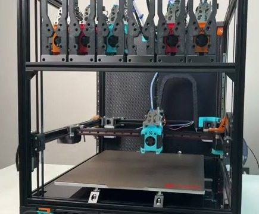</a> Version: Pat&#x27;s Maker Space build Photo: <a href="https://www.youtube.com/watch?v=w41YSW4RRHE">Pat&#x27;s Maker Space</a></td><td align="center" width="33%"><a href="17-stealthchanger.jpg">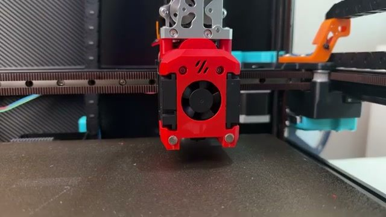</a> Version: Pat&#x27;s Maker Space build Photo: <a href="https://www.youtube.com/watch?v=w41YSW4RRHE">Pat&#x27;s Maker Space</a></td></tr>
<tr><td align="center" width="33%"><a href="18-stealthchanger.jpg">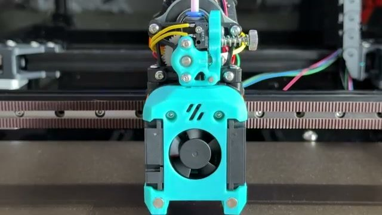</a> Version: Pat&#x27;s Maker Space build Photo: <a href="https://www.youtube.com/watch?v=w41YSW4RRHE">Pat&#x27;s Maker Space</a></td></tr>
</table>

## Notes

- It works with many toolheads, for example StealthBurner, Dragon Burner, A4T, and XOL. ([source](https://stealthchanger.com/hardware/toolheads/))
- The shuttle also works like Voron Tap: with the OptoTap sensor, the nozzle probes the bed. ([source](https://stealthchanger.com/hardware/stealthchanger/))
- Printers that the author names: Voron 2.4, other flying-gantry printers. ([source](https://github.com/DraftShift/StealthChanger))
- With standard 60 mm docks a 300 mm Voron fits up to 5 tools and a 350 mm Voron up to 6, and wide 76 mm docks fit one tool fewer. ([source](https://stealthchanger.com/hardware/toolheads/))
- Each tool needs its own toolhead board over CAN bus or USB, for example the BigTreeTech EBB36 (CAN) or the LDO Nitehawk-36 (USB). ([source](https://stealthchanger.com/electronics/th_boards/))
- LDO sells StealthChanger kits, and the base kit includes a CNC shuttle. ([source](https://github.com/DraftShift/StealthChanger/wiki/Vendors-and-Kits))
- Printing materials that need an enclosure requires a tophat, which adds about 200 mm of height on 250 and 300 mm Vorons and 250 mm on a 350 mm Voron. ([source](https://stealthchanger.com/hardware/tophat/))
- StealthChanger uses klipper-toolchanger-easy, a fork of klipper-toolchanger made for the StealthChanger community. ([source](https://stealthchanger.com/software/))

## Builds by other people

- [Voron 2.4 build](https://www.youtube.com/watch?v=B1Xh_jFcCas), *Adrian Bear*. Voron 2.4 StealthChanger build that printed 4 and then 5 colours in 2024.
- [Six-tool Voron 2.4 350 build](https://www.youtube.com/watch?v=w41YSW4RRHE), *Pat's Maker Space*. Six-tool StealthChanger on a Voron 2.4 350. The video covers wiring, tool alignment, calibration, and cost.
